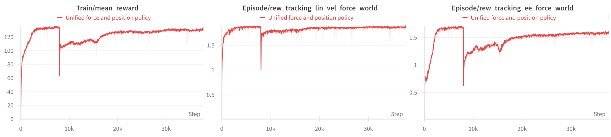
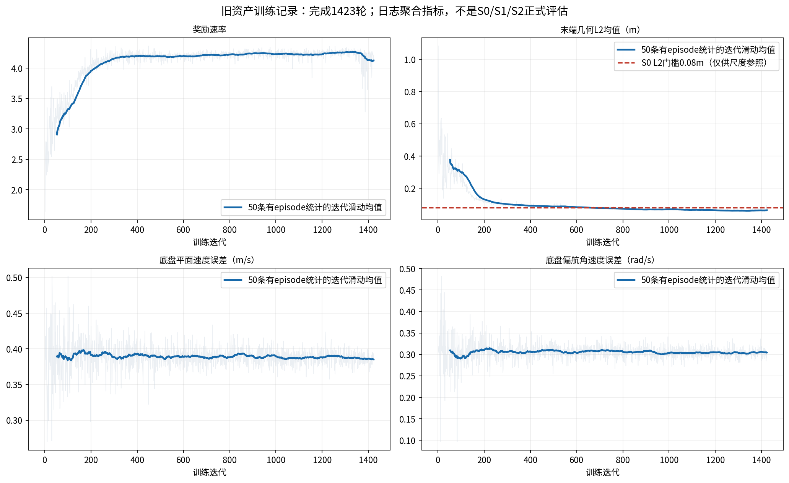

# 新训练资产准入与官方论文曲线比较

## 判断

`v3_a1_desktop_train_v1`可作为下一次A阶段正式训练的仿真模型。当前远程r02源码与正式配置身份一致，`start_gate.json`显示`ready=true`、无阻断项。这个判断是“具备起跑条件”，不等于策略已达到论文效果，也不等于模型完成实机标定。

训练资产保留28个link、14个自由度、视觉几何和已确认的估算物性；只将碰撞表示从927个shape优化到80个。最终源码身份下，静置、轮系及机械臂动作、局部reset、自碰撞和训练恢复均完成既定验证；512环境训练10轮并跨进程续训1轮通过，4096环境正式配置完成容量更新且未出现遗漏碰撞交互警告。同源码、同GPU的512环境完整step测得约4.81倍加速；4096×100轮完整平均约4.03秒/轮，8000轮学习段约8.96小时的线性估算。

限制是碰撞代理对复杂表面作了近似，名义质量和惯量也是仿真估算；32环境250步零动作仍记录到1次物理终止。测试支持其作为训练候选，不构成所有姿态连续无穿透证明或实机物性验证。此前旧模型的A段表现也不能直接作为新模型的训练结果；旧训练最后仅1423轮日志和1400轮权重，旧资产身份与新模型不同。

## 与官方训练曲线的比较

官方一手图是论文Appendix C.4的Fig. A.7：奖励总值、底盘速度跟踪奖励、末端跟踪奖励三条训练曲线，覆盖第一阶段及约8000轮后的受力/扰动阶段。作者的文字说明为：第二阶段开始时总奖励和末端奖励先下降，随后底盘运动恢复、全身末端到达稳定；末端奖励平台略低，原因是力命令及扰动的采样多样性增加。图末约37k–38k来自原图刻度目测，不是作者公布的精确训练轮数或原始标量。

旧资产第1–1423轮曲线只覆盖第一阶段早期，且记录的是V3的`episode/reward_rate`与跟踪误差，不是论文的`Train/mean_reward`原始量。因奖励聚合、机器人、随机化和坐标任务不同，不能对两条曲线的纵轴数值作直接优劣比较。只比较形状：V3奖励前约300轮快速上升后平台，末端L2误差持续下降；这一部分与官方第一阶段“先快速学习、再趋稳”的方向相似。但V3底盘速度误差停在约0.38m/s、偏航误差约0.30rad/s，没有呈现理想的持续改善。因此旧训练日志只能说明末端技能有进步，不能说全身移动跟踪已复现论文。

官方图未公布可供重画的逐轮原始数值；本比较保留作者原图，不对曲线做数字化拟合，也不制造精确差值。

## 新训练理想应观察到什么

第一阶段的理想曲线是：回报在早期明显上升，随后进入稳定平台；末端位置跟踪误差整体下降并保持低位；底盘线速度和偏航速度误差也同步下降或保持低位；物理失败率随学习下降，而不是靠缩短episode或大量提前终止得到表面回报。策略还应在移动底盘、不同目标方向及随机化条件下保持这种趋势。

按已冻结的V3阶段验收表，8000轮后需独立评估S0（底盘零速度、关闭push）、S1（底盘运动、关闭push）和S2（底盘运动并保留push）。TCP L2均值目标分别为≤8、12、15cm；底盘平面速度误差分别≤0.05、0.15、0.20m/s；偏航角速度误差分别≤0.15、0.20、0.25rad/s；各组物理失败率分别≤5%、5%、10%。还需通过对应状态估计门槛；S2另外检查push后1秒恢复误差。三个场景逐项判定，不以总奖励或单条TCP曲线替代。

第二阶段开始后的理想趋势应参照官方Fig. A.7：课程切换初期允许奖励及末端跟踪短暂下降，但随后应恢复并稳定；底盘跟踪应恢复到受力前的合理水平，末端平台可以略低，但不能持续恶化。最终是否达标仍由冻结的S0/S1/S2评估决定。

## 图与来源

官方原图核查及数字边界：`/home/sorry/python_ws/interactive/research/literature/projects/unifiedforce/reproduction/outputs/stage2_20261029/official_comparison/paper_check.md`；论文缓存`arXiv:2505.20829v2`，Appendix C.4/Fig. A.7。旧训练逐轮趋势：`old_training_stop_20261103/1400轮训练效果分析.md`与`old_training_stop_20261103/iterations.jsonl`。冻结阈值：`UniFP_v3/configs/v3_a_initial_v1.json`。资产与运行验证：`UniFP_v3/docs/experiments/2026-11-03_v3_collision_optimization.md`及本目录`runtime/r02/verified_summary.json`。
