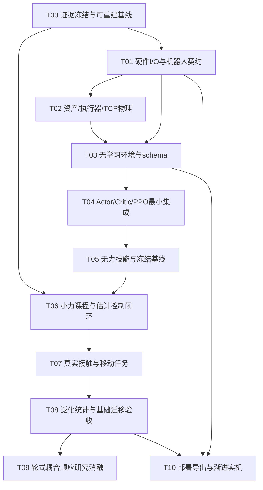

# UniFP → V3迁移：实施票据总览

日期：2026-10-30。状态：**待设计确认的实施拆分，未开始业务代码实施或新训练。** 设计议题00–10按顶层架构→数据/组件→实验/部署→测试顺序讨论，记录用户确认后再执行依赖已满足的票据。

## 执行顺序与依赖

T01资料整理可在T00代码修复时并行推进；T10的接口资料/离线回放可以前置准备，实际实机运行依赖G4/T08及监督器验证。图中依赖代表完整票据的完成条件，不要求无意义地串行等待可独立的只读调研。

## 票据

| 票据 | 验证闭环 | Blocked by |
|---|---|---|
| [T00](00-证据冻结与可重建基线.md) | 可重建包＋真实B2/V3证据与清单 | 无前置票据；相关设计待确认 |
| [T01](01-硬件接口与机器人契约.md) | 实机可得信号与可执行动作→明确schema | T00；硬件资料/测量 |
| [T02](02-资产执行器与TCP物理验证.md) | 轮/臂/TCP物理输入→响应可解释 | T01 |
| [T03](03-无学习环境与schema闭环.md) | 脚本动作→整机反馈/目标/trace | T01、T02 |
| [T04](04-官方风格学习器最小集成.md) | rollout→PPO/aux更新→完整resume | T03 |
| [T05](05-无力技能与冻结基线.md) | arm/base/联合任务→独立mean指标 | T04 |
| [T06](06-小力课程与估计控制闭环.md) | TCP力→估计/顺应→零力保留 | T00、T05 |
| [T07](07-真实接触与移动任务.md) | 物体反力→Fn/切向任务→接触保持 | T06 |
| [T08](08-泛化统计与基础迁移验收.md) | 留出工况/多训练seed→基础迁移结论 | T07 |
| [T09](09-轮式耦合顺应研究消融.md) | 单主线假设→同预算消融与任务收益 | T08 |
| [T10](10-部署导出与渐进实机验证.md) | 可部署Actor→监督器→独立硬件指标 | T01、T03、T08 |

## 当前状态与可执行事项

- **已完成：** 根目录AGENTS逐字节复制；官方四篇流程与源码核对；V3当前资产/两后端/旧实验审计；已有B2三个NPZ float64复算；总体与模块规划。
- **当前不依赖新增实验即可做：** 阅读评估报告，按设计00确认硬件动作边界的核实方法与正式后端，再顺序讨论模块01–10。文档中的Q&A目前都是推荐答案，不代表已获得确认。
- **尚未执行：** 票据中的代码修复、新评估/训练、接触仿真、硬件标定与部署。无需为了提交本次计划而提前启动这些工作。
- **资料缺口：** 真实底盘固件接口与反馈、A1控制模式和带宽、质量/COM/执行器标定、真实TCP工具与独立力真值；旧V3已删的原始trace不能靠摘要重建。

每票在单个新上下文内实施与验证；新的事实先更新知识库，接口/方案冲突先记录并按规范讨论，不静默跨模块扩范围。
