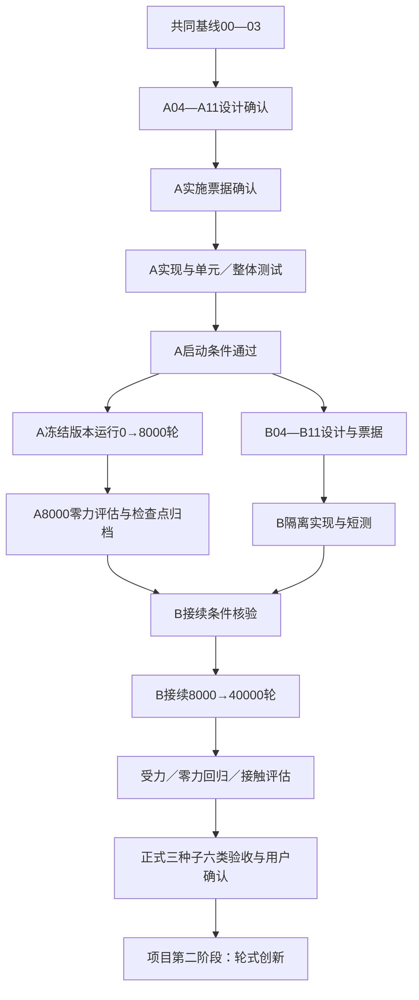

# 仿真复现的A／B两部分开发与衔接计划

更新日期：2026-10-31。用户明确要求：在00—03共同基线之后，先完成前8000个训练迭代的初步复现开发并运行；运行期间继续开发后续受力复现。用户已确认8000是训练迭代，不是环境step。

## 一、范围与名词

项目第一阶段仍是完整官方效果的仿真复现；其中拆为复现A、复现B两个开发／训练部分。项目第二阶段仍指轮式机器人特有创新，须完整复现六类验收及用户最终确认之后才进入。

- **复现A：基础位置与运动复现**。完成可独立运行的V3官方原生训练链，训练累计迭代[0,8000)，末端命令力与人工外力均为零；验证底盘／TCP跟踪、状态估计、训练稳定性与检查点恢复能力。零人工外力不意味着关闭重力或地面接触。底盘速度push等额外扰动必须由A09明确是否开启及其对“零力”口径的影响，不能隐含继承。
- **复现B：受力条件下的力位复现**。承接A的8000轮检查点，开发／启用力调度、受力标签、补偿目标及受力评估；正式每种子继续32000轮，累计到40000。真实物体接触仿真仍属于本部分的必要验收，不能用人工外力替代。
- **开发并行**指冻结A训练版本运行时，在另一个隔离工作区继续设计、实现、短测B；不要求两段训练同时占用GPU，不在A运行目录直接修改源码。

A／B拆分和8000轮边界为用户已明确的新范围；下面未讨论的具体接口、阈值、网络数值、课程范围和恢复字段仍在对应模块确认，本计划不伪造这些结论。

## 二、预算和计数边界

保留02已确认的dt=0.005s、decimation=4、策略周期0.020s、T=24，正式目标4096环境、总40000轮／seed。每轮每环境收集24步，然后完成一次PPO迭代；累计迭代只按完整更新完成量计，不依赖旧checkpoint文件名。

| 部分 | 完整迭代范围 | 目标规模下训练转移／seed | 每环境累计仿真时长 |
|---|---|---|---|
| A | 完成第1—8000轮，完成量0→8000 | 786432000 | 3840s |
| B | 完成第8001—40000轮，完成量8000→40000 | 3145728000 | 15360s |
| 合计 | 40000轮／seed | 3932160000 | 19200s |

这些是N=4096时的算术预算，不是墙钟耗时或达到效果的保证。开发A默认沿用seed=0及02已确认的开发规模，先排查单种子趋势；不自动将这次开发运行认定为正式seed=1／2／3之一。A开发检查点可以接续B开发，但完整正式验收仍须在A＋B配置及协议冻结后，seed=1／2／3分别从头执行A8000＋B32000。若以后希望提前启动正式A，需先满足00的正式验收协议冻结要求，不能看B开发结果后挑选有利A种子或变更A配置。

官方源码的`global_steps > force_start_step*24`存在策略步与迭代换算及严格大于边界，不能直接用来保证精确A／B分界。A明确关闭末端命令力和人工外力；只有完成8000轮且B接续检查通过，才进入B的力调度。进入B不要求每个环境第一子步立即受非零力，具体幅值／渐进规则由B09确认。

## 三、保留模块编号，分别形成两个闭环

00—03作为共同基线继续引用，不重做已经确认的选择；03新增参数候选先经确认用于物理短测，再经验证和冻结后用于A长训练。04—11保留顶层模块索引，分别建立`design/part-a/`和`design/part-b/`的独立议题文件，各自按04→11讨论，11均是最后一个议题且分单元测试／整体测试。

| 模块 | A必须交付，才能先跑8000轮 | B在A运行期间继续开发 |
|---|---|---|
| 04 环境 | step/reset、时序、全部公共字段及力相关字段的预留语义，零人工外力下可用 | 非零力字段赋值、力事件与子步对齐、接触真值通道 |
| 05 Actor／估计 | 完整统一策略；提前定好后续可续训的网络／输出布局；状态估计与确定性推理 | 受力下的估计监督、覆盖度与诊断，不靠加头／换维数绕开兼容性 |
| 06 Critic | 单标量V；形态适配字段、未来力字段与缩放先定好 | 启用实际受力／接触特权值，检查零值槽变非零后的含义 |
| 07 PPO／Runner | 完整采样更新与完整保存／恢复；8000轮准确停止；A/B版本与计数兼容检查 | 从8000接续、恢复课程／优化器／计数，继续到累计40000 |
| 08 目标／奖励 | 几何目标、底盘／TCP跟踪与必要约束；选定的力位接口在F=0时有定义 | 外力与命令力符号、补偿目标、受力奖励及真实接触场景 |
| 09 课程／随机化 | A强制力关闭、随机化与扰动定义、8000边界 | 独立力流、力幅／K范围、渐进课程及零力混合采样 |
| 10 评估 | 零力跟踪／状态估计及论文同口径对照，原始trace和8000模型归档 | 匹配力、独立外力、估力、受力后零力回归和物体接触评估 |
| 11 测试／验收 | A单元、物理短测、学习更新、恢复测试、长训练启动检查及8000结果评估 | A→B接续、受力／接触闭环、零力回归及最终三种子六类验收 |

不能把A缩成只改资产和环境：Actor、Critic、PPO、奖励、评估和测试都必须有可运行的最小完整版本。B先不实现真实受力行为，但A必须完成以下公共契约的设计与保存。

## 四、在A启动前锁定的衔接契约

以下契约由所属模块逐项确认；A04现已确认Actor单帧58／32帧总1856、监督12、命令15、Critic3帧，Actor／encoder／decoder结构现已由A05-Q4确认；Critic单帧98／三帧294及完整字段现由A06-Q4d确认，网络按A06-Q2为294→512→256→128→1；终止价值资料已由A06-Q5确认，完整PPO公式归A07。

1. **模型与数据布局**：动作A=14已确认；Actor观测O、Critic观测C、监督P、命令切片、历史长度、坐标系／单位／缩放及网络参数shape在A04—A06确定并形成快照。需要在B激励的力相关槽位和辅助输出在A就有定义，不在B临时扩输入／输出。A阶段力槽真实取零，不将已知人工外力真值偷偷提供给Actor。
2. **零力估计的证据边界**：A可以验证线速度／末端状态估计和力相关输出的零输入表现；全零力标签不能证明非零外力估计已学会。A05-Q3已确认保留官方零力监督及分组权重；主／辅助优化器参数边界与两步更新已由A05-Q6确认；主PPO数值与完整恢复留A07，不由本计划批准新mask或新损失。
3. **动作与机器人物理**：A、B保持已冻结的14维动作解释、控制周期、TCP、资产和名义执行器。B只按白名单改变力课程等明确的任务字段；如必须改几何、观测归一化或模型shape，先评估对A检查点的破坏。不能静默`strict=False`加载或随机初始化新增层后称为原训练续接。
4. **必要的完整checkpoint能力**：A07就必须设计并实现模型、主／辅助优化器、已用调度器、RNG、已完成迭代、累计转移／策略步／课程计数、运行部分、版本／资产／schema指纹及配置的保存／核验。不存在的调度器不为凑字段新增。on-policy rollout只在完整更新完成的空边界保存续训快照，不要求保存废弃的半轮buffer。
5. **恢复承诺**：A8000检查点包含学习状态和准确计数；B开始新仿真episode时允许明确的物理状态reset，但不重置学习／课程计数。默认不承诺恢复PhysX内部接触缓存或GPU逐比特轨迹；报告属于学习状态连续的分段续训，不能冒称与从不重启的40000轮完全等价。若正式比较需要无进程中断，须先完成B行为再做统一连续正式运行，或预先冻结并披露重启协议。
6. **冻结A、隔离B**：A在独立快照／检出中运行，B在另一个本地Git工作区或分支开发；不热更新正在训练的代码、环境包或资产。checkpoint复制／引用只读，B输出新目录，保留parent checkpoint指纹及允许差异表。具体路径／分支命名在A07／B07确定，不在本轮创建工作区或预留GPU。

## 五、开发与验收的衔接

图中的A／B先描述开发seed=0闭环；正式seed=1／2／3重复同样A／B流程，或在B完成后采用已冻结的统一连续运行协议。并行是AR与BD／BI，A→B训练本身仍有先后关系。

- **A启动条件**：A范围知识库、A04—A11设计及A实施计划已确认；03控制／TCP候选完成物理验证与冻结；从官方代码建立的新V3训练链真实通过测试，4096如用于本次运行须预检通过；A结束条件和原始日志／曲线协议在启动前明确。启动A不等待B实现完成。
- **A8000结果检查**：准确8000轮、F_cmd=F_ext=0的执行证据、完整checkpoint和可恢复性、奖励曲线、TCP／底盘物理误差、状态估计和失败统计；不以奖励上涨替代物理指标，也不把全零估力认作外力估计验收。
- **B接续条件**：A8000结果达到预先确认的基础要求；B设计／票据／实现及短测通过；schema／资产／模型／优化器／计数兼容核验通过；所有允许变化已记录。若A8000未达基础门槛，不自动延长A或绕过门槛；保留失败结果，分析后确认调整。
- **时间安排**：若A先跑完、B尚未准备好，在8000检查点安全停下等待，不自动启力；若B先完成，等待A跑满8000和评估，不提前切换；基础恢复错误在训练前失败，不以只加载权重代替完整恢复。
- **完整复现验收**：原00规定的三个正式种子、每个六类必验、绝对物理指标和用户最终确认继续有效。A局部通过只代表初步复现，不代表项目第一阶段结束。

## 六、设计、票据与确认范围调整

用户本轮明确修改了“必须等完整受力部分设计完才允许编码”的全任务串行安排：今后分别以A、B当前交付范围完成知识库→模块设计→实施计划→确认→实施。A公共契约与A自己的全部模块须先确认；B实现仍须B自己的设计和票据先确认。阶段切片不允许绕过当前切片的设计和测试流程。

本轮只重排议题及依赖，不生成已可执行的正式tickets，不修改业务代码、不创建新训练目录、不安装环境或启动训练。后续正式tickets建议分别放在`tickets/part-a/`、`tickets/part-b/`，各自overview列前置依赖与当前可执行项；跨部分依赖明确指向A的交付证据。

## 七、当前讨论位置

00—03已确认的共同基线保留，03新增数值仍标为候选。用户于2026-10-31整组确认A04-Q1—Q7，并要求详细记录与原文相比的保留和修改项；见[A04差异记录](comparison/A04-论文与官方源码差异.md)。公共04-Q1保留历史，以A04确认稿为准。A05-Q1—Q6全部确认并完成模块收束并记录完整辅助输出流程和损失公式，A06-Q1—Q5全部确认并收束，A07-Q1—Q7全部确认并完成模块收束，A08-Q1a已确认、Q1b三项目标域边界暂定用于验证，Q1c已确认、时长待动态验证，Q2已确认，Q3a—Q3c已确认，Q4a时间缩放已确认，Q4b主任务数值已确认为验证候选，Q4c执行器数值已确认为验证候选，A08-Q4d稳定／接触数值已确认为验证候选（尚未物理验证或冻结长训），Q5a奖励聚合、Q5b1 episode归约、Q5b2物理误差、Q5b3日志契约均已确认，Q5c合并方案待确认，随后依序完成A08—A11；完成A设计与实施计划并获确认后才开发、测试并启动A，再隔离继续B各模块。后续各模块同样逐项记录论文表述、固定源码行为、本工作选择、依据／影响及验证证据。

模块文件入口见[任务总入口](README.md)。
