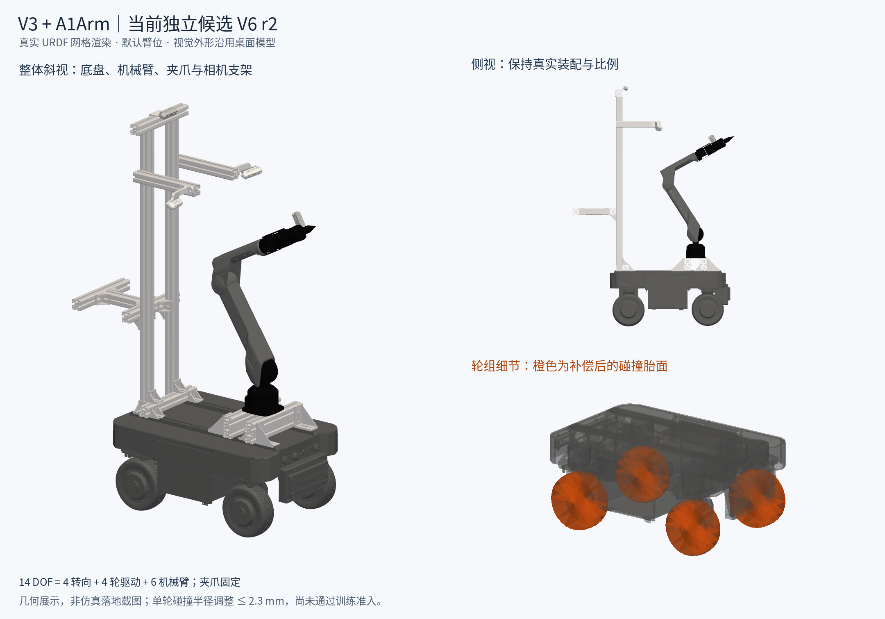

# 当前V6 r2外形与后续计划

日期：2026-11-04。本文件为现有T02—T05工作的展示与下一步建议，不替代已确认设计或验收标准。

## 外形图与来源

图片直接读取`UniFP_v3/resources/robots/v3_a1_desktop_train_v6_coplanar_r2/`的URDF和实际网格，以默认臂位（arm_joint2=1.0rad、arm_joint3=−1.5rad）渲染。它是几何展示，不是仿真落地或训练运行截图。

左侧为整体斜视，右上为侧视，右下为半透明底盘与橙色滚动碰撞胎面。视觉沿用桌面模型，保留四轮底盘、机械臂、固定夹爪及相机支架。机械臂6个关节、转向4个关节、轮驱动4个关节，共14 DOF、28 link。URDF质量合计83.317915kg，约83.318kg，物性仍为此前确认的仿真估算与源上装参数，非整机实测。

V6 r2相对V5仅微调64个滚动碰撞分片，每轮半径变化不超过2.3mm。普通外观图无法直观看出毫米级补偿，右下以颜色突出其作用区域，未放大实际几何差异。来源哈希、视角及关节姿态见`render_manifest.json`；复现脚本为`../../knowledge/render_v6_model.py`。

## 当前限制

几何共面验证已通过，前后／双侧移低层运动误差均小于0.03m/s。但双向偏航误差仍为0.05665／0.05972rad/s，超过0.05rad/s门槛，静置1秒末仍有残余轮速。现有图片与解析运动诊断不证明策略已学会移动追踪。当前候选未切换正式训练配置。

## 后续顺序

1. **远程复核当前候选**：以相同seed、名义物性、根高和控制参数复现4环境静置及双向运动。对照训练使用的GPU张量管线与本地混合管线，先确认剩余现象能否复现。另用5秒零动作诊断区分落地瞬态与持续振荡，不替换原1秒结果。
2. **完成T02／T03剩余定位**：对齐每轮转向目标／实际角度、轮速目标／实际值、实际子步力矩、接触变化与底盘yaw。分别检验转向误差、轮地滑移和接触振荡，只针对证据支持的因素作单变量对照。已失败的增益提高20%方案不进入正式配置；新增设计冲突回到对应设计议题。
3. **通过T04再冻结身份**：保持前后／双侧移≤0.03m/s、双向偏航≤0.05rad/s的低层门槛及既有物理条件。最终源码／资产／控制配置完成相关单测、32环境功能、512×10及跨进程续1轮、4096容量与速度检查。旧身份通过记录不自动覆盖新资产。
4. **执行T05新A8000**：门控全部通过后，以独立运行身份从头训练8000迭代，保留旧数据。同步观察底盘实际运动、TCP和失败率；结束后重做冻结S0／S1／S2评估。A验收前不进入受力复现B，第一阶段验收前不开展轮式创新。

当前无证据要求先改Actor、Critic或PPO结构；是否需要调整奖励、探索或其他学习参数，留待物理执行链通过及新训练证据确定。
