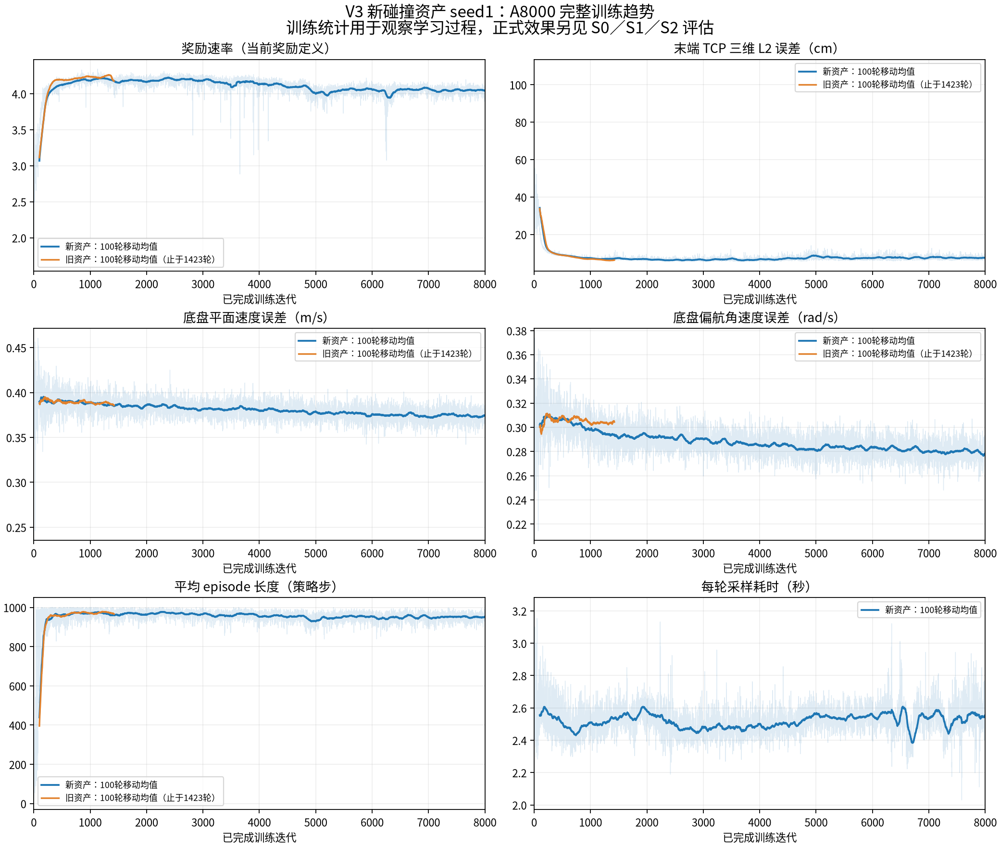
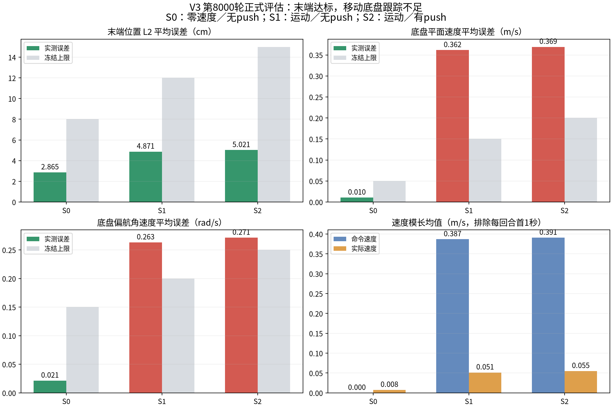

# V3 A8000训练进度与效果分析（2026-11-04）

本次A8000已经正常完成，末端追踪与六维状态估计有明显效果；正式评估中S0通过，S1／S2因底盘速度跟踪不达标而未通过。因此目前不能宣布A阶段整体验收完成，建议先定位移动底盘响应不足，再决定是否进入B受力阶段。本轮仅分析与评估，没有继续训练或修改训练业务代码、资产、奖励与冻结阈值。

后续只读官方对照补算了XYZ误差，并发现“轮目标频繁到上限但底盘低速”与“reset后首步TCP目标大跳变”两个新诊断信号；其原因尚未隔离，详见[官方对照与改进建议](官方对照与改进建议.md)。

## 已核实状态

新碰撞资产seed1训练已完成8000／8000轮。最终完成时间为2026-11-04 00:57:15（Asia/Shanghai），相对11月3日17:35启动约7小时22分钟。训练进程正常退出；`completion.json`记录`last_saved_iteration=8000`，最终检查点SHA256与`checkpoints.jsonl`一致：`afa062c97b6090bad076d2888ee9f39ef5c2dc3958c624485450f8c2f8b45eef`。

8000行迭代记录连续，24步／轮与4096环境计数全部一致，累计192000个每环境策略步、786432000次环境转移。检查的标量指标无非有限数；控制台无Traceback、RuntimeError或遗漏交互／缓冲溢出匹配。7个抽查检查点的模型参数均有限。

## 完整训练趋势

以下均为所列区间内逐轮统计的算术均值，未按episode或时间重新加权；不能替代正式推理评估。

| 区间 | 奖励速率 | TCP L2（cm） | 底盘平面速度误差（m/s） | 偏航角速度误差（rad/s） |
|---|---:|---:|---:|---:|
| 1—100 | 3.069 | 34.17 | 0.390 | 0.302 |
| 101—400 | 3.979 | 11.63 | 0.390 | 0.308 |
| 401—800 | 4.154 | 8.34 | 0.390 | 0.304 |
| 801—1400 | 4.199 | 7.08 | 0.387 | 0.297 |
| 2001—4000 | 4.174 | 6.47 | 0.383 | 0.289 |
| 4001—6000 | 4.071 | 7.35 | 0.378 | 0.284 |
| 7501—8000 | 4.048 | 7.48 | 0.374 | 0.280 |

末端任务有明显学习，但2001—4000轮TCP约6.47cm，最后500轮约7.48cm，后段没有继续提高；奖励从约4.174回落至4.048。底盘平面速度误差仅从约0.390降至0.374m/s，偏航约0.302降至0.280rad/s，不能称为良好运动跟踪。

从完整逐episode日志计算的训练物理失败率：401—800轮为3.82%，2001—4000轮为5.81%，4001—6000轮为8.26%，最后500轮为8.35%。这里包含随机动作、随机化和push，与确定性三场景评估协议不同，不能直接按冻结门槛判定。

动作变化惩罚相关的原始统计后段升高；三组动作变化惩罚的加权贡献合计从2001—4000轮的约−0.646增大至最后500轮的约−0.760，是后段奖励下降的主要扣分变化。四轮驱动动作标准差均值从第200轮约1.275升至第8000轮约1.708，机械臂从约0.639升至0.708。带探索噪声的训练统计与Actor均值推理表现必须分开判断。这些观测与后段波动相符，但尚无消融，不能断定单一根因，更未修改奖励或策略配置。

## 训练开销与旧模型比较

全程采样累计约5.60小时，PPO／辅助更新累计约1.44小时，两者合计平均3.17秒／轮；墙钟还包含初始化、记录和保存。新旧801—1400轮的采样加更新时间分别约3.16秒与43.22秒，观察到约13.66倍速度差；两次正式训练使用不同物理GPU且服务器负载不同，此数不能替代此前同GPU严格对照约4.812倍的完整step加速结论。

新旧模型早期奖励和末端学习曲线接近，当前无证据表明碰撞简化使早期学习失效。旧模型只训练到1423轮，没有其8000轮结果可供终点对照。本次约7小时22分钟仅是A阶段8000轮，不是完整40000轮受力复现耗时，也不能与论文完整训练时长直接等同。

## 冻结终点评估

使用远程原固定源码`validation/collision_optimization_20261103_r02/source/UniFP_v3`与精确8000轮检查点，按`v3-a-initial-v1`冻结manifest执行Actor均值推理。每组32环境、每环境3个episode、最长20秒；seed1001、push_seed2001，策略更新数为0。未采用本机正在开展的Go2W／Piper改动。

三组均完整采集96个episode，且均已封存。核验根报告记录的三组归档清单SHA、下载文件SHA、最终检查点身份一致；每个环境恰好完成3个episode，策略更新数为0，三组45个源码文件与113个活动资产的身份清单一致。静止场景是自由底盘接受零速度命令，不是固定底盘。

| 场景 | TCP L2均值／P95（cm） | 平面速度误差（m/s） | 偏航误差（rad/s） | 物理失败率 | 验收结论 |
|---|---:|---:|---:|---:|---|
| S0：零速度命令、无push | 2.86／4.70 | 0.0105 | 0.0214 | 0／96＝0% | 11／11项通过 |
| S1：运动命令、无push | 4.87／9.12 | 0.3615 | 0.2632 | 4／96＝4.17% | 9／11项通过，速度与偏航未通过 |
| S2：运动命令、有push | 5.02／10.29 | 0.3693 | 0.2713 | 8／96＝8.33% | 10／13项通过，速度、偏航与push后速度恢复未通过 |

TCP L2冻结上限分别为8／12／15cm，三组均通过；物理失败率上限分别为5%／5%／10%，三组本次点估计通过。平面速度误差上限为0.05／0.15／0.20m/s，偏航上限为0.15／0.20／0.25rad/s，S1和S2均超限。六维状态估计MAE逐项通过，但这不代表底盘控制已学会。96个episode来自32个环境且使用同一个评估种子，本结论只适用于本次协议，不能替代多训练种子稳健性结论。

S2共有204个完整的push后1秒窗口，窗口TCP L2均值为7.68cm，低于20cm上限；底盘速度误差为0.3814m/s，高于0.30m/s上限。报告保留了另4个不足1秒的窗口，未把它们混入完整窗口均值；其所在episode及物理失败仍保留在总体统计中。

原程序把阈值失败也编码为`ungraded_or_incomplete`；本次三组的`evidence_complete`均为`true`，因此S1／S2的准确含义是“完整评估后未通过”，不是缺少评估数据。

## 移动底盘响应诊断

在已封存trace上额外排除每个episode首1秒，计算命令与实际速度的对应关系。这是附加诊断，不修改正式评分样本或阈值。

| 场景 | 命令平面速度模长均值（m/s） | 实际平面速度模长均值（m/s） | vx／vy／偏航命令投影增益 |
|---|---:|---:|---|
| S0 | 0 | 0.0076 | 零命令不定义 |
| S1 | 0.3868 | 0.0514 | 0.097／0.036／0.194 |
| S2 | 0.3907 | 0.0550 | 0.093／0.037／0.180 |

投影增益按`sum(command * actual) / sum(command ** 2)`逐维计算，理想同向跟踪约为1。S1实际速度模长只有命令均值的约13.3%，且三个方向的响应均弱；S2结论一致。由此可确认当前策略主要实现了低底盘速度下的机械臂追踪，不能仅凭“存在运动命令时末端误差小”宣布完成移动底盘复现。

目前证据定位的是行为短板，尚未区分轮系执行参数、动作尺度与映射、奖励权衡、观测输入或课程设置的具体影响，也未证明由碰撞简化引起。下一步建议先核对命令→Actor→转向／驱动目标→轮速／力矩→底盘速度的实际链路，再设计最小对照。训练后段已趋于平台并有轻微退化，直接增加轮数或进入B缺少依据。

## 与官方目标的关系

当前末端误差快速下降、状态估计准确，说明部分学习链路有效；但是官方目标包含底盘移动时的末端追踪，本次底盘响应不足，因此不能认定这一核心目标已复现。不同资产、命令／目标分布与协议使绝对奖励和误差无法直接等同于论文图中的数值。本次A阶段未做受力任务，不对论文受力曲线或实机效果作结论，也不把7小时22分钟视为论文完整训练时长复现。

## 评估归档说明

首次评估因远程固定快照缺少Git元数据，在S0采集完成后的归档阶段失败。已通过外置Git目录恢复原入口，未更改源码、资产、检查点和manifest；重跑三组全部封存。外置提交`9f173e3b89930086aa77558d15cbd6fecf9cdfde`建立于评估期间，只表示事后快照，不冒充训练前的版本身份。详见[归档问题记录](评估归档问题记录.md)。

## 原始证据

- `iterations.jsonl`：8000轮完整标量记录。
- `checkpoints.jsonl`：全部周期检查点路径与SHA256。
- `training_summary.json`：分段均值与计数核验。
- `episode_summary.json`：完整训练episode分母、失败统计、运行metadata和完成记录。
- `policy_noise.json`：7个检查点动作标准差与模型有限性核查。
- `reward_contributions.json`：奖励分项加权贡献核算。
- `run_evaluation_r02.sh`：成功完成三组封存的精确命令。
- `evaluation_r02/`：根报告、三组summary、逐episode记录、有效配置与归档清单。
- `motion_diagnostics.json`：完整封存trace的命令／实际速度汇总。

远程训练根：`/mnt/data_8THDD/myl_unifp_v3_stage1/runs/a8000_seed1_v3_collision_v1/`；正式完整评估根：`/mnt/data_8THDD/myl_unifp_v3_stage1/evaluations/a8000_seed1_v3_collision_v1_20261104_r02/`。首次失败目录保留。原始大trace与完整checkpoint留在远程，本文不更改训练版本或同版验收门槛。

## 2026-11-04后续诊断附注

后续真实GPU诊断确认reset后刚体TCP缓存过期、初始目标与当前FK不一致；同控制下更换光滑胎面接触代理恢复了前后／侧移，转向还有自碰撞相关干扰，旋转残余未完全定位。本文原始评估数字与冻结判定保留，但不能把较小TCP均值解释为移动任务已达到官方效果。修复与新训练尚未实施。[排查总结](../../../../docs/progress/2026-11-06_v3_status.md)。

首次失败r01目录现保留失败记录、配置与指标；其中三份与正式r02逐字节SHA一致的大文件已在核验后删除并记录保留副本位置。完整r02和正式训练数据保留。清单见上述排查任务的`knowledge/cleanup_manifest.json`，不得继续把r01描述为保留全部重复原始大文件。
