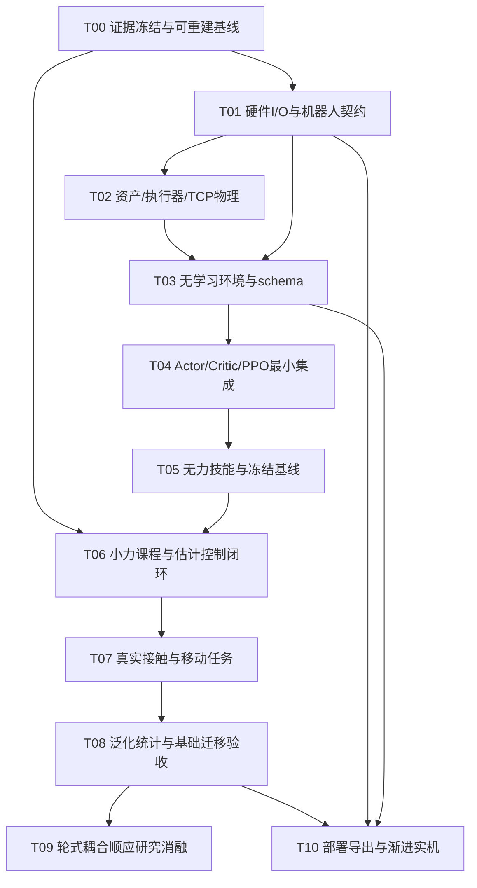

# 已结束模型任务的创建与决策记录

原任务：`unifp-v3-migration`。当前已退出活动设计；历史内容不代表B设计获批。


---

## 原文件：README.md

# 历史跨阶段迁移草案

本目录保留此前源码审计、复现统计和未确认设计／票据，便于追溯。用户现已明确要求：先从干净官方代码完成V3效果复现，验收之后才进入轮式创新；旧迁移仅供参考。

因此，本目录设计和tickets不是当前可执行计划，不能据此修复旧桥开工或提前进入创新。当前入口为 [第一阶段知识库与模块讨论](../unifp-v3-stage1-reproduction/README.md)。历史源码事实中的旧根路径现映射到 `/home/sorry/python_ws/interactive/unifp_reproduction/legacy/v3_reference_20261030/`；历史内容未被伪装为重新验证结果。


---

## 原文件：design/00-运行架构与决策.md

# 00 运行架构与动作边界

状态：待确认设计草案。推荐结论：先保留可审计的Gym诊断参考，以实机执行接口决定9维或14维正式动作；长期Isaac Lab训练线需要独立物理回归，不与形态/算法改动一次混合。

## 当前链与目标链

当前有 `Lab RangerUniFPVecEnv → 原生learner` 与 `Gym backend_envelope动态提取任务方法 → 原生learner` 两条链；实际512冻结结果属于后者。路径清理后均不能直接当成可分发运行包。[事实与源码位置](../knowledge/v3_source_audit.md#1-当前存在两条运行路径)

目标：`RunConfig → robot/task schema → backend → obs/history → policy → action adapter →整机物理 → reward/done/trace → storage/PPO`。训练后部署替换backend与特权支路，保持actor观测和action adapter语义一致。

## 决策Q&A

| 问题 | 推荐答案 | 用户确认 |
|---|---|---|
| 第一个正式动作接口是什么？ | 若真机是底盘速度＋模式，采用`[vx,vy,wz,q_arm_target(6)]`9维；仅在独立轮组命令和反馈已核实后才选14维直接轮控 | 待确认，需硬件清单 |
| 用Gym还是Lab？ | Gym冻结诊断用于历史可追溯；长期正式线建议Lab。先做静态/阶跃/受力响应一致性，明确版本与差异 | 待确认 |
| 是否直接加载B2权重？ | 首版V3从头训练。不同维度、动力学和动作含义使直接加载无依据；跨形态表示迁移作为单独实验 | 待确认 |
| 第一批就改PPO吗？ | 保留官方单Critic、单GAE、共享latent＋辅助估计，先把机器人/任务契约做正确 | 待确认 |

## 边界与接口

- `RobotSpec`：关节/刚体/TCP名字、物理与控制限制、可得传感器和frame，带版本与单位。
- `TaskSpec`：目标所附着frame、可达域、力定义、接触对象、课程与失败条件。
- `ObservationSpec`：Actor/critic/label字段顺序、长度、缩放、采样时间和valid mask；维度由字段计算。
- `ActionSpec`：策略空间、物理空间、限幅/加速度/模式切换规则；9与14不能共用checkpoint语义。
- `RunState`：迭代、实际transition数、课程时钟、优化器、RNG及恢复语义。

不增加一个泛化的“支持任意机器人”框架。先实现一个明确的V3任务与一个正式后端；旧桥作为参考隔离，避免让业务逻辑继续通过AST抽取和绝对旧路径拼装。

```text
spec = load_versioned_specs(config_path)
preflight(spec, backend_version, asset_hash, runtime_paths)
environment = make_v3_environment(spec)
learner = make_official_style_learner(environment.dimensions)
for iteration:
    collect_rollout(environment, learner, state)
    update_ppo_then_auxiliary(learner)
    evaluate_if_due_and_save_full_state(state)
```

## 状态、失败与检查

preflight缺资产/依赖/schema不匹配应在创建GPU仿真前失败，并列出缺失项。禁止自动换资产、切CPU/后端或将缺失力标签补0继续训练。后端切换改变物理指纹时生成新run，禁止静默resume。

测试seam：不启动仿真的配置解析/路径检查；同输入schema hash检查；两后端同单轮/单臂阶跃的离线轨迹对照。验收依据见模块10。


---

## 原文件：design/01-总体参数资产与执行器.md

# 01 总体参数、资产与执行器

状态：待确认设计草案。推荐结论：当前可动模型保留为近似资产，建立参数来源账本；先验证轮地、转向、臂与TCP的物理响应，才扩展受力范围。

## 已知起点与需要修改的参数

当前资产83.3179kg、4转向＋4滚动＋6臂＋夹爪；不是旧17.6kg固定轮。以下数值仅是当前模型/控制器值，不是本轮确认的实机参数。[资产/执行器证据](../knowledge/v3_source_audit.md#2-实际资产与动作语义)

| 参数块 | 当前值/行为 | 迁移要求与来源 |
|---|---|---|
| 全身质量/COM/惯量 | 83.3179kg标称；固定COM训练 | 底盘＋安装架＋臂＋工具分别登记；整机称重与COM/惯性辨识，合法正定惯量与平行轴核验 |
| 轮几何 | 碰撞半径0.1m；轴距/轮距有资产来源 | 核实实际带载半径、轮距/轴距、安装偏置、转向零位；visual尺寸不能替代接触半径 |
| 转向内环 | kp300、kd20、限矩35Nm | 确认固件角度/角速度范围和最短转向分支，辨识时延/速率/死区 |
| 轮驱动 | 5×action rad/s，kd20、限矩80Nm | 使用实机闭环带宽和电机/减速比限制；连续轮角不作home-position奖励 |
| 机械臂 | 6维；home=(0,1,-1.5,0,0,0)rad；kp80,kd4 | A1关节方向/顺序/限位/负载/控制模式与实机逐项对齐；home须有可达/碰撞证据 |
| 臂力矩限值 | 40/40/27/7/7/7Nm | 作为当前模型值保留，按驱动接口核实可用连续/峰值限值与温升条件 |
| 策略与物理周期 | 20ms策略，5ms物理×4 | 保留首版基线，测量实机反馈和命令频率后确定可部署dt；改变dt需同步历史、reward和折扣时间 |
| 末端点 | arm_seg6原点/COM/TCP不同 | 定义`T_arm6_tcp`、工具质量/COM，统一位置奖励、施力点与测力参考点 |
| 接触 | 平地、自碰撞关闭 | 验证轮胎摩擦/接触求解与碰撞网格；在已排除错误自碰撞后明确启用范围 |

## 接口与量纲

`ActuatorModel.step(command, measured_state, dt_s) → joint_targets/efforts`；所有角度rad、轮/关节角速度rad/s，底盘速度m/s、yaw-rate rad/s，力N、力矩Nm。内环连续控制频率与actor更新频率分别记录。

9维方案：`action_adapter`将base twist变成**受转向/轮速/模式限制的目标**，再通过已标定的底盘内环执行；不能在每个step直接设置root速度。14维方案：位置控制4转向与6臂，速度控制4驱动轮，每组独立缩放与速率限幅。

```text
physics_state = read_articulation()
joint_commands = adapter(policy_action, previous_command, control_dt)
for physics_substep:
    actuator_model.apply(joint_commands, physics_state)
    physics.step()
    physics_state = refresh()
```

## 状态与失败语义

motor strength到底缩放动作幅度、目标速度还是力矩增益必须分别命名，不能沿用官方“幅度乘子”却写成力矩标定。`q_default + scale*a`是绝对home残差，不是累计积分。部署失联进入独立监督器的已定义停止状态，不由学习策略处理。

关键检查：静态载荷平衡；前进/横移/原地转向；转向阶跃与轮速阶跃；臂逐关节小阶跃；同一TCP受力在不同臂姿态的响应；法向接触力、滑移和轮组饱和记录。

## Q&A

| 问题 | 推荐答案 | 用户确认 |
|---|---|---|
| 现资产可以立刻用来研究sim-to-real吗？ | 可作近似仿真起点，先建立实测来源和响应对齐，再作sim-to-real结论 | 待确认 |
| 初期采用哪些自由度？ | 底盘＋六臂；夹爪独立固定/脚本控制，工具姿态与TCP单独登记 | 待确认 |
| 参数不知道时如何处理？ | 记录估计/待测，不将官方四足参数或vendor可视化参数当实机真值 | 待确认 |


---

## 原文件：design/02-环境观测命令与动作.md

# 02 环境、观测、命令与动作契约

状态：待确认设计草案。推荐结论：采用schema生成所有长度和切片，先冻结时间、坐标和动作的语义；不再靠73/149/58/98等魔法维度或无效命令槽兼容。

## 当前事实与目标数据结构

官方actor为73×32、critic149×3、label12、action17；当前V3为58×32、98×3、12、14。详细字段见[官方审计](../knowledge/official_source_audit.md#3-actor历史编码与辅助状态估计)与[V3审计](../knowledge/v3_source_audit.md#3-actor辅助估计器的实际接口)。

目标接口：

```text
Observations:
    actor_history: Float[N,H,D_actor]
    actor_valid: Bool[N,H]                 # reset/warm-up语义
    privileged_history: Float[N,Hv,D_value]  # 仅训练
    supervision: Float[N,D_label]          # 仅训练/评估真值
    supervision_valid: Bool[N,D_label]
    timestamp_s: Float[N]
StepResult:
    next_observations
    reward: Float[N]
    terminated: Bool[N]
    truncated: Bool[N]
    final_value_observation: ...           # reset前timeout状态
    raw_metrics / applied_action / feasibility
```

与官方learner接口可设一个明确边界adapter，转换成其观测字典；保持terminated/truncated和final observation信息，不能在环境层丢失后再猜。

## Actor字段建议与实机可得性

| 字段 | 维度 | frame/单位与条件 |
|---|---:|---|
| 姿态 | projected gravity3或roll/pitch2，二选一 | body frame，IMU可得；schema冻结后不可混换 |
| base angular velocity | 3 | body，rad/s，IMU |
| 转向角/速度 | 原角4＋速度4；周期编码为候选 | rad/rad/s；受限转向角不是任意连续角，是否sin/cos须保留限位距离 |
| wheel angular velocity | 4 | rad/s；不把累计轮角当home误差 |
| arm q / dq | 6＋6 | rad/rad/s，按真实关节名映射 |
| 上一实际命令 | 9或14 | 策略尺度与物理尺度分别存储，不混用 |
| 任务命令 | 初期12 | base twist3＋EE位置3＋姿态3＋EE命令力3；frame各自登记 |
| 可用增强信号 | 按清单计算 | odom、轮/臂电流、控制模式、饱和反馈、观测延迟；只有实机实际可得才进入Actor |

初版D由最终选择的这些字段求和，**不预先硬定一个包含未知传感器的数字**。Actor不得使用仿真真值base velocity、外力、接触分类或物性来替代缺失传感器；若加入真实可用odom，区分噪声/延迟后的测量与critic真值。

## 目标与坐标

- 统一世界W（z向上）、基座B、仅yaw旋转的Y、工具E、任务/接触面S，明确所有变换的源和目标。
- Gym四元数`xyzw`与Lab常见`wxyz`在后端边界转换一次，纯任务数学统一约定；测试用90°旋转验证，不能只测单位四元数。
- 同口径UniFP基线保留随base XY/yaw移动的球心；世界固定物体任务使用固定S/W目标，actor收到转换到可用局部frame的命令。二者作为不同任务，分别评估。
- A1球域/笛卡尔域、姿态插值和避碰用当前安装姿态计算。给出姿态命令就要有对应任务和指标，否则首版显式删除姿态槽或设定固定姿态任务，不允许有名无实。

## 动作与时序

9维：`[vx,vy,wz,q_arm_residual(6)]`；14维：`[steer_residual(4),wheel_rate(4),arm_residual(6)]`。这里臂残差相对固定home；若改为目标增量积分，应作为另一action schema及模型版本。

```text
obs_t, label_t = observe_current_state_once()
raw_action_t, logp_t = actor.sample(obs_t)
applied_t = adapter.limit_and_convert(raw_action_t, command_state)
next_state = simulate(applied_t)
reward_t, final_metrics = score_before_reset(next_state)
next_obs = reset_done_then_observe(next_state)
store(obs_t, label_t, raw_action_t, logp_t, reward_t, done, final_observation)
```

PPO对采样的raw action保存和重算logp；实际执行的限幅动作/轮组目标另外存。不能把raw logp与clipped action配对做PPO。历史每策略步只入队一次，reset仅清当前env，warm-up以mask表述；不得用另一回合的历史补齐。

## 失败、检查与Q&A

非有限/时间戳倒退/frame/schema错配立即停止本run并保存诊断，不用0填补。可达性拒绝在采样前；若做投影，原请求、投影目标和投影量分别记录。

测试seam：字段构造纯函数、帧转换、per-env reset、命令变换、adapter映射、有限动作与实际限幅等。保证同一state构造actor与label，避免t/t+1错位。

| 问题 | 推荐答案 | 用户确认 |
|---|---|---|
| 世界固定还是相对底盘目标？ | 保留相对基线核验；研究移动接触采用世界/任务固定目标，所有对照使用同一定义 | 待确认 |
| 初版Actor加哪些传感器？ | 先以硬件稳定获取清单为准；odom/电流增强单独消融 | 待确认 |
| 是否保留base force槽？ | 首版聚焦EE受力，移除无激励的base力命令/标签；后续启用时整体扩展schema | 待确认 |


---

## 原文件：design/03-Actor与辅助估计.md

# 03 Actor、历史编码与辅助估计器

状态：待确认设计草案。推荐结论：保留官方共享latent结构，重建V3的观测/动作/监督契约；先证明确定性动作和非零力估计有效，再探索显式物理状态反馈或新编码器。

## 当前与目标网络

官方真实结构是`历史2336→512→256→128→64 latent`，动作头`[最新73,latent64]→512→256→128→17`；decoder为`64→128→64→12`。当前V3换成1856历史、最新58、输出14。**decoder的12维估计没有显式拼回动作头。** [源码与梯度依据](../knowledge/official_source_audit.md#3-actor历史编码与辅助状态估计)

建议首版：

```text
history[N,H,D] → encoder(512,256,128) → latent[N,64]
[latest_frame[N,D],latent] → actor(512,256,128) → mean[N,A]
learned_valid_std[A] → joint diagonal Normal(mean,std)
latent → decoder(128,64) → estimates[N,9]
```

`H=32`、`A=9`或14由动作边界确定，D由schema确定。历史仍对应约0.64s名义采样窗口；最旧至最新时间差为31dt。保留MLP/latent维度是为了控制变量，不是已证明V3最优。

## 分模块修改清单

| 子模块 | 保留 | 修改/核查 |
|---|---|---|
| 历史缓存 | per-env FIFO、reset清零 | 有效历史mask、时延对齐、部署时间戳；不跨回合 |
| encoder | 共享64 latent、PPO与辅助监督均回传 | 输入schema与物理尺度，记录两支梯度/参数更新量 |
| actor head | 最新本体帧＋latent、联合动作分布 | 输出维度、动作分组尺度/限速；初版不增加多个独立决策器 |
| std | 可学习探索 | 按底盘/轮/转向/臂的物理1σ分别初始化，正数性、上下界/记录可审计；不可统一照抄1.0 |
| decoder | MLP辅助物理监督 | 首版建议9维：base velocity3、EE position3、EE external force3；基座外力未激励不保留成功假象 |
| 估计目标 | 仅训练时真值监督 | EE位置建议统一局部笛卡尔m，力在yaw或任务frame的N；与原球坐标标签差异单独版本化 |
| loss | 辅助监督独立于PPO，encoder共享 | 单位缩放、valid mask、非零力分层、零力回归；报告原单位MAE/RMSE |
| 推理 | 仅Actor与encoder；decoder按需估计 | deterministic mean为部署主指标，sample另作诊断；禁止在线使用Critic真值 |

若要最严格对照官方表示，可先以12维旧标签/球坐标保持一个诊断baseline，再在正式9维任务使用清楚定义的标签。二者不能共用同一个“官方完全不变”标记。

## Loss与梯度接口

原实现将每组prediction和target都乘权重后做MSE，`.2`实际贡献`.04`倍平方误差；力另有`.01`单位缩放。新配置应显式区分`physical_scale`与`loss_coefficient`，不要把这个行为悄悄改成另一公式。[原实现](../knowledge/official_source_audit.md#53-辅助损失及实际更新范围)

```text
latent = encoder(history)
mean = actor(concat(latest_frame,latent))   # 不detach latent
prediction = decoder(latent)
auxiliary_loss = sum(alpha_k * masked_mean(square((prediction_k-truth_k)/scale_k)))
```

norm/scale只用训练数据或事先冻结物理尺度，评估不更新统计。保持一套PPO Adam和一套辅助Adam交替更新encoder，并保存两者状态。actor-head/std不与辅助预测损失相连；decoder不与PPO动作计算相连。显式拼接`F_hat`或detach latent均属于后续结构消融，不是首版默认。

## 可观测性与失败语义

大质量底盘、摩擦/滑移/内环、负载和电流饱和可能造成相似状态历史；不能把有decoder就等同于可准确辨识力。使用多个方向/幅值/姿态/接触开关，比较恒零、传统观测器、无历史、无辅助估计等基线。真值标签只表示实际建模/施加的力；注入力、接触反力及合外力须有各自mask。

历史不足、传感器失效或物理非有限不产生“可信力为0”的输出语义；部署降级由监督器处理，具体阈值在接口测量后定。力预测不确定性网络仅在有校准与决策收益证据后添加。

## 测试与Q&A

测试seam：shape、缓存时间、标签t/t+1对齐、梯度归属、actor无特权路径、std正数性、同一输入CPU/GPU/导出一致性。mean/sample在同一验证种子和初始设置下对照，不能用sample曲线替代mean部署能力。

| 问题 | 推荐答案 | 用户确认 |
|---|---|---|
| 首版换Transformer/GRU吗？ | 先保留官方MLP；历史模型升级需在稳定基线上做等预算消融 | 待确认 |
| 力估计是否直接回灌Actor？ | 首版保留共享latent；显式力回灌作为单独、可比较的实验 | 待确认 |
| 首版是否保留base外力头？ | 无独立激励/真值与任务时移除；后续开启需整体扩展命令、标签与测试 | 待确认 |


---

## 原文件：design/04-Critic与价值估计.md

# 04 Critic与价值估计

状态：待确认设计草案。推荐结论：保留非对称训练和单标量V头，按V3重建特权字段，重点检查观测可用性与回报时序，不先引入双Critic。

## 当前链与保留内容

官方`149×3=447→512→256→128→1`，当前V3为`98×3=294→同MLP→1`。Critic读取特权历史，不共享actor encoder；不把当前候选action作为Q函数输入。标量V与一套标量GAE是官方基线的实际定义。[来源](../knowledge/official_source_audit.md#4-critic-的真实特权契约)

## V3特权schema

| 字段块 | 建议内容 | 单位/边界 |
|---|---|---|
| 真值状态 | base真实速度、姿态/角速度、A1与轮/转向状态、TCP位置/姿态 | m/s、rad/s、rad、m；frame明确 |
| 真实力与接触 | TCP净外力、单独注入力、接触反力、轮法向力/滑移真值、接触对象状态 | N/Nm，按实际物理可得；标签与reward来源一致 |
| 物理参数 | 质量/负载、COM/惯量、轮半径/转向零位、摩擦、执行器增益/时延 | 每项写实际值还是delta，不能混用 |
| 命令与执行状态 | 原任务命令、补偿目标、上一执行命令、模式、限幅/饱和与可达状态 | 合法训练特权，不泄漏给actor |
| 世界任务 | 对固定表面/物体的相对状态与法向 | 只有该任务开启时纳入；无效字段不补零假装已观测 |

前3帧作为首版保留，Dv由schema求和。当前98维不是目标长度；删除base-force无效字段、增加接触/执行器字段后应修改配置、storage与导出元信息。若某物理参数不随机但固定，记录常量的意义而不标成“已适应范围”。

## 接口、状态与失败

```text
value_obs_t = value_schema.pack(state_t, physics_parameters, task_state_t)
value_t: Float[N,1] = critic(flatten(last_3_value_frames))
rollout stores(value_obs_t, value_t, reward_t, terminated, truncated)
return_target = gae_with_explicit_timeout(final_value_obs)
```

reset清零对应环境的value历史；bootstrap使用真实的终止前下一状态。不能拿reset后的观测补timeout价值。特权中的force-offset目标不能同步送入Actor作为“命令”，否则泄漏外力真值。

## 诊断与检查

记录value loss、explained variance、returns/value均值和分位数、各阶段奖励尺度；按零力/非零力、可达/不可达、接触/离开接触分层看V误差。负载或力课程骤变时，V退化和Actor退化分别检查。合理数值并不单独证明策略成功。

测试seam：构造特定state验证字段位置与缩放；改变隐藏物性只改变critic分支；actor导出不包含特权输入；手算短rollout的V/return和timeout。

## Q&A

| 问题 | 推荐答案 | 用户确认 |
|---|---|---|
| 是否做底盘/机械臂双值头？ | 首版单值头；只有证据显示多任务回报冲突且稳定基线可比较时再做创新消融 | 待确认 |
| 轮滑移/接触真值可以输入Actor吗？ | 仅当有同定义的实机测量/估计接口；仿真真值默认仅训练和评估 | 待确认 |
| COM固定是否足够？ | 可以是诊断条件，但不能写成已验证负载/COM泛化；正式阶段按辨识范围随机化 | 待确认 |


---

## 原文件：design/05-PPO缓冲区与Runner.md

# 05 PPO、rollout缓冲区与Runner

状态：待确认设计草案。推荐结论：保留官方标量PPO核心；主要改schema、终止时序、辅助监督与完整训练状态，所有偏离有版本和小规模回归。

## 原算法需要保留什么

官方是全动作联合高斯log-prob、一个总reward、一套GAE、一个Critic，并非“底盘/臂分组PPO”。实际配置为clip0.2、gamma0.99、lambda0.95、value系数1、entropy0.01、5epoch×4minibatch、主LR1e-3、自适应KL目标0.01、主梯度norm1、辅助LR1e-5、24步rollout。[源码依据](../knowledge/official_source_audit.md#5-ppogae辅助监督及梯度)

首版保留优化顺序：每minibatch先PPO主更新，再用更新后的encoder前向辅助MSE更新；不detach共享latent。不为了轮式平台另写一个没有对照的算法。

## 具体修改

| 子模块 | 修改内容 | 检查方式 |
|---|---|---|
| policy初始化 | D_actor/D_value/D_label/A从同一schema获取 | 模型、环境、storage hash不一致拒绝加载 |
| storage | actor历史、value历史、label与valid mask、raw action/logp、value、reward、done | shape覆盖N=1和多env；时刻一致 |
| GAE | 保持标量；明确terminated与truncated、rollout截断 | 短序列手算，不把reset后obs做bootstrap |
| timeout | 新环境提供reset前final value obs；用`gamma*V(final_state)`补timeout后切断 | 与官方`V_old(s_t)`近似存在差异，版本化并独立回归 |
| auxiliary | mask与单位/loss系数显式；保留共享encoder双优化器状态 | 非零样本、零力样本分组；梯度归属测试 |
| 动作分布 | raw action正确保存；记录每组物理std、clip/饱和比例 | joint logp数值与sum逐维一致，mean/sample分别评估 |
| 学习率/熵 | 首版以官方值起步，按KL、std与物理探索幅度诊断 | 动作维数改变会改变entropy/KL总和，不能只看相同数字 |
| 日志 | 原单位物理指标、真实辅助MSE、loss与回报独立 | 原辅助返回日志额外除64，不能直接当真实MSE |
| runner | run manifest、课程时钟、所有计数和完整resume | 小规模save/load/update回归 |

## 样本与物理时间预算

| 环境数N | H_rollout | batch | 4 minibatch时每批 | 16000轮transition |
|---:|---:|---:|---:|---:|
| 512 | 24 | 12288 | 3072 | 196608000 |
| 4096 | 24 | 98304 | 24576 | 1572864000 |

相同轮数差8倍样本。增大N会同时改变batch、更新噪声、环境多样性与GPU负担，不能称仅速度变化。记录iteration、批量policy steps、总transitions、每环境仿真秒、wall time和优化器步数；消融优先等transition，再报告时间成本。

若策略dt改变，折扣的物理时域会变，可用`gamma_new=gamma_old**(dt_new/dt_old)`作为保持时间尺度的明确设计；lambda、rollout长度、历史长度、reward dt和课程时长也要同步复核。该公式是设计换算，不是当前配置已改。

## 完整checkpoint与恢复语义

```text
checkpoint = {
  model, ppo_optimizer, auxiliary_optimizer, learning_rates,
  iteration, optimizer_steps, policy_steps, transitions, simulation_time_s,
  curriculum_stage, force_amplitude, scheduler_clock,
  normalizer_state, python_numpy_torch_cuda_rng,
  config, schema_hash, asset_hash, source_hash, runtime_fingerprint
}
```

载入前核验schema/资产/后端；不匹配需显式新实验或迁移映射，禁止strict=False吞掉形状错误。环境状态、接触求解器和history若不完整序列化，清楚标“学习状态恢复、物理重启”，固定warm-up/重采样并排除相应统计；不承诺PhysX位级连续。

官方原runner未保存global_steps与辅助优化器，且循环中保存的iter元数据可能旧；新实现必须以真实当前轮次和独立课程时钟保存，移除`force_start_iteration*24`硬编码依赖。[原事实](../knowledge/official_source_audit.md#7-课程随机化和断点恢复)

## 最小调用框架与Q&A

```text
transition = sample_policy_and_value(obs_t, label_t)
result = env.step(transition.raw_action)
storage.add(transition, result, final_value_obs)
returns = scalar_gae(storage, final_rollout_value)
for minibatch in fixed_versioned_batching_rule:
    ppo_step(minibatch)
    auxiliary_step(minibatch.label, minibatch.valid_mask)
save_full_learning_state(actual_counters)
```

| 问题 | 推荐答案 | 用户确认 |
|---|---|---|
| 马上调低LR/熵能解决退化吗？ | 原因未证实；先记录std、KL、梯度和奖励分项，再做单因素试验 | 待确认 |
| 换大GPU就用同轮数吗？ | 同时报告等transition与wall time，先做容量/吞吐/动力学回归 | 待确认 |
| 修timeout算算法创新吗？ | 算明确记录的实现修正；与官方兼容路径分开验证，不包装成创新 | 待确认 |


---

## 原文件：design/06-力模型任务与奖励.md

# 06 力模型、任务与奖励

状态：待确认设计草案。推荐结论：先复现可解释的TCP注入力与统一补偿目标，再加入真实接触；力施加、估计标签、奖励和独立评估使用同一符号/作用点，但分别记录不同物理量。

## 1. 当前实现的差异

官方使用注入力缓冲构造标签与`p_geom+(F_external+R_yaw F_cmd)/K`位置奖励。当前V3 Gym接口`apply_rigid_body_force_tensors`在arm_seg6 COM施力，不是TCP接触点；该body COM相对末段原点约有−3.88cm Z偏置。当前K=200N/m，两独立力流每轴±60N，同向时每轴偏移代数上界0.6m，不保证A1可达。[来源](../knowledge/v3_source_audit.md#5-课程目标奖励与随机化)

## 2. 力、坐标与TCP接口

| 名称 | 定义 | 记录frame/单位 |
|---|---|---|
| `F_injected_env_on_tool` | 人为施加在TCP上的已知外扰 | world或task frame，N |
| `F_contact_env_on_tool` | 物体对工具的接触反力 | world或task frame，N |
| `F_total_env_on_tool` | 同一定义下的注入力＋接触反力，避免重复计数 | N，排除或显式定义重力/内力成分 |
| `F_cmd_tool_on_env` | 期望工具对环境的作用力 | 任务frame，N；与反力方向相反 |
| `wrench_at_tcp` | 在明确TCP参考点的力/力矩 | N与Nm，变换需含力臂 |

```text
tcp_world = compose(base_pose, arm_fk, tool_transform)
F_world = rotate(force_frame_to_world, F_injected)
apply_force_at_position(body, F_world, tcp_world)
# 后端若只支持COM wrench：torque_COM += (p_tcp-p_COM) cross F_world
```

at-position施力与显式`r×F`不可同时叠加，否则力矩重复。统一后验证不同TCP偏置下合力相同而力矩按力臂变化；零外力必须实际不施力。

## 3. 两类任务分别定义

**A：方法层注入力任务。** 保留官方补偿关系作为首版对照。Actor收到原目标与力命令，不收到含真外力的补偿目标；critic、reward与评估可以使用真值。实现层配对`F_injected_world=-R_yaw F_cmd_yaw`可使补偿目标等于几何目标；这是可审计的符号检查，不冒充作者未公开的完整统计协议。

**B：真实接触任务。** 使用世界固定表面/物体和实际接触求解。接触法向上力控制，切向上位置/速度控制，姿态对齐工具；明确目标优先级，不能要求同一刚性受限法向既精确穿透位置又独立指定任意力。估计标签改为明确定义的接触/总外力，原注入力标签不能自动等同于物体反力。

## 4. 可达与受力可行域

采样前检查原目标、整个插值轨迹和补偿目标：IK、关节/速度界、自碰撞、工具/底盘环境碰撞、臂力矩裕度`tau≈J(q)^T F`、底盘轮地牵引/倾覆裕度与模式约束。先对固定基座做已知可达集，再开放底盘协同；不要用“四足可俯身”的旧采样范围。

K可以从固定标量扩展为明确定义frame下的正定对角矩阵，但首版不同时学习K和策略；先按任务可达余量与允许接触力设置，并记录其物理单位N/m。底盘导纳D对应N·s/m，偏航分量需要Nm·s/rad，不能全部混作同一常数200。

被拒绝目标记拒绝率/原因。若采用投影，记录原请求与投影量，指标同时报告；禁止事后把目标改成当前位置来掩盖误差。

## 5. 奖励重构清单

| 奖励块 | 首版/扩展内容 | 审计点 |
|---|---|---|
| TCP位置 | 原/补偿目标分别记物理误差；奖励明确选择其中一个 | 不能把两个目标的误差混画 |
| TCP姿态 | 固定/命令姿态与对齐任务，使用连续姿态差定义 | 当前姿态槽无有效任务需补齐或删除 |
| base运动 | body/任务frame下vx/vy/wz，按物理模式可执行 | 不奖励理想瞬时全向速度 |
| 轮式约束 | 转向速率/分支切换、轮间一致性、侧滑/纵滑、饱和 | 不对连续轮角罚home-position误差；低速滑移用有效性阈值 |
| 效率和平滑 | 臂/轮功率或可测电流代理、各组动作变化/加速度 | 物理单位和执行器组分别归一，避免轮速必需值受重罚 |
| 接触扩展 | 法向力误差、切向轨迹、接触保持、峰值反力/姿态 | 属新任务扩展，单列与原UniFP代理奖励区别 |
| 约束/终止 | 关节限位、碰撞、车身姿态、超速/过力、失联 | 奖励软罚不能代替独立硬件保护 |

物理指标与reward分项都记录，分项先检查正常动作下的量级与梯度贡献，再定权重。轮速度/加速度和转向速度不能不加核查地复用腿关节惩罚权重。每步reward是否乘dt、episode return及每秒归一分别标注。

## 6. 状态、测试与Q&A

力脉冲状态保存phase、起止时间、幅值、frame、作用点；reset对该env清零。真实接触从求解器或独立测力传感获取，注明是否含重力/惯性；不能将注入缓冲与net_contact重复相加或漏掉力矩。

测试seam：±X/Y/Z施力、90°yaw变换、COM/TCP力矩、抵消配对、零力验证、目标拒绝/投影、单平面接触反力守恒与工具frame变换。

| 问题 | 推荐答案 | 用户确认 |
|---|---|---|
| 首版继续±60N吗？ | 不直接继承；按可达、力矩和底盘裕度设置小幅课程，幅值上限由测量/验证确定 | 待确认 |
| 力误差使用哪个真值？ | 注入力和物体接触反力分别记录，训练标签由当前任务明确选择 | 待确认 |
| 注入力成功就能称接触力控制成功吗？ | 不能；至少还需真实接触对象与独立反力跟踪测试 | 待确认 |


---

## 原文件：design/07-课程随机化与训练顺序.md

# 07 课程、随机化与训练顺序

状态：待确认设计草案。推荐结论：阶段切换由独立物理指标与保留技能闸门驱动，不按固定8000轮自动开启最大力；分开加难度和随机化。

## 当前事实

官方力门为`global_steps>8000*24`；V3旧512实验也在192001批量策略步后引入±60N。V3无力8000mean为4.25cm，受力9000的零力误差已升至17.32cm，终点更差。固定COM不等于全部随机化关闭，旧训练仍含质量、摩擦、motor幅度与push等。[事实](../knowledge/v3_source_audit.md#5-课程目标奖励与随机化)

## 建议课程

| 阶段 | 任务 | 每阶段检查与退出条件 |
|---|---|---|
| S0 无学习物理 | 静置、轮/转向/臂阶跃、TCP定向施力 | 坐标/幅度/时延/接触可信，物理不变量检查通过 |
| S1 基础无力 | 固定base臂到达；固定臂base速度；联合无力 | mean控制成功、无持续饱和、可达集覆盖；建立新冻结baseline |
| S2 单轴慢力 | TCP一个轴、低幅缓慢ramp；命令力/外扰分别激励 | 力符号、估计相位、零力偏置、姿态依赖与控制误差可解释 |
| S3 随机向量力 | 多方向、独立/抵消配对、幅值递进 | 非零估力优于恒零，补偿跟踪改善且零力能力不明显退化 |
| S4 真实接触 | 固定平面→不同刚度/摩擦→可动物体 | Fn跟踪、切向误差、接触峰值与失联接管通过 |
| S5 移动接触 | 世界固定目标、长行程/重定位 | 跨臂工作域时连续接触；轮滑/能耗/成功率优于基线 |
| S6 泛化与实机 | 留出负载/地面/时延/种子与低速实机 | 满足预先冻结指标与独立监督约束 |

S0→S1先1/少量环境，再扩大并行做吞吐、物理一致性和reset测试。最终N通过显存/接触容量/性能实测决定，不把4096当方法的必要常数。10–50轮短训练仅作更新与日志烟雾检查，不用来判断收敛。

## 课程状态与防遗忘

独立记录`curriculum_stage`、`policy_time_s`、实际非零力暴露时间、各幅值采样比例、transition总数；不再从iteration×24推导所有课程。学习状态resume恢复这些计数；物理重启写清并执行warm-up。

每阶段保留明确比例的零力/旧幅值任务（比例待设计冻结），固定验证种子定期测mean零力、受力、饱和与估计。若连续多个验证窗口越过已约定退化阈值，停止晋级并保存最后合格/失败检查点；不要只因总reward恢复就继续加力。回滚的是训练课程/检查点选择，失败轨迹仍保存，不覆盖。

## 分层随机化

| 顺序 | 参数 | 范围来源与检查 |
|---|---|---|
| 首先固定 | 正确几何/惯性/执行器/TCP | 用来验证结构和力位关系，不能把明显错误用随机化掩盖 |
| 第一层 | IMU/编码器噪声、命令延迟、更新抖动、轮/臂内环 | 采集真实时间序列，区分白噪声与时域相关误差 |
| 第二层 | 负载/COM、轮径、转向零位、静/动摩擦、驱动死区 | 来自称重、标定及响应辨识；每项单独敏感性测试 |
| 第三层 | 接触面刚度/摩擦、工具偏置、地面变化、外扰方向/带宽 | 与目标场景对应；保留训练外但物理合理的测试集 |

移除四足步态相关随机化。不要直接用root速度突变代表真实受力；若保留push作为鲁棒性扰动，应单独命名和记录，不把它当force estimator的力真值。

## 调用框架、失败与Q&A

```text
stage = load_curriculum_state()
episode_task = sample_feasible_task(stage, calibrated_ranges)
collect_and_update()
validation = evaluate_frozen_commands(mean_policy)
if promotion_gate(validation, retained_zero_force_skill):
    stage.advance_with_logged_reason()
elif regression_gate(validation):
    freeze_promotion_and_save_failure_bundle()
save(stage, scheduler_clock, force_exposure, learning_state)
```

| 问题 | 推荐答案 | 用户确认 |
|---|---|---|
| 仍然每阶段8000轮吗？ | 预算可设上限，但晋级由物理指标决定，比较时报告真实transition与力暴露 | 待确认 |
| 先用16000退化权重续训吗？ | 先诊断保留；正式线从已验证无力baseline或新schema重训，不默认续接失败终点 | 待确认 |
| 什么时候加入所有随机化？ | 无力/单力物理关系确认后逐层加入，每加一层重测保留技能 | 待确认 |


---

## 原文件：design/08-轮式创新与消融.md

# 08 轮式创新假设与消融

状态：待确认研究方案。推荐主线是“滚动与转向约束下的底盘—机械臂耦合顺应”，先完成稳定基础迁移；以下均为待实验与文献查新的假设，不是新颖性已证实的结论。

## 1. 为什么轮式平台有新的问题

官方论文方法分别处理base与EE目标，正文3.1明确把更完整的跨部位力转换留作后续方向；但已有相关整机控制工作，不能据此推断本方案是首创。论文已含B2和G1跨形态结果，所以“再换一种形态”不够。来源：[本地一手论文缓存的3.1节](../../../../research/literature/projects/unifiedforce/assets/paper.html#S3.SS1)及摘要。

轮式V3的可动性随转向构型、轮速上限、轮地摩擦与内环模式变化，底盘不能像四足一样改变支撑步态与主动蹲伏。末端施力对整机的作用取决于臂姿态与力臂，轮地约束可能让“手臂让位”与“底盘让位”的最优分配不同。

## 2. 主线A：转向约束感知的底臂耦合顺应

**问题：** 给定TCP法向力/位置任务，如何在A1工作域、驱动/转向响应和轮地约束下分配底盘与臂运动，使接触稳定且低滑移？

在相同frame中，由末端力得到基座受力：`F_B=R_BE F_E`，`tau_B=r_BE×F_B+R_BE tau_E`；平面base保留`[Fx,Fy,tau_z]`。力与偏航力矩的导纳系数单位分别定义。此变换是物理事实，**创新须来自有效的耦合策略/约束建模与实验收益，不是写出力臂公式本身**。

建议模块接口：

```text
allocation_state = {arm_configuration, steering_angles, wheel_rates,
                    actuator_limits, estimated_contact_wrench, task_reference}
allocated_target = coupled_compliance(allocation_state)
policy → base/arm commands → same calibrated low_level_adapter
```

实现可先用可解释的受约束分配/导纳作为对照，再验证学习残差或构型条件策略是否提高接触性能。初期不同时引入QP、新时序网络和新PPO，否则难以定位收益。

**必备对照：** 固定base仅臂顺应；base/arm独立导纳；稳定基础UniFP迁移；去转向构型特征；去滚动/滑移约束；完整方法。全部使用相同硬件接口、任务与等transition预算。

**主要指标：** 接触Fn MAE与峰值、切向轨迹误差、接触保持率、长行程完成率、轮滑/轮组不一致、底盘路径、臂限位/奇异裕度、能量。若仅reward或估力变好，不接受为本主线成功。

## 3. 候选B：接触力与滑移/饱和的可辨识估计

**问题：** 历史关节/轮状态中的“运动不符”可能来自接触外力、轮滑、执行器饱和或未知负载，能否借助实机可得的电流、odom、转向/动作历史区分？

先做有控制的辨识数据：无接触不同摩擦；相同接触不同负载；相同外力不同转向；饱和/未饱和；传感器延迟变化。训练辅助目标可分`contact_force`、`slip_state`与有效性；不直接把仿真接触布尔值送入部署Actor。

**对照：** 恒零；只关节历史；无历史；加电流；加odom；传统动量/扰动观测器；完整估计器。电流输入必须真实可得；真值力使用独立测量，不用同一电流换算同时作为唯一答案。

**验收：** 在留出地面/负载上降低非零力误差与误报；无力假阳性不增加；若输出不确定性，需校准与控制决策收益。传感器更多导致的收益与算法收益分别报告。

## 4. 候选C：接触不中断的底盘重定位

**任务：** 世界固定表面长程擦拭/接触扫描、抽屉或其他长行程接触，机械臂逼近工作域边界时底盘重定位，同时保持法向力和工具姿态。

**对照：** 固定base；达到限位再停止重规划；独立底臂控制；基础UniFP；耦合方法。统计接触断开次数、重定位耗时、峰值力、路径/能量与完成率。

该方向可作为主线A的主要验证场景，减少三个不相关“创新点”同时展开。人机牵引/导航可留作后续任务，不以不完整的安全论证直接开始人机接触。

## 5. 研究顺序与Q&A

选一条主线后再做系统文献检索，检索wheeled mobile manipulation、whole-body impedance/admittance、force estimation、steering/slip-aware control等一手论文，形成与已有方法逐项对照。该步骤未在本轮声称完成全领域新颖性排查。

| 问题 | 推荐答案 | 用户确认 |
|---|---|---|
| 主要创新选什么？ | 以A为方法主线、C为任务证据，B作为有硬件反馈与辨识证据后的增强 | 待确认 |
| 迁移本身能否当论文创新？ | 需要新问题、方法和受控收益；单独换形态/传感器/轮数不足 | 待确认 |
| 是否立刻实现创新模块？ | 基础无力/受力迁移稳定且对照齐全后再加，避免无法归因 | 待确认 |


---

## 原文件：design/09-评估部署与数据保全.md

# 09 评估、部署与数据保全

状态：待确认设计草案。推荐结论：以确定性mean策略的独立物理指标为主，完整保存原始trace与训练状态；实机I/O和安全监督独立验收。

## 1. 评估协议

| 条件 | 目的 | 主要指标 |
|---|---|---|
| 零力/静止与移动 | 几何技能与无力偏置 | EE XYZ MAE、L2均值/P95、<阈值比例、姿态误差、base速度/轨迹、估力零偏置 |
| 外扰独立/命令力独立 | 区分两输入作用 | 补偿/原目标误差、分轴/幅值/方向、实际力峰值、响应/恢复时间 |
| 实现层抵消配对 | 检查力位统一与符号 | 原与补偿目标一致性、与零力差、估力基线 |
| 真实接触 | 力闭环 | 独立反力Fn MAE/RMSE/P95、超调、峰值、相位、接触保持、切向轨迹 |
| 移动重定位 | 跨工作空间协同 | 完成率、接触中断、臂裕度、轮滑、底盘路径和能耗 |
| 训练外负载/摩擦/时延 | 泛化 | 上述指标分层退化、失效模式与恢复/接管 |

单轴MAE、所有XYZ元素汇总RMSE和向量L2均值不同，字段名与单位不能混用。力的注入、命令、接触真值、估计分别保存；位置目标保存原请求、补偿与投影版本。

## 2. 种子、预算与基线

- 开发期固定验证种子/轨迹用于晋级与选点；最终测试使用未参与选点的seed、目标、负载和地面。
- 至少3个独立训练seed作为研究阶段的建议最低重复数；每seed多个episode/env不等于更多训练seed。误差条按独立重复的合适单位统计，不把相邻48000帧当独立样本求虚假的高置信度。
- deterministic mean为部署主结果；sample为探索/分布偏移诊断。保存std及各执行器对应物理幅度、clip与饱和率。
- 对照使用同任务frame、相同传感器可用性、控制接口、物理设置和等transition预算。新Actor/后端/动作边界的比较须标明同时变化项。
- 基线顺序：经典位置/导纳或阻抗控制；无辅助估计/无历史；稳定基础UniFP迁移；候选创新。传统基线需同限幅和低层内环，避免给不同控制器不同能力。

## 3. 数据与产物接口

```text
run/
  manifest.json       # commit或源码hash、资产、schema、依赖、GPU/后端、配置与seed
  checkpoints/        # 全学习状态；best/last/failed分别保留
  metrics.jsonl       # 每轮reward/loss/原单位物理量/课程与实际施力
  evaluations/
    protocol.json
    raw_trace.npz     # [time,env,...]，所有frame/单位/valid/reset mask
    result.json
    source_sha256.json
```

原始trace记录timestamp、原/补偿/投影目标、TCP状态、raw/applied action、执行器目标、轮滑/接触/饱和、注入力/接触力/估计、reset/timeout/history有效性。指标由trace离线重算；公式与mask版本化。清理仅删除有明确可替代来源的缓存，不能再次把支撑关键结论的唯一轨迹清空。

历史归档摘要与当前实际保留内容分别声明。清单错误修订留变更说明，不能用当前hash为已丢失轨迹补出“历史验证通过”。

## 4. 部署链与状态机

当前未见完整Ranger ROS2/CAN＋A1Arm真机控制链，硬件接口仍需实测。[事实](../knowledge/v3_source_audit.md)

```text
IMU/odom/轮组与臂反馈 → timestamp/frame adapter → Actor历史
                                     ↓
                             mean policy (+估计器)
                                     ↓
                速度/加速度/关节/力矩/接触阈值监督
                                     ↓
              chassis command/mode + A1Arm command
```

状态：`DISARMED → FEEDBACK_VALID → ARMED_LOW_SPEED → RUNNING`；时间戳过期、通信异常、限位/超力或人工接管转`SAFE_STOP`，恢复需按硬件操作流程。安全阈值源自硬件与任务实验，不能在没有资料时编造数值；策略reward不是安全停止实现。

仿真与部署使用相同动作映射、frame与历史窗口，模拟固件模式切换、内环延迟、死区与饱和。若只有底盘级速度接口，不能部署14维直接轮策略并靠投影临时补齐。导出Actor/encoder（按需decoder）即可，Critic与真值标签不参与实机推理。

## 5. 渐进硬件验证与Q&A

台架/限速方向检查→无接触低速→已知小外力与独立测力→固定平面接触→移动操作。每层先验证watchdog/急停/遥控接管，再记录性能。仅“无专用F/T”不等于没有电流/力矩反馈，报告准确列出传感器。

测试seam：导出前后同输入输出、录制实机反馈离线回放、时间戳异常、模式不匹配、掉线、限位/饱和与人工接管。不能将估计器输出本身当唯一力精度真值。

| 问题 | 推荐答案 | 用户确认 |
|---|---|---|
| 是否只给奖励和视频？ | 同时保留原始trace、协议与物理指标；视频是辅助证据 | 待确认 |
| 测力计是否可以用于验证？ | 可以；“策略不用专用F/T”不排斥外部测力计提供独立评估真值 | 待确认 |
| 何时部署？ | 仿真接触与泛化、接口和监督器检查通过后，逐级低速实机测试 | 待确认 |


---

## 原文件：design/10-测试与准入.md

# 10 测试与迁移准入

状态：待确认设计草案。本文件是最后一个设计议题，分单元测试与整体测试。推荐结论：先验证物理不变量，再用事先冻结的工程指标决定课程和部署准入；测试阈值不能冒充论文标准。

## 一、单元测试

| 测试对象/seam | 输入与检查 | 失败语义 |
|---|---|---|
| 配置/manifest | 缺资产、失效路径、63位SHA、schema不匹配 | preflight失败并指出具体项，不自动fallback |
| 关节映射 | 打乱后端joint顺序，以名字恢复动作/obs | 不可缺失、重复或把夹爪并入策略 |
| 坐标/四元数 | 单位与90°yaw/roll，W/B/Y/E/S往返 | 位置/向量/力矩分别变换，禁止顺序混淆 |
| TCP施力 | 同F不同力臂、at-pos与等效COM wrench | `tau=r×F`一致，不能双计力矩 |
| 目标 | 零力、抵消配对、同向叠力、不可达目标 | 符号正确、拒绝有原因、投影可追踪 |
| history/reset | 单env reset与多env混合，warm-up mask | 不污染其他env、不重复入队、不跨回合 |
| 标签时序 | 已知状态t与动作后的t+1 | obs_t配label_t，不把未来标签配到旧obs |
| 动作adapter | raw极值、速度/角度/加速度界、模式切换 | 实际可执行、raw与applied分别记录 |
| joint logp | 单维Normal与全维logp手算 | raw action与对应logp一致 |
| GAE/timeout | 2–3步手算，失败/超时/rollout截断分开 | 用终止前value obs，不用reset后obs |
| 梯度归属 | 分别反传PPO与aux | PPO到encoder/actor/std/critic；aux到encoder/decoder |
| save/load | 两Adam、LR、计数、normalizer、RNG | 数值恢复，课程不重新等待8000轮 |
| 估计指标 | 恒零、常量、已知预测，zero/nonzero mask | 单位、MAE/RMSE/L2与有效分母正确 |
| 导出/部署 | 同一真实schema输入，时间戳失效等 | actor不依赖特权；监督器独立接管 |

纯数学和契约测试不需要启动Isaac；物理反力/内环测试在整体测试中完成。数值容差按浮点精度与后端行为设定，不要求GPU PhysX位级确定性。

## 二、整体测试

### G0：可重建与原基线

- 在干净目录只读preflight核对路径、依赖、schema与资产hash，创建1环境、reset、step、save/load；不依赖被删日志或别处的Lab源码。
- 历史V3检查点若不能在完整同环境下重放，标明缺失证据，不以新后端复测数冒充旧结果。
- 补B2抵消配对等最小评估并保留原始trace，不要求为了“好看”延长训练。

### G1：物理与执行器

- 静置载荷平衡、轮滚动/转向方向、纯前进/横移/旋转、A1逐关节阶跃；记录响应、时延、稳态误差、轮地滑移与力矩饱和。
- 已知TCP外力的合力/力矩与接触反力响应正确；动态运动由轮地驱动产生，不靠root写入。
- 同物理任务对比后端时固定资产、内环、dt、接触配置，报告差异；一致性差异在本任务可接受范围内后才迁移训练结论。

### G2：无力技能

- 分开验证arm-only、base-only与joint；mean策略优先。记录L2/P95、XYZ/姿态、base速度、饱和、终止与可达覆盖。
- 同旧协议复测时，以旧8000mean零力4.25cm/XY RMSE0.078m/s量级作为历史参考；换frame、后端或任务后必须建立新的明确baseline，不能直接混比。
- 训练短跑有梯度/参数变化与回报分项不代表收敛；正式晋级依赖独立验证。

### G3：受力技能

- zero、单流外扰、单流命令、独立两流、抵消配对均测；实际施力不为0且方向/作用点正确。
- 在非零力有效历史样本上估计优于恒零，补偿目标跟踪优于无辅助/无力策略；同时复测零力保留技能。
- 分幅值、方向、姿态与转向构型统计，避免仅整体均值被长零力段支配。

### G4：接触、泛化与统计

- 固定/移动接触面验证Fn、切向路径、姿态、峰值、接触保持与轮滑。
- 留出地面/负载/时延与多个独立训练seed；验证集选点后用未见测试集汇报，失败也保留。
- 基础方法、传统控制器与创新消融统一输入/限制/预算；不与作者图片计算虚构精确差异。

### G5：部署

- 离线录制反馈回放与导出一致性；限速台架检查、watchdog/急停/遥控接管；低速无接触，再小力接触，再移动任务。
- 真机阈值由硬件与任务安全边界确定，未核实前不自动执行。

## 三、工程阈值提案与硬条件分开

**硬条件：** 坐标与单位/施力正确、零力真正为零、无非有限值、无特权泄漏、无跨回合历史、可达目标不靠无代价root移动、日志可复算、学习状态恢复正确。违背任何一项不能靠reward抵消。

以下是供确认的**工程目标示例**，并非论文或硬件认证标准；须在首次训练前冻结，不事后随结果移动：

| 目标 | 推荐制定方式 |
|---|---|
| 无力位置与base速度 | 按任务精度、几何工作域和新冻结baseline设MAE/P95，不仅设平均值 |
| 估力有效性 | 非零力RMSE相对恒零至少改善20%可作初步目标，必须同时看零力误报/相位/方向 |
| 受力后保留无力技能 | 与同协议无力baseline相比，平均L2退化≤10%可作课程晋级目标，并单列P95与失败率 |
| 接触力控制 | 根据任务和独立测力噪声/硬件限力设绝对MAE、P95及峰值；不能照抄论文10N当V3安全值 |
| 实机停止/通信 | 按固件响应与实验风险确定时延、速度和力限，先台架验证 |

## Q&A

| 问题 | 推荐答案 | 用户确认 |
|---|---|---|
| 只要reward恢复是否晋级？ | 不；必须通过物理、mean控制、估力基线和零力回归 | 待确认 |
| 是否执行所有大规模测试？ | 先G0/G1和小规模单元/整体测试，随后依阶段开展，避免前置物理错误消耗长训练 | 待确认 |
| 阈值是否已经确认？ | 尚未；20%/10%是工程讨论提案，硬件绝对限值等待实测 | 待确认 |


---

## 原文件：official_recommendations.md

# 官方流程视角的 V3 迁移建议草案

日期：2026-10-30。以下是待设计确认的建议，不冒充已确认实现；源码事实与行号见 `knowledge/official_source_audit.md`。本文件不要求本轮改业务代码。

## 1. 应迁移方法，不能把原权重当 V3 初始化保证

可迁移的是历史编码与并行状态估计、非对称 Actor/Critic、同一策略的无力到受力课程、统一力/位奖励思想和 PPO 采样优化链。B2+Z1 的 73/149/17 维、腿部步态相位、5 维臂残差、12 腿+5 臂索引与 PD 增益不具备 V3 通用性。新的观测/动作改变后，直接加载原 checkpoint 不能视作同一任务继续训练；先建立 V3 从头训练的基线，再研究结构保持的表征迁移或蒸馏，并报告对照。

## 2. 模块化方案的最小必要内容

| 板块 | 必须明确的设计 | 首版保留 | 有证据后再扩展 |
|---|---|---|---|
| 总体配置 | 机器人资产/版本、DOF名字映射、N、dt/decimation、真实动作单位、控制限幅、任务坐标系 | 配置可追溯与物理量日志 | 规模扩大和性能调优 |
| 任务命令 | 车体速度命令与策略输出分开；EE 世界固定任务还是随车目标；`F_cmd` 与 `F_ext` 的独立语义 | 同一任务描述驱动训练和评估 | 真接触面坐标与姿态目标 |
| Actor 观测 | 从实机可用信号倒推；轮转角用 sin/cos 或明确展开规则；滚动角不当有意义绝对位置；上周期实际执行动作与延迟 | 历史 encoder + 当前帧 + latent 的动作路径 | 学习 slip/延迟相关表示 |
| Actor 动作 | 选底盘 twist+6臂关节目标，或轮驱/转向+6臂；两者各有不同部署契约，须先据硬件接口定一个 | Gaussian、分维输出和受限 adapter | 基于运动模式/接触状态的协调动作 |
| 状态估计器 | 预测量坐标系/物理单位/标签来源；分离注入力、接触反力与底盘扰动；若无 base 注入就不宣称 base-force 学习 | 共享历史 latent 与辅助 MSE、记录零力和非零力误差 | 电流/力矩支持的扰动解耦与置信度 |
| Critic | 用 V3 真值重写特权 schema，删除腿参考、步态和足标记，加入真实轮接触/slip/参数 | 单标量 V、独立 MLP、特权仅训练使用 | 多值头作为研究消融，不能当官方默认 |
| PPO/storage | 更新 obs/label/action shape 和契约；全维 log_prob 与总 reward；截断/终止观测保持同一时序 | 标量 GAE、clip、value loss、KL-adaptive 与辅助交替更新 | 分组熵/KL只作动作异构诊断；若改目标须新实验 |
| 奖励与课程 | 删除腿式项；分开零力追踪、受力补偿、真实接触误差；可达目标及偏移后可行性 | 无力→慢变小力→更难扰动的课程思想 | 滑移/可行域/接触几何感知课程 |
| 断点恢复 | 模型、两 optimizer、LR、有效迭代与课程进度、配置及 RNG 全记录 | 显式版本化训练状态 | 按需物理状态快照 |
| 评估 | 无力、仅 cmd、仅 ext、匹配 cmd/ext、独立随机、实际接触分开；多种子、相同目标时程和分层统计 | 几何/补偿误差、估力误差、速度和终止 | 真实传感真值和硬件执行性能 |

## 3. 重要的官方边界，迁移时不得扩大声称

1. 官方 Actor 没有显式 `F_hat → control formula → action` 路径。若 V3 增加显式估力反馈，属于结构变化，需要单独消融，不是完成维度适配就天然获得的能力。
2. 官方是单 Critic/单 reward/单 GAE。PPO 并不因为机器人变轮式而必须换算法，优先控制环境、观测、执行器、奖励的变量。
3. 官方统一奖励对 `p_geom+(F_ext+F_cmd)/K` 做位置追踪，不直接证实真实刚性接触力控制。V3 实际推门、擦拭、沿面任务必须有接触模型、接触真值和 force-control 指标。
4. 原球心随底盘 XY/yaw 移动。用于“轮底盘协同追世界固定接触点”时需要重新设计任务参考，避免底盘一动目标也一起移动，使所谓底盘协同结论失去对应任务含义。
5. 不照抄每轴 ±60 N、K=200 或 8000 iteration。偏移量与新臂工作空间、底盘驱动闭环和力幅值必须一起核验；力幅值与刚度不是可独立随意移植的参数。
6. 零力标签下的小估力误差可能由恒零预测获得；必须报告始终预测零基线、非零力误差、无力误报及按实际力幅值分桶结果。
7. 两 optimizer 会交替改变共享 encoder；辅助监督更准不保证动作更好。对照应移除训练辅助损失再重训，而不是仅推理时跳过 decoder。

## 4. 可以提出的轮式研究问题

这些是研究方向候选，尚不是已证明新颖性或已有实验收益的结论：

- **区分接触外力与轮地滑移/驱动器误差。** 两者都可影响本体历史；使用轮编码器、转向角、IMU、可得电流和臂状态，研究扰动可辨识性及预测置信度。基线应含简单历史网络、无电流/无轮反馈消融以及可解释观测器。
- **接触任务驱动的底盘—机械臂运动分配。** 根据轮子瞬时运动可行域、转向延迟和接触约束，让基座移动承担低频大范围位移、臂承担带宽允许的跟踪。必须比较固定底盘、独立控制、统一策略；用任务误差与滑移/转向切换代价证实收益。
- **面向真实接触约束的顺应策略。** 相比只在末端注入力，用接触法向/切向以及摩擦锥组织命令、奖励与评价；研究移动过程中的方向性顺应，但须以独立的真实接触反力测量验证。
- **跨速度/地面/负载的可信迁移。** 在标定后的轮式模型上留出路面、轮胎摩擦、负载和控制延迟，验证对零力精度与受力任务的共同影响。仅完成平台替换不应作为唯一创新主张。

## 5. 数据与可复现性

本地官方 Git 提交可读取，但当前远程训练记录原先是归档目录。要将“有效复现”作为迁移基线，应记录本地官方文件指纹与实际训练代码指纹的对应，保留课程计数恢复等修补说明，并将单 seed、有限评估及未完整匹配论文协议的局限与可迁移方法结论分别书写。


---

## 原文件：tickets/00-证据冻结与可重建基线.md

# T00 证据冻结与可重建基线

状态：实施草案，待相关设计确认；本轮未执行业务代码修改。

## Blocked by

无。此外，涉及模块设计需先确认。

## 具体范围

冻结B2有效检查点、V3无力8000与受力失败16000的用途；建立可运行包preflight，修复失效ROOT/相对路径、缺失plan映射和显式依赖，修订63位baseline SHA清单并保留更正记录。B2现有检查点补充实现层配对与非零力基线评估，原始数据单独保存。不得补造已删除的旧trace。

## 涉及位置与接口

`ranger_512_migration/logic/{ranger_512_fixedcom_baseline.py,backend_envelope.py,evaluate_stage_verified.py}`、`SUMMARY.json`、原B2评估脚本与run manifest。

`preflight(config, source_manifest, asset_manifest) → 缺失项/验证结果`；冻结资产/schema/环境依赖/代码指纹，历史摘要与当前可验证范围分开。

## 测试

在干净目录完成路径/哈希检查；缺plan/依赖有明确失败；1环境create/reset/step/save/load smoke；B2协议导出实际力、目标与误差可复算。

## 验收与产物

不依赖已删目录/绝对旧schema；能识别损坏清单；最终/基线权重不被覆盖；配对测试与零力/非零力基线具原始trace和协议。

交付最小可独立复查的代码差异、配置/schema版本、测试/评估结果及原始证据路径；不覆盖旧实验。知识库发现新事实时先更新对应源码审计，再调整设计。对应设计模块：00、05、09、10。

## 本轮已有工作

本轮已完成证据调研、已有NPZ复算及发现问题；未执行本票据的代码修复或新增评估。


---

## 原文件：tickets/01-硬件接口与机器人契约.md

# T01 硬件接口与机器人契约

状态：实施草案，待相关设计确认；本轮未执行业务代码修改。

## Blocked by

T00。此外，涉及模块设计需先确认。

## 具体范围

列出Ranger固件可接受命令、模式与轮组反馈，A1Arm控制模式/关节名/限制、传感器/odom/电流频率与时间戳；据实选择9维或14维策略边界，冻结W/B/Y/E/S和TCP。

## 涉及位置与接口

新V3 RobotSpec/ActionSpec/ObservationSpec；当前`ranger_unifp_vec_env.py`的ACTION_NAMES、ARM_HOME、控制器与硬件适配边界。

`RobotSpec`与`ActionSpec`定义字段、单位、来源、可得性和版本；9维为base twist3+arm6，14维需独立轮组控制证据。

## 测试

录制真实反馈与低幅命令回读，核对关节方向/序号、模式切换、频率/时延；无硬件时标待测，不伪造通过。

## 验收与产物

每个Actor字段都有真实来源；每个策略动作有实际可执行接口；未知项有负责人和所需测量；动作边界与schema版本冻结。

交付最小可独立复查的代码差异、配置/schema版本、测试/评估结果及原始证据路径；不覆盖旧实验。知识库发现新事实时先更新对应源码审计，再调整设计。对应设计模块：00、01、02、09。


---

## 原文件：tickets/02-资产执行器与TCP物理验证.md

# T02 资产执行器与TCP物理验证

状态：实施草案，待相关设计确认；本轮未执行业务代码修改。

## Blocked by

T01。此外，涉及模块设计需先确认。

## 具体范围

核验现可动URDF/USD质量/COM/惯量和几何、碰撞与自碰撞；校准轮/转向/臂内环和延迟；建立TCP施力接口及COM等效力矩，保留近似参数标签。

## 涉及位置与接口

`robot_description/a1arm_description`、`RangerJointPD`、新正式后端配置/施力接口，现`backend_envelope.py`作证据对照。

`ActuatorModel.step(...)`、`apply_force_at_tcp(F, frame, point)`；dt、力/力矩/关节单位及姿态约定明确。

## 测试

静置、轮滚动和转向方向、前进/横移/旋转、arm阶跃、±XYZ与偏心TCP加载；后端切换做同场景响应回归。

## 验收与产物

基础物理不变量通过；物理运动来自轮地驱动；TCP力矩不漏不双计；响应与标定资料/模型假设可追踪，不把vendor外观当高保真。

交付最小可独立复查的代码差异、配置/schema版本、测试/评估结果及原始证据路径；不覆盖旧实验。知识库发现新事实时先更新对应源码审计，再调整设计。对应设计模块：01、06、10。


---

## 原文件：tickets/03-无学习环境与schema闭环.md

# T03 无学习环境与schema闭环

状态：实施草案，待相关设计确认；本轮未执行业务代码修改。

## Blocked by

T01、T02。此外，涉及模块设计需先确认。

## 具体范围

实现一个明确正式后端的V3观测、命令/目标、历史、动作adapter、reset/终止与metrics接口。先固定/脚本动作端到端运行，不接PPO；区分相对底盘基线与世界固定任务。

## 涉及位置与接口

`unifp_observations.py`、`RangerPrivilegedInputs`、`unifp_task_signals.py`、环境step/reset及正式action adapter；旧桥只作对照。

Actor[N,H,D]、critic[N,Hv,Dv]、label[N,L]与valid；raw/applied action分别存；reset前final value observation与terminated/truncated分离。

## 测试

字段shape/单位/frame、90°yaw/四元数转换、每env历史reset、标签时刻、动作映射/饱和、目标采样可达性；随机有界脚本动作烟雾。

## 验收与产物

无特权泄漏/历史串回合/重复入队；脚本动作与反馈、力作用点和原/补偿目标可追踪；不存在正常step直接写root运动。

交付最小可独立复查的代码差异、配置/schema版本、测试/评估结果及原始证据路径；不覆盖旧实验。知识库发现新事实时先更新对应源码审计，再调整设计。对应设计模块：00、02、06、10。


---

## 原文件：tickets/04-官方风格学习器最小集成.md

# T04 官方风格学习器最小集成

状态：实施草案，待相关设计确认；本轮未执行业务代码修改。

## Blocked by

T03。此外，涉及模块设计需先确认。

## 具体范围

接入共享latent Actor/decoder、单Critic与标量PPO；所有维度由schema生成，按动作组初始化探索尺度；明确辅助权重平方旧行为和新版本损失，完整保存学习状态。

## 涉及位置与接口

官方`actor_critic.py`、`ppo.py`、`rollout_storage.py`、`on_policy_runner.py`的V3集成层与配置；原官方源码留可追踪参考。

A=9或14，latent64，首版MLP[512,256,128]，label建议9；每minibatch先PPO后aux，两优化器共享encoder；显式timeout接口。

## 测试

joint logp、短GAE/timeout手算、梯度归属、正std、mask、save/load后数值与计数一致；小规模10–50轮更新与日志烟雾。

## 验收与产物

参数确实更新、无非有限、Actor不依赖特权、两Adam/课程完整恢复；短跑仅算集成通过，不宣称收敛。

交付最小可独立复查的代码差异、配置/schema版本、测试/评估结果及原始证据路径；不覆盖旧实验。知识库发现新事实时先更新对应源码审计，再调整设计。对应设计模块：03、04、05、10。


---

## 原文件：tickets/05-无力技能与冻结基线.md

# T05 无力技能与冻结基线

状态：实施草案，待相关设计确认；本轮未执行业务代码修改。

## Blocked by

T04。此外，涉及模块设计需先确认。

## 具体范围

在可达任务集分别训练/验证arm-only、base-only与联合无力；先名义动力学再受控噪声。确定性mean为主，冻结通过检查点与回归阈值。

## 涉及位置与接口

V3 TaskSpec/任务课程、物理指标记录、独立eval protocol；不改PPO核心以追求奖励数字。

原目标位置/姿态、base twist、施力均为0的验证；原始trace含reset/valid/饱和、动作std与施力验证。

## 测试

多命令/姿态/转向构型与独立评估seed；同旧协议时与4.25cm历史参考核对，换任务需新baseline；sample另诊断。

## 验收与产物

mean下位置/姿态/base指标达到预先冻结任务目标，无长期饱和或不可达目标掩盖；零力真实为0；保留完整数据和失败结果。

交付最小可独立复查的代码差异、配置/schema版本、测试/评估结果及原始证据路径；不覆盖旧实验。知识库发现新事实时先更新对应源码审计，再调整设计。对应设计模块：01、02、03、07、09、10。


---

## 原文件：tickets/06-小力课程与估计控制闭环.md

# T06 小力课程与估计控制闭环

状态：实施草案，待相关设计确认；本轮未执行业务代码修改。

## Blocked by

T00、T05。此外，涉及模块设计需先确认。

## 具体范围

从单轴慢速小力开始，分别激励命令力与外力，再扩展独立/抵消配对；每档检查补偿目标可达性、force estimator基线、mean控制与零力保留。

## 涉及位置与接口

TCP force scheduler、辅助标签/mask、统一位移目标与reward、curriculum state、独立评估。

F_injected/F_cmd与frame/point、K的N/m、力脉冲状态；label可见性与非零有效mask；晋级由独立指标驱动。

## 测试

±XYZ、方向/幅值/姿态分层、恒零/无历史/无辅助基线；保存施力验证、响应相位、zero-regression与mean/sample差异。

## 验收与产物

不仅aux loss下降：非零力估计优于基线、补偿控制改善、零力未越过约定退化门槛；不可达/饱和率明确；不能直接跳±60N。

交付最小可独立复查的代码差异、配置/schema版本、测试/评估结果及原始证据路径；不覆盖旧实验。知识库发现新事实时先更新对应源码审计，再调整设计。对应设计模块：03、05、06、07、09、10。


---

## 原文件：tickets/07-真实接触与移动任务.md

# T07 真实接触与移动任务

状态：实施草案，待相关设计确认；本轮未执行业务代码修改。

## Blocked by

T06。此外，涉及模块设计需先确认。

## 具体范围

加入有明确物理参数的固定表面/可动物体，定义法向力与切向位置/姿态；再做世界固定目标下的接触移动/重定位。区分人工注入力与真实接触反力。

## 涉及位置与接口

任务/接触场景、TCP接触真值、task-frame目标、混合任务reward/metrics和碰撞终止。

Fn/N、接触wrench参考点、切向路径、世界固定目标；Actor命令不含仿真真实外力，独立力真值供训练/评估。

## 测试

接触/离开、不同面朝向/刚度/摩擦、幅值阶跃与ramp、跨臂工作域移动；传统导纳/仅臂与基础UniFP同接口对比。

## 验收与产物

接触力误差/超调/峰值、接触保持、切向轨迹、轮滑与成功率均可复算；不把补偿位置误差当直接接触力控制证明。

交付最小可独立复查的代码差异、配置/schema版本、测试/评估结果及原始证据路径；不覆盖旧实验。知识库发现新事实时先更新对应源码审计，再调整设计。对应设计模块：02、06、07、09、10。


---

## 原文件：tickets/08-泛化统计与基础迁移验收.md

# T08 泛化统计与基础迁移验收

状态：实施草案，待相关设计确认；本轮未执行业务代码修改。

## Blocked by

T07。此外，涉及模块设计需先确认。

## 具体范围

按实测范围逐层加入传感器/时延/负载/摩擦/轮参数随机化，做留出工况、独立训练seed与等transition基线；冻结正式基础迁移结论。

## 涉及位置与接口

domain randomization、eval protocol、seed/预算manifest、原始trace到报告脚本。

每个物理随机变量的单位、分布、采样时机、训练/验证/测试划分和来源；统计以独立重复为单位。

## 测试

至少3个独立训练seed为建议研究门槛；未见负载/地面/时延；mean为主；比较传统、无估计/无历史与完整基础迁移。

## 验收与产物

结果不只来自验证选点/一seed；零力/受力/真实接触指标完整，置信区间不把相邻帧当独立样本；失败trace与损失同时保留。

交付最小可独立复查的代码差异、配置/schema版本、测试/评估结果及原始证据路径；不覆盖旧实验。知识库发现新事实时先更新对应源码审计，再调整设计。对应设计模块：05、07、09、10。


---

## 原文件：tickets/09-轮式耦合顺应研究消融.md

# T09 轮式耦合顺应研究消融

状态：实施草案，待相关设计确认；本轮未执行业务代码修改。

## Blocked by

T08。此外，涉及模块设计需先确认。

## 具体范围

选择转向约束感知的底臂耦合顺应为主线，世界固定接触重定位为验证场景；先系统查新，再加入一个最小可归因的模块。外力/滑移可辨识增强按硬件与证据另立子题。

## 涉及位置与接口

候选耦合分配/导纳/策略条件模块、task reference、轮式约束和研究对照；基础迁移代码与权重冻结。

末端wrench到base planar wrench含力臂变换、构型/执行器约束与统一目标；不同时替换PPO/编码器/控制边界。

## 测试

固定base仅臂、独立底臂导纳、基础UniFP、去构型/去轮约束与完整方法，同任务同预算；报告Fn/轨迹/接触保持/轮滑/能量。

## 验收与产物

对预先提出的轮式问题给出可重复收益和负结果/边界；单换形态、增大模型或训练更多不能算创新。

交付最小可独立复查的代码差异、配置/schema版本、测试/评估结果及原始证据路径；不覆盖旧实验。知识库发现新事实时先更新对应源码审计，再调整设计。对应设计模块：08、09、10。


---

## 原文件：tickets/10-部署导出与渐进实机验证.md

# T10 部署导出与渐进实机验证

状态：实施草案，待相关设计确认；本轮未执行业务代码修改。

## Blocked by

T01、T03、T08。此外，涉及模块设计需先确认。

## 具体范围

导出Actor/encoder与按需decoder，接入真实底盘/A1Arm接口、时间同步和确定性supervisor；先离线回放，再限速台架、无接触、小力、移动接触。

## 涉及位置与接口

V3 inference/export、ROS2/CAN/chassis adapter、A1Arm adapter、安全状态机与反馈录制回放。

部署只读可得观测，输出与训练同定义；DISARMED/FEEDBACK_VALID/ARMED/RUNNING/SAFE_STOP，watchdog/接管及限幅接口独立。

## 测试

导出一致性、录制状态回放、过期反馈/掉线/限位/模式错误/遥控接管；外部测力真值与低速分级物理测试。

## 验收与产物

无特权依赖；每个动作均受已验证硬件限值与内环约束；失联可停止；独立实测指标支持结论，阈值与试验条件明确。

交付最小可独立复查的代码差异、配置/schema版本、测试/评估结果及原始证据路径；不覆盖旧实验。知识库发现新事实时先更新对应源码审计，再调整设计。对应设计模块：00、01、02、03、09、10。


---

## 原文件：tickets/overview.md

# UniFP → V3迁移：实施票据总览

日期：2026-10-30。状态：**待设计确认的实施拆分，未开始业务代码实施或新训练。** 设计议题00–10按顶层架构→数据/组件→实验/部署→测试顺序讨论，记录用户确认后再执行依赖已满足的票据。

## 执行顺序与依赖



T01资料整理可在T00代码修复时并行推进；T10的接口资料/离线回放可以前置准备，实际实机运行依赖G4/T08及监督器验证。图中依赖代表完整票据的完成条件，不要求无意义地串行等待可独立的只读调研。

## 票据

| 票据 | 验证闭环 | Blocked by |
|---|---|---|
| [T00](00-证据冻结与可重建基线.md) | 可重建包＋真实B2/V3证据与清单 | 无前置票据；相关设计待确认 |
| [T01](01-硬件接口与机器人契约.md) | 实机可得信号与可执行动作→明确schema | T00；硬件资料/测量 |
| [T02](02-资产执行器与TCP物理验证.md) | 轮/臂/TCP物理输入→响应可解释 | T01 |
| [T03](03-无学习环境与schema闭环.md) | 脚本动作→整机反馈/目标/trace | T01、T02 |
| [T04](04-官方风格学习器最小集成.md) | rollout→PPO/aux更新→完整resume | T03 |
| [T05](05-无力技能与冻结基线.md) | arm/base/联合任务→独立mean指标 | T04 |
| [T06](06-小力课程与估计控制闭环.md) | TCP力→估计/顺应→零力保留 | T00、T05 |
| [T07](07-真实接触与移动任务.md) | 物体反力→Fn/切向任务→接触保持 | T06 |
| [T08](08-泛化统计与基础迁移验收.md) | 留出工况/多训练seed→基础迁移结论 | T07 |
| [T09](09-轮式耦合顺应研究消融.md) | 单主线假设→同预算消融与任务收益 | T08 |
| [T10](10-部署导出与渐进实机验证.md) | 可部署Actor→监督器→独立硬件指标 | T01、T03、T08 |

## 当前状态与可执行事项

- **已完成：** 根目录AGENTS逐字节复制；官方四篇流程与源码核对；V3当前资产/两后端/旧实验审计；已有B2三个NPZ float64复算；总体与模块规划。
- **当前不依赖新增实验即可做：** 阅读评估报告，按设计00确认硬件动作边界的核实方法与正式后端，再顺序讨论模块01–10。文档中的Q&A目前都是推荐答案，不代表已获得确认。
- **尚未执行：** 票据中的代码修复、新评估/训练、接触仿真、硬件标定与部署。无需为了提交本次计划而提前启动这些工作。
- **资料缺口：** 真实底盘固件接口与反馈、A1控制模式和带宽、质量/COM/执行器标定、真实TCP工具与独立力真值；旧V3已删的原始trace不能靠摘要重建。

每票在单个新上下文内实施与验证；新的事实先更新知识库，接口/方案冲突先记录并按规范讨论，不静默跨模块扩范围。


---

## 原文件：v3_recommendations.md

# V3迁移优先级与模块边界建议

状态：基于 `knowledge/v3_source_audit.md` 的规划建议，未确认设计、未实施业务代码。

## 一、总体判断

现有V3版本已证明可动资产、14维联合策略、原生PPO与监督估计可以跑通，而且无力8000检查点获得约4.25cm的确定性EE均距；它不是“还没有迁移”。但受力课程终点控制退化、mean/sample差异显著、部署动作接口和包可执行性仍不闭合，不能直接作为成功迁移或实机部署基线。

应保留其无力能力与历史权重作为审计对照，重建可复验基线，再做受力课程与研究创新。新B2+Z1复现有效并不自动修复V3控制/仿真问题。

## 二、高优先级问题排序

1. **P0，恢复独立可执行与证据闭环。** 将训练/评估入口从旧日志路径、AST临时提取与已删除IsaacLab依赖中明确剥离，冻结资产hash、接口schema、conda/CUDA/PhysX版本；先跑只读加载和小规模前向/step smoke，不立即重训16000。历史summary可用于追溯，不冒充当前原始数据复验。
2. **P0，确定真机动作接口。** 14维独立舵角/轮速是否可在当前Ranger固件执行，应由实机API/状态反馈确认；若只可下发底盘速度和模式，推荐以`[vx,vy,wz]+6臂目标=9维`作为部署基线，仿真内用明确的4WIS/4WID控制分配器。不要把14维独立轮动作训练结果直接经黑盒映射部署成3维速度。
3. **P0，资产与任务能力一致。** 当前83.32kg是标称近似，不是标定真值；校验轮半径、转向零位、限速/时延、惯性、摩擦与工具点。球域可达不代表受力偏移后可达；±60N两流、K=200N/m的偏移代数上界0.6m/轴，对A1需做IK、关节/驱动能力与碰撞约束检查。
4. **P1，受力课程不能只按轮次硬切。** 从低幅、慢变化、可达域内外力起步；分别报告零力、命令力、外扰、匹配抵消和真实接触任务。每阶段同时守住无力性能、估计误差、受力控制、底盘速度和安全指标。准确区分位置偏移学习与真实接触力闭环。
5. **P1，确定性部署性能。** mean是部署直接输出，sample依赖策略噪声。主报告必须以mean为准并保留sample诊断；不能只展示sample估力好或best validation点。调查噪声对可观测性和分布转移的作用，但不把现象直接解释成已证实根因。
6. **P1，非完整轮式约束与底臂分工。** 无一致性约束的8维轮组动作可能产生横向擦滑和互相对抗；需量化转向一致性、轮滑、能耗、驱动饱和。评价底盘让位/臂顺应是否优于固定底盘或传统admittance，不能只靠奖励看起来上升。
7. **P2，Actor/critic/梯度诊断再谈改算法。** 首版保留MLP/CSE/PPO主干，修改schema、缩放、标签和执行器；分开记encoder的PPO/辅助梯度范数、方向、每项未缩放MSE、std、clip/KL/entropy。只有基线证据显示瓶颈，才引入任务分支、显式物理隐变量或梯度处理，避免多项同时变更。

8. **P1，力的施加点与符号闭合。** 现状是末端body COM受力，不是TCP接触。新接口分别声明`F_ext_env_on_tool`和`F_cmd_tool_on_env`，在world/yaw变换后定义符号；若保留当前加和位移目标，抵消协议应设`F_ext_world=-R_yaw*F_cmd_yaw`以使目标回到原位置。真实接触或TCP位置施力需在COM补`(p_TCP-p_COM)×F`力矩或使用指定施力点API；不可把现有纯力脉冲当作已验证TCP接触力控制。

## 三、建议模块边界

|模块|输入→输出|迁移责任|首版保留|
|---|---|---|---|
|资产与机器人schema|URDF/USD＋名称→关节/body映射、限值|14维旧映射与9维候选映射明确分版；TCP与坐标变换|同一整机刚体树|
|底盘adapter／运动学分配器|受限base twist或舵角/轮速→真实执行器目标|与真机控制层级一致；速度/模式/延迟/饱和|稳定底层闭环|
|任务与课程|目标轨迹＋力协议→commands/外力与标签|A1可达性；力源、方向、单位；阶段计数恢复|先保留官方两阶段思想|
|Actor观测与history|真实可读本体量＋命令→当前帧与FIFO|轮角周期性、轮速/里程计、电流可用性；同步/噪声/延迟|有限历史与隐变量估计|
|Actor与CSE|history→latent、动作mean/std、辅助预测|输入/输出维度、目标尺度、力可观测性；不泄漏真值|先MLP及现有latent路径|
|Critic|仿真真值与状态→value|按schema组织真实特权量，去掉恒零无效量或显式标注；contact vs slip区分|非对称训练|
|奖励与终止|机器人/任务状态→分项奖励/done/timeout|轮式滑移与转向一致性、A1安全、受力位置/接触力口径|物理指标先于总奖励|
|PPO/storage|rollout→更新|shape、timeout、标签时序、两个optimizer、课程计数/RNG恢复|GAE/PPO/KL机制|
|评估与发布|只读checkpoint＋协议→曲线/表/原始数组|固定command tape、独立test seed、mean主结果、资源预算匹配|训练/验证隔离|
|实机supervisor|策略命令＋状态→限幅后命令/安全停止|控制权、模式、超时、急停、工具/碰撞/电流限值|确定性独立监督|

## 四、轮式平台值得检验的创新假设

- **轮转向构型感知的全身顺应。** 根据接触方向和负载选择轮朝向/底盘运动方向、分配底盘与机械臂响应，使可实现的顺应方向与轮地约束一致。与固定舵角/普通base twist/固定底盘基线对比。先确认轮构型在真机上可控制，不能把不可部署的独立舵角当创新接口。
- **区分外力、滑移和驱动器饱和的本体估计。** 重底盘闭环会抑制受力运动，轮滑与电机延迟可能混淆外力；利用有边界的轮速/转角/IMU/电流时序预测力和可信度，评价留出摩擦/负载/制动状态下是否优于仅关节历史。外部F/T或测力计用于验证，不作为推理输入。
- **轮式移动接触中的能量与可达性约束。** 在长行程移动接触时兼顾力/位置、轮滑、功耗、TCP可达性和接触峰值；与传统admittance+底盘分配以及无约束残差策略做消融。软奖励不等同于被动性或稳定性证明。

上述均为待证假设；单纯B2→Ranger、17→14或17→9、换URDF不构成充分方法创新。
