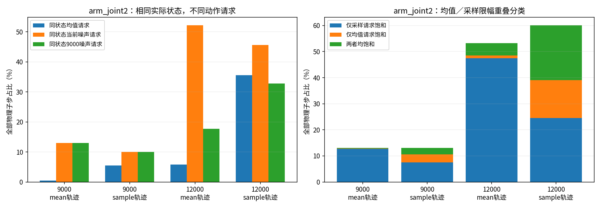
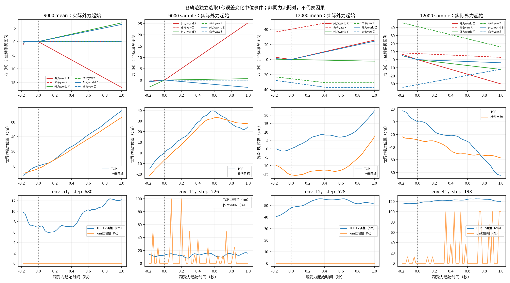
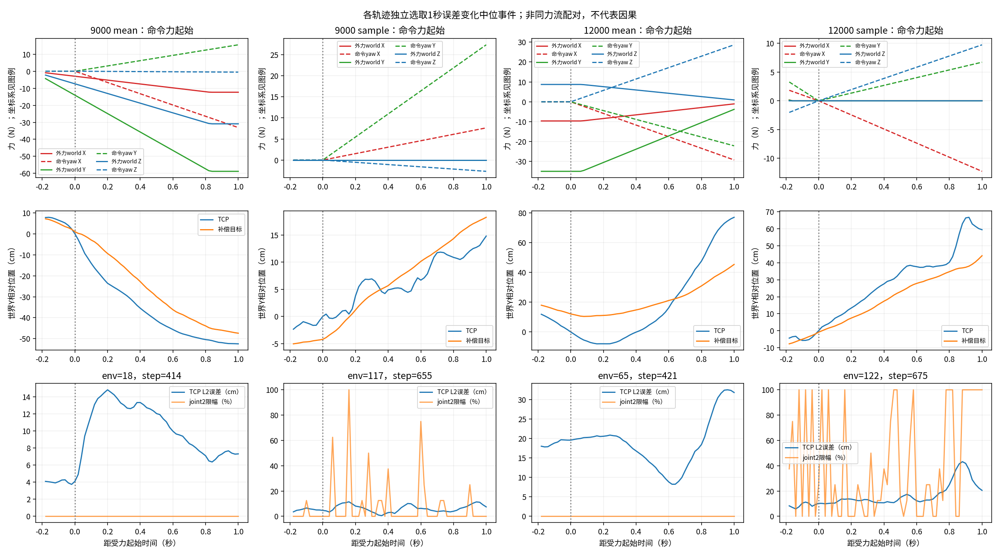

# B策略动作请求与执行分解报告

日期：2026-11-08。用户授权实施前两项只读定位：同状态均值／噪声请求分解，以及原B受力事件后的TCP响应。正式训练未停、参数未改，本轮无优化器、无策略更新，不启动新的正式或对照训练。

## 核心结论

**当前证据支持两个问题并存：探索噪声明显放大即时力矩饱和，均值策略自身也已丢失较好的任务跟踪与协调能力。** 不能再把“44%左右饱和”直接理解为机器人在多数任务上先天力矩不足；同一12000存档换成均值执行，joint2饱和约5.83%，误差仍31.62cm。

在12000均值轨迹同状态上，当前std请求joint2限幅52.22%，9000std请求17.66%，均值请求5.83%。这直接证明即时请求对噪声尺度敏感，但没有证明限制std重新训练一定能恢复均值策略。实际采样轨迹中的状态已受到过去噪声影响，那里即使去掉本步噪声，joint2仍有35.57%的反事实请求限幅。

仅命令力的窗口恶化比仅实际外力更明显，提示应优先检查任务命令／目标表征到协调动作的学习，而不能只盯辅助估力头。该事件观察未控制状态分布，不能当成已确定的命令通道bug。

## 1. 采样、反事实与控制器一致性

9000／12000各跑mean和sample两条独立128环境×1000策略步轨迹，共512000策略transition；每关节每轨迹覆盖1024000个真实物理子步状态。每个子步在同一q／qdot／episode执行系数上计算三个候选：均值、同均值＋当前std噪声、同均值＋9000std噪声；噪声方向完全相同。仅当前轨迹mode的原控制器力矩真正提交。

分解原clip_actions、执行系数、位置／轮速目标裁剪、P项、速度项、最终力矩限幅。四组实际提交与分解器逐子步最大差均0 N·m，三个候选也在初始同状态上逐个与原控制器核对通过。原先控制器未被覆盖或更改输出。位置／轮速目标单位不同，归档按策略顺序存放；详细口径见[检查口径](检查口径.md)。

| 存档／实际轨迹 | TCP L2均值（cm） | 物理失败次数 | 同状态均值joint2限幅 | 同状态当前噪声joint2限幅 | 同状态9000噪声joint2限幅 |
|---|---:|---:|---:|---:|---:|
| 9000／mean | 12.32 | 1 | 0.45% | 13.00% | 13.00% |
| 9000／sample | 12.94 | 2 | 5.54% | 10.06% | 10.06% |
| 12000／mean | 31.62 | 9 | 5.83% | 52.22% | 17.66% |
| 12000／sample | 33.37 | 23 | 35.57% | 45.64% | 32.78% |

各轨迹都为20秒／128环境的新episode。失败是事件次数，不是同分母正式验收失败率；mean与sample会因运动与reset分歧而产生不同后续状态、事件与任务流，不能把跨轨迹差值当严格因果。

同状态分类尤其说明差别：在12000均值轨迹，约47.43%子步属于“均值未限幅、加入当前噪声才限幅”，共同限幅约4.79%；但在12000采样轨迹，sample_only约24.58%、mean_only约14.50%、both约21.06%。不能把当前std到旧std的即时占比差当作长期可减少失败的比例。

## 2. 均值策略还有哪些问题

在均值轨迹中，9000→12000的TCP误差12.32→31.62cm；机械臂全部关节在当前策略区间内均未限幅的样本比例为98.46%→90.04%，这些样本的误差仍为12.22→29.73cm。这是条件观察，不能排除先前饱和、惯性、底盘饱和和任务难度的作用；但足以反驳“只要取消本步机械臂限幅，精度就自然恢复”。

均值请求的四轮速度目标需要限速裁剪的比例，从9000约0.08%／0.30%／1.67%／0%，增加到12000约22.06%／24.64%／27.67%／22.63%。arm_joint1／4／5位置目标裁剪从0%／10.20%／6.09%增至17.91%／19.33%／29.62%。它们可能与限位附近姿态和策略请求偏置有关，尚不能认定某个动作索引接错或奖励权重错误。

原始动作的±100全局裁剪极少，12000均值轨迹约0.008%的动作元素触发，不是当前最主要的裁剪位置。重要非线性集中在真实关节／轮速目标和力矩边界。

joint2均值请求的“8子步平均力矩绝对值再平均”从8.80增至15.86 N·m，P项对应10.37→20.98、速度项4.96→8.03 N·m；分量可抵消，绝对值不能相加。归档分量是子步平均而不是峰值，不能据其低于40便判定无子步饱和。

## 3. 受力切换后的目标与TCP响应

分别检测实际world外力与yaw命令力从0进入非0的事件，在0.1／0.5／1秒统计。前目标用本步pending外力和当前root；后目标用实际applied外力和执行后root。保存reset前终止步，并把跨reset、物理失败、startup、push、另一力onset单列。总体代数核验：误差平方变化可精确拆为TCP位移项、目标位移项和二阶项；误差<1e-4 m²。

这一步不能把外力推动TCP误判为Actor主动补偿，也不能要求TCP追赶一个已不再使用的冻结world目标。原任务几何目标随root和轨迹命令移动：9000均值轨迹外力onset后1秒，几何目标位移中位约28.1cm、补偿目标约36.6cm；12000约32.4cm／37.7cm。world方向与短时误差变化均会受到这些移动影响。

下表筛选**非startup、整窗无reset、无push、无另一力onset且另一股力全窗为0**的1秒窗口；底盘和几何目标仍按原任务运动，既有状态误差也没有匹配。所列为窗口末TCP L2误差中位数，不是各次受力单独造成的误差或正式验收结果。

| 存档／实际轨迹 | 仅实际外力窗口数 | 1秒末误差中位（cm） | 仅命令力窗口数 | 1秒末误差中位（cm） |
|---|---:|---:|---:|---:|
| 9000／mean | 63 | 11.67 | 76 | 10.03 |
| 9000／sample | 66 | 11.26 | 66 | 9.79 |
| 12000／mean | 68 | 12.15 | 87 | 37.09 |
| 12000／sample | 79 | 13.54 | 58 | 29.04 |

实际外力会真实作用在末端刚体COM，也进入补偿目标；命令力仅定义目标，不作为第二股实际注入力。因此两类响应差异在机制上有意义，但本次观察仍不能将外力工况较好直接归功于正确主动控制。12000命令力窗口恶化值得优先做状态与方向匹配的对照，再审计命令／目标输入到Actor利用的调用链。

保留了全部事件及world／yaw主轴正负、1秒内力模峰值0—30／30—60／60—110N分组，见[analysis.json](analysis.json)的`isolated_direction_magnitude_groups`。幅值是向量模，不是每轴上限；分组后许多格只有少数样本，不能据单格定论。末端始终运动，冻结onset目标误差只作为代数参照，负值不作为失败判据。

代表图按独立轨迹1秒误差变化的中位事件选取，非最佳样本；只排除reset／startup／push／另一力新onset，可能保留已经存在的另一股力，因此第一行两股力均展示。表格的“仅一种力”筛选更严格，两者不能混用分母。每个窗口并未固定目标、姿态和任务速度，图不作为策略错误的单独证明。

## 4. 结论与下一步

1. 已证实即时噪声显著增加请求限幅；H1得到支持。
2. 均值策略也退化、轮速和关节目标频繁裁剪，且大量当步臂未饱和时仍误差大；仅执行器限幅不能解释全部问题。H2需要同时看策略协调与历史状态，不能只调低推理std。
3. 目标运动确实足以混淆简单方向判断；H3成立为分析限制。新数据没有证明“所有补偿动作都方向反了”，也没有发现原控制器分解与实际代码不一致。
4. 下一项应先用现有观测和Actor做命令通道／目标坐标的同输入敏感性审计，确认正负命令力、底盘yaw与目标输入的对应；这不更新权重、不擅改坐标定义，仍需用真实响应检验，反事实输入敏感性不等同正确控制。之后设计一个从9000完整状态承接、仅限制探索尺度的独立训练对照，与原参数对照同预算比较均值精度与全部子步饱和。若标准差控制后均值仍退化，再分别隔离奖励权衡／共享表示，不同时改多项。

当前检查未授权或实施奖励／熵／动作缩放／PD参数修改，未修改资产或取消碰撞终止；不把原生可运行当效果验收通过。

## 5. 完成核验与训练状态

四条轨迹全部returncode0；[verification.json](verification.json)保存12个原生执行脚本／原始数据跨端SHA一致证据，以及手算单测、128×1000×8、零更新与原控制器一致性核验。所有NPZ数组有限，限幅重叠分类与总量一致、P＋速度项与限幅前力矩一致、误差位移恒等式通过；归档结果重新分析入口为`/usr/bin/python3 analyze_execution.py`。

2026-11-08T19:38:34.089895+08:00只读检查：正式PID1981990存活，累计12471轮，最新标量有限、无新run/failure.json；本轮wrapper及回放进程全部退出，见[运行快照](final_runtime_check.json)。下一完整观察16000、原累计40000预算保持。以上图表是9000／12000存档的独立补测，不是当前在训策略的实时评估。
