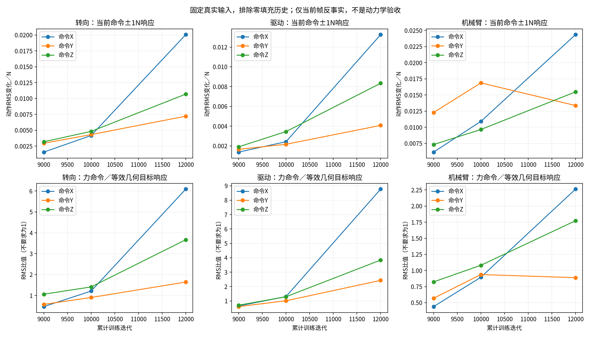

# B阶段命令力、目标坐标与Actor利用审计

日期：2026-11-08。用户授权继续执行只读诊断下一项；本轮不修改业务源码／训练参数／资产，不启动对照训练、不停止正式seed1。全部计算为CPU推理或无仿真的tensor fixture。

## 核心结论

**未发现命令槽位、0.01缩放、yaw/world转换、Actor读取末帧的明确代码接线错误。Actor没有忽略命令力；其响应在后段明显增强，尤其X命令对底盘动作的敏感性增长，结合此前均值目标频繁裁剪与噪声限幅，更支持策略响应／协调与执行边界匹配失衡。** 这仍不等于已证明唯一根因，也不等于正负动作在动力学上全部错误。

本轮把“命令可见”与“控制正确”分开：60组原方法确定性构造通过；七组真实历史共1120条，对三个存档作同输入反事实推理，得到252条分组记录。旧历史、物理状态输入固定，只改当前帧的±1N／±10N命令；三组模型不发生更新。

## 1. 实际通道及与官方的对应

| 数据／环节 | 当前V3位置 | 单位／坐标 | 核对结果 |
|---|---|---|---|
| 几何目标命令 | commands3:6→Actor46:49 | radius m、elevation/azimuth rad；缩放0.5/1/1.3 | Actor仍见几何目标 |
| 末端命令力 | commands9:12→Actor52:55 | yaw系N×0.01 | 正负／XYZ槽位正确 |
| 刚结束区间实际人工外力 | applied_world→external_yaw→labels6:9 | 当前yaw系N×0.01 | 不直接进入Actor |
| 待施加人工外力 | pending_ee_force_world | world系N | 不覆盖刚发生受力的标签／特权帧 |
| 补偿目标 | Critic95:98 | 任务yaw球坐标×0.5/1/1.3 | 解码world与独立公式一致 |
| 当前Actor帧 | 历史1856末尾58维 | 32×58，当前帧在最后 | 旧31帧保留、末帧追加正确 |
| 动作均值 | Actor(current58, Encoder(history1856)) | 14维无量纲策略动作 | 与原update_distribution完全一致 |

源码依据：`UniFP_v3/legged_gym/envs/v3/legged_robot_v3.py:30`、`:654`、`:668`、`:979`、`:1010`、`:1626`、`:1649—1738`；`v3_actor_critic.py:154`附近。具体记录见[research.md](research.md)。当前与冻结运行源码的环境／Actor／PPO三个文件SHA逐项一致。

官方`UniFP/legged_gym/envs/b2/legged_robot_b2z1_pos_force.py:375—423`同样让Actor见commands、将补偿球目标仅放Critic；`:1890—1900`的奖励公式同样为几何world目标加上world人工外力与yaw命令旋转后的和除以K。V3与官方目标点、自由度和组织时序有既有迁移差异，但本轮未发现命令应当直接施加而被漏施的情况；命令力本来用于定义任务，不是另一股人工注入力。

Actor没有绝对yaw角并非此处缺槽错误：任务目标和命令均按yaw局部系表达。机器人转向时，同一个局部+X命令会在world中旋转；不能期待Actor在输入完全不变时，仅因世界yaw改变就输出不同动作。人工外力标签另以当前yaw逆旋转。

## 2. 60组坐标与帧构建核验

覆盖yaw=-180/-90/0/90/180度、roll0.2rad／pitch-0.3rad、XYZ各±30N命令、实际外力有／无，且root实际Z故意不同于目标名义Z。独立手算使用R_yaw、名义任务center与K200，不直接复用被测球坐标转换。

- Actor命令槽最大误差0；0.01缩放保持。
- 几何world目标、补偿world目标、Critic球目标反变换最大误差约2.384e-7m（0.238微米）。
- yaw外力监督缩放最大误差约2.98e-8。
- 改pending外力不改变当前已发生状态的Actor／Critic／标签；改人工力标签缓存不改变Actor。
- 原_publish_observations保留旧31帧，并仅将原构建出的当前Actor帧放在末尾；命令槽没有观测噪声。

例：yaw0、命令+X30N→world目标+X0.15m；yaw90度、命令+X30N→world目标+Y0.15m；yaw90度、命令+Y30N→world目标-X0.15m。完整60组结果见[tensor_audit.json](tensor_audit.json)。

本轮未新建物理仿真；step中先结算、后推进事件／发布的结论来自实际源码审计及此前已通过的时序证据，不能将这60组tensor构造宣称为新的原生物理验收。首次尝试复用完整step测试fixture时，远程运行环境缺pytest而未导入成功；随后改用仅依赖unittest的原奖励／帧fixture并补齐必要tensor，无安装依赖、不修改tavis或训练环境，最终60组全部通过。

## 3. 相同真实输入下的策略响应

七组已有真实观测各160条，交叉9000／10000／12000模型；在每条相同输入上，当前帧某个命令力分量增加／减少1N，取动作均值差除以2N。旧31帧、所有身体观测、上一动作和其他命令不变，超出训练每轴±60N范围的样本不计；另对±10N复核。不是将32帧历史一律改成不真实的恒力。

主表排除历史第一帧仍为zero padding的样本，XYZ有效数分别1005／999／1006（七probe汇总）；包括padding的结果也独立保留。每个存档对完全相同样本计算，单位为动作组RMS／N，组内是策略动作，不能将转向、驱动、机械臂数值当作相同物理单位直接比较。

| yaw命令轴 | 动作组 | 9000响应RMS/N | 10000 | 12000 | 12000/9000 |
|---|---|---:|---:|---:|---:|
| X | 转向 | 0.00156 | 0.00417 | 0.02006 | 12.89 |
| X | 驱动 | 0.00138 | 0.00243 | 0.01325 | 9.60 |
| X | 机械臂 | 0.00617 | 0.01092 | 0.02434 | 3.95 |
| Y | 转向 | 0.00295 | 0.00431 | 0.00721 | 2.44 |
| Y | 驱动 | 0.00166 | 0.00217 | 0.00408 | 2.46 |
| Y | 机械臂 | 0.01229 | 0.01687 | 0.01337 | 1.09 |
| Z | 转向 | 0.00319 | 0.00482 | 0.01069 | 3.35 |
| Z | 驱动 | 0.00192 | 0.00345 | 0.00834 | 4.35 |
| Z | 机械臂 | 0.00733 | 0.00966 | 0.01548 | 2.11 |

**X命令的转向／驱动／机械臂响应增长约12.9／9.6／3.9倍，Z命令约3.4／4.4／2.1倍。** 七个probe各自的X命令转向增长均约12.3—14.0倍、驱动8.0—11.3倍，说明并非只由一组特殊输入拉高；这些probe相关，不能按独立训练seed计算置信度。±10N的单位响应也维持同样方向的量级，完整数据见[policy_response.json](policy_response.json)、[response_summary.json](response_summary.json)。

这说明Actor确实利用命令力，而且其局部响应增强。动作均值对命令敏感不等于稳态补偿增益、更不等于命令到真实TCP的物理传递增益；若动作本已靠近关节／轮速边界，输出变化可能继续被裁剪。当前尚无依据通过提高跟踪奖励来让它“看见命令”，也不能仅凭敏感性倍数确定应该把哪个奖励改成多少。

## 4. 同等目标平移与网络两路径

内部参考：当前力命令±δF会使同状态补偿目标平移±δF/200m；另将几何目标在yaw系平移相同距离、重新转球坐标，只修改当前几何命令46:49。保持外力／其他命令不变，比较两种输入的动作响应。此参考不是性能基准：未来任务轨迹、命令语义、奖励历史不同，两种动作不要求完全相同或比值等于1。几何目标反事实也可能靠近原采样边界，仅作为局部网络对照。

排除padding后，12000的X力命令／等效几何平移响应RMS比约6.09（转向）／8.77（驱动）／2.26（臂），9000约0.47／0.65／0.44。力命令路径相对几何目标路径明显增强，且增长不均匀，构成协调失衡的线索。不能因两者动作余弦相似度降低，就认定某个world坐标轴符号反了。

同一当前命令既进入Actor的当前58维，也改变Encoder输入中的末帧。按固定顺序精确分解：总动作变化=固定旧latent下的当前帧效应＋新当前帧下的Encoder效应，逐样本恒等式通过；路径RMS不能直接相加或当百分比分责。

对X命令+1N，9000的直接路径RMS约0.00156／0.00137／0.00597，Encoder路径约0.00018／0.00007／0.00026；12000分别约0.01288／0.00820／0.02048与0.00795／0.00525／0.00483。两个路径的响应都有变化，**不能把全部异常归为Encoder，也不能仅凭这个分解认定辅助更新造成了异常。** 此前同参数点梯度没有持续反向冲突，与本轮表示敏感性变化不矛盾。

## 5. 本轮结论与下一步

本轮缩小了问题范围：

1. 未发现明确输入／坐标接线错误，暂不需要修改命令缩放、旋转公式或直接把Decoder估力接到Actor。
2. 不是Actor完全看不到或忽略命令，后段对X／Z命令反而明显更敏感；结合上一轮均值精度退化、目标裁剪和噪声限幅，优先考虑训练中策略响应及协调发生漂移。
3. 不能从动作敏感性直接判断动态方向正确；若需要定位某轴的真实闭环增益，应使用匹配起始状态与受控命令的独立短回放，明确目标／底盘运动和命令事件是否改变，不能将本轮CPU反事实冒充该验证。
4. 修改优先级仍为先设计从9000完整学习状态承接的单变量探索尺度对照，保留原奖励、PD、动作缩放和资产，比较同预算的均值精度、噪声执行、目标裁剪和全子步饱和。仅降推理std无法回退已经漂移的均值；从12000恢复与从9000避免退化应分开。

本轮没有启动上述训练或调整任何参数。探索控制能否防止均值响应失衡，仍需训练对照；若不能，再分别隔离PPO更新稳定性、奖励权衡和共享表示，不能用一次多项改动宣称原因已查明。

## 6. 完成与可复核性

[verification.json](verification.json)核验通过：60组tensor、7数据集／1120输入／3检查点／252记录，四个原生执行／结果文件跨端SHA一致，环境／Actor／PPO三个本地与冻结源码SHA一致，七个真实观测输入与checkpoint来源SHA一致。所有新增函数完整类型标注和英文docstring、AST通过；与原策略均值完全一致、命令干预只改指定槽、旧历史逐值不变、网络路径分解恒等式均由运行脚本断言。

运行：远程专用Python执行[audit_tensor_chain.py](audit_tensor_chain.py)与[audit_policy_response.py](audit_policy_response.py)，CPU两线程、未创建仿真或优化器；本机`/usr/bin/python3 summarize_audit.py`重算表与图。命令、来源和限制见[审计口径](审计口径.md)，最终统计脚本为[summarize_audit.py](summarize_audit.py)。

2026-11-08T20:06:22.429251+08:00只读检查正式PID1981990正常、累计12569、最新标量有限、无新run/failure.json；本轮审计进程均退出。下一完整观察16000、原累计40000预算保持，详见[运行快照](final_runtime_check.json)。这里的实时检查只是快照，不承诺持续后台监控。
