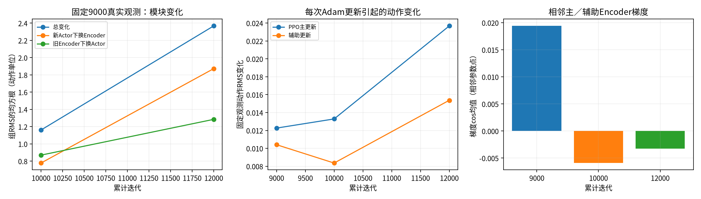
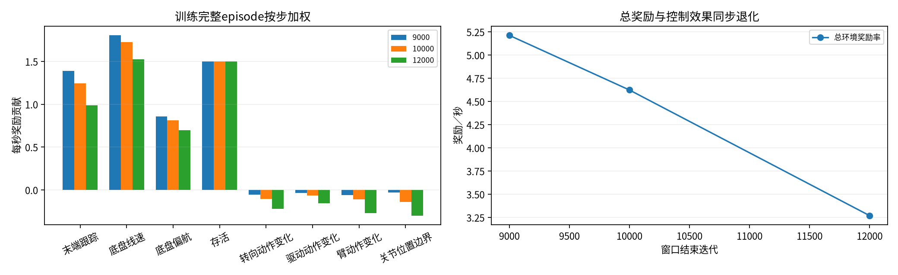
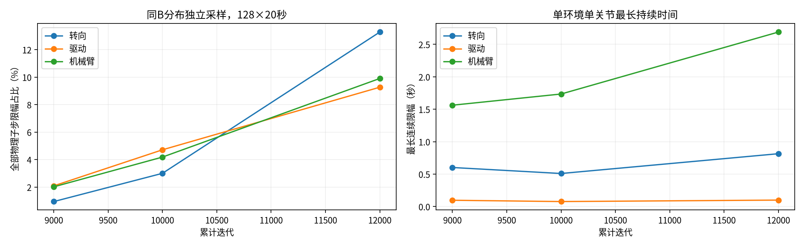

# B阶段策略退化：共享表示、奖励、饱和与可达性顺序检查

日期：2026-11-08。本轮按用户指令继续上轮诊断，检查9000、10000、12000三个存档。正式seed1维持原参数运行，不改资产、奖励、PPO、终止规则或预算；所有诊断使用独立进程与输出目录。

## 核心结论

四项顺序检查已完成。**目前证据最强的是探索动作尺度与PD执行余量不匹配，并伴随已退化的均值策略；尚未确定唯一训练根因。** 奖励记账检查通过；共享Encoder确有耦合，但同参数点梯度不支持持续反向冲突；补偿目标少量越界和静态超载不能解释普遍退化。正式训练持续，本轮没有修改业务源码、资产或任何训练参数。

检查分清三种操作：原生采样推理每组策略更新0次；为观察更新影响，独立内存副本各执行原PPO 1轮；正式训练进程没有被诊断更新或重启。三组采样、IK、梯度和身份核验均已完成，不存在待运行的本轮后台实验。

## 1. 共享latent与两个更新

### 1.1 同一真实观测输入下的模块交叉检查

使用上轮七组真实历史各160帧，共1120条1856维输入；每组分别送给三个Encoder，并交叉给三个Actor，不运行仿真或更新。12000与9000的latent平均余弦相似度约0.636—0.845，latent变化RMS相对9000原RMS约0.855—0.964。表示确实改变，但网络内部表示可重新组织，**这本身不等于错误或遗忘根因**。

固定9000真实观测，分别只替换Encoder或Actor都会改变动作，说明二者都有变化。分解严格满足“总动作差=新Actor下的Encoder效应+旧Encoder下的Actor效应”，但RMS因方向不同不能直接相加或当百分比分责。混合模块并非正式策略，存在表示不匹配，不能把换回旧Encoder当修复。

### 1.2 直接观察一轮原PPO与辅助更新

每个检查点在独立GPU进程跑128环境×1000策略步、原B分布与采样动作，保存中间真实24步rollout。所有推理采样结束、仿真销毁之后，恢复该存档的双Adam与lr，在内存副本执行原`V3PPO.update()`：20次主更新＋20次辅助更新。每次Adam前后都读取同一批留出历史的动作、latent和估力；观察器只调用原step一次，不修改梯度，不写策略存档。

这实际验证了辅助更新经共享Encoder改变Actor动作；但该小rollout不是正式4096环境更新，不能把变化幅度外推为训练中的真实幅度。相邻更新梯度处在略不同参数点；另用保存rollout、恢复相同参数，在三个互不重叠1024样本子集上核对同一点的PPO／辅助梯度，避免把相邻梯度当成严格冲突证据。

原生CPU/GPU的旧策略logp最大差须<1e-3，保证比较的确使用同一旧策略。梯度cos正／负只说明该批次局部方向一致／冲突；PPO损失含采样回报噪声，不能靠少量cos判定长期因果。Adam有独立历史，原始梯度范数也不等于参数更新比例。

本轮检查足以证实共享表示会传递辅助更新，尚不能证明它是退化主因，也没有发现需立即断开共享Encoder的代码接线错误。具体数值见下表、[latent_crosscheck.json](latent_crosscheck.json)、[update_summary.json](update_summary.json)和[same_point_gradients.json](same_point_gradients.json)。

### 1.3 完整结果

动作RMS为每次Adam更新前后，在固定留出输入上计算的动作变化，再对20次更新取均值，单位为策略动作单位；不直接等于关节角或力矩。

| 累计迭代 | PPO主更新动作RMS变化 | 辅助更新动作RMS变化 | 相邻主／辅助梯度cos均值 | 相邻负cos次数／20 |
|---|---:|---:|---:|---:|
| 9000 | 0.012265 | 0.010408 | 0.019409 | 13 |
| 10000 | 0.013289 | 0.008359 | -0.005914 | 11 |
| 12000 | 0.023681 | 0.015372 | -0.003230 | 10 |

下表是在完全相同参数点上，对三个互不重叠的1024样本子集计算的Encoder梯度cos；这是判断局部方向的较直接证据。

| 累计迭代 | 子集1 | 子集2 | 子集3 |
|---|---:|---:|---:|
| 9000 | -0.11354 | 0.39428 | 0.03980 |
| 10000 | 0.02891 | 0.01163 | -0.03048 |
| 12000 | 0.03535 | 0.01741 | 0.07324 |

**12000轮三组均为小正值，不能认定辅助目标持续与PPO对抗。** 这些梯度多数接近正交，也不表示两种目标始终互相促进。CPU／GPU旧logp最大差为9.73e-5，小于身份检查阈值1e-3。私有副本中辅助更新后的留出估力MAE平均每次上升约0.031／0.039／0.036 N，是单个小rollout的局部泛化现象，不证明长期辅助训练有害。

## 2. 奖励权衡与记账

复用已核验SHA的完整401414条训练episode汇总，逐窗口按episode步数加权，使用实际`episode_metadata.json`中的23项配置权重。窗口为累计8801—9000、9801—10000、11801—12000；episode按结束时刻归窗，跨窗episode保留完整时长，不能当严格截断的逐step窗口。所有分项之和与reward_return/duration一致；补充采样另在每个策略步核对实际返回reward，计入dt且保留负值。

| 窗口结束迭代 | 总奖励率 | 末端跟踪贡献 | 底盘线速贡献 | 底盘偏航贡献 | 动作变化三组合计 | 关节位置边界 |
|---|---:|---:|---:|---:|---:|---:|
| 9000 | 5.212 | 1.388 | 1.804 | 0.855 | -0.153 | -0.030 |
| 10000 | 4.623 | 1.243 | 1.727 | 0.811 | -0.281 | -0.143 |
| 12000 | 3.269 | 0.986 | 1.527 | 0.697 | -0.652 | -0.300 |

存活项约1.5始终相同。9000→12000奖励率下降约1.943，其中三项跟踪合计下降0.837、动作变化惩罚恶化0.499、位置边界惩罚恶化0.271，其他项共同贡献其余下降。末端跟踪误差由13.09增至32.83 cm。

**没有发现奖励求和、符号或dt错误，也没有出现牺牲跟踪却换来更高总环境奖励的现象。** 这是优化效果同步恶化，不能仅凭动作惩罚变大就认定其权重太大而应该降低；动作变激烈本身也会使惩罚变大。奖励数值贡献不同于策略梯度贡献。

熵奖励属于PPO loss，独立于上述环境奖励。std增大且entropy_coef=0.01是需要进一步隔离的机制，但不能把无量纲熵loss与每秒环境奖励直接相减。完整记账见[reward_check.json](reward_check.json)。

## 3. 执行器饱和

本轮重新采样三个检查点，回读每个策略步的全部8个物理子步，而不是只看最后一个子步。每组1000×128×8=1024000个“子步×环境”，每关节各有这么多样本。限幅定义为原控制器提交的力矩绝对值达到effort的99.9%；不把它冒充原生电机力传感器读数。连续时长在局部reset时清零。

| 累计迭代 | 补测TCP L2均值（cm） | 转向限幅（%） | 驱动限幅（%） | 机械臂限幅（%） | arm_joint2限幅（%） | joint2最长连续（s） | 臂任意单关节最长连续（s） |
|---|---:|---:|---:|---:|---:|---:|---:|
| 9000 | 12.86 | 0.95 | 2.09 | 2.02 | 9.83 | 1.3475 | 1.5625 |
| 10000 | 17.86 | 3.00 | 4.71 | 4.18 | 20.41 | 1.5700 | 1.7350 |
| 12000 | 32.84 | 13.28 | 9.27 | 9.90 | 44.73 | 1.8775 | 2.6900 |

转向／驱动／机械臂是各组关节的平均占比，不是“任一关节饱和”的概率。全部8子步的真实提交力矩表明，第二关节由9.83%增至44.73%限幅，12000轮机械臂单关节最长连续限幅约2.69秒。三组普通物理失败分别2／0／14次；独立噪声路径不同，不与上一轮探针失败数做严格配对。

joint2的P增益约300.072 N·m/rad，位置动作缩放0.25 rad/动作单位，effort40 N·m。固定状态且忽略执行随机系数、目标及力矩限幅时，动作噪声产生的P项标准差敏感度为`Kp × action_scale × std`：

| 累计迭代 | joint2动作std | 位置目标扰动std | 限幅前P项波动量级 |
|---|---:|---:|---:|
| 9000 | 0.316 | 0.079 rad | 23.68 N·m |
| 10000 | 0.439 | 0.110 rad | 32.91 N·m |
| 12000 | 0.807 | 0.202 rad | 60.56 N·m |

60.56大于40说明请求尺度对执行器很激烈，但不能直接推导实际饱和概率，实际有目标裁剪、重力、速度和位置偏差等因素。它与真实子步限幅增长形成一致线索。上一轮只降诊断std减少失败却不恢复精度，说明即使缓解饱和，也不能自动修复已经退化的均值策略。

## 4. 目标可达性与静态负载

每10策略步保存128环境reset前状态，各组12800个快照。使用活动V6 URDF、真实root旋转和平移将目标变换到base坐标。链长三角不等式给出以joint1原点为中心、半径0.996176 m的必要界：超出此界是该固定root下确定不可达；在界内仍未必可达。

每组几何／补偿目标各等间隔抽96个位置，在硬关节限位内用实际关节角、名义角、中点和三个确定随机起点做位置IK，残差<1 mm记为找到位置解。IK失败保留为“未确定”；没有检查碰撞、末端姿态、轨迹连续性、速度或动力学，找到位置解不等于可以稳定执行。

解析TCP Jacobian经有限差分核验；重力关节力矩经势能导数独立核验，最大差约2.6e-9 N·m；1000个随机FK点均在链长必要界内，见[kinematic_verification.json](kinematic_verification.json)。

原B目标XY随底盘平移并按yaw旋转，Z参考名义高度，见`legged_robot_v3.py:979`附近。**不能简单以“底盘开过去”解决相对机械臂的补偿目标越界**；转向改变世界外扰相对方向或root姿态变化仍会改变条件，本轮没有证明全部动态调整都无效。固定墙使用独立世界目标，应另行解释。

静态负载代理使用真实当前关节／root、实际人工外力、URDF上装mass/COM及存档tool质量增量，计算接触自由、固定root下的`-(tau_gravity + J_COM^T F_ext)`并与effort比较。不含惯性、接触和控制余量，既不代表全任务可行性，也不能把动态超限都归给外力过大。

若几何目标普遍有位置解、补偿目标仅少量越界，而实际饱和在很多子步发生，就不足以用“任务处处不可达／外力必然超载”解释退化。具体分母与IK结果见[workspace_check.json](workspace_check.json)。

| 累计迭代 | 快照数 | 几何目标超链长数 | 补偿目标超链长数／占比 | 补偿IK位置有解／超界／界内未解（96点） | 几何IK有解 | 任意臂关节静力代理超额占比 |
|---|---:|---:|---:|---|---:|---:|
| 9000 | 12800 | 0 | 132／1.031% | 91／0／5 | 96／96 | 0.727% |
| 10000 | 12800 | 0 | 126／0.984% | 93／1／2 | 96／96 | 1.250% |
| 12000 | 12800 | 0 | 112／0.875% | 95／0／1 | 96／96 | 0.969% |

第二关节单独的静力代理超额占比依次为0.203%／0.516%／0.336%。静态代理与实际动态限幅的分母和物理条件不同，不能相减当作原因占比；但它不支持“多数状态仅靠静态承载就已不可能”的解释。补偿目标超链长占比没有随误差恶化而增长，故不能把少量边界工况当作整体退化主因。IK未找到解不等同已证明不可达；96点子样本也不是全工况可行性证明。

## 5. 证据边界与后续

本轮未修改正式训练。额外一轮原PPO只在诊断副本内执行，不保存权重；正式model_009000/010000/012000哈希已重新核对，与此前一致。首批导出重名错误已修正并保留远程失败日志，不作为有效证据。

从问题范围看，应优先验证探索尺度与原PD执行限制的匹配，以及均值策略在B中的保持／恢复。共享Encoder有耦合机制，奖励权衡也需关注，但本轮不能据此认定唯一根因或直接改参数。少量不可达／超载样本应单列，不能用它们解释全部退化，也不应直接取消碰撞终止或继续大改资产。

依既定安排，正式seed1仍到累计16000同协议观察。若需验证修复，应另立清晰的单变量分支、固定父与协议，区分“从早期较好存档避免退化”和“从12000恢复已退化均值”；只调低std的推理对照不是重新训练实验。

本机复算入口：`analyze_rewards.py`、`latent_crosscheck.py`、`check_same_point_gradients.py`、`check_workspace.py`、`summarize_checks.py`。远程原生采样入口为[run_checks.py](run_checks.py)和[collect_checks.py](collect_checks.py)，使用原项目Python、Gym SDK、冻结源码和GPU3；具体参数见[检查口径](检查口径.md)。本机和远程均保留本轮rollout及留出输入；摘要、NPZ和脚本可在本机复核。远程失败导出记录保留在`failed_export_r01/`，不计入有效结果。

## 6. 完成与身份核验

[verification.json](verification.json)核验通过：三组均128环境×1000策略步，23项奖励逐步求和检查通过；全部NPZ数组有限，饱和率在[0,1]，数组均值与摘要一致；每组20次主更新＋20次辅助更新仅发生在私有副本；IK分类计数完整；三组检查点与原始401414条episode来源SHA保持一致。本机与远程18个执行脚本／原始结果文件SHA逐项一致。所有本轮Python脚本AST解析通过。

[final_runtime_check.json](final_runtime_check.json)记录交付前训练快照和本轮诊断退出状态；实时轮数以远程新run的`iterations.jsonl`为准。图表展示的是9000／10000／12000存档补测，不能当作当前在训策略的实时评估。
