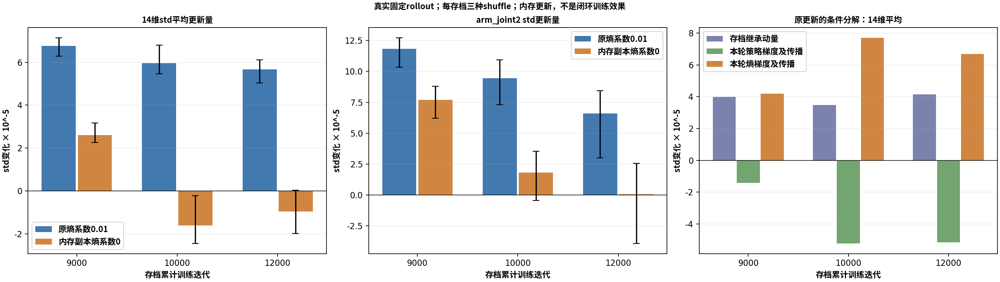

# B阶段标准差为何增长：更新来源检查

日期：2026-11-08。结论：**在已保存的真实小rollout上，熵项是持续推动std增长的直接因素；后段PPO策略梯度已有压低平均std的趋势，但原更新仍使std增长。** 这比“噪声与退化相关”前进一步，尚不是整段训练退化的唯一因果证明，也不是闭环修复完成。

## 检查范围与可信度

复用9000／10000／12000各自的24×128条真实rollout，恢复对应完整模型、双Adam和实际学习率；每个存档用三种固定shuffle seed（3101／3102／3103）各执行一轮原PPO，即20次主更新和20次辅助更新。三种shuffle来自同一批数据，**不是三个独立训练seed**。没有新仿真，不采集新轨迹，不保存更新后模型，不干预正式训练。

在私有副本上用不替换梯度的hook读取std梯度，原Adam每次恰好执行一次。9000／3101另作无观察器原更新，模型全部参数、双Adam全部状态和损失与观察版逐位相同。180次主更新的Adam变化重建最大单步误差5.93×10^-8，20次累加最大误差2.85×10^-7。旧logp身份、解析熵梯度／高斯score、value对std无直接梯度、参数组顺序、实际lr及原文件SHA均核验。

最终证据含9轮原更新、9轮配对零熵副本和1轮观察器中性回放，共19个私有单rollout更新。此前完善动量展开口径的两次初测各10轮，合计实际执行39个私有更新；初测不是额外独立样本。正式策略被诊断更新次数为0。

## 1. 哪些模块在推动std

主损失为`L_surrogate + c_value*L_value - 0.01*H`。std只直接接收surrogate与熵梯度，value路径不依赖std，辅助Adam不持有std。状态无关对角高斯的每维熵损失梯度为`-0.01/std_i`，因此梯度下降方向始终推动std增大。它不会主动识别某个关节PD是否已经饱和。

但“熵梯度始终向上”不能说明全部更新都由熵造成：surrogate可能同向或反向，全主参数一起裁剪，Adam还携带过去的两类信号。因此同时测量实际20次更新，并沿momentum递推分开追踪三部分：存档继承的首阶动量、本rollout的策略梯度及后续传播、本rollout的熵梯度及后续传播。各步固定实际二阶矩分母，三项可以重建更新；不能把这种条件分解当作移除熵后的真实结果。

以下为三种shuffle、14维动作的平均std更新量，单位均为`10^-5`：

| 存档 | 存档继承动量 | 本rollout策略梯度及传播 | 本rollout熵梯度及传播 | 原更新净变化 |
|---|---:|---:|---:|---:|
| 9000 | +3.98 | -1.41 | +4.20 | +6.76 |
| 10000 | +3.48 | -5.22 | +7.69 | +5.95 |
| 12000 | +4.15 | -5.16 | +6.68 | +5.67 |

10000与12000两个存档的三种shuffle中，本rollout策略项都倾向降低平均std；熵项与继承动量将其抵消后，净更新仍向上。9000的arm_joint2策略项反而向上，说明任务／关节不同，不能概括成“PPO始终正确而熵始终有害”。继承动量混合了过去的信号，不能全部归给熵。全局梯度缩放系数约0.0186—0.1292，共同缩放两类即时梯度；不是熵绕过了梯度裁剪。

## 2. 真正执行一次配对零熵更新

另从每个完全相同的存档恢复副本，使用相同rollout／shuffle／采样RNG，只将该副本`entropy_coef`从0.01改为0，再调用原`V3PPO.update()`。保留可学习std、原随机采样、全部网络、双Adam历史、实际初始lr、KL自适应和主后辅更新。该副本重算自己的梯度裁剪、Adam分母与后续网络状态，**不是从原更新量中简单减去上一表的熵项**。

| 存档 | 原0.01：平均std变化 | 零熵副本：平均std变化 | 原0.01：joint2变化 | 零熵副本：joint2变化 |
|---|---:|---:|---:|---:|
| 9000 | +6.76 | +2.61 | +11.81 | +7.69 |
| 10000 | +5.95 | -1.60 | +9.46 | +1.83 |
| 12000 | +5.67 | -0.95 | +6.60 | +0.08 |

以上单位仍为`10^-5`，三种shuffle均值。10000平均std在三种shuffle下都转为下降；12000两次下降、一次微升，平均下降。12000的joint2变化范围为-3.91至+2.56，不能把平均接近0解释为所有样本／所有关节都停止增长。9000仍增长但速度减慢，符合继承动量和任务梯度仍起作用的事实。

## 3. 与官方相比，以及能够解释什么

官方有效配置`UniFP/legged_gym/envs/b2/b2z1_pos_force_config.py:315`同样为0.01；V3没有把官方的零熵配置抄错。PPO构造函数默认0.0被任务配置覆盖，不能混淆。当前证据支持：沿用官方熵系数，在V3当前动作映射、PD余量与受力任务分布中，可能使探索持续扩张，增加限幅与不稳定，并参与均值策略的后续退化。

此前已证实joint2 std约0.316→0.807，同状态噪声明显提高即时力矩限幅，且均值策略也退化。本轮补齐了“什么更新在推动噪声增长”的局部机制。**尚未证明**取消熵奖励能恢复均值策略、估力闭环、底盘跟踪或接触成功，也没证明9000—12000全部退化由该项造成。小批128环境的固定数据无法替代正式4096环境重新采样后的闭环对照；重复使用本批数据很多轮会变成过期数据训练，不能拿它模拟长训。

## 4. 恢复条件与下一步

std的Adam step在9000／10000／12000分别为180000／200000／240000，与每轮20次主更新一致；实际主lr为3.375e-5／3.375e-5／1.5e-5，双Adam均保留。未发现本次副本恢复丢失std动量或误用初始lr的问题。

下一项推荐做**只改熵系数的独立短程闭环对照**，暂不同时加std上界、冻结Encoder、重置Adam、改PD、奖励或力范围。具体可审阅草案见[单变量对照草案](单变量对照草案.md)，尚未获新训练预算或设计确认，未启动。现有正式训练继续原配置，下一观察点16000。

复算入口：[采集脚本](audit_std_updates.py)、[汇总脚本](summarize_std_audit.py)、[原始数据](std_updates.json)、[统计表](summary.json)、[完成核验](verification.json)、[训练快照](final_runtime_check.json)。远程来源为`/mnt/data_8THDD/myl_unifp_v3_stage1/validation/b_diagnostics_20261108_r01/std_update_audit/`；完整checkpoint与真实rollout保持原路径，来源SHA在原始数据中。

## 5. 完成与正式训练快照

2026-11-08T20:23:47.750222+08:00只读核对：gpuf3正式PID1981990存活、累计12629，最新标量有限、无新run/failure.json；本轮诊断进程全部退出。下一完整观察16000、预算40000保持。本机／远程脚本与原始结果SHA一致，三份真实rollout及本地／冻结三份PPO源码身份一致，报告链接与函数标注／docstring AST核验通过。进程查询排除了检查器自身，未将它误记为遗留诊断。没有修改业务源码、资产、正式训练参数或重启正式进程。
