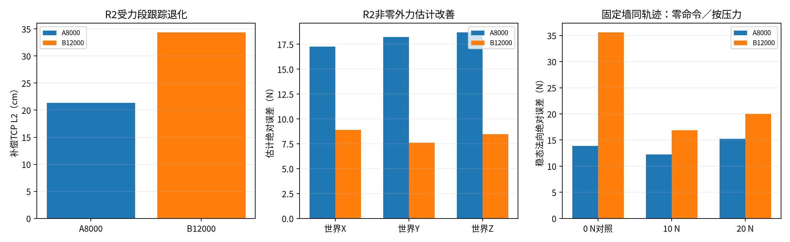
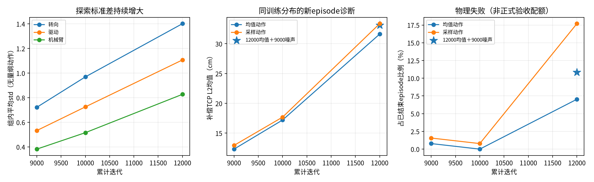
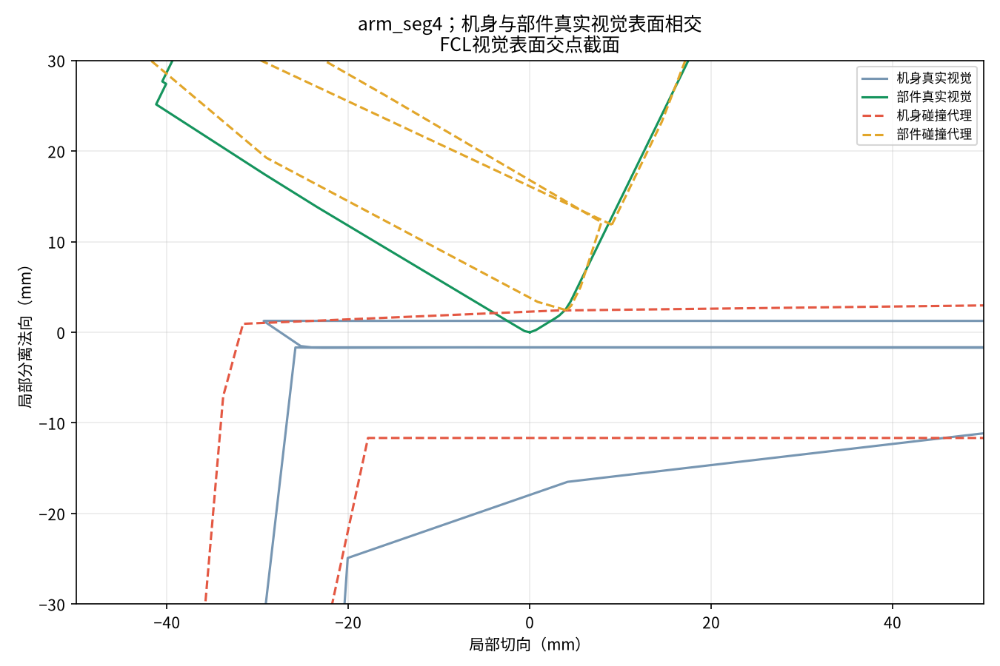

# B12000：补评估、策略变化与物理失败诊断

本次完成用户授权的三项只读诊断。正式seed1保持原资产、控制、奖励、PPO及预算继续训练；没有用诊断结果自动调参、停训或替换检查点。本报告中的12000为累计训练迭代，即A8000后新增B4000，尚非B终点。

## 1. 正式受力、接触和零力评估

全部补评估使用同一model_012000.pt，SHA256为`273d4269bc37e95f879d21b178bc0380e20d2539e2d9cfd7488296f049c3146c`。R2为32环境×3episode，固定墙接触为32×3，0 N墙对照为32×1；三组均`evidence_complete=true`、`policy_updates=0`。50项归档文件的SHA256全部匹配，见[evaluation_verification.json](evaluation_verification.json)。性能未过的`ungraded_or_incomplete`标签不表示缺测。

| 同协议指标 | A8000父模型 | B12000 |
|---|---:|---:|
| R2非零任务力段补偿TCP L2均值 | 21.35 cm | 34.34 cm |
| R2同段L2 P95 | 45.37 cm | 93.27 cm |
| R2非零外力估计XYZ MAE | 17.28／18.25／18.69 N | 8.90／7.59／8.45 N |
| R2物理失败 | 2/96 | 14/96 |
| 固定墙10 N成功 | 0/48 | 0/48 |
| 固定墙10 N稳态法向绝对误差 | 12.24 N | 16.89 N |
| 固定墙20 N成功 | 0/48 | 0/48 |
| 固定墙20 N稳态法向绝对误差 | 15.22 N | 20.00 N |
| 同轨迹0 N墙对照稳态法向绝对误差 | 13.90 N | 35.58 N |

**模型确实学到了部分外力估计，但这种改善尚未转化为闭环跟踪和稳定性。** 非零外力估计L2从35.20降到16.45 N；B的零外力估计XYZ MAE仍约3.16／3.11／3.16 N，存在残差。R2仅非零力逐轴估计及相对零预测基准的候选门槛通过，跟踪、底盘速度、失败率、零力估计、状态估计和push恢复均未过。整体未验收通过。

固定墙128个episode均未物理终止，但接触96个episode零成功。代表10 N轨迹存在明显过冲和接触丢失，20 N组稳态法向误差20 N对应未形成所需稳态按压力。这说明“未触发终止”不能等同“力控有效”。接触反力的估计仅作泛化诊断，不能与人工注入力监督指标混用。

这里有三种不同的“零力”：①已完成的S0/S1/S2自由空间零力回归，288episode零物理失败，TCP均值9.63／7.51／7.54 cm，A父为2.06／2.09／2.27 cm；②R2事件中外力或命令为零的片段，另一条力流仍可能非零；③固定墙0 N命令对照，沿与接触任务相同的靠墙轨迹，仍可能产生被动接触反力。35.58 N是第三种的稳态测量，不代表自由空间有35.58 N外力；0 N组不计按压成功率。

本项目已有N单位受力结果，取代此前“12000缺受力归档”的状态。此前[官方对比](../official_comparison_20261108/实验对比报告.md)中的官方代码个人复现实验，随机力B12000补偿L2约11.17 cm，但其机器人、力流、地形及协议不同，不能与V3 R2作严格倍数排名，也不是论文作者原始数据。

## 2. 策略与动作诊断的口径

CPU读取9000、10000、12000完整检查点；三个模型参数均有限、std均为正。转向／驱动／机械臂的组内平均std分别为：

| 累计迭代 | 转向std | 驱动std | 机械臂std |
|---|---:|---:|---:|
| 9000 | 0.722 | 0.533 | 0.382 |
| 10000 | 0.969 | 0.725 | 0.516 |
| 12000 | 1.401 | 1.107 | 0.827 |

14维全部增大，12000/9000约1.86—2.56倍；总高斯熵10.18→14.39→20.41 nat。冻结entropy_coef为0.01，实际主学习率为3.375e-5／3.375e-5／1.5e-5，辅助学习率1e-5。这些是事实，尚不能证明熵奖励是唯一根因。

三个模型还读取相同160×1856真实观测输入，动作均值也确实改变，排除“只有访问到的状态不同”这一解释。动作绝对值不能直接换算为关节弧度或力矩，需经过原动作缩放与控制器。clip=100未触发，也不表示力矩或关节目标无限幅。

独立GPU跑七组新episode：每组128环境×1000策略步，每步20 ms；沿原B训练分布保留力事件、命令与push，不创建优化器。mean使用网络均值；sample使用当前检查点std；sample_std9000仅在诊断中将12000采样std替换为9000值，网络均值及正式存档不改。动作噪声用独立Generator，避免直接消耗环境RNG；局部reset后轨迹仍会分叉，因此不是完全配对的历史重放，也不是新的正式验收。

TCP误差覆盖全部采样transition，并在局部reset前读取，包含失败步；失败率分母为该定长窗口内已结束episode，而非“每环境至少失败一次”。力矩限幅读取每个策略步的最后物理子步，不代表全部8个子步极值。策略动作顺序为4转向＋4驱动＋6机械臂，力矩／速度已按action_dof_indices从原生DOF顺序重新排列；summary的dof_names仅列原生顺序。

| 累计迭代／模式 | 全transition补偿L2 | 物理失败／已结束episode | 转向／驱动／臂平均力矩限幅占比 |
|---|---:|---:|---|
| 9000 mean | 12.32 cm | 1/128（0.78%） | 0.36%／1.42%／0.17% |
| 9000 sample | 12.94 cm | 2/128（1.56%） | 0.79%／1.89%／1.18% |
| 10000 mean | 17.20 cm | 0/128（0.00%） | 0.51%／3.46%／0.42% |
| 10000 sample | 17.69 cm | 1/128（0.78%） | 2.59%／4.37%／2.43% |
| 12000 mean | 31.62 cm | 9/128（7.03%） | 3.22%／7.31%／1.47% |
| 12000 sample | 33.37 cm | 23/130（17.69%） | 12.17%／8.55%／7.63% |
| 12000 sample_std9000 | 33.10 cm | 14/129（10.85%） | 4.54%／7.54%／2.50% |

七组共896000个transition，50次终止前物理失败记录，计数／步号／episode对应一致，见[probe_verification.json](probe_verification.json)。这些工程与统计核验通过，不意味着策略性能通过。

结论：①mean误差12.32→17.20→31.62 cm，均值策略已退化；②sample std同步增大、动作跳变及力矩限幅上升，12000失败23/130；③只将12000诊断std换回9000，动作变化明显减小、失败降到14/129，但误差仍33.10 cm，未恢复9000水平。该单seed隔离支持“探索噪声对稳定性有额外影响”，同时反驳“只调小噪声即可恢复精度”的解释；轨迹分叉和样本规模限制了效应量的可靠性，不能当正式修复方案或统计显著性结论。

原始数据为`probe_*/summary.json`、`steps.jsonl`、`episodes.json`、`failures.json`及`shared_observations.pt`；检查点统计为[checkpoint_statistics.json](checkpoint_statistics.json)，共同输入结果为[checkpoint_common_inputs.json](checkpoint_common_inputs.json)。

## 3. 物理失败与几何证据

正式R2的14次终止，按终止步root四元数重算roll/pitch，其中6次满足倾覆谓词，另8次不满足倾覆、按原终止源码属于base_contact。6次倾覆是否同时机身接触，原R2 trace无法判断。证据见[R2_terminal_predicates.json](R2_terminal_predicates.json)。这些正式R2事件与下面新episode诊断的几何分类不是同一批样本。

原终止规则位于`UniFP_v3/legged_gym/envs/v3/legged_robot_v3.py:713`附近：abs(roll)>0.8 rad，或abs(pitch)>1.0 rad，或base净接触力范数>1 N。普通失败仍局部reset，不全局停训。

新诊断在reset前保存所有body原生姿态、净接触力、root、关节角、命令与外力。先区分倾覆／base接触，再用与base近似相反的净合力提名另一部件；这是候选，不能当成PhysX直接返回的接触对。对候选用V6完整视觉和碰撞三角网格分别做FCL表面相交与距离测试，不用凸包IoU代替真实几何。

分类保留以下边界：真实视觉表面相交支持实际自碰几何；仅代理相交不自动等于资产错误，也可能包含近似包络、填隙和接触余量；终止边界分离不能排除先前子步、10 mm contact_offset或实体包含；合力无法配对则保持未确定。倾覆与接触分类可重叠，不将二者相加当互斥概率。

代表PNG是局部截面，HTML保留完整三角面，图例可开关代理。视觉分离时截面穿过最近点；视觉已相交时从完整三角网格的FCL交点定位截面；没有可用交点时才以部件中心作明确标注的回退。

新episode七组累计50次失败的分类如下（不是正式R2的14次）：

| 类别 | 次数 |
|---|---:|
| 倾覆，未触发base接触 | 6 |
| 真实视觉表面相交 | 1 |
| 仅碰撞代理表面相交 | 27 |
| 终止边界表面分离，子步／余量待定 | 12 |
| 接触对未确定 | 4 |

真实相交例为12000 sample、step455、env75，候选部件arm_seg4；它的视觉几何确实与机身相交。仅代理例为12000 mean、step64、env23，gripper1真实视觉相距12.440 mm而代理相交。它们支持两种不同的几何情况并存，不能把整个训练归为单一资产故障。此处6个倾覆事件均未同时触发base_contact，因而本批表恰为互斥计数，不意味着一般情况下二者必然互斥。

[全部代表图与交互三维索引](geometry_final/README.md)；[真实相交交互图](geometry_final/probe_12000_sample_event8.html)；[仅代理相交交互图](geometry_final/probe_12000_mean_event0.html)。下图来自实际视觉交点附近截面，绿色为机械臂，蓝色为机身：

## 4. 查看与复跑

- [策略变化总图](policy_diagnosis.png)、[受力时间曲线](R2_plots/force_tracking.png)。
- [10 N接触视频](contact_10N.mp4)、[20 N接触视频](contact_20N.mp4)、[0 N同轨迹视频](contact_0N.mp4)，均为20秒。
- [R2首episode视频](R2_policy.mp4)只有1.04秒：env0首episode提前终止，原协议在该episode结束后停止录制，不能当完整20秒力事件演示。
- [10 N接触曲线](contact_plots/contact_env0_episode0.png)、[20 N接触曲线](contact_plots/contact_env0_episode1.png)、[0 N曲线](zero_control_plots/contact_env0_episode0.png)。

本机复算汇总：从项目根执行`python .scratch/unifp-v3-stage1-reproduction/knowledge/part_b_implementation/bt10_diagnosis_20261108/summarize_probes.py`。几何复算：`classify_failures.py --probes <本目录> --output <新的独立输出目录>`，需trimesh/scipy/matplotlib/plotly/python-fcl，当前FCL隔离安装在`/tmp/unifp-v3-geometry-fcl`，没有修改tavis。原生Gym探针需远程项目Python／SDK和冻结源码环境，具体命令与检查点路径见[run_probes.py](run_probes.py)、[run_assessments.py](run_assessments.py)及各状态JSON；它们创建独立输出目录，不应覆盖本次证据。

远程原始受力／接触归档保留在`/mnt/data_8THDD/myl_unifp_v3_stage1/evaluations/b12000_supplement_20261108_r01/`；完整trace及checkpoint未重复下载。新episode探针保留在`validation/b_diagnostics_20261108_r01/`。本机目录保存摘要、可复跑脚本、七组探针数据及可视化。

## 5. 后续判断

维持正式seed1到累计16000的既定观察点，按同协议复评，判断早期下降能否恢复；普通失败不触发停训。当前结果足以定位问题范围，但不足以把B判为最终失败，也不能仅凭论文早期下降就认定必然恢复。

若16000仍恶化，优先设计独立分支检验探索std／熵与均值策略优化，不在正式run中同时改多项。保留当前std、较低噪声或有界std的差异应先明确设计并做同检查点、同力流的多seed对照；均值策略也恶化时，继续核对奖励分项／动作稳定性代价与两路力任务的平衡。辅助估力改善而闭环退化，提示不能只盯辅助loss。

资产方面先按真实自碰、代理近接触、倾覆分别处理。没有证据支持为所有失败继续统一改碰撞模型，更不能为提高成功率直接关闭base终止。对未确定事件若需要根因级结论，再围绕保存姿态捕获更细物理子步／原生接触对；本次几何分类不冒充该层因果证据。

## 6. 完成核验与训练快照

2026-11-08T18:24:20.156500+08:00只读检查：正式训练PID1981990存活，累计12206轮，无run/failure.json；补评估与探针wrapper均已正常退出，没有遗留本次远程诊断仿真。下一完整观察16000，仍到累计40000。此为检查时快照，不是持续监控承诺。

[运行与脚本身份核验](final_runtime_check.json)、[七组计数核验](probe_verification.json)、[补评估封存核验](evaluation_verification.json)均通过；远程执行脚本与本机版本SHA一致。10个代表PNG和交互HTML已生成，代表代理／真实相交截面已人工查看；中间预览清理见[cleanup_record.json](cleanup_record.json)。知识库／设计／训练业务源码未因本次诊断改变，没有宣称性能修复完成。

交付前再次只读核对：PID1981990仍存活，iterations.jsonl最新累计12214；训练继续，未修改任何训练参数。

## 7. 估力为何尚未转化为控制：调用链解释

进一步核对当前代码后，核心结论应精确表述为：辅助估计头已经学到部分与外力相关、可在独立episode中使用的信息；完整策略尚未把这种信息变成稳定的动作。估计准确性、策略利用能力、执行器可实现性是三个不同环节。当前没有证据把问题归结为一个已经定位的接线bug。

### 7.1 实际网络与控制路径

`v3_actor_critic.py:91`附近创建Encoder、Decoder和Actor；`:164`附近的动作分布路径为历史1856维→Encoder→64维latent，与当前58维观测拼接→Actor→14维动作均值。Decoder从同一个latent输出12维辅助预测，供监督与记录使用，预测的外力3维不直接回接Actor，也没有直接转成补偿力矩。这与官方`UniFP/legged_gym/b2_gym_learn/ppo_cse_pf/actor_critic.py:143`附近的结构一致。

`legged_robot_v3.py:1010`附近的奖励目标为`p_goal + R_yaw(F_cmd + F_ext)/K`，K各轴200 N/m，F_ext取真实已注入力，F_cmd是任务命令，不是第二路实际施加力。真实外力还进入Critic与辅助标签，Actor通过带有受力后运动信息的观测历史隐式适应外扰。系统整体是观测闭环，但不存在“辅助头估出8 N后，直接由公式命令电机抵消8 N”的显式执行链。

因此Decoder可以更善于读出外力，而Actor仍不会正确协调转向、驱动和机械臂。估计XYZ MAE约8 N在200 N/m下对应约4 cm的单轴位移敏感度，只是量级参照，不能当实际误差分解或理论下界；Actor未显式用该预测除以K，当前34 cm跟踪误差也不能全部归给估力残差。

### 7.2 已确认的控制退化与待验证机制

已确认：去掉随机动作后的mean策略也持续恶化；噪声标准差、动作变化、力矩限幅均增大；仅诊断降低std能减少失败而不能恢复精度。这将问题优先定位在B阶段策略利用／优化与执行稳定性，而非仅估力精度或视频随机性。

共享表示漂移是合理假设：`v3_ppo.py:57`附近的参数组表明PPO更新Encoder／Actor／Critic／std，辅助更新Encoder／Decoder；`:242`之后先PPO再辅助。辅助学习可以改变latent和Decoder、保持预测改善，却同时改变Actor面对的表示；Actor需要继续适应。两个目标的梯度是否冲突、漂移是否解释本次退化尚未测量。官方也采用共享结构，不能将两个更新本身判为实现错误，更不能未经验证就删掉辅助更新。

动作执行的非线性同样存在：`legged_robot_v3.py:1555`附近将位置动作乘0.25、轮速动作乘5，再做关节目标／轮速／最终力矩限幅；随机动作增长会被放大成目标变化。机械臂位置目标的噪声标准差约从0.0955增至0.2069 rad，驱动速度目标约从2.66增至5.53 rad/s，均为忽略执行系数与限幅前的组均量级，不能当真实关节运动。限幅后请求动作不能完整执行，力和运动耦合又会改变后续观测。

### 7.3 迁移中仍欠缺的验证

工程准入已证明可运行、有限值、可恢复，不等于已证明V6能够稳定学会整个B任务域。保留官方每路每轴±60 N和K200是已确认复现目标，但机器人负载、工作空间、自由底盘和执行余量不同。B09已记录同向边界单轴补偿0.6 m，以及局部持续力矩限幅；它们提示需要按工况统计可达性／执行余量，不能推断所有样本不可达或直接归咎资产。

另一项是估计监督到策略利用的验证：当前证明Decoder预测改善，还没有隔离Encoder变化、Actor适应和奖励权衡各自的贡献。这是下一轮定位所欠缺的证据，不能用辅助loss下降代替控制验收。若在16000仍不恢复，应在独立分支分开检查std、共享表示变化、饱和工况与奖励贡献；不在正式训练里同时改多项。

真实接触还有额外泛化差异：训练主要注入人工外力，墙反力随位置／速度、接触开闭、摩擦和受力点而变，接触估力不必与人工力同样准确。接触0成功因此不代表完全没学到外力，但这一域差异也解释不了R2原受力分布中的退化。当前先解决同分布策略与稳定性，随后再判断真实接触迁移。

## 2026-11-08 19:03：四项顺序诊断完成

已完成共享latent／主辅更新、奖励记账、全部物理子步饱和、目标可达性／静态负载四项检查。三个检查点各128环境×1000策略步，每个关节1024000个子步样本；独立内存副本各执行原PPO一轮20主＋20辅助，正式训练未被更新、修改或重启。共享更新会改变动作，但同参数点12000的三个Encoder梯度cos均为小正值，不能认定持续冲突为主因；23项奖励逐步记账通过，总奖励与控制效果同步恶化。

目前最强线索是探索／动作映射／PD执行余量的匹配：arm_joint2全部子步限幅9.83%→20.41%→44.73%，12000机械臂单关节最长连续限幅2.69秒。joint2的限幅前局部P噪声尺度23.68→32.91→60.56 N·m，对应effort40 N·m；只是固定状态敏感度，不是实际力矩标准差或根因证明。补偿目标超链长必要界约1.03%／0.98%／0.88%，静力代理任意臂关节超额约0.73%／1.25%／0.97%；两者未随策略退化显著上升，不足解释整体失稳。均值策略也退化，因此仅降低推理std不是完整修复。

三组检查点、原401414条episode来源哈希核验一致，本机／远程18个原始结果与执行脚本逐项SHA匹配，NPZ有限值／shape／计数／梯度旧logp身份均通过。2026-11-08T19:03:38.570377+08:00只读核对正式PID1981990存活、累计12345轮，最新标量有限，无新run/failure.json；本轮诊断进程全部退出。下一完整观察16000、预算40000保持。本轮不改业务、资产、奖励、PPO或训练参数；下一项建议先设计探索尺度与执行限制的独立单变量训练对照，不把建议当成已确认修复。

具体结果、分母和证据边界见[四项顺序检查报告](sequential_checks/检查报告.md)、[证据核验](sequential_checks/verification.json)及[交付前运行快照](sequential_checks/final_runtime_check.json)。前文“尚未测量”的共享更新／梯度、奖励与可达性检查已由本节补齐；仍未确定唯一训练因果。

## 2026-11-08 19:38：同状态动作分解与受力响应完成

用户授权后完成9000／12000各mean／sample四条原B轨迹，128环境×1000策略步，512000transition。每个物理子步在同状态计算mean、当前std和9000std请求，仅原mode实际执行；逐子步与原控制器最大差0 N·m，策略更新0，四组均正常退出。原始数据12文件跨端SHA一致，手算单测／NPZ有限与shape／P+D／限幅重叠／误差位移恒等式核验通过。

12000均值轨迹joint2同状态限幅为mean5.83%、当前std52.22%、9000std17.66%；证明噪声显著增加即时限幅，但不证明限制std重新训练必恢复。均值轨迹TCP误差9000→12000仍12.32→31.62cm，当前区间全部臂未饱和样本误差12.22→29.73cm；四轮均值速度目标裁剪从约0—1.7%增至22—28%。采样轨迹历史状态已变，即时去掉噪声仍35.57%joint2限幅，不能跨轨迹简单相减分责。

原事件中非startup、无reset／push／另一力onset且另一股力全窗0的1秒窗口：仅外力mean误差中位11.67→12.15cm，样本63→68；仅命令力10.03→37.09cm，样本76→87。状态和力流未匹配，不能当因果或正式验收；提示优先检查命令／目标到协调动作的利用，不能把外力直接推动TCP当主动控制。目标自身移动明显，已单独记录几何／补偿目标、TCP及误差，保存方向／幅值分组与三张图。

2026-11-08T19:38:34.089895+08:00正式PID1981990存活、累计12471、最新标量有限，无新failure；诊断无遗留进程。正式训练参数、业务源码、资产、终止和16000观察／40000预算保持。下一建议先做现有Actor命令／目标坐标敏感性审计，再按设计确认从9000完整状态进行单变量探索尺度训练对照；本轮没有启动该训练或改奖励。

[完整动作执行报告](action_execution/检查报告.md)，[同状态分解图](action_execution/同状态力矩分解.png)，[复算脚本](action_execution/analyze_execution.py)。

## 2026-11-08 20:06：命令力—目标—Actor审计完成

用户授权后完成60组无仿真tensor核验，以及七组1120条真实历史对9000／10000／12000的当前帧±1／±10N反事实推理（252记录，零更新）。命令Actor52:55、几何目标46:49、Critic补偿95:98、0.01力缩放、yaw/world转换、applied/pending隔离与历史末帧发布均通过，最大world误差2.384e-7m；环境／Actor／PPO本地与冻结源码SHA一致，未找到需立即修改的命令／坐标接线错误。

Actor没有忽略命令力：排除padding后同输入X命令敏感性9000→12000转向／驱动／臂增长约12.9／9.6／3.9倍，Z约3.4／4.4／2.1倍，±10N同趋势；七probe均呈X明显增长。直接当前帧路径与Encoder路径都有变化，不能仅归辅助更新或把RMS相加分责。12000 X力命令相对等效几何平移响应比约6.09／8.77／2.26，非期望值应为1的指标，也不证明动作方向错误。结合此前均值退化、目标裁剪与噪声限幅，更支持策略响应／协调与执行边界不匹配，仍未确定唯一因果。

首次step测试fixture因远程专用环境无pytest未导入，已改用现有unittest帧／奖励fixture并补齐tensor，60组全部通过；未安装依赖或修改tavis。当前仅CPU推理／原帧方法，无原生仿真或新训练。2026-11-08T20:06:22.429251+08:00正式PID1981990存活、累计12569，最新标量有限、无新failure，审计进程全部退出，下一16000观察／40000预算保持。下一建议按设计流程准备从9000完整状态承接的单变量探索尺度训练对照，不自动改奖励／PD／坐标／资产；反事实敏感性不能替代真实闭环验证。

[完整审计报告](command_audit/审计报告.md)，[敏感性图](command_audit/命令敏感性.png)。

## 2026-11-08 20:24：标准差更新来源与配对零熵检查完成

复用三个存档各24×128真实rollout、完整双Adam和实际lr，三种shuffle各观察一轮原更新，并作同存档／同数据／同shuffle的零熵内存副本；最终协议19个私有更新，正式策略受诊断更新0次。观察器9000／3101与原更新的全部模型／双Adam／loss逐位一致；180次主更新的展开Adam重建最大单步误差5.93e-8。

熵项明确持续推动std扩大；展开区分存档继承动量与本rollout策略／熵梯度，10000／12000的策略项平均反向压低std，而熵与继承动量抵消后净更新仍上升。实际配对去熵后，14维平均std单轮变化（单位1e-5）9000由+6.76降为+2.61，10000由+5.95转-1.60，12000由+5.67转-0.95；12000三种shuffle中两降一微升，部分关节仍增长。官方有效配置同为0.01，未发现抄错系数；这支持探索／执行余量适配问题，不证明全程退化唯一根因或闭环修复。详细报告见[标准差更新来源检查](std_update_audit/检查报告.md)。

建议从9000完整父状态做仅entropy_coef 0.01→0的两组4096环境、各200轮独立闭环对照，保持std可学习及双Adam，不重置参数；恢复后需生成真实干预身份，不能冒充原same_stage。具体[草案](std_update_audit/单变量对照草案.md)待确认，未启动新训练。2026-11-08T20:23:47.750222+08:00正式PID1981990正常、累计12629，标量有限、无新failure；诊断全部退出，16000观察／40000预算及原参数保持。
