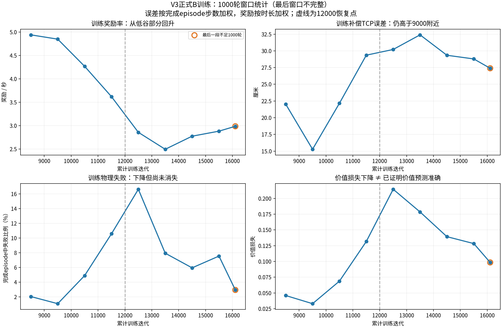
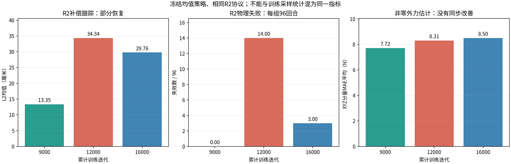
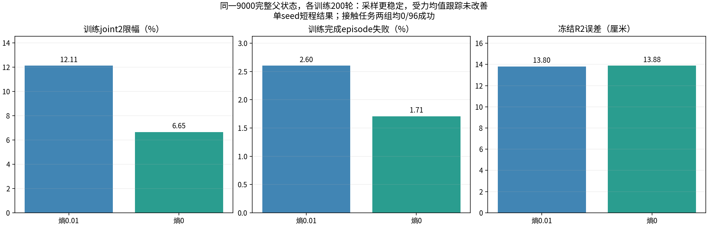

# 2026-11-09：正式B16000观察与200轮熵对照分析

## 1. 当前判断

**正式训练仍在运行，出现部分恢复，但受力复现尚未通过。探索噪声过大是有实验证据支持的影响因素，却不足以单独解释或修复闭环跟踪退化。现有结果不能把问题定为PPO公式或Critic实现错误；Critic的价值校准与优势质量仍是尚需专项核查的环节。**

本次2026-11-09 13:42:55—13:43:25北京时间读取远程状态；迭代日志快照到累计16218，A8000后已完成B8218，即B32000预算的25.68%。正式PID1981990存活，原GPU1、4096环境、原熵0.01配置保持，无本run的failure.json。16000完整零更新观察已完成，程序已继续训练；下一个完整观察点为24000，之后32000及40000。

正式run：`/mnt/data_8THDD/myl_unifp_v3_stage1/runs/b32000_seed1_v3_v6r2_resume12000_20261108/`。

独立熵对照远程根：`/mnt/data_8THDD/myl_unifp_v3_stage1/validation/b_entropy_closed_loop_20261108_r01/`。两组从同一B9000完整学习状态出发，各200轮，终点9200；所有父模型与终点评估已于2026-11-09 00:14:23完成。它们不属于正式主线，不能把9200对照终点称为正式训练当前进度。

## 2. 正式训练近期趋势

下面对完成episode重算统计：补偿TCP误差按episode步数加权，奖励率按episode总时长加权；失败率为该窗口完成episode中普通物理失败的比例。窗口按episode日志记录的累计迭代归属划分，episode本身可能跨窗口。价值损失是窗口内各迭代的平均值。这与此前按episode等权或按迭代等权统计不完全相同，不能直接混用。

| 累计迭代窗口 | 补偿TCP L2 | 奖励率 | 完成episode物理失败率 | 平均价值损失 |
|---|---:|---:|---:|---:|
| 9001—10000 | 15.28 cm | 4.847 | 1.07% | 0.0330 |
| 11001—12000 | 29.35 cm | 3.619 | 10.57% | 0.1317 |
| 12001—13000 | 30.21 cm | 2.857 | 16.62% | 0.2145 |
| 13001—14000 | 32.39 cm | 2.495 | 7.93% | 0.1785 |
| 14001—15000 | 29.34 cm | 2.775 | 5.94% | 0.1393 |
| 15001—16000 | 28.79 cm | 2.882 | 7.54% | 0.1283 |
| 16001—16218，不完整窗口 | 27.39 cm | 2.986 | 2.93% | 0.0984 |

最后一段只有218轮，不能和完整1000轮窗口等量比较。失败率也没有单调下降：15001—16000比上一窗口反弹。总体看，奖励和误差从13000—14000附近的低谷部分恢复，但还远未回到9000—10000附近水平。

当前主学习率在约1e-5量级，15001—16000平均1.50e-5，16001—16218平均1.38e-5。它由Actor的KL自适应机制决定，同时作用于主Adam中的Actor与Critic参数。这是一条可能影响恢复速度的耦合路径，不是“学习率有错”的结论，也不足以要求立即改学习率。

## 3. 冻结评估：16000相比12000改善在哪里

以下为相同协议下冻结均值策略的评估，不是训练高斯采样轨迹的统计。9000为本次独立父评估；12000复用此前有效补评估；16000为正式观察归档。

| R2指标 | B9000 | B12000 | B16000 |
|---|---:|---:|---:|
| 非零任务力段补偿TCP L2均值 | 13.35 cm | 34.34 cm | 29.76 cm |
| 物理失败 | 0/96 | 14/96 | 3/96 |
| 非零外力估计XYZ MAE | 9.36／6.23／7.58 N | 8.90／7.59／8.45 N | 9.43／7.34／8.74 N |
| 非零外力估计L2均值 | 15.33 N | 16.45 N | 16.93 N |

16000的补偿误差比12000低约13.3%，失败也减少，说明不是一直单向发散。但仍明显差于9000的13.35 cm；估力并未随训练时长持续提高。

16000的R2非零任务段底盘平面速度误差0.292 m/s、偏航角速度误差0.325 rad/s，均未过冻结门槛。通过的项目包括非零外力估计、物理失败率和push恢复；未通过的还包括补偿跟踪、零外力估计以及部分速度／TCP状态估计。不能把部分通过写成R2整体通过。

### 3.1 零力基础能力仍有遗忘

| 零力协议 | A8000 | B12000 | B16000 | B16000判定 |
|---|---:|---:|---:|---|
| S0：底盘零速度命令、无push | 2.06 cm | 9.63 cm | 8.36 cm | TCP L1／L2未过 |
| S1：底盘运动、无push | 2.09 cm | 7.51 cm | 8.31 cm | 平面速度跟踪未过 |
| S2：底盘运动、有push | 2.27 cm | 7.54 cm | 8.32 cm | 本组冻结门槛通过 |

三组各96episode，16000均无物理失败。S0比12000改善，S1／S2的TCP均值则略变差；不能说零力能力整体恢复。S2通过也不表示恢复到A原有精度。

### 3.2 真实接触依然没有形成有效力控

| 固定墙协议 | B12000 | B16000 |
|---|---:|---:|
| 10 N成功 | 0/48 | 0/48 |
| 10 N稳态法向绝对误差 | 16.89 N | 32.76 N |
| 20 N成功 | 0/48 | 0/48 |
| 20 N稳态法向绝对误差 | 20.00 N | 42.58 N |
| 0 N同墙轨迹法向绝对误差 | 35.58 N | 7.43 N |

16000接触96episode均无物理失败，但零成功；两个非零按压力任务的误差反而增大。0 N墙对照的被动接触力下降，只能说明这一对照发生变化，不代表10／20 N按压力控制学会了，也不是自由空间外力估计误差。

该现象支持把“注入外力下的状态估计”“补偿目标的闭环跟踪”“真实接触按压力”分别分析，不能认为第一项有改善，后两项就自然成立。对于接触还需结合轨迹区分未接触、过冲、持续挤压和方向问题；本轮未重新逐帧分类，不能仅凭汇总值判定具体是哪一种。

## 4. 两组200轮熵对照：证实了什么，没有证实什么

同一9000父checkpoint SHA：`d0c64674c852300776662b389e14047e998f8444486f74db5fabea684f089b1f`。两组初始网络、双Adam、实际学习率和初始观测／物性／root／关节状态／RNG摘要一致。唯一主动学习配置差异是熵系数0.01与0。实际学习轨迹分化后，KL和自适应学习率也会随之不同，这是干预的后续结果，不是额外手动调参。

### 4.1 高斯采样训练更稳定

| 训练指标 | 原熵0.01 | 零熵0 |
|---|---:|---:|
| 完成episode步数加权TCP误差 | 12.70 cm | 12.49 cm |
| 完成episode物理失败率 | 2.603% | 1.708% |
| 后50轮joint2全物理子步限幅 | 12.108% | 6.653% |

零熵保留高斯采样和可学习std，并非改成确定性动作。训练限幅下降约45%，失败率下降约0.90个百分点。两组14维std初值完全相同，原熵组14维均上升，零熵组14维均下降。该单seed实验支持熵项影响探索尺度及即时执行稳定性，但不证明所有seed、长期预算都一样。

### 4.2 冻结均值策略的受力跟踪没有同步改善

| 冻结评估 | 父9000 | 原熵9200 | 零熵9200 |
|---|---:|---:|---:|
| S0 TCP | 5.39 cm | 6.71 cm | 5.74 cm |
| S1 TCP | 6.69 cm | 7.55 cm | 6.76 cm |
| S2 TCP | 6.73 cm | 7.57 cm | 6.79 cm |
| R2非零任务段补偿TCP | 13.35 cm | 13.80 cm | 13.88 cm |
| R2物理失败 | 0/96 | 0/96 | 0/96 |
| R2零外力XYZ MAE | 2.67／2.18／3.04 N | 2.91／2.41／3.17 N | 2.69／2.26／2.99 N |
| 10／20 N接触成功 | 0/48、0/48 | 0/48、0/48 | 0/48、0/48 |

零熵组比原熵组保留了更多零力跟踪精度，但R2误差没有更小；13.80与13.88 cm的差异也不足以在单seed短程下推断稳定优劣。父9000的R2整体仅零力估计门槛未过，零熵9200该项略改善后R2整体通过；**这不意味着其TCP比原熵更好，更不等于完整B复现通过**。接触仍全部失败。

接触归档中，原熵9200普通物理失败1/96，零熵9200为3/96。因此不能把训练采样失败率下降推广为所有接触场景都更稳定。R2冻结策略中的全关节限幅比例也没有因去熵而降低：约0.841%对0.966%；它与训练joint2全子步限幅的场景和分母不同。

**更新后的结论是：探索尺度是一个已得到支持的影响因素，关闭熵不是已经验证的完整修复方案。** 不据此替换正式配置，不延长对照预算。

## 5. 结合Critic讨论，怎样定位当前问题

### 5.1 价值损失下降不等于未来预测已准确

当前Critic拟合的是：

$$
\hat R_t=A_t^{raw}+V_{old}(c_t).
$$

标签包含实际奖励，也包含旧价值自举；策略分布、标签尺度、失败频率和裁剪分支都在变化。因此从0.2145降至约0.0984，只能说明在各自批次上记录的价值损失减小，不能据此认定对真实长期回报的偏差减半，也不能单凭损失判断拟合质量提升了多少。

训练日志没有保存每次采样的全部状态价值、逐步TD残差和优势质量指标，不能仅用现有标量还原其是否系统性高估危险状态。本轮未执行新的价值校准实验。

### 5.2 “估得出力”与“能用动作补偿”是两种学习任务

辅助解码器通过监督学习估计外力；Actor通过PPO利用奖励和优势学习协调动作。Actor使用共享编码latent，并不直接把解码后的三维力当成动作答案。因此部分力信息可解码，只说明表征含有相关信息，不保证策略已学会将它与力命令、位置目标和执行余量正确组合。

9000与16000的非零力估计处于相近量级，闭环误差却由13.35变为29.76 cm；零熵减少采样限幅，但R2均值跟踪没有提高。它们共同说明“估力信息已经足够好，所以控制一定应该好”的推论不成立，需要检查从表示、任务目标到动作及实际执行的整条学习路径。

### 5.3 不能把问题定位为Adam或PPO公式

Adam只执行梯度更新，不判断机器人实际效果。PPO负责策略目标与更新约束，Critic通过价值损失学习；两者通过优势和共用主学习率等路径耦合。网络能够正常更新、loss有限，也不能保证有用的动作会被强化。

此前坐标、缩放、命令时序、奖励记账和恢复检查未找到直接接线错误；官方有效熵同为0.01，不能说抄错参数。现有证据更支持迁移后的探索、策略协调与执行能力适配问题，但尚未排除价值估计和优势偏差对这一过程的参与。

## 6. 当前候选原因与可区分证据

以下为排查顺序，不是人为赋予根因概率，也不是已批准的参数修改：

| 优先级 | 候选环节 | 现有证据 | 能进一步区分它的检查 |
|---|---|---|---|
| 1 | 力任务下的Actor协调与执行余量 | 均值策略退化、底盘跟踪差；去熵未改善R2闭环 | 固定完整状态，分离仅命令力／仅人工外力，核对误差—动作—实际TCP位移的方向和时延 |
| 2 | Critic价值校准与GAE优势质量 | 自举误差可能影响Actor，当前只有loss标量 | 冻结多个checkpoint，比较价值与多次后续回报；分失败、稳定、力切换和限幅状态检查TD／GAE |
| 3 | 探索与熵／Adam历史 | 已证明影响std、限幅和训练失败，但无法单独解释均值策略退化 | 先完整归档本次短程结论；后续若扩展预算，重新确认，不直接改正式熵 |
| 4 | 奖励和课程对V3的适配 | 零力遗忘、力命令阶段误差大、真实接触未学会 | 优势审计之后，判断好轨迹是否实际得到更优累计回报，再决定是否设计奖励或课程对照 |

第一项已有线索，第二项是刚才讨论暴露出的重要证据缺口，适合作为下一项独立诊断；两者可以在分析时按同批状态对齐，避免只看网络loss。

Critic专项必须区分：一是预测当前短片段return标签的能力，二是对更长后续真实执行结果的校准。只计算对自身GAE标签的拟合误差，会继续带有同源自举，不能独立证明未来回报预测正确。未真正终止的片段或纯超时不应被简单当作零未来；如使用固定时长后续采样，应分开报告已观测回报与末端自举、采用多次重复并说明方差。

同样，优势和结果一致性只能提供统计依据；若要证明某个动作优于另一个动作，需要同状态分支等更强对照，不能把不同状态的动作相关性当作因果结论。

本轮只完成状态分析与已授权对照的验收，不启动新训练、不改Critic／PPO结构、不改奖励／PD／资产。正式继续原观察安排；不能因普通失败自动停止，也不把论文“第二阶段初期可能下降”解释成“继续训练必然恢复”。

## 7. 来源与核验范围

- [远程原始摘要与训练日志快照](remote_snapshot.json)：包含读取时间、状态、两组训练记录、正式记录、24组冻结评估摘要及归档manifest。
- [分析指标](analysis_metrics.json)：完成episode统计窗口和原对照统计。
- [验收核验](verification.json)：两组各200轮、初始状态配对、唯一熵配置差异、每迭代192子步、24组评估配额与零更新。
- [24份checkpoint副本独立哈希](checkpoint_copy_hashes.json)：逐份实际重算，不只复用相同哈希名。
- 344项归档文件核对通过，另独立重算24份checkpoint副本，50份冻结源码重新哈希一致。大体积`policy_trace.jsonl`本轮未重算哈希，保留远程；未据此声称完整逐行重放验证。
- 16000 checkpoint SHA：`f02d48b7ef3eccbf3454244291074824ae179ad61f8ea4d048a4b8947fec6b5f`。
- 原熵9200 SHA：`bacab2e8fd0ff0d5cc88ba366d787ad1da22e9018e978c80e1cdbed899bf4686`；零熵终点及各评估实际SHA见核验JSON。
- 12000原始证据复用[此前诊断](../../bt10_diagnosis_20261108/诊断报告.md)；A8000零力结果见项目[统一进度](../../../../../../docs/progress/2026-11-06_v3_status.md)。

`ungraded_or_incomplete`是现有评估器的合并性能标签，本次24组均配额完整且证据完整。性能未过不等于工程缺测；工程完整也不等于性能验收通过。
