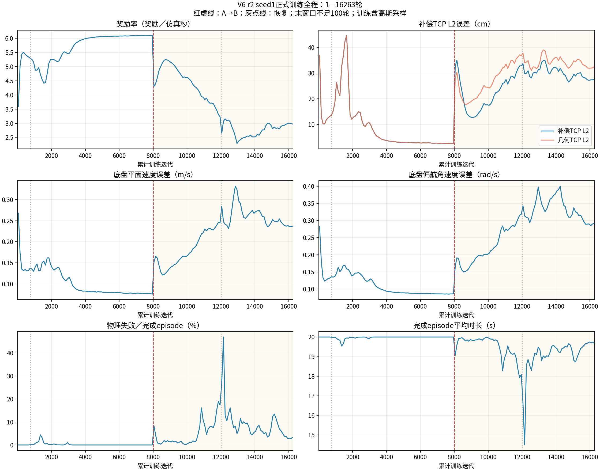
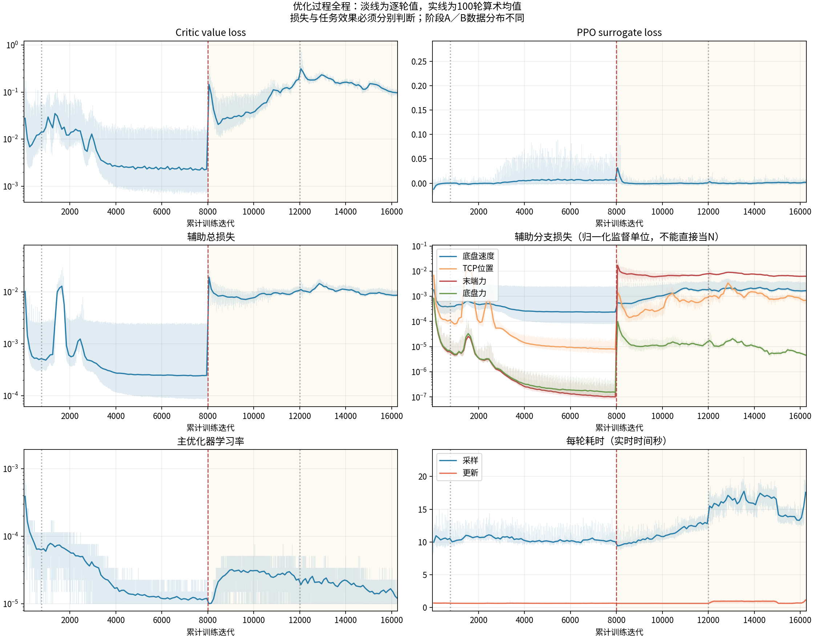
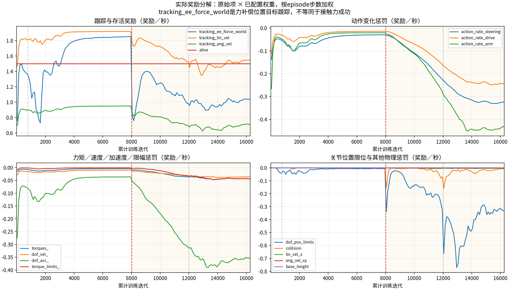
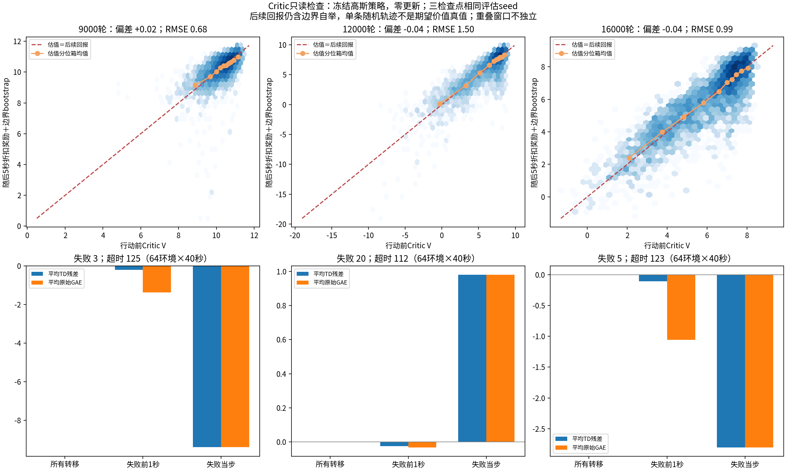

# 2026-11-09：正式训练完整曲线与Critic只读检查

**当前结论：A已收敛，B经历先恢复、再退化、再部分恢复；B尚未复现成功。数据连续、奖励记账与GAE计算核验通过，未发现足以定位为PPO／Critic公式错误的证据。新增证据显示Critic的总体估值没有明显同向漂移，而动作噪声和执行限幅继续增大，必须把“价值能拟合”“优势是否有用”“动作能否执行”分开判断。**

正式曲线截点为北京时间2026-11-09 13:57，累计16263轮；A8000后完成B8263轮，为B32000预算的25.82%。14:14实时复核为16330轮，PID1981990存活、当前run无`failure.json`，正式训练配置未变，下一完整观察点仍为24000。

## 1. 完整曲线与数据口径

本次串接四段正式日志：A1—767、A768—8000、B8001—12000、B12001—16263。没有混入旧资产训练、9000父模型的200轮熵对照或本次只读诊断。

- [完整曲线PDF，含训练、优化与奖励分解三页](完整曲线.pdf)
- [完整100轮窗口数据CSV](完整100轮窗口.csv)
- [绘图脚本](plot_full_curves.py)
- [曲线核验记录](curve_verification.json)

红虚线为A→B；灰点线为767／12000恢复边界。误差按完成episode的步数加权，奖励率等于真实奖励之和除以总仿真时长，失败率为失败episode数除以该窗口完成episode数。episode按照结束时所在迭代归属窗口，因此不等于窗口内部全部transition的逐步均值；仍未结束的episode尚未计入。

跨恢复点的701—800窗口已合并两段run的分子和分母，不能单独把恢复run少量结束episode画成高失败率。末窗口16201—16263只有63轮。100轮窗口用于观察局部变化，与此前1000轮窗口统计不应直接混用。

| 累计迭代窗口 | 补偿TCP L2 | 奖励／仿真秒 | 物理失败／完成episode |
|---|---:|---:|---:|
| 7901—8000，A | 2.57 cm | 6.102 | 0.00% |
| 8901—9000，B | 12.89 cm | 5.195 | 1.33% |
| 11901—12000 | 32.85 cm | 3.225 | 17.39% |
| 12901—13000 | 31.27 cm | 2.285 | 4.94% |
| 15901—16000 | 27.19 cm | 2.988 | 2.75% |
| 16101—16200 | 27.39 cm | 2.984 | 2.87% |
| 16201—16263，短窗口 | 27.57 cm | 2.972 | 3.33% |

A与B的外力、目标和命令分布不同，不能用A／B奖励差直接判定算法好坏。但B内部9000以后长期变差，以及相同零力冻结评估中的精度退化，共同说明当前现象不只是切换B时的一次正常奖励下降。12000恢复附近的短窗尖峰还涉及新episode初始化和状态分布变化，不能单凭时间相邻认定恢复代码导致退化。

## 2. 优化损失和实际奖励揭示了什么

优化图的淡线保留全部逐轮记录，实线是100轮算术均值。B的末端力辅助损失明显高于A属于任务变化后的预期现象；辅助损失以归一化监督单位计算，不能把其数值直接当作牛顿误差。正式日志没有逐轮保存全部std、真实接触力或受力冻结误差，不能据此补造这些“完整曲线”。

主学习率受Actor KL控制，并同时用于主Adam中的Actor与Critic。surrogate loss接近零不等于策略没有更新，也不等于任务已经优化成功；value loss下降也不意味着独立长期预测误差按同样比例下降。

每项贡献为原始项乘配置权重，统一换算为奖励／仿真秒。与真实episode奖励率的最大重建误差为`1.24e-6`，没有发现惩罚正负号或时间缩放造成的记账差异。`tracking_ee_force_world`在这里奖励的是力补偿位置目标跟踪，名称不能理解为真实接触力已控制成功。

8901—9000到15901—16000，奖励率约下降2.21，其中：

- TCP与底盘三项跟踪奖励合计下降约0.75；
- 三组动作变化惩罚由约−0.16增至−1.01，多损失约0.85；
- 关节位置限位惩罚由约−0.03增至−0.31；
- 关节加速度惩罚进一步增大。

因此策略同时付出了更差跟踪、更大动作变化和更多执行约束代价。不能把它解释为“主动牺牲部分位置精度，换取已经成功的力控制”；现有真实接触评估仍未成功。

## 3. Critic专项检查：方法与边界

9000／12000／16000三个正式checkpoint，各在远程GPU3运行64环境×2000策略步，即每环境40秒、每组128000 transitions；高斯采样、环境seed1001、push seed2001、独立动作噪声seed3001。模型完全冻结，零优化器与零策略更新，不影响正式GPU1的学习状态。相同seed不保证策略不同后仍获得相同状态或外力轨迹。

使用原控制、奖励、终止与force课程。创建actor时恢复同checkpoint的前64环境物性；重新开始episode，不把它称为训练历史复演。保存行动前V、实际奖励、真正失败／纯超时、reset前后继V、每子步限幅、目标力与实际注入外力、reset前误差。

TD采用：

$$
\delta_t=r_t+\gamma(1-\mathrm{terminated}_t)V(c_{t+1}^{terminal})-V(c_t).
$$

普通非终止使用实际后继；纯超时使用reset前终端观测；真正失败不自举。GAE按24步窗口重建，纯超时补偿一次、done截断递推、最后全窗口标准化，和真实`V3RolloutStorage.compute_returns`逐窗对照。

较长回报检查从第32步起每隔25步取样，最多观察250步（5秒），遇到失败停止并令尾值为零；纯超时在旧episode边界保留终端V；普通五秒截断保留末端V。**每组4416个窗口重叠，不能当作4416个独立实验；单次随机后续也不是状态期望价值的真值。**

## 4. Critic结果：没有发现总体价值失控，但局部信号不能只看平均

| 新采样诊断指标 | 9000 | 12000 | 16000 |
|---|---:|---:|---:|
| V与5秒后续回报的平均差，V减目标 | +0.018 | −0.043 | −0.044 |
| 两者RMSE | 0.680 | 1.502 | 0.994 |
| 单步TD绝对值均值 | 0.0332 | 0.0883 | 0.0606 |
| 完成episode中的物理失败／纯超时 | 3／125 | 20／112 | 5／123 |
| 失败前1秒标准化GAE为负的比例 | 76.0% | 56.6% | 84.0% |
| 失败当步标准化GAE为负的比例 | 100% | 50% | 60% |
| 机械臂joint2物理子步限幅比例 | 10.07% | 45.23% | 59.67% |
| joint2动作高斯std | 0.316 | 0.807 | 0.969 |
| 全段高斯采样补偿TCP L2 | 12.85 cm | 32.75 cm | 26.65 cm |

这些是新episode的诊断数据，不能替代32环境×3episode正式均值策略R2的13.35／34.34／29.76 cm，也不能混用其失败分母。

### 4.1 价值估计不是完全没有依据

五秒目标中约88%绝对量来自已观察折扣奖励、约12%来自边界自举；未跨episode的窗口尾值比例约8%。价值分箱均值总体接近对应后续回报。12000误差增大、16000恢复但仍差于9000，与任务退化和部分恢复相符，未显示大规模同向高估。

这缩小了“Critic整体价值失控是唯一根因”的可能性，但不能证明所有危险状态都估得准。不同检查点采样状态分布也不同，不能仅凭RMSE或相关性决定哪个网络本体更好，更不能由此排除Critic局部误差影响Actor。

### 4.2 为什么失败当步仍可能有正优势

12000样本中，一次失败当步`V≈−4.17`、实际即时奖励`r≈−0.21`，真正终止后尾值为零，因此`delta≈+3.96`。这是公式在该估值下的正常结果，没有把reset后的新episode价值串入旧轨迹。

优势比较的是“该状态下这次结果相对预期怎样”，并非简单的成功正、失败负。若模型已经认为该状态前景很差，结束episode的结果可能高于其负价值预期。它既可能涉及局部低估，也可能涉及糟糕状态下持续动作惩罚和终止语义的组合；仅凭事后选中失败轨迹，不能判定动作应该被压低多少。

16000失败前一秒大部分优势为负，表明负面反馈并未普遍消失。但本次只有5次失败，尚不足以证明优势的动作排序正确，也不能证明这些动作在训练更新中最终被有效压低。要判断局部误估还是合理基线，需要在同类甚至相同状态上收集多条后续，并检查实际策略梯度；本轮不作这个因果结论。

### 4.3 更明确的执行端问题仍在

joint2 std与子步限幅比例继续增大，即使16000跟踪和失败比12000改善，该关节执行余量仍更差。限幅会让不同原始动作变成相近的实际力矩，策略梯度优化的高斯动作与实际控制效果之间的对应变弱。该物理解释与现象一致，但限幅比例本身也不能证明唯一根因。

之前两组200轮熵对照已证明去熵可以减少训练采样限幅，却未改善冻结均值R2跟踪，因此“关闭熵即可修复”仍不成立。应继续区分探索噪声、均值动作与受力执行约束的相互作用。

## 5. 已核查与尚未解决

已核查：

- 第1—16263轮无缺失、无重复，`policy_steps=24×iteration`、`transitions=4096×policy_steps`完全一致；1622749条完成episode纳入统计。
- 四段资产manifest一致；各阶段两段run源码manifest一致；A→B的已记录课程和配置变化保留。
- 全部记录标量有限；奖励权重四段相同，原始项能重建奖励率。
- 9份远程原始诊断文件与本地SHA256一致；三个checkpoint源码身份核对通过，网络参数前后逐张量相同。
- 非终止的`next_value[t]`与下一步`value[t+1]`一致；逐步奖励能由23项raw rewards重建。
- 249个完整24步窗口与真实训练GAE代码交叉核对，原始优势最大误差约`6.0e-6`，标准化优势最大误差约`4.34e-5`；该storage源码SHA与正式checkpoint绑定版本一致。
- 原A767的暂停记录和B12000的评估工具退出记录属于已知历史，不代表当前run发生新错误。

尚未解决：B受力闭环、零力精度遗忘、真实接触按压力零成功，以及均值策略为何长期没有学会稳定补偿。估力信息可解码并不保证Actor使用它产生了可执行的动作。

下一步优先围绕 **“均值动作／噪声→执行限幅→跟踪奖励→局部优势→实际策略更新”** 做同状态或匹配状态检查，判断限幅后动作区分度、接近失败时的局部估值和实际更新方向；与已有去熵对照衔接。继续正式观察至24000，保留9000／16000对照。不凭本次结果直接改Critic网络、PPO公式、奖励权重、PD或资产。

## 6. 证据和复跑入口

- [采集脚本](collect_critic.py)：只读仿真，须使用已绑定冻结源码、项目Gym环境和GPU运行。
- [Critic分析脚本](analyze_critic.py)：读取三个已归档NPZ，重建TD／GAE、五秒目标并绘图。
- [真实GAE对照脚本](check_gae.py)：本机torch解释器运行，CPU小缓冲对照，不导入Gym。
- [Critic详细指标](critic_metrics.json)、[GAE核验](gae_verification.json)、[文件核验](file_verification.json)、[实时状态](final_runtime_check.json)。
- 远程原始证据：`/mnt/data_8THDD/myl_unifp_v3_stage1/validation/full_curves_critic_check_20261109_r01/`。
- 正式训练输出：`/mnt/data_8THDD/myl_unifp_v3_stage1/runs/b32000_seed1_v3_v6r2_resume12000_20261108/`。
- 上一轮[完整冻结评估与熵对照报告](../entropy_closed_loop_20261108/analysis_20261109/训练分析报告.md)继续有效。

本次仅增加独立分析和项目记录，未修改官方副本、正式训练业务源码、运行参数或预算。
