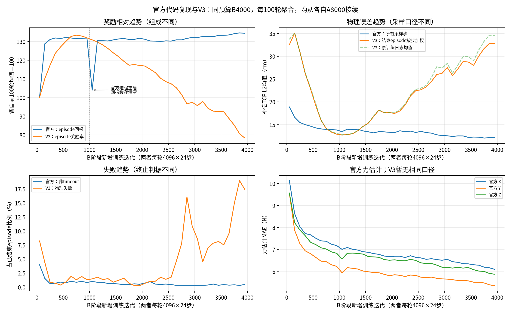
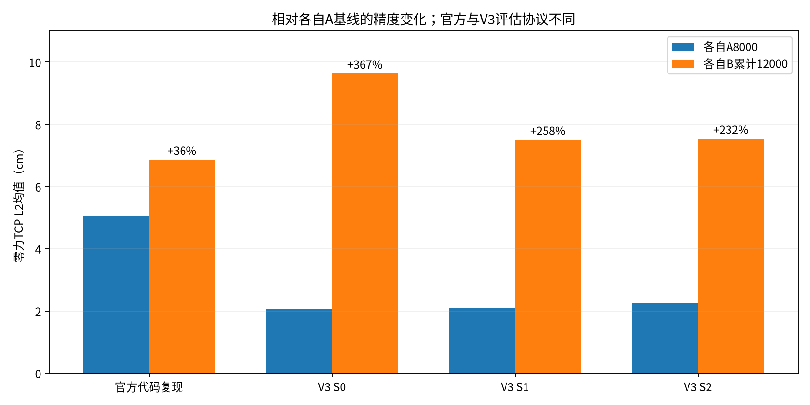

# V3与官方代码复现实验：同预算B4000对比

日期：2026-11-08。比较窗口：各自A8000结束后新增B4000，即累计8001—12000。此次只读日志、汇总和绘图，未修改训练、资产、奖励或观察安排。

> 后续更新（2026-11-08 18:24）：12000的R2／接触／0 N已补齐，旧文“缺有效受力归档”仅指本报告初次分析时状态。R2非零外力估计XYZ MAE为8.90／7.59／8.45 N，相对A父明显改善；补偿L2为34.34 cm、物理失败14/96，闭环仍退化，接触10／20 N成功均0/48。详见[三项诊断报告](../bt10_diagnosis_20261108/诊断报告.md)。新协议结果仍不与不同机器人官方复现作严格排名，旧统计保留。

## 结论

官方代码复现实验在B阶段有早期适应过程，随后误差、失败比例和力估计逐步改善。V3也曾改善，在累计8801—9000附近达到较好状态，但之后持续退化至12000。**现有V3轨迹尚未呈现与官方复现相同的恢复趋势，不能仅凭论文所说的“第二阶段初期下降”认定当前表现正常，也不能据此断言继续训练必然失败。**

V3的A无力定位基础有效，但进入B后保持原能力的表现较差；当前缺少有效的B12000受力独立评估和接触结果，尚不能判断实际受力估计、柔顺跟踪及接触力控是否达标。继续原预算观察到16000，按已冻结协议补齐这些证据。

2026-11-08 17:40:45北京时间只读检查：gpuf3正式续训进程PID1981990在运行，最新累计12046，未发现新run的failure.json。这是当时快照，不是持续监控承诺。续训保持V6 r2、K200、两路每轴±60 N、4096环境和原PPO，未因效果下降停止。

## 1. 对比对象与可比范围

“官方实验”在本文特指**使用官方代码的个人复现实验**，并非论文作者发布的原始训练数据。本机档案根为：

`/home/sorry/python_ws/interactive/research/literature/projects/unifiedforce/reproduction/`

其中`outputs/stage2_20261029/launch_record.json`明确原训练主机为gpuf3、GPU0。因此它是保存在本机的官方复现档案，不能写成此次核实了本机GPU运行。V3当前也在gpuf3训练，使用GPU1。

| 项目 | 官方代码复现 | 本次V3 |
|---|---|---|
| 机器人 | B2＋Z1四足机械臂 | V6 r2轮式机械臂 |
| 本次比较训练预算 | 从各自A8000新增4000轮 | 相同 |
| 采样 | 4096环境×24策略步／轮 | 相同 |
| 新增transition总数 | 393,216,000 | 相同 |
| 策略周期 | 20 ms，5 ms×4 | 20 ms，2.5 ms×8 |
| 动作 | 17维 | 14维，转向位置／轮速／臂位置控制 |
| Actor输入 | 73×32＝2336 | 58×32＝1856 |
| Critic输入 | 149×3＝447 | 98×3＝294 |
| 辅助输出 | 12维 | 12维 |
| 末端人工力 | 命令与外扰两路，每轴±60 N | 相同幅值；不能据此推断全部采样分布相同 |
| 虚拟刚度 | 200 N/m | 200 N/m |
| 训练地形 | 官方粗糙地形 | 平地 |
| 目标采样 | 半径0.35—0.95 m，俯仰±1.2566 rad，方位±1.885 rad | 半径0.45—0.70 m，仰角0—1.0472 rad，方位±1.0472 rad；参考原点也不同 |

两者PPO配置中的clip=0.2、KL目标0.01、entropy=0.01、gamma=0.99、lambda=0.95、5次epoch、4个minibatch和adaptive调度一致。这不意味着实际学习率历史一致：V3恢复已有主／辅助Adam、实际lr及环境／RNG；官方首次A→B没有辅助Adam和仿真／RNG存档，且B1000处重建过仿真。官方使用随机episode起始长度，V3不使用。

两个配置陷阱已按源码排除：官方虽配置`zero_vel_cmd_prob_after_force=0.8`，存档环境实际只读取`zero_vel_cmd_prob=0.3`；不能声称本次差异来自“官方80%静止而V3只有30%”。官方虽保留底盘人工力参数，`_push_robot_base`调用被注释；V3保持相应力槽为零符合此实际调用。8秒底盘速度push是另外的机制，不能和N单位人工力混淆。

## 2. 训练曲线：同预算下趋势已分叉

各图为100轮聚合。奖励先除以各自前100轮均值，只比较各自变化方向，不比较总奖励绝对高低。官方包含四足步态奖励，且日志是已结束episode回报的滚动缓存；V3是episode奖励率，二者分母和奖励组成均不同。官方B1000附近的尖锐下降对应进程重启及回报缓存重建，不能直接当作一次策略崩溃。

| B窗口 | 官方补偿TCP L2 | V3补偿TCP L2（完成episode按步加权） | 官方非timeout比例 | V3物理失败比例 |
|---|---:|---:|---:|---:|
| 1—100 | 18.85 cm | 32.52 cm | 3.98% | 8.24% |
| 201—400 | 15.22 cm | 28.96 cm | 0.65% | 0.78% |
| 3801—4000 | 12.13 cm | 32.83 cm | 0.38% | 18.19% |

V3并非从头完全学不会：B801—1000，即累计8801—9000，加权误差曾降到13.09 cm，奖励率5.21；B末200轮误差升至32.83 cm，奖励率降至3.27。原训练日志末200轮的等episode、再等iteration误差为34.60 cm，加权后仍退化，说明趋势不能完全由短失败episode的均值权重解释。

**口径限制：**官方误差覆盖每轮全部98304个transition。V3加权值来自窗口内结束episode的完整历史，可能包含窗口前的步，也不包含窗口末尚未结束的episode；这是接近逐步口径的复核，并非严格相同的rollout统计。两条曲线不能直接作为“同题条件下V3差了几倍”的证据。

失败比例均以已结束episode为分母，但判据不同：官方配置`terminate_after_contacts_on=[]`，主要通过roll>0.8或pitch>1.0倾覆判定；V3另有base_link接触合力>1 N终止。因此18.19%与0.38%不能解释为相同碰撞／倾覆事件的直接概率比。V3此处日志只记`physical_failure`，不能据此区分倾覆、机械臂碰机身、机身触地或碰撞近似误差。

此次重算把V3 episode中的更新前时钟加1，对齐iteration日志的更新后时钟。全部401414条episode记录覆盖累计8003—12000；前两轮尚无结束记录是正常的。旧12000报告按episode原字段分窗，千轮失败率10.57%仍保留为历史；此次正确对齐后最后1000轮是10.59%，最后200轮是18.19%，三个值的窗口不同，不互相替换。

## 3. 无力能力保持：官方也退化，V3退化更明显

| 各自独立评估 | A8000 TCP L2 | B12000 TCP L2 | 相对自身A误差增幅 |
|---|---:|---:|---:|
| 官方代码复现，无力 | 5.05 cm | 6.87 cm | +36.0% |
| V3 S0，静止无push | 2.06 cm | 9.63 cm | +367.4% |
| V3 S1，运动无push | 2.09 cm | 7.51 cm | +258.3% |
| V3 S2，运动有push | 2.27 cm | 7.54 cm | +231.8% |

V3三组共288episode，物理失败均为0。因此训练分布中的较高失败比例不等于在无力评估也频繁倒地；增加末端力后的任务分布值得重点观察。S0未过位置门槛，S1未过平面速度及vx估计门槛，S2未过vx估计门槛；不能把“0失败”当作跟踪性能已通过。

官方独立评估为8环境×6000步，粗糙地形、无push，关闭观测噪声与相关物性随机化。V3为冻结S0／S1／S2协议，每组32环境×3episode，平地、不同目标与push安排。表中的跨阶段变化在各自协议内成立；跨机器人绝对精度仍不构成严格排名。V3 A时2 cm不能直接证明比官方四足的5 cm更优秀，B时同样如此。

## 4. 受力能力：官方已有改善证据，V3当前证据不全

官方训练前100轮力估计XYZ MAE约10.13／9.56／9.57 N，末200轮为6.13／5.37／5.89 N。对应B12000独立随机力评估：

- 补偿TCP L2均值11.17 cm，P95 27.24 cm；三轴误差均小于10 cm的采样占67.60%。
- 原始几何目标L2为19.82 cm。受力时目标本就带F/K位移，不能只看原几何误差判控制好坏。
- 力估计MAE为6.69／5.84／6.51 N，无非timeout终止。
- 此评估两路力独立抽样，不是论文matched-force协议；也不是固定墙接触实验，不能当成论文接触力控复现完成。

V3 B12000受力评估因观察manifest引用错误而未形成有效归档，接触／0 N观察尚未执行。已有训练`auxiliary/force_ee_loss`是缩放标签上的MSE／辅助更新统计，不能直接与牛顿MAE相比，不能简单开根号换算成同一个量。它略有下降也不能证明实际闭环受力跟踪改善。

官方后来B8000、累计16000的独立无力／受力误差约6.63／11.25 cm，末200轮训练误差11.84 cm，力MAE5.41／4.70／5.16 N；说明其后续改善逐渐趋稳。这只是下一检查点的历史参考，不能拿更长预算去给当前V3 B4000做等预算排名。

## 5. V3奖励为何下降：已有症状，尚无根因判定

对完成episode按真实步数加权，再乘冻结奖励权重，重构每秒奖励率；40个百轮窗口都与实际记录吻合，绝对差小于1e-5。以下对比累计8801—9000与11801—12000：

| 奖励贡献（每秒） | 较好窗口 | 最后200轮 |
|---|---:|---:|
| 末端补偿跟踪 | +1.388 | +0.986 |
| 底盘平移跟踪 | +1.804 | +1.527 |
| 底盘偏航跟踪 | +0.855 | +0.697 |
| 三组动作变化惩罚合计 | −0.153 | −0.652 |
| 三组关节加速度惩罚合计 | −0.112 | −0.308 |
| 关节位置限位惩罚 | −0.030 | −0.300 |
| 碰撞惩罚 | −0.006 | −0.075 |

动作变化平方和：转向2.89→11.06、驱动1.76→7.85、机械臂1.33→6.08；机械臂关节速度平方和40.86→104.81 (rad/s)²。这些是多关节聚合量，不是某一关节速度或直接的视频抖动频率。可确认后段更不平滑、限位压力增大，并同时丢失部分底盘跟踪能力；尚不能区分动作均值变化、探索标准差增长、关节控制适配或某类受力目标难度增加的贡献。

它不是已经定位的资产错误，也不是已证明必须调整±60 N。此次分析不改参数，不把MSE下降当作控制达标，不把评估程序报错解释为训练退化原因。

## 6. 与论文结论的关系及下一检查点

论文附录C.4确实描述stage two initial drop，随后locomotion recovering、whole-body reaching stabilizing，并允许增加力命令多样性后reaching reward略低。出处为本机`research/literature/projects/unifiedforce/assets/paper.html:1672`。它支持继续观察早期课程适应，但没有给出“任何时长的持续恶化都正常”的规则，也不能替代真实受力评估。

保持正式预算，到累计16000执行已确认的零力S0／S1／S2、R2随机受力、接触与0 N对照。重点检查：

1. 末端补偿误差是否从目前后段30 cm以上回落，并同时改善P95；单独奖励回升不够。
2. 三组动作变化、关节速度／加速度和限位惩罚是否回落；只看辅助损失不够。
3. 训练物理失败比例能否从最后200轮18.19%回落，并在需要排查时补充终止原因分类。
4. 无力精度是否恢复，尤其S0从2.06→9.63 cm的遗忘；同时核对S1／S2底盘及状态估计。
5. R2中获取有效N单位力估计MAE、非零力补偿误差、失败率与视频；接触评估独立回答是否学到持续施力。

以上是解释结果的观察方向，不增加新的自动停训门槛。按用户指令继续训练，普通物理失败仍局部reset；若16000仍沿当前方向退化，再凭受力分组、动作分布和终止分类证据讨论修正，不提前认定某一参数是根因。

## 7. 证据、重算与校验

- [机器汇总与来源SHA256](comparison_summary.json)：两次原始4000轮逐行对齐，含百轮窗口、关键窗口、无力对比、限制说明及来源路径。
- [V3 episode只读汇总](v3_episode_blocks100.json)：远程401414条记录，源SHA256为`f43afc89efab8d3376be97ae9b9bb3b549a69abaf2561952f3d295cb79ceac36`。
- [当前续训检查快照](live_training_snapshot.json)：检查时间、进程、最新指标；不属于本次冻结4000轮对比窗口。
- [重算绘图脚本](compare.py)、[远程只读汇总脚本](aggregate_remote_episodes.py)。本机重绘命令：`python .scratch/unifp-v3-stage1-reproduction/knowledge/part_b_implementation/official_comparison_20261108/compare.py`，在项目根执行。

重算已验证：两组完成轮数严格等于8001—12000；官方每轮98304样本；V3总episode与汇总一致；更新前后时钟对齐；奖励分项与总量闭合；官方B12000无力NPZ逐步误差重算与汇总一致。两张图已生成并检查。未重跑仿真，未占用训练GPU。

主要源码依据：官方档案`train_stage2.py:53—145`为全transition统计及力估计采样，`:172—210`为恢复差异和episode初始化；存档`source/legged_robot_b2z1_pos_force.py:125—130,199—205,838—857`分别对应末端／底盘力调用、终止与静止命令；`evaluate_stage2.py:28—59`为独立评估配置及误差采样。V3当前`legged_robot_v3.py:713—739,871—915,1010—1040,1082—1120,1351—1372`对应终止、episode误差、补偿目标、动作／速度惩罚与命令采样；`v3_episode_log.py:9—56`为等episode汇总，`v3_on_policy_runner.py:115—143`为两类日志时钟。路径及内容摘要见机器汇总。
