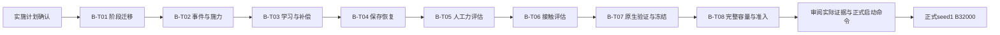

# B受力复现实施计划

状态：2026-11-07 B04—B11全部设计已获用户确认；正式拆分八张票据，用户已回复“开始实施”确认计划，B-T01已完成且50项相关回归通过，B-T01—08均已完成；2026-11-08用户授权的正式B seed1已启动，当前观察累计12000轮效果，不把工程完成等同于B效果通过。

2026-11-09当前补充任务：[B-T11](11-entropy-experiment-runner.md)和[B-T12](12-entropy-native-and-trials.md)均已完成，两组各200轮及父／终点评估完整。去熵减少训练限幅与失败，但冻结R2跟踪未改善、接触仍零成功，未替换正式配置。正式16000观察已完成、继续运行；下一完整观察24000。详见[结果分析](../../knowledge/part_b_implementation/entropy_closed_loop_20261108/analysis_20261109/训练分析报告.md)，下方旧日期条目保留历史状态。

## 固定范围与验收边界

- 路线为V6 r2完整A8000→B新增32000→累计40000，B仍为官方受力复现，不进入轮式创新，不切V8、不重跑A。
- 正式父路径及SHA以[总体计划](../../development-plan.md)第七节为准，实际迁移前重新核验；保留网络／双Adam／实际lr／创建物性／RNG／累计计数和push状态。
- N4096、T24、2.5ms×8、14动作、Actor1856／Critic294／辅助12；人工力作用末端刚体COM，命令力不提交PhysX，底盘N力保持零。
- 官方每轴±60N为目标，先分档验证再冻结；如需适配，凭证据回写B09确认。所有具体事件、reward及阈值以已确认B04—B11为准，票据不另起参数方案。
- 普通物理失败局部reset并统计；工程错误先修复，不要求A父或短训已达到B终点效果。512原生短训已并入真实4096的10＋1轮，不增加只载权重／重建优化器的开发路径。

## 票据与依赖

编号B-Txx为实施票据，设计B04等为模块，两者不可混用。原六个候选切片细化为八票：人工力评估与接触评估分开，范围／原生验证与最终容量／准入分开，便于每张票在独立上下文完成。

| 票据 | 主要交付 | 验证与审查 | Blocked by | 当前状态 |
|---|---|---|---|---|
| [B-T01](01-stage-transition-and-initialization.md) | A8000→B身份、完整状态迁移、创建物性与一次新episode | 真实学习器＋张量环境，A恢复回归 | 实施计划已确认 | 已完成，50项回归通过 |
| [B-T02](02-force-events-and-transition-timing.md) | 两路事件、COM施力、标签／转移／reset时序及B采样 | 事件／坐标／转移单测，早期4环境短测可复用 | B-T01已完成 | 已完成，23项相关回归通过 |
| [B-T03](03-force-learning-compensation-and-metrics.md) | 非零力辅助学习、Critic补偿槽、reward和日志 | 真实网络／双Adam更新、符号／shape／A回归 | B-T02已完成 | 已完成，45项相关回归通过 |
| [B-T04](04-b-checkpoint-resume-and-budget.md) | B存档恢复、事件状态、完整轮计数与40000停止 | 张量环境真实保存恢复与终点边界 | B-T03已完成 | 已完成，56项相关回归通过 |
| [B-T05](05-force-evaluation-and-zero-regression.md) | 零力回归、14组受力评估、估力／统计／曲线 | 手算trace、无更新与配额／有效性验证 | B-T04已完成 | 已完成，62项相关回归及原生smoke通过 |
| [B-T06](06-contact-evaluation-and-actor-mapping.md) | 固定墙测量、全局actor映射、8点采样与接触评估 | 乱序索引／局部reset／接触统计与无墙回归 | B-T05已完成 | 已完成，73项V3测试及完整脚本smoke通过 |
| [B-T07](07-native-force-contact-and-range-validation.md) | 本机／远程G1—G3、范围冻结、A完整零力回归 | 原生施力／接触正对照，32环境分档扫描 | B-T06已完成 | 已完成，±60N已确认冻结 |
| [B-T08](08-full-scale-resume-preflight-and-launch-preparation.md) | G4—G5、4096迁移10＋1轮／容量、全基准及开训准备 | 原生完整恢复、成本、B准入与A门控回归 | B-T07及前票全部完成 | 已完成，实际准入及formal入口探测通过；未开长训 |

## 实施方法与完成定义

每票开启独立实施上下文，先阅读本票、所属设计、research实际源码及前票完成记录；这不额外要求并行agent。先编写能暴露缺失行为的测试并确认失败原因，再最小实现、运行相关回归并审查，记录实际修改、测试命令／结果及剩余问题后才推进后继。不为一次性逻辑建框架，不为所有边界加逐step检查。新增／修改函数具完整类型标注及英文Google docstring，解释单位／shape／坐标系与必要副作用。

Q1的U1—U7随所属票实现，不积压到最后另写一套算法替身。Q2的G1—G3在B-T07收束、G4—G5在B-T08收束；相同有效源码／配置／资产／runtime下已完成的证据复用，代码变更只补受影响层。纯文档检查不代替单测或Gym验证。

B-T01—06可以在本机完成大部分开发和单测，本机原生短测只用已核验Preview4依赖与授权CPU＋GPU，不修改tavis。B-T07同时需要本机和远程短测，B-T08的4096训练恢复与容量只在远程执行。远程资源不足先等待，不缩N、不占用其他用户任务、不覆盖运行目录。

正式测试输出归同一有身份的validation证据目录，保留原始trace、结果与必要失败视频；只在主线文档维护摘要，不新建模型修复任务或堆复制脚本。正式父、UniFP官方副本、V6资产、A数据与r3／V8证据保留，不清理Go2W／Piper工作。

所有票据通过表示工程上准备就绪，不等于B效果已复现。B-T08交付实际证据、明确命令／设备和预计耗时，正式启动另按用户指令处理；本实施计划确认不自动启动32000轮。终点依B10逐类验收，三个seed各自从其A父承接，未通过不自动延长或进入创新阶段。

## 当前执行入口

用户已确认本正式实施计划；B-T01已完成，验证证据见`knowledge/part_b_implementation/bt01/verification.json`。当前B-T01—09已完成；用户已授权正式开训与12000后续训，远程seed1正在运行，下一完整观察点为累计16000。以下日期追加段落保留历史进度，不作为当前执行入口。设计依据见[part-b](../../design/part-b/11-单元测试整体测试与验收.md)，创建历史／清理证据仍见[模型历史](../../knowledge/model_history/README.md)，不因本次拆票重新清理。

2026-11-07：B-T06部分验证64项通过，无墙4环境×5秒零物理失败；真实墙创建遇到SDK逐环境约束，修订见B08-Q3d，待确认后继续。B-T06未完成，不提前推进B-T07。

2026-11-07用户已确认B08-Q3d逐环境回调创建墙；按该时序继续B-T06，历史部分验证不等同于整票完成。

B-T06已按Q3d实施并完成票内验收，当前B-T07开始两端原生验证和范围扫描；正式训练未启动。

2026-11-07用户确认B09-Q1a保留官方±60N；B-T07完成并冻结两份manifest。当前B-T08实施中，正式B长训仍不自动启动。

2026-11-08：B-T08完成。4096×10＋跨进程1轮、完整容量、14组1344episode与接触96／0N32episode、封存SHA、82项覆盖及r06两项专项、七阶段实际准入和真实formal入口Gym前探测均通过。最终证据`knowledge/part_b_implementation/bt08/verification.json`，启动／成本／观察安排`B阶段开训准备.md`。正式B32000尚未启动，不自动推进其他seed或创新阶段。

2026-11-08最新：用户已明确授权正式seed1开训，并指定累计12000轮先评估。远程GPU1已启动（PID1883377），启动验证到8006；全部实施票已完成，当前为正式训练观察阶段。独立启动快照及manifest增加12000，原观察点和40000预算保留；无其他训练参数变化。实际启动与路径见bt08/launch_20261108/launch.json，统一进度保留完整记录。

2026-11-08：12000观察因manifest哈希差异退出；用户明确要求继续训练观察。当前执行[B-T09](09-observation-reference-and-resume.md)，仅窄修tools的参考manifest选择并完整续训，设计依据B10-Q4b；不因普通指标下降停止。

2026-11-08 17:29最新：B-T09已完成，实际续训PID1981990、首轮12001、检查到12003。当前正式训练运行，下一观察点16000，仍累计40000终点；用户明确继续观察正常奖励下降。机器记录bt09/launch.json，旧12000失败报告保留。

2026-11-08 18:24：用户授权的三项只读诊断完成，补齐R2／接触／0N、三个检查点七组动作对照、50次新终止事件几何分类。详见[诊断报告](../../knowledge/part_b_implementation/bt10_diagnosis_20261108/诊断报告.md)。这不是新增业务修复票或性能验收通过；正式训练仍按原参数到16000观察，若后续修复需按设计流程确认。

2026-11-08 19:03：按用户要求完成四项顺序只读诊断，见[检查报告](../../knowledge/part_b_implementation/bt10_diagnosis_20261108/sequential_checks/检查报告.md)。奖励记账通过；共享更新耦合存在但未证实持续梯度冲突；joint2全子步饱和9.83%→44.73%是最强线索，少量补偿不可达／静力超额不足解释退化。没有新增或宣称完成业务修复票；正式训练累计12345轮正常，下一16000观察保持。后续如做探索尺度／PD匹配训练对照，应先按设计流程确认。

2026-11-08 19:38：进一步只读定位完成，见[动作请求与执行分解](../../knowledge/part_b_implementation/bt10_diagnosis_20261108/action_execution/检查报告.md)。噪声明显放大即时限幅，均值仍31.62cm且轮速目标频繁裁剪；仅命令力响应恶化是后续审计线索，非已证实接线bug。四条原生诊断全部退出，正式seed1累计12471继续，参数不改。未新增或冒充完成修复票，未启动独立训练对照。

2026-11-08 20:06：下一项只读[命令—目标—Actor审计](../../knowledge/part_b_implementation/bt10_diagnosis_20261108/command_audit/审计报告.md)完成；60tensor／252同输入记录通过，未发现明确接线错误，Actor命令敏感性后段增大，需独立训练验证探索与协调退化。不是新修复票或性能验收通过；正式累计12569继续，16000观察保持，未改业务或参数。

2026-11-08 20:24：[标准差更新来源检查](../../knowledge/part_b_implementation/bt10_diagnosis_20261108/std_update_audit/检查报告.md)完成；三个真实小rollout的配对单轮原PPO检查支持熵项为std持续增长的直接因素，去熵在后段使平均更新转降，但尚未验证闭环改善。19个最终协议私有更新，正式不变；累计12629正常、无新failure，诊断均退出。只改熵系数的两组各200轮[草案](../../knowledge/part_b_implementation/bt10_diagnosis_20261108/std_update_audit/单变量对照草案.md)待设计／预算确认，未新增或冒充完成修复票，未开新训练。

2026-11-08 20:43：B-T11完成，4单元／AST及两组4096×10＋跨进程1轮通过，50源码SHA与唯一熵配置差异通过；B-T12进行中，GPU3 PID2011444当前父9000冻结评估，自动后续各200轮及全部冻结评估，尚未完成。入口[执行状态](../../knowledge/part_b_implementation/entropy_closed_loop_20261108/执行状态.md)。正式GPU1累计12698正常，原设置保持。

2026-11-08 21:36：B-T12仍进行中，原调度21:15因父contact跨盘封存目录移动失败退出，200轮尚未启动。已复现并验证同盘TMPDIR修正，恢复PID2017242重测父contact/0N，之后自动原两组200轮与终点评估；原已完成结果保留。正式累计12871正常。完整证据见entropy_closed_loop_20261108/执行状态.md。
