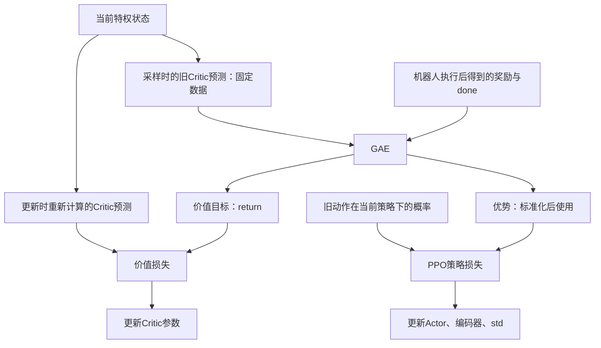

# UniFP 的 Critic：输入什么、预测什么、怎样学会预测

本文以官方 `b2z1_pos_force` 任务中的 Critic 为主线，并在网络参数、数据缓存和超时处理处明确对照当前V3。先看 [完整训练流程](/home/sorry/python_ws/interactive/unifp_reproduction/introduction/00-training-flow-zh-CN.md)，动作与关节控制见 [Actor 专篇](/home/sorry/python_ws/interactive/unifp_reproduction/introduction/01-actor-zh-CN.md)，概率比率与整体更新见 [PPO 专篇](/home/sorry/python_ws/interactive/unifp_reproduction/introduction/03-ppo-zh-CN.md)。梯度、反向传播和Adam等基础概念，可先读 [神经网络训练入门](/home/sorry/python_ws/interactive/unifp_reproduction/introduction/06-neural-network-training-zh-CN.md)。

官方核查对象：`/home/sorry/python_ws/interactive/unifp_reproduction/UniFP`，提交 `68847a070f88d731058c3d8476929bc3b205f5bd`；明确标为V3的对照读取当前 `UniFP_v3/` 工作树。下文的数值例子是为解释公式而设置的算例，不是实际训练日志。

阅读时先抓住一条线：**Critic先预测剩余回报，机器人实际执行一段，GAE结合奖励与后续预测构造目标，Critic再学习缩小预测偏差。** 第1节解释为什么要这样预测，第4—5节逐步手算，第7节说明这些预测怎样帮助Actor。公式与对应代码分开展示；在VS Code中使用Markdown预览阅读公式。

2026-11-09根据讨论补充的问题索引：

| 你的问题 | 对应位置 |
|---|---|
| 没有世界模型，怎么预测未来？是不是预测下一状态？ | 1.4：直接学习回报，不推演状态 |
| 当前奖励高，为什么未来价值可能低？ | 1.2、1.4：后续结果给此前状态提供训练依据 |
| 用的是哪些过去数据？会反复读取所有历史日志吗？ | 第4节第二步：最近一批采样与数据生命周期 |
| Critic的参数是什么？447维与294维为什么不同？ | 3.1—3.2：前向公式、权重形状与参数数量 |
| 图中的第四步、第五步是在更新参数吗？ | 第4节开头与第四至六步：造目标、算损失、改参数 |
| Critic训练Actor，Actor又影响Critic，会不会越训越差？ | 7.1：真实奖励的约束与自举的局限 |
| 奖励可以改权重，本项目怎么判断训练有效？ | 7.2：奖励目标与独立任务评估 |
| 执行优化器就算PPO吗？ | 7.3：算法、损失、自动求导与优化器的边界 |

## 1. 先明确：Critic 输出的“分”究竟是什么

**Critic 接收当前状态的特权观测历史，输出一个实数，预测从这里继续按当前策略行动，未来能拿到多少折扣累计奖励。它不输出关节角度，也不直接给出某个动作的分数。**

在这个项目中，可用下面的记号理解：

$$
V_\phi(c_t)\approx\mathbb{E}_{\pi_\theta}\left[\sum_{k=0}^{\infty}\gamma^k r_{t+k}\mid c_t\right].
$$

这里 `c_t` 是 Critic 的 447 维输入，不是“动作”。实际回合会终止，公式中的求和在终止处截断；没有走到终点的 rollout 会使用价值预测补上后续。`γ=0.99`，而且代码用 GAE 构造训练目标，不是每次都收集完整无限长回报。

代码证据：[Critic 的 evaluate 只有观测输入并返回 value](/home/sorry/python_ws/interactive/unifp_reproduction/UniFP/legged_gym/b2_gym_learn/ppo_cse_pf/actor_critic.py:173)、[折扣系数与 GAE 系数](/home/sorry/python_ws/interactive/unifp_reproduction/UniFP/legged_gym/envs/base/legged_robot_config.py:196)、[真实的 return 计算](/home/sorry/python_ws/interactive/unifp_reproduction/UniFP/legged_gym/b2_gym_learn/ppo_cse_pf/rollout_storage.py:72)。

三个经常混淆的量：

| 量 | 谁产生 | 实际含义 |
|---|---|---|
| 即时奖励 `r_t` | 环境中人工编写的奖励函数 | 执行动作后，这一步的效果如何 |
| 价值 `V(c_t)` | Critic 神经网络 | 从当前状态继续行动，预计能累计得到多少奖励 |
| 优势 `A_t` | PPO 用奖励与价值预测计算 | 这次实际经历相对于原来的价值预期好多少 |

环境先调用奖励函数并加权求和得到 `rew_buf`；Critic 既不创造这些奖励规则，也不决定奖励项的权重。证据：[compute_reward](/home/sorry/python_ws/interactive/unifp_reproduction/UniFP/legged_gym/envs/b2/legged_robot_b2z1_pos_force.py:305)。

例如 `V=8.0` 不表示“这一步奖励为 8”“动作正确率 80%”“关节应转 8 rad”。它只是当前奖励定义下的累计回报预测值。奖励项在注册时还会乘策略时间步 `dt`，所以价值的数值大小也取决于奖励系数和时间尺度，不具有独立的角度或力单位。证据：[奖励系数乘 dt](/home/sorry/python_ws/interactive/unifp_reproduction/UniFP/legged_gym/envs/b2/legged_robot_b2z1_pos_force.py:1551)。

也要区分 `V(s)` 和 `Q(s,a)`：这份 Critic 没有单独接收候选动作 `a_t`，因此不是“输入某个动作，评价这个动作”的 Q 网络。它确实会收到上一时刻已执行动作作为观测的一部分，但这并没有把其接口变成 `Q(s,a)`。证据：[149 维拼接中的 self.actions](/home/sorry/python_ws/interactive/unifp_reproduction/UniFP/legged_gym/envs/b2/legged_robot_b2z1_pos_force.py:379)、[evaluate](/home/sorry/python_ws/interactive/unifp_reproduction/UniFP/legged_gym/b2_gym_learn/ppo_cse_pf/actor_critic.py:173)。

### 1.1 先把价值公式逐项读成一句话

| 记号 | 含义 | 本项目中对应什么 |
|---|---|---|
| $c_t$ | 当前Critic输入 | 最近3帧特权状态，447维 |
| $\phi$ | Critic可训练参数 | `critic_body`的权重和偏置 |
| $\pi_\theta$ | 当前Actor策略 | 根据历史生成动作的高斯分布 |
| $r_t$ | 当前动作执行后的即时奖励 | 环境计算的多项奖励加权和 |
| $\gamma$ | 未来奖励的折扣系数 | 有效配置为0.99 |
| $\mathbb{E}$ | 对未来可能经历取平均 | 对策略采样和环境随机性下的长期结果取期望 |

所以第一条公式的意思是：“看到当前状态后，假如继续按现在的策略控制，预计未来总共还能获得多少折扣后的奖励。”它没有要求Critic逐帧模拟未来，也没有要求它输出未来每个时刻的机器人姿态；网络直接用已有经验学习这个总量。

折扣把越远的奖励权重设得越小。若未来只有三步奖励依次为0.10、0.20、0.30，之后真实终止，那么这次经历的折扣回报是：

$$
G_t=0.10+0.99\times0.20+0.99^2\times0.30=0.59203.
$$

这只是一次实际经历；Critic要预测的是类似状态下未来经历的平均回报。相同观测下，采到不同动作、摩擦条件不同或扰动不同，都可能产生不同回报，所以一次预测不必等于某一次随机经历的最终结果。

奖励每步都已乘时间步长，折扣又按策略步计算。例如100策略步即约2秒后的奖励，折扣权重约为 $0.99^{100}=0.366$。这说明Critic关注的是带时间尺度的未来表现，而不是单看当前末端误差。

### 1.2 为什么当前误差相近，价值却可能不同

假设两个状态的末端误差都为5cm：一个状态底盘平稳、关节速度较小；另一个状态机械臂正快速冲过目标、关节即将限幅。当前末端奖励可能相近，但后者接下来可能发生较大偏差或失稳，所以预测的未来回报可以更低。

同样，机器人已经远离目标但正稳定接近，和距离相同却继续远离，也不应得到相同的未来预期。Critic读取速度、历史、物性和力等信息，就是为了学习这些“当前画面相近、未来后果不同”的差异。这里没有预先硬编码“某速度必须扣多少价值”；关系由奖励驱动的训练学习。

这也解释了为什么需要价值基准。某个困难状态获得0.10的奖励，可能已经好于该状态的预期；某个容易状态获得0.20，却可能差于预期。Actor需要相对当前处境的好坏信号，而不能只按即时奖励绝对值奖励所有动作。

### 1.3 为什么可以只看短轨迹：Bellman关系与bootstrap

把未来总回报拆开，第一项是眼前奖励，其余部分就是“下一状态之后的未来”：

$$
V^\pi(c_t)\approx\mathbb{E}_{\pi}\left[r_t+\gamma(1-d_t)V^\pi(c_{t+1})\mid c_t\right].
$$

这是理解Bellman关系的本项目写法：把特权历史当作价值学习的状态表示，真实终止时后续项归零。输入表示有限，公式不意味着这3帧能完全消除环境的部分可观测性。超时的特殊处理见第6节。

这条关系使训练不必每次都等整个episode结束。已经执行的短轨迹提供真实奖励，尚未观察到的后续部分由旧Critic估计补上，这就叫bootstrap。预测一开始会不准，但反复收集新奖励、修正预测，可以逐渐改善；它不是“Critic自己随便编一个分再证明自己正确”。

折扣与bootstrap都不会让Critic自动知道未来。策略改变或进入受力阶段后，未来回报分布也变了，Critic必须继续通过新经验学习。

### 1.4 没有世界模型，怎么“预测未来”

**这里预测的是未来累计回报，不是未来状态。** 两种计算方式必须区分：

| 方法 | 实际计算 |
|---|---|
| 用世界模型推演 | 当前状态与动作 → 预测下一状态 → 继续推演 → 汇总奖励 |
| 本项目的Critic | 当前特权观测历史 → MLP → 一个累计回报估值 |

公式中的 $c_{t+1}$ 来自机器人在Isaac Gym中实际执行动作后取得的观测；Critic没有生成它。训练程序再把这个已经发生的结果用于修正此前状态的价值。

一个关键的时间区别是：**相对于采样时刻，后面的结果属于未来；相对于稍后进行的网络更新，这些结果已经发生。** 例如，机械臂当时接近目标，但速度很大，之后碰撞、跟踪恶化或提前终止。收集完这段经历后，较差的后续回报就能通过GAE影响前面状态的训练目标。

下面只用三步教学奖励说明“眼前奖励”和“累计回报”的区别，不是项目实际奖励配置：

| 经历 | 第一步奖励 | 第二步奖励 | 第三步奖励 | 折扣回报，$\gamma=0.99$ |
|---|---:|---:|---:|---:|
| 当前接近目标，随后碰撞并终止 | 5 | −10 | 终止后不再累计 | −4.9 |
| 当前稍远，但持续稳定跟踪 | 3 | 3 | 3，之后终止 | 8.9103 |

网络通过多次经历，学习速度、位置、力等特征与后续回报的统计关系。它不必重建具体轨迹，也不必显式写出碰撞的物理方程。有限观测、样本不足和分布变化都会限制这种泛化能力。

同样，$V(c_t)$ 是按当前策略继续行动的平均预期，不能单独评价同一状态下所有候选动作。某个已执行动作的好坏，还要结合它实际产生的奖励、下一状态价值以及后续轨迹来估计。

## 2. Critic 输入：447 个数到底装了什么

### 2.1 先看形状

默认配置：

```python
c_frame_stack = 3
single_num_privileged_obs = 149
num_privileged_obs = int(c_frame_stack * single_num_privileged_obs)
```

因此一个环境的 Critic 输入是 `3 × 149 = 447` 个浮点数。默认同时运行 4096 个环境时，完整批次形状是 `[4096, 447]`。证据：[任务维度配置](/home/sorry/python_ws/interactive/unifp_reproduction/UniFP/legged_gym/envs/b2/b2z1_pos_force_config.py:102)、[默认环境数](/home/sorry/python_ws/interactive/unifp_reproduction/UniFP/legged_gym/envs/base/legged_robot_config.py:4)。

### 2.2 单帧 149 维：按代码拼接顺序逐项展开

下面的切片采用 Python 的 **从 0 开始、右端不含** 记法。例如 `[0:3]` 就是第 0、1、2 项。

| 单帧切片 | 维数 | 代码中的内容 | 送入网络前的缩放 / 解释 |
|---|---:|---|---|
| `[0:3]` | 3 | `base_lin_vel` | 机身坐标系真实线速度，乘 `2.0` |
| `[3:6]` | 3 | `ee_pos_sphe_arm` | 实际末端球坐标 `[r,pitch,yaw]`，分别乘 `[0.5,1.0,1.3]` |
| `[6:9]` | 3 | `forces_local[:, gripper_idx]` | 仿真注入的末端外力，转到仅跟随机身 yaw 的坐标系，乘 `0.01` |
| `[9:12]` | 3 | `forces_local[:, robot_base_idx]` | 仿真注入的机身外力，同上，乘 `0.01`；默认课程调用被注释，因此为零 |
| `[12:24]` | 12 | `diff = dof_pos[:,:12] - ref_dof_pos` | 12 个腿关节相对步态参考角度的误差，未额外缩放 |
| `[24:46]` | 22 | `mass_params_tensor` | 随机化参数增量，细分见下文；未额外缩放 |
| `[46:47]` | 1 | `friction_coeffs_tensor` | 地面接触摩擦系数，未额外缩放 |
| `[47:64]` | 17 | `motor_strength[:,:17] - 1` | 电机强度因子相对 1 的偏差 |
| `[64:68]` | 4 | `stance_mask` | 按步态相位生成的四足预期支撑标记，0 或 1 |
| `[68:72]` | 4 | `contact_mask` | 仿真足端世界竖直方向接触力是否大于 5 N，布尔量转为浮点 |
| `[72:75]` | 3 | `projected_gravity` | 单位重力方向转到机身坐标系；不是 `[0,0,-9.81]` 的加速度值 |
| `[75:78]` | 3 | `base_ang_vel` | 机身坐标系角速度，乘 `0.25` |
| `[78:95]` | 17 | `dof_pos - default_dof_pos` | 17 个受控关节相对固定默认角度的误差，乘 `1.0` |
| `[95:112]` | 17 | `dof_vel` | 17 个受控关节角速度，乘 `0.05` |
| `[112:129]` | 17 | `self.actions[:,:17]` | 最近一次已经施加的动作数值，没有再乘 `action_scale` |
| `[129:130]` | 1 | `sin(2π phase)` | 当前步态相位的正弦 |
| `[130:131]` | 1 | `cos(2π phase)` | 当前步态相位的余弦 |
| `[131:146]` | 15 | `commands * commands_scale` | 基座速度、末端位置/姿态槽位、末端力命令、机身力命令 |
| `[146:149]` | 3 | `ee_goal_offset_local_sphere` | **加入力偏移之后**的末端目标球坐标，乘 `[0.5,1.0,1.3]` |

这张表直接逐项对应 [compute_observations 的 torch.cat](/home/sorry/python_ws/interactive/unifp_reproduction/UniFP/legged_gym/envs/b2/legged_robot_b2z1_pos_force.py:379)。缩放值来自 [normalization.obs_scales](/home/sorry/python_ws/interactive/unifp_reproduction/UniFP/legged_gym/envs/base/legged_robot_config.py:129)，命令的缩放顺序见 [commands_scale](/home/sorry/python_ws/interactive/unifp_reproduction/UniFP/legged_gym/envs/b2/legged_robot_b2z1_pos_force.py:1441)。

几个必须结合代码理解的细节：

**第一，12 维 `diff` 与 17 维关节位置误差不是同一个东西。** `default_dof_pos` 是配置中的固定参考姿态；`ref_dof_pos` 则在这个默认姿态上，根据当前步态相位给部分腿关节增加变化。因此前者固定，后者可能随步态变化。这并不推翻“默认角度固定”的结论。证据：[diff 的定义](/home/sorry/python_ws/interactive/unifp_reproduction/UniFP/legged_gym/envs/b2/legged_robot_b2z1_pos_force.py:347)、[动态步态参考的计算](/home/sorry/python_ws/interactive/unifp_reproduction/UniFP/legged_gym/envs/b2/legged_robot_b2z1_pos_force.py:1818)、[固定默认角度配置](/home/sorry/python_ws/interactive/unifp_reproduction/UniFP/legged_gym/envs/b2/b2z1_pos_force_config.py:41)。

**第二，22 维 `mass_params_tensor` 不是 22 个刚体的绝对质量。** 顺序实际是：`1 维机身附加质量 + 3 维 COM 偏移 + 1 维末端附加质量 + 17 维刚体质量增量`，也就是 `1+3+1+17=22`。其中代码通过 `props[1].com` 修改 COM；默认 `randomize_leg_mass=False`，所以最后 17 维增量为零。不要根据变量名把这 22 个数全部解释成质量。证据：[随机化参数的真实拼接](/home/sorry/python_ws/interactive/unifp_reproduction/UniFP/legged_gym/envs/b2/legged_robot_b2z1_pos_force.py:781)、[任务随机化开关](/home/sorry/python_ws/interactive/unifp_reproduction/UniFP/legged_gym/envs/b2/b2z1_pos_force_config.py:70)。

**第三，Critic 中的外力是仿真施加的 `self.forces`，不是 Actor 自己估计的力，也不是足端接触力总和。** `forces_local` 来自将这个施力张量旋转到 yaw 对齐坐标系；足端接触只在另外 4 维 `contact_mask` 中用到。证据：[施力与坐标转换](/home/sorry/python_ws/interactive/unifp_reproduction/UniFP/legged_gym/envs/b2/legged_robot_b2z1_pos_force.py:359)、[接触标记](/home/sorry/python_ws/interactive/unifp_reproduction/UniFP/legged_gym/envs/b2/legged_robot_b2z1_pos_force.py:344)。

**第四，特权信息没有经过 Actor 那条加噪路径。** 代码只给 `obs_buf` 的 Actor 单帧加高斯噪声，再把特权帧直接追加到 `critic_history`；最终环境返回前仍会把观测截到 `[-100,100]`。这不意味着 Critic 的世界没有随机性：物理参数、环境扰动依旧会改变这些真实观测。证据：[加噪与追加历史](/home/sorry/python_ws/interactive/unifp_reproduction/UniFP/legged_gym/envs/b2/legged_robot_b2z1_pos_force.py:424)、[返回前观测裁剪](/home/sorry/python_ws/interactive/unifp_reproduction/UniFP/legged_gym/envs/b2/legged_robot_b2z1_pos_force.py:135)。

### 2.3 坐标系：不是所有的“局部坐标”都相同

- 机身线速度、角速度、投影重力：用完整的 `base_quat` 逆旋转，跟随机身 roll、pitch、yaw。
- 实际末端球坐标：先减去 `get_ee_goal_spherical_center()`，再用仅 yaw 的四元数逆旋转；`r` 单位为米，pitch、yaw 单位为弧度。
- 末端/机身外力：只按机身 yaw 逆旋转，保留世界竖直方向。
- 力偏移目标的球坐标：也围绕相同目标球坐标中心，使用仅 yaw 的坐标系。

证据：[完整机身坐标系速度与重力](/home/sorry/python_ws/interactive/unifp_reproduction/UniFP/legged_gym/envs/b2/legged_robot_b2z1_pos_force.py:157)、[末端球坐标和外力转换](/home/sorry/python_ws/interactive/unifp_reproduction/UniFP/legged_gym/envs/b2/legged_robot_b2z1_pos_force.py:349)。

虽然变量叫 `ee_pos_sphe_arm`，这里的原点不是简单的“实际肩关节位置”。代码中的中心由机身世界 `x,y`、零 `z`，加上随 yaw 旋转的配置偏移构成；默认偏移为 `[0.2,0,0.8]`。不能根据局部注释把它理解成随机身 roll/pitch 全部转动的机械臂基座坐标。证据：[中心计算](/home/sorry/python_ws/interactive/unifp_reproduction/UniFP/legged_gym/envs/b2/legged_robot_b2z1_pos_force.py:975)、[中心偏移默认值](/home/sorry/python_ws/interactive/unifp_reproduction/UniFP/legged_gym/envs/b2/b2z1_pos_force_config.py:18)。

最后 3 维特权目标来自：

$$
x^{offset}_{world}=x^{command}_{world}
+\frac{F^{external}_{world}+R_{yaw}F^{command}}{K_p^{force}}.
$$

先算世界系偏移，再变换回上述局部球坐标。因此 Critic 既看到原始命令，也看到考虑当前注入外力后的目标；它更容易预测这种状态下接下来的奖励。这里的力刚度 `K_p^{force}` 是任务层面的力到位置偏移系数，不是关节 PD 控制里的关节刚度。证据：[偏移目标的计算](/home/sorry/python_ws/interactive/unifp_reproduction/UniFP/legged_gym/envs/b2/legged_robot_b2z1_pos_force.py:369)。

### 2.4 单帧缩放的实际数值例子

假设某一帧有以下物理量，缩放后 Critic 看到的就是右侧数字：

| 物理 / 控制量 | 原值 | 对应的网络输入 |
|---|---|---|
| 机身前进速度 | `0.30 m/s` | `0.30 × 2 = 0.60` |
| 末端球坐标 | `[0.60 m, 0.20 rad, -0.10 rad]` | `[0.30, 0.20, -0.13]` |
| yaw 对齐坐标系中的注入末端力 | `[20,0,-10] N` | `[0.20,0,-0.10]` |
| 某个关节相对默认姿态偏移 | `0.10 rad` | `0.10` |
| 某个关节角速度 | `2 rad/s` | `0.10` |
| 某个电机强度因子 | `1.10` | `1.10 - 1 = 0.10` |
| 最近动作 | `0.40` | `0.40`，此处没有转成 `0.10 rad` |

这不是另一套动作定义，而是状态输入的数值归一化。控制执行端仍按 Actor 专篇中的 `q_target=q_default+0.25×motor_strength×action` 计算。缩放与字段证据同 [输入拼接](/home/sorry/python_ws/interactive/unifp_reproduction/UniFP/legged_gym/envs/b2/legged_robot_b2z1_pos_force.py:379)、[缩放配置](/home/sorry/python_ws/interactive/unifp_reproduction/UniFP/legged_gym/envs/base/legged_robot_config.py:129)；动作到关节目标的执行证据见 [扭矩计算](/home/sorry/python_ws/interactive/unifp_reproduction/UniFP/legged_gym/envs/b2/legged_robot_b2z1_pos_force.py:877)。

### 2.5 三帧怎样拼成 447 维

代码初始化长度为 3 的 `deque`，每个元素 `[4096,149]`，初始为零；每次计算观测把最新单帧追加到右边，最后按 `history[0]` 到 `history[2]` 顺序拼接：

```python
self.critic_history.append(self.privileged_obs_buf)
self.privileged_obs_buf = torch.cat(
    [self.critic_history[i] for i in range(self.cfg.env.c_frame_stack)],
    dim=1,
)
```

正常稳定运行时：

```text
c_t = [ 单帧 p_(t-2) | 单帧 p_(t-1) | 单帧 p_t ]
         149 维          149 维        149 维
```

所以 `[0:149]` 是最旧帧，`[298:447]` 是最新帧。默认策略时间步是 `0.005×4=0.02 s`，相邻帧间隔 20 ms，最旧到最新相差 40 ms。回合重置时，对应环境的所有历史帧清零，随后追加新帧；不能把重置后头几帧理解成已有完整三帧真实历史。证据：[历史初始化](/home/sorry/python_ws/interactive/unifp_reproduction/UniFP/legged_gym/envs/b2/legged_robot_b2z1_pos_force.py:1464)、[追加和展平](/home/sorry/python_ws/interactive/unifp_reproduction/UniFP/legged_gym/envs/b2/legged_robot_b2z1_pos_force.py:431)、[重置历史](/home/sorry/python_ws/interactive/unifp_reproduction/UniFP/legged_gym/envs/b2/legged_robot_b2z1_pos_force.py:300)、[策略 dt 计算](/home/sorry/python_ws/interactive/unifp_reproduction/UniFP/legged_gym/envs/b2/legged_robot_b2z1_pos_force.py:1741)、[物理 dt](/home/sorry/python_ws/interactive/unifp_reproduction/UniFP/legged_gym/envs/base/legged_robot_config.py:164)。

## 3. 网络内部：447 个输入怎样变成 1 个预测

任务配置把 Critic 隐藏层设为 `[512,256,128]`。实际网络是：

```text
[batch,447]
    ↓ Linear(447,512) + ELU
[batch,512]
    ↓ Linear(512,256) + ELU
[batch,256]
    ↓ Linear(256,128) + ELU
[batch,128]
    ↓ Linear(128,1)
[batch,1]
```

最后一层没有 sigmoid、softmax 或 tanh，所以 `value` 不是限定在 `[0,1]` 的概率，也没有预设正负范围。一次传入 4096 个环境，会各输出一个预测，形状为 `[4096,1]`，而不是把 4096 个环境合起来只打一个总分。证据：[隐藏层配置](/home/sorry/python_ws/interactive/unifp_reproduction/UniFP/legged_gym/envs/b2/b2z1_pos_force_config.py:313)、[Critic 层构造](/home/sorry/python_ws/interactive/unifp_reproduction/UniFP/legged_gym/b2_gym_learn/ppo_cse_pf/actor_critic.py:95)、[默认激活及 ELU 实现](/home/sorry/python_ws/interactive/unifp_reproduction/UniFP/legged_gym/b2_gym_learn/ppo_cse_pf/actor_critic.py:26)、[get_activation](/home/sorry/python_ws/interactive/unifp_reproduction/UniFP/legged_gym/b2_gym_learn/ppo_cse_pf/actor_critic.py:182)。

真正的计算接口只有：

```python
def evaluate(self, critic_observations, **kwargs):
    value = self.critic_body(critic_observations)
    return value
```

来源：[actor_critic.py:173](/home/sorry/python_ws/interactive/unifp_reproduction/UniFP/legged_gym/b2_gym_learn/ppo_cse_pf/actor_critic.py:173)。

**Critic 不经过 Actor 的历史编码器，也不先调用 12 维状态解码器。** `critic_body` 与 `actor_body` 是两个独立构造的 MLP；同在一个 `ActorCritic` 容器中不代表共享线性层。Critic 的输入直接来自仿真特权观测，Actor 的输入与潜变量路径见 Actor 专篇。证据：[Actor 构造与 Critic 构造](/home/sorry/python_ws/interactive/unifp_reproduction/UniFP/legged_gym/b2_gym_learn/ppo_cse_pf/actor_critic.py:83)、[Actor 的编码路径](/home/sorry/python_ws/interactive/unifp_reproduction/UniFP/legged_gym/b2_gym_learn/ppo_cse_pf/actor_critic.py:143)。

### 3.1 每一层的公式与可训练参数

把一条输入写成列向量，计算过程为：

$$
h_1=\operatorname{ELU}(W_1c_t+b_1),\qquad
h_2=\operatorname{ELU}(W_2h_1+b_2),
$$

$$
h_3=\operatorname{ELU}(W_3h_2+b_3),\qquad
V_\phi(c_t)=W_4h_3+b_4.
$$

默认ELU逐元素作用，其形式是：

$$
\operatorname{ELU}(z)=
\begin{cases}
z,&z>0,\\
e^z-1,&z\leq0.
\end{cases}
$$

权重矩阵决定不同输入怎样组合，偏置调整该层输出的基准；隐藏层的输出是中间特征，不是人工规定的某个物理量。全部可训练参数记为：

$$
\phi=\{W_1,b_1,W_2,b_2,W_3,b_3,W_4,b_4\}.
$$

“更新Critic”就是修改这些矩阵和向量里的数，而不是把某个输出变量直接赋值成目标回报。对于列向量约定，线性层权重形状是“输出维数×输入维数”；PyTorch批量输入则存为 `[batch,input_dim]`，实际运算对应输入乘权重的转置。

### 3.2 官方与V3：结构相同，第一层参数不同

| 层 | 官方权重／偏置形状 | 官方参数数量 | V3权重／偏置形状 | V3参数数量 |
|---|---|---:|---|---:|
| 输入→512 | $W_1:[512,447]$；$b_1:[512]$ | 229,376 | $W_1:[512,294]$；$b_1:[512]$ | 151,040 |
| 512→256 | $W_2:[256,512]$；$b_2:[256]$ | 131,328 | 相同形状，独立训练 | 131,328 |
| 256→128 | $W_3:[128,256]$；$b_3:[128]$ | 32,896 | 相同形状，独立训练 | 32,896 |
| 128→1 | $W_4:[1,128]$；$b_4:[1]$ | 129 | 相同形状，独立训练 | 129 |
| **Critic合计** | | **393,729** | | **315,393** |

每层参数量是“输入维数×输出维数＋输出维数”。上述数量只计Critic，不计Actor、历史编码器、辅助解码器和动作标准差；相同形状也不意味着官方与V3共享权重值。

V3输入为 `3×98=294`，官方为 `3×149=447`。V3仍使用 `[512,256,128]` 隐藏层、ELU和线性标量输出。证据：[V3输入及历史维数](/home/sorry/python_ws/interactive/unifp_reproduction/UniFP_v3/legged_gym/envs/v3/v3_pos_force_config.py:13)、[V3 Critic构造](/home/sorry/python_ws/interactive/unifp_reproduction/UniFP_v3/legged_gym/b2_gym_learn/ppo_cse_pf/v3_actor_critic.py:97)、[V3线性层与ELU](/home/sorry/python_ws/interactive/unifp_reproduction/UniFP_v3/legged_gym/b2_gym_learn/ppo_cse_pf/v3_actor_critic.py:103)。

学习率、折扣系数 $\gamma$、GAE系数 $\lambda$、损失权重和梯度裁剪阈值是训练超参数，不属于 $\phi$。Adam还保存梯度统计状态；它们影响后续更新，但也不是Critic前向网络的权重。

## 4. 一条真实训练数据经过 Critic 的完整路径

先区分“训练流程中的步骤”与“真正的参数更新”：

| 步骤 | 做什么 | 修改Critic参数吗？ |
|---|---|---|
| 第一至三步 | 采样、存储经历、计算旧估值 | 否 |
| 第四步 | 用GAE计算本轮固定回报目标 | 否 |
| 第五步 | 当前网络重新前向，计算价值损失 | 否；只建立可求导的计算关系 |
| 第六步的 `backward()` | 计算各参数梯度 | 否；产生梯度，不改权重 |
| 第六步的 `optimizer.step()` | 按梯度与Adam状态调整权重 | **是** |

因此，截图中的第四步和第五步都是训练的一部分，但还需要第六步才完成一次权重更新。

### 第一步：行动之前，先预测当前状态的价值

Runner 获取当前 Actor 观测、Critic 特权观测和监督标签。`PPO.act()` 分别计算动作与价值：

```python
self.transition.actions = self.actor_critic.act(obs).detach()
self.transition.values = self.actor_critic.evaluate(critic_obs).detach()
self.transition.observations = obs
self.transition.critic_observations = critic_obs
```

这里发生的是“同一个时刻分别前向计算”，不是“Critic 先挑出一个动作，再交给 Actor 执行”。`detach()` 把这次采样得到的旧预测当作固定数据；Runner 的整段 rollout 还包在 `torch.inference_mode()` 中，不保留环境交互过程的梯度图。

证据：[PPO.act](/home/sorry/python_ws/interactive/unifp_reproduction/UniFP/legged_gym/b2_gym_learn/ppo_cse_pf/ppo.py:77)、[Runner rollout](/home/sorry/python_ws/interactive/unifp_reproduction/UniFP/legged_gym/b2_gym_learn/ppo_cse_pf/on_policy_runner.py:119)。

### 第二步：Actor 的动作进入环境，环境产生奖励

`env.step(actions)` 完成关节控制和物理仿真，计算 `r_t`、终止标记 `done_t`，再生成新观测。PPO 把刚才的旧价值与实际奖励对应起来存入 rollout：

```text
(c_t, a_t, r_t, done_t, V_old(c_t), ...)
```

`a_t` 来自 Actor，`r_t` 来自环境，`V_old(c_t)` 来自 Critic。它们是同一条 transition 的不同字段，不能混成一个“打分结果”。证据：[环境 step 的返回值](/home/sorry/python_ws/interactive/unifp_reproduction/UniFP/legged_gym/envs/b2/legged_robot_b2z1_pos_force.py:100)、[process_env_step](/home/sorry/python_ws/interactive/unifp_reproduction/UniFP/legged_gym/b2_gym_learn/ppo_cse_pf/ppo.py:90)、[add_transitions](/home/sorry/python_ws/interactive/unifp_reproduction/UniFP/legged_gym/b2_gym_learn/ppo_cse_pf/rollout_storage.py:54)。

默认保存 24 步 × 4096 个环境：特权观测 `[24,4096,447]`，旧价值、奖励、return 和 advantage 均为 `[24,4096,1]`。这是张量存储顺序，不是把 24 帧再并进 Critic 的输入；Critic 每次依旧只吃 447 维。证据：[storage 张量创建](/home/sorry/python_ws/interactive/unifp_reproduction/UniFP/legged_gym/b2_gym_learn/ppo_cse_pf/rollout_storage.py:24)、[24 步配置](/home/sorry/python_ws/interactive/unifp_reproduction/UniFP/legged_gym/envs/base/legged_robot_config.py:211)。

**具体用的是哪些“过去数据”？** 主要是刚刚由当前策略采集的这一批经历，不是扫描以前所有训练日志：

| 缓存字段 | 来源 | 用途 |
|---|---|---|
| Critic特权观测 $c_t$ | 动作执行前的仿真观测历史 | 更新时重新计算价值 |
| 奖励 $r_t$ | 这次动作执行后的环境结果 | 构造回报目标；纯超时另有bootstrap补偿 |
| `done`与超时信息 | 环境终止检查 | 划分episode边界，避免连接到重置后的新回合 |
| 旧价值 $V_{old}(c_t)$ | 采样时的Critic | GAE和价值裁剪的固定基准 |
| 最后状态价值 | 采样末端的Critic | 补上没有执行到的后续回报 |
| 动作、旧概率、旧均值与标准差 | 采样时的Actor | 主要服务于PPO策略更新，不是Critic的关节答案 |

在4096环境设置下，一轮有98,304条transition。整批数据分4个小批次、重复学习5遍，每条样本参与5遍训练，共20次主优化器更新。完成后缓存游标清零，下一轮用新采样覆盖；清零的是有效长度，不要求把整块GPU内存填成零。旧日志和checkpoint用于记录与恢复，不作为长期经验回放库自动混入下一批更新。

更早的经历主要通过已经学到的网络权重和Adam状态继续起作用。V3沿用这一数据生命周期，特权观测张量在4096环境下为 `[24,4096,294]`。环境正常运行时episode可以跨多个rollout继续，不因每次24步更新就全部重置；V3跨进程恢复则按既定协议开启新episode。证据：[官方清除有效游标](/home/sorry/python_ws/interactive/unifp_reproduction/UniFP/legged_gym/b2_gym_learn/ppo_cse_pf/rollout_storage.py:69)、[V3采集与更新循环](/home/sorry/python_ws/interactive/unifp_reproduction/UniFP_v3/legged_gym/b2_gym_learn/ppo_cse_pf/v3_on_policy_runner.py:119)、[V3缓存清除](/home/sorry/python_ws/interactive/unifp_reproduction/UniFP_v3/legged_gym/b2_gym_learn/ppo_cse_pf/v3_rollout_storage.py:115)。

三帧Critic历史、32帧Actor历史、24步rollout分别是“一次估值的输入窗口”“一次动作决策的输入窗口”“一次更新前的采样长度”。24步既不是Critic输入帧数，也不是它只能评价24步内的效果；片段外回报通过bootstrap连接。

### 第三步：rollout 结束，补上最后一个状态的价值

```python
last_values = self.actor_critic.evaluate(last_critic_obs).detach()
self.storage.compute_returns(last_values, self.gamma, self.lam)
```

如果第 24 步后回合还没结束，后续奖励尚未收集，就用 `V_old(c_24)` 近似未看到的未来。这就是 bootstrap：**用一个已有的价值估计，补足短轨迹后面的回报**。24 步 rollout 的结尾不等于回合结束。证据：[compute_returns 的入口](/home/sorry/python_ws/interactive/unifp_reproduction/UniFP/legged_gym/b2_gym_learn/ppo_cse_pf/ppo.py:102)、[最后状态的调用位置](/home/sorry/python_ws/interactive/unifp_reproduction/UniFP/legged_gym/b2_gym_learn/ppo_cse_pf/on_policy_runner.py:147)。

### 第四步：从后往前，用 GAE 构造监督目标

先忽略超时校正，记 `d_t` 为 `done`，则代码对应：

$$
\delta_t=r_t+\gamma(1-d_t)V_{old}(c_{t+1})-V_{old}(c_t),
$$

$$
A_t^{raw}=\delta_t+\gamma\lambda(1-d_t)A_{t+1}^{raw},
$$

$$
\hat R_t=A_t^{raw}+V_{old}(c_t).
$$

`γ=0.99`、`λ=0.95`。这份代码中 Critic 的拟合标签是 `returns_batch = R_hat`；Actor 使用的优势会再按整批均值、标准差归一化。因此“未经归一化的 A 为正”和“最终送给 PPO 的标准化 A 为正”不能无条件画等号。

这里的三条公式各做一件事：第一条算**这一步比原预测好多少**，第二条把后面多步的预测偏差向前汇总，第三条把“原预测＋修正量”变成新的拟合目标。$\delta_t$叫TD残差，TD表示时序差分。

若沿途没有终止，第二条递推可以展开成：

$$
A_t^{raw}=\delta_t+(\gamma\lambda)\delta_{t+1}
+(\gamma\lambda)^2\delta_{t+2}+\cdots.
$$

因此后面发生的失稳也能影响此前动作的训练信号，而不是只有失稳发生那一步才受影响。默认 $\gamma\lambda=0.9405$，较远的预测偏差逐渐衰减。实际实现只展开到当前rollout边界，边界以外靠bootstrap，并不是无限回看。

`λ`调节对多步信息的使用：若取0，就只看本步TD残差；若取1，在未终止窗口内会合并成“窗口内真实折扣奖励＋末端bootstrap”。只有真的看到终止，后者才不再依赖末端价值。默认0.95在单步估计的偏差与多步随机经历的方差之间折中。

证据：[GAE 循环与优势标准化](/home/sorry/python_ws/interactive/unifp_reproduction/UniFP/legged_gym/b2_gym_learn/ppo_cse_pf/rollout_storage.py:72)、[γ、λ 配置](/home/sorry/python_ws/interactive/unifp_reproduction/UniFP/legged_gym/envs/base/legged_robot_config.py:206)。

**Critic 的训练标签不是人工填写的“标准关节角度”。** 标签由执行得到的奖励、终止信息以及旧价值预测共同构造。它学的是未来奖励的预测能力，而不是监督学习的动作答案。

此处只生成固定目标，不做梯度更新。进入本轮5遍小批次学习后，$V_{old}$、$\hat R$与优势均保持为采样后确定的数据；不会每改一次Critic，就立刻用它重写这一批的标签。旧网络参数不必另复制成完整网络，缓存的旧预测值已经提供所需基准。

### 第五步：用当前网络重新计算价值，拟合刚才的目标

rollout 展平为 98,304 条样本，默认分 4 个 minibatch，每批 24,576 条，重复 5 个 epoch。每个 minibatch 重新执行：

```python
value_batch = self.actor_critic.evaluate(critic_obs_batch)
```

此时没有 `detach()`，也没有 rollout 外层的 `inference_mode()`，因此可以对 Critic 参数求梯度。证据：[batch 的展平与生成](/home/sorry/python_ws/interactive/unifp_reproduction/UniFP/legged_gym/b2_gym_learn/ppo_cse_pf/rollout_storage.py:96)、[epoch 与 minibatch 配置](/home/sorry/python_ws/interactive/unifp_reproduction/UniFP/legged_gym/envs/base/legged_robot_config.py:202)、[update 中重新 evaluate](/home/sorry/python_ws/interactive/unifp_reproduction/UniFP/legged_gym/b2_gym_learn/ppo_cse_pf/ppo.py:119)。

默认启用 clipped value loss：

$$
V^{clip}=V_{old}+\operatorname{clip}(V_\phi-V_{old},-0.2,+0.2),
$$

$$
L_V=\operatorname{mean}\left[\max\left((V_\phi-\hat R)^2,(V^{clip}-\hat R)^2\right)\right].
$$

注意代码里的 `target_values_batch` **是采样时保存的旧价值**，名字容易误导；真正拟合的 return 目标是 `returns_batch`。`target_values_batch` 来自 `storage.values`，不是人为设定的最终分数。

证据：[minibatch 字段的来源](/home/sorry/python_ws/interactive/unifp_reproduction/UniFP/legged_gym/b2_gym_learn/ppo_cse_pf/rollout_storage.py:105)、[value loss 的实际实现](/home/sorry/python_ws/interactive/unifp_reproduction/UniFP/legged_gym/b2_gym_learn/ppo_cse_pf/ppo.py:154)。

数值例子：旧预测 `8.0`、拟合目标 `8.5`，更新过程中当前预测变为 `8.4`。

| 计算步骤 | 演算结果 |
|---|---|
| 相对旧预测的变化 | $8.4-8.0=0.4$ |
| 裁剪后的预测 | $8.0+0.2=8.2$ |
| 普通平方误差 | $(8.4-8.5)^2=0.01$ |
| 裁剪平方误差 | $(8.2-8.5)^2=0.09$ |
| 本样本价值损失 | $\max(0.01,0.09)=0.09$ |

这里是对**损失中参与比较的价值变化**做裁剪，并非强行限制 Critic 输出在某个固定区间，也不是最终更新必须精确停在 `8.2`。

取两个平方误差中较大的一个，是为了不让“相对旧预测一下跳很远”在代理损失里显得过分有利。在上述8.4的例子中，取到的裁剪分支已进入平台区，本样本可能不再提供把预测继续推向8.5的梯度。这是更新约束，不是保证所有样本的拟合误差每一步都下降；其他样本共享网络参数，也会影响该状态的新预测。

### 第六步：反向传播算梯度，优化器真正修改 Critic 参数

```python
loss = surrogate_loss + value_loss_coef * value_loss \
       - entropy_coef * entropy_batch.mean()
self.optimizer.zero_grad()
loss.backward()
nn.utils.clip_grad_norm_(self.actor_critic.parameters(), self.max_grad_norm)
self.optimizer.step()
```

默认 `value_loss_coef=1.0`。Critic 的参数沿 `value_loss → value_batch → critic_body` 的计算图更新；Actor 则沿策略目标的计算图更新。虽然损失合并相加、优化器也拿到整个 `ActorCritic` 参数集，但两者没有因此共享输出层，也没有让 Actor 直接接收 Critic 的那个标量。

证据：[损失与优化器更新](/home/sorry/python_ws/interactive/unifp_reproduction/UniFP/legged_gym/b2_gym_learn/ppo_cse_pf/ppo.py:164)、[Adam 注册的参数范围](/home/sorry/python_ws/interactive/unifp_reproduction/UniFP/legged_gym/b2_gym_learn/ppo_cse_pf/ppo.py:52)、[value loss 权重](/home/sorry/python_ws/interactive/unifp_reproduction/UniFP/legged_gym/envs/base/legged_robot_config.py:196)。

把这一步再拆开：`zero_grad()`清除上次残留梯度；`backward()`用链式法则计算梯度；梯度裁剪调整整体梯度尺度；`step()`才修改权重和Adam内部统计状态。清除梯度不等于重新初始化网络。

若暂时忽略价值裁剪，单个小批次的梯度为：

$$
\nabla_\phi L_V
=\frac{2}{B}\sum_{i=1}^{B}
\left(V_\phi(c_i)-\hat R_i\right)
\nabla_\phi V_\phi(c_i).
$$

目标 $\hat R_i$ 不对当前参数求导。这里既包含输出偏差，也包含“每个权重怎样影响输出”的链式导数。实际代码对裁剪损失求导，并将价值损失权重纳入主损失。

为解释优化器，令 $g_k$ 表示经过主损失权重和全局梯度裁剪后的Critic梯度，$k$表示该参数的优化更新次数。Adam逐元素维护：

$$
m_k=\beta_1m_{k-1}+(1-\beta_1)g_k,\qquad
u_k=\beta_2u_{k-1}+(1-\beta_2)g_k^2,
$$

$$
\hat m_k=\frac{m_k}{1-\beta_1^k},\qquad
\hat u_k=\frac{u_k}{1-\beta_2^k},\qquad
\phi_{k+1}=\phi_k-\eta_k\frac{\hat m_k}{\sqrt{\hat u_k}+\epsilon}.
$$

$m$是梯度的指数滑动平均，$u$是梯度平方的指数滑动平均；带帽量修正初始为零产生的偏差。$\eta_k$是当前学习率，$\epsilon$防止分母为零。这些统计让“当前梯度相同”也不一定产生相同更新，因为优化历史可能不同。它们不是额外的世界模型。

V3使用相同主损失更新思想，主Adam包含Critic、Actor及编码器等参数；辅助Adam只注册编码器与解码器。Critic与Actor的层权重独立，但共用主学习率，并共同参与全局梯度范数裁剪。主学习率又根据Actor的新旧策略KL调整，所以独立网络不等于更新尺度完全隔离。证据：[V3优化器参数范围](/home/sorry/python_ws/interactive/unifp_reproduction/UniFP_v3/legged_gym/b2_gym_learn/ppo_cse_pf/v3_ppo.py:53)、[KL调整学习率](/home/sorry/python_ws/interactive/unifp_reproduction/UniFP_v3/legged_gym/b2_gym_learn/ppo_cse_pf/v3_ppo.py:221)、[主更新与辅助更新](/home/sorry/python_ws/interactive/unifp_reproduction/UniFP_v3/legged_gym/b2_gym_learn/ppo_cse_pf/v3_ppo.py:234)。

## 5. 单条 transition 的完整算例

假设这条 transition 是 rollout 最后一条，回合仍在继续；Critic 旧预测 `V(c_23)=8.0`，执行 Actor 动作后环境给奖励 `r_23=0.12`，新状态的 bootstrap 预测 `V(c_24)=8.1`。

| 步骤 | 输入 | 输出 |
|---|---|---|
| 当前 Critic 前向 | `c_23`，447 维 | `V_old=8.0` |
| 环境执行 | Actor 的 17 维动作 | `r=0.12`、`done=0`、新观测 |
| rollout 末端预测 | `c_24`，447 维 | `V_next=8.1` |
| TD 残差 | `0.12 + 0.99×8.1 - 8.0` | `δ=0.139` |
| GAE | 此处为 rollout 最后一步，后续 GAE 初值为 0 | `A_raw=0.139` |
| return 标签 | `8.0 + 0.139` | `R_hat=8.139` |
| Critic 更新 | 重新前向的 `V_φ(c_23)` 与固定 `8.139` | 根据 value loss 更新网络参数 |
| Actor 更新 | 该样本的标准化优势、动作概率比率 | 按 PPO 更新动作分布，细节见 PPO 专篇 |

因此，Critic 原来以为“从这里出发未来约值 8.0”，当前短轨迹和后续预测提示它更接近 `8.139`，于是训练目标要求它修正预测。它并没有输出“把肩关节调到 8.139 rad”。

在这次更新里，旧预测8.0和目标8.139都固定。只有重新前向得到的当前预测可以随参数变化。若先忽略裁剪、只看这一个样本的平方误差：

$$
L_V=(V_\phi-8.139)^2,\qquad
\frac{\partial L_V}{\partial V_\phi}=2(V_\phi-8.139).
$$

当前预测若为8.0，导数是−0.278；梯度下降倾向于提高预测，朝8.139靠近。网络通过反向传播把这个方向分配给各层权重，Adam再决定实际参数改变量。它不是直接把输出变量赋值为8.139，也不是把每个权重都增加0.139。真实训练还会对minibatch取均值、使用裁剪损失和Adam状态。

如果再往前一条样本是 `V(c_22)=7.9`、奖励 `0.10`、没有终止，则：

$$
\begin{aligned}
\delta_{22}&=0.10+0.99\times8.0-7.9=0.12,\\
A_{22}^{raw}&=0.12+0.99\times0.95\times0.139=0.2507295,\\
\hat R_{22}&=7.9+0.2507295=8.1507295.
\end{aligned}
$$

这就显示出 GAE 的“后面发生的好坏继续向前传播”：前一步不仅参考下一状态的价值，还参考下一步的预测偏差。算例逐式对应 [compute_returns](/home/sorry/python_ws/interactive/unifp_reproduction/UniFP/legged_gym/b2_gym_learn/ppo_cse_pf/rollout_storage.py:72)。

## 6. 跌倒终止、回合超时、rollout 截断：三者要分开

### 6.1 正常任务失败导致终止

环境会检查姿态角阈值等条件，并设置 `reset_buf`。例如机身 pitch 绝对值超过 `1.0 rad` 或 roll 超过 `0.8 rad` 会触发重置。此时 `done=1`，GAE 中的 `(1-done)=0`，不把重置后的新回合价值接到旧回合后面。证据：[check_termination](/home/sorry/python_ws/interactive/unifp_reproduction/UniFP/legged_gym/envs/b2/legged_robot_b2z1_pos_force.py:199)、[GAE 终止 mask](/home/sorry/python_ws/interactive/unifp_reproduction/UniFP/legged_gym/b2_gym_learn/ppo_cse_pf/rollout_storage.py:79)。

沿用 `V_old=8.0`、`r=0.12` 的算例，若这是失败终止：

$$
\delta=0.12+0-8.0=-7.88,\qquad
\hat R=-7.88+8.0=0.12.
$$

### 6.2 仅因达到回合时间上限而超时

默认回合时间上限为 20 s。环境在 `episode_length_buf > max_episode_length` 时标记 `time_out_buf` 并设置 done，同时把 `time_outs` 交给 PPO。超时不一定说明策略失败，所以 PPO 在写 storage 前对奖励加一个 bootstrap 项。证据：[时间上限配置](/home/sorry/python_ws/interactive/unifp_reproduction/UniFP/legged_gym/envs/base/legged_robot_config.py:4)、[超时判断](/home/sorry/python_ws/interactive/unifp_reproduction/UniFP/legged_gym/envs/b2/legged_robot_b2z1_pos_force.py:204)、[超时信息返回](/home/sorry/python_ws/interactive/unifp_reproduction/UniFP/legged_gym/envs/b2/legged_robot_b2z1_pos_force.py:292)。

**这里必须按这份代码的真实实现解释：**

```python
self.transition.rewards += self.gamma * torch.squeeze(
    self.transition.values * infos['time_outs'].unsqueeze(1).to(self.device), 1)
```

也就是说，它加的是本 transition 在行动前保存的 `V_old(c_t)`，**没有在这里重新计算一个专门的超时终止观测 `V(c_terminal)`**。后面的 GAE 仍因 `done=1` 截断，不读取重置后新回合的价值。

来源：[PPO.process_env_step:90](/home/sorry/python_ws/interactive/unifp_reproduction/UniFP/legged_gym/b2_gym_learn/ppo_cse_pf/ppo.py:90)、[行动前保存 value 的位置](/home/sorry/python_ws/interactive/unifp_reproduction/UniFP/legged_gym/b2_gym_learn/ppo_cse_pf/ppo.py:77)。

用同样算例：

$$
r'=0.12+0.99\times8.0=8.04,\qquad \hat R=8.04.
$$

原始环境奖励仍是0.12，8.04是经过超时校正后入库的奖励及此边界样本的return；GAE因done为1不再接下一回合。

这是对当前仓库 bootstrap 实现的说明；不能把通用教材里“用真正的末状态价值 bootstrap”的表述原封不动写成它已经这样做了。

**V3在这里与官方不同：** V3保存reset前真正的终止后继特权观测，只对纯超时行计算 $\gamma V(c_{terminal})$ 并加到训练奖励，然后同样以done截断GAE。正常物理失败不加这个超时补偿。不要把本节官方使用行动前价值的实现误当成V3当前行为。证据：[V3终止观测与超时补偿](/home/sorry/python_ws/interactive/unifp_reproduction/UniFP_v3/legged_gym/b2_gym_learn/ppo_cse_pf/v3_ppo.py:143)。

### 6.3 只是收满 24 步 rollout，回合并未结束

这种情况 `done=0`，不会因“收满 batch”触发环境重置；用第 24 步后的 `last_values` 补足后续即可，对应上一节的 `8.139` 算例。证据：[24 步采样和 compute_returns](/home/sorry/python_ws/interactive/unifp_reproduction/UniFP/legged_gym/b2_gym_learn/ppo_cse_pf/on_policy_runner.py:119)。

## 7. Critic 怎样帮助 Actor，它自己又被谁训练

可以按两条相连的数据路径理解：



更精确地说：rollout 中的旧价值已 detach，return 与 advantage 是固定的 batch 数据。因此 Actor 的策略损失**不会沿着 advantage 反向传播回采样时的 Critic**；Critic 是通过单独的 value loss 学习的。两者通过训练数据与优势估计协作，而不是 Actor 把 Critic 的实时输出当控制输入。证据：[采样值 detach](/home/sorry/python_ws/interactive/unifp_reproduction/UniFP/legged_gym/b2_gym_learn/ppo_cse_pf/ppo.py:77)、[GAE 存储计算](/home/sorry/python_ws/interactive/unifp_reproduction/UniFP/legged_gym/b2_gym_learn/ppo_cse_pf/rollout_storage.py:72)、[两项损失相加](/home/sorry/python_ws/interactive/unifp_reproduction/UniFP/legged_gym/b2_gym_learn/ppo_cse_pf/ppo.py:147)。

每个 minibatch 中还有一次状态估计辅助更新，但它走 `obs → adaptation_encoder → adaptation_decoder → MSE`。虽然辅助 Adam 也注册了容器的全部参数，这个辅助损失的计算图不包含 Critic，所以不会直接训练 `critic_body`。不能因为优化器参数列表相同，就说“辅助状态估计训练会更新 Critic”。证据：[两个优化器的初始化](/home/sorry/python_ws/interactive/unifp_reproduction/UniFP/legged_gym/b2_gym_learn/ppo_cse_pf/ppo.py:52)、[辅助更新真实前向与 backward](/home/sorry/python_ws/interactive/unifp_reproduction/UniFP/legged_gym/b2_gym_learn/ppo_cse_pf/ppo.py:178)、[get_student_latent](/home/sorry/python_ws/interactive/unifp_reproduction/UniFP/legged_gym/b2_gym_learn/ppo_cse_pf/actor_critic.py:177)。

Critic使用特权状态不会直接让Actor在部署时依赖这些状态：特权信息在训练中帮助估计回报与优势，Actor仍只从自己的观测历史生成动作。部署时保留Actor及编码器即可。这种训练时给价值网络更多信息、动作网络只用可获得观测的做法称为非对称Actor–Critic。

### 7.1 互相依赖，会不会越训练越差

**有这种可能，PPO不保证每次更新都改善真实任务表现。** 但这不是只有预测、没有外部依据的循环：每轮新轨迹提供了实际奖励和实际终止结果，Critic必须持续拟合这些经历所支持的回报目标。

如果看到真正终止，可直接计算这次经历的完整回报：

$$
G_t=\sum_{k=0}^{K}\gamma^k r_{t+k}.
$$

它不需要末尾价值预测，但一次经历仍是随机样本，不是所有未来的期望真值。短片段则常使用“已观察奖励＋末端估值”；GAE进一步组合多步信息。因此，目标有真实经验的约束，也可能传播Critic的估值偏差。

要区分两个结论：使用完整回报和只依赖状态的基准时，在标准策略梯度条件下，基准不准确不必然改变期望梯度方向；本项目使用包含自举的GAE，不能据此断言Critic误差无害。若持续高估某类危险状态，可能造成优势失真，继而让Actor更常进入不良状态。策略分布变化又可能使Critic更难学习。

固定一批目标、PPO策略裁剪、价值裁剪、KL学习率调整和梯度裁剪，各自控制不同风险，均不等于收敛保证。优势标准化只调整统计尺度，也不能把错误排序自动修正。反过来，Critic可以准确预测一个差策略的低回报，因此价值损失很低也不能证明Actor很好。

### 7.2 奖励权重由人设定，怎样判断任务真的做好了

奖励是环境给出的实际计算结果，但奖励函数本身是人为定义的训练目标。机器人可能提高该目标，却仍未达到我们要求的稳定性、跟踪或接触表现。若不良行为没有降低累计回报，不能期待Critic自行识别人类认为的“不合理”。

本项目依靠以下三类证据验证训练，而不是由算法保证效果：

| 层面 | 核查内容 | 能说明的范围 |
|---|---|---|
| 工程实现 | 奖励求和、坐标、力时序、历史、动作映射、终止与恢复 | 检查训练信号有没有被实现错误污染 |
| 冻结任务评估 | S0／S1／S2、受力跟踪、真实接触与零力对照 | 用位置误差、力误差、失败率等实际指标判断效果 |
| 受控归因实验 | 相同起点和预算下单独改变一个因素 | 区分探索、执行、价值估计或奖励权衡的影响 |

验收阈值属于项目约定，不能证明算法必然成功。奖励权重可以通过独立实验修订，但修订后应作为新配置报告，不能事后改变同一实验的评估门槛来宣称通过。

若要确认Critic是否是问题来源，应检查其预测与后续实际回报是否匹配、失败前是否持续高估、优势较高的动作是否对应更好的后续结果，并正确处理终止和采样边界。仅凭value loss变大或Actor控制变差，都不足以定位根因。这里说明检查原理，不声称这些专项审计已经全部完成。

### 7.3 “优化器执行”就算PPO吗

**不等于。Adam是通用参数优化器；PPO是策略学习算法。** 在本项目中，PPO训练程序组织数据和目标，再调用自动求导及Adam：

| 层次 | 负责什么 | 本项目示例 |
|---|---|---|
| 网络 | 输入如何变成输出 | Critic的MLP、Actor及历史编码器 |
| 目标与算法 | 为什么增加或减少某类动作的概率 | GAE、PPO概率比与裁剪策略目标 |
| 损失函数 | 当前预测或策略偏离目标多少 | 价值回归损失、策略损失、熵项 |
| 自动求导 | 每个参数怎样影响损失 | `backward()` |
| 优化器 | 用梯度与历史统计计算参数改变量 | Adam的 `step()` |

`optimizer.step()`确实发生在PPO训练流程中，但同样的Adam也可以训练图像分类器或普通回归网络；仅调用它不会自动产生PPO。Critic的价值回归是这套Actor–Critic PPO实现的配套学习任务，PPO名称通常主要指策略更新方法。

此外，本项目辅助状态估计也调用Adam，但它优化的是状态标签的监督损失，不是PPO裁剪策略目标。因此不能用“是否执行了优化器”来区分主PPO更新和辅助更新。完整基础解释见 [神经网络训练入门](/home/sorry/python_ws/interactive/unifp_reproduction/introduction/06-neural-network-training-zh-CN.md)。

## 8. 前 8000 轮左右与后面的力课程：Critic 变了什么

两阶段的完整时间顺序见流程总览。本篇只强调 Critic 的变化：

| 项目 | 力课程触发前 | 力课程触发后 |
|---|---|---|
| 网络结构 | `447→512→256→128→1` | 相同，不更换网络 |
| 价值损失与 GAE | 已训练 | 继续按相同机制训练 |
| 末端注入力 / 力命令 | 默认无课程注入力、命令为零 | 课程会随机安排末端力命令与外力脉冲 |
| 特权输入 `[6:9]` | 零 | 随实际施加的末端外力变化 |
| 特权输入最后 3 维 | 无力偏移时就是原位置目标的对应球坐标 | 包含外力与力命令引起的位置偏移 |
| 机身外力课程 | 调用未启用 | 默认仍未启用，不能说这 3 维后来就一定非零 |

精确门槛是 `global_steps > force_start_step * 24`，而配置 `force_start_step=8000`。所以这里的“8000”对应约 8000 次 PPO iteration，不是仅 8000 次物理积分；严格条件是 global policy step 超过 192000。Critic 是在同一个训练过程中适应新分布，不是在门槛处重新创建或切换成另一个“力 Critic”。证据：[门槛与被注释的机身力调用](/home/sorry/python_ws/interactive/unifp_reproduction/UniFP/legged_gym/envs/b2/legged_robot_b2z1_pos_force.py:125)、[门槛配置](/home/sorry/python_ws/interactive/unifp_reproduction/UniFP/legged_gym/envs/b2/b2z1_pos_force_config.py:178)、[网络仅在 Runner 初始化时创建](/home/sorry/python_ws/interactive/unifp_reproduction/UniFP/legged_gym/b2_gym_learn/ppo_cse_pf/on_policy_runner.py:66)。

受力课程开始后，即使原始位置命令相同，实际外力和补偿目标也会改变后续奖励。旧Critic可能暂时过于乐观，产生更大的负TD残差或价值损失；随后它需要学习新的处境基准。价值损失先上升本身不能证明代码错误，也不能证明“继续训练必然恢复”，必须结合真实回报、补偿误差、底盘跟踪、失败率和执行限幅判断。

## 9. 推理时为什么可以不带 Critic

训练需要 Critic，是为了更好地估计优势和短 rollout 后面的回报；真正控制机器人只需要 Actor 根据可获得的观测输出动作。

项目的推理入口返回 `actor_critic.act_inference`，它调用 `act_student`，执行历史编码、Actor 动作均值计算，并可解码一些状态作为附带输出；这条执行路径没有调用 `evaluate()` 或 `critic_body`。因此在线控制不需要把摩擦系数、随机质量增量、真实注入力等 Critic 特权信息都测出来再运行 Critic。证据：[推理入口](/home/sorry/python_ws/interactive/unifp_reproduction/UniFP/legged_gym/b2_gym_learn/ppo_cse_pf/on_policy_runner.py:252)、[act_inference 与 act_student](/home/sorry/python_ws/interactive/unifp_reproduction/UniFP/legged_gym/b2_gym_learn/ppo_cse_pf/actor_critic.py:158)。

**对照最初的问题：Actor 决定怎么动；环境奖励描述这一步实际发生的效果；Critic 预测从当前状态继续走下去的累计收益；PPO 用这些数据更新网络。** “Critic 打分”可以作为入门比喻，但具体代码中的“分”必须限定为价值预测，不能把即时奖励、动作评分和关节控制都混在一起。

## 10. 阅读与复核范围

看Critic训练曲线时，建议把以下量对应起来：

| 现象 | 可以说明什么 | 还需要核查什么 |
|---|---|---|
| 价值loss降低 | 当前批次预测更接近当前return标签 | 真实回报是否提高；标签本身带bootstrap且随策略变化 |
| 价值整体升高 | 网络预测未来回报更高 | 实际episode回报是否支持这个预测，是否存在高估 |
| 价值loss很低但控制差 | 坏策略的回报也可能被预测得很准 | Actor、奖励、探索与动作执行；准确预测不等于策略优秀 |
| 价值loss突增 | 预测和新标签分歧变大 | 是否切换受力分布、失败增多、奖励变化或数值异常 |

Critic不是单独验收的机器人控制器，它的实用价值是为策略改进提供足够准确、波动可控的训练基准。当前V3的输入维数和恢复细节见 [V3两阶段对应](/home/sorry/python_ws/interactive/unifp_reproduction/introduction/05-v3-two-stage-training-zh-CN.md)，不要把本文官方447维直接套给V3的294维Critic。

- 文件定位、张量维度、坐标变换、GAE、超时 bootstrap、value loss 均按上述官方提交逐项静态核查。
- 没有修改官方源码，没有启动仿真或执行训练，也没有据此声称已验证实际训练收敛效果。
- 文章中的具体奖励 / 价值算例只用于手算解释，真实数值应以运行产生的日志和 rollout 张量为准。
