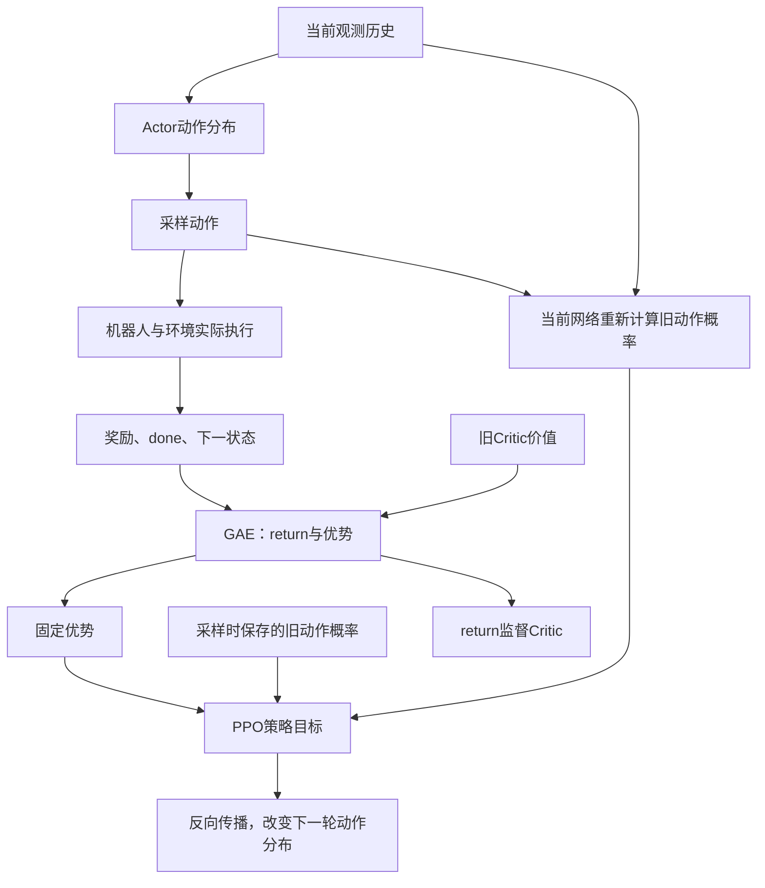

# UniFP 的 PPO：一批机器人经验怎样变成网络参数更新

本文解释官方 `b2z1_pos_force` 任务实际执行的 PPO，而不是只介绍 PPO 的一般概念。源码核对版本为 `68847a070f88d731058c3d8476929bc3b205f5bd`。

配套阅读：[总体训练流程](/home/sorry/python_ws/interactive/unifp_reproduction/introduction/00-training-flow-zh-CN.md)、[Actor 详解](/home/sorry/python_ws/interactive/unifp_reproduction/introduction/01-actor-zh-CN.md)、[Critic 详解](/home/sorry/python_ws/interactive/unifp_reproduction/introduction/02-critic-zh-CN.md)。

阅读主线是：**先让机器人实际尝试，再判断哪些尝试相对更好，最后让这些动作在类似观测下更容易出现，并限制单次改动。** 下文先讲这条因果关系，再对应到数据缓存、GAE、概率比和代码。所有手算均为教学例子，不代表实测训练结果。

## 1. 先回答：PPO 到底是哪个东西

**PPO 是利用机器人交互数据更新神经网络参数的训练算法，不是一个输出高层命令的网络。** 在这份代码中，`PPO` 是 Python 类；它持有 ActorCritic 模型、经验缓存和两个优化器。

要区分三个动作：

1. Actor 根据观测产生动作分布，训练时从中采样动作。
2. 环境把动作变成关节目标角度，再通过 PD 控制器产生力矩，执行仿真并计算奖励。
3. PPO 读取刚才保存的数据，计算损失并调用 `backward()`、`optimizer.step()`，使未来的动作分布发生变化。

所以用户的理解“PPO 用来改变 Actor 的神经网络参数”是对的，但还不完整：这里 PPO 的主损失也训练 Critic、历史编码器和动作标准差；同一训练循环还有一项单独的状态估计监督学习更新。

证据：[PPO 对象和优化器创建，ppo.py:44](/home/sorry/python_ws/interactive/unifp_reproduction/UniFP/legged_gym/b2_gym_learn/ppo_cse_pf/ppo.py:44)、[实际更新，ppo.py:164](/home/sorry/python_ws/interactive/unifp_reproduction/UniFP/legged_gym/b2_gym_learn/ppo_cse_pf/ppo.py:164)。

### 1.1 为什么知道目标位置，仍然需要PPO

“末端应到哪里、底盘应怎样运动”是任务要求，并没有直接给出所有关节该怎样配合。相同末端目标可由不同底盘位置、转向姿态和机械臂姿态实现；动作还会受惯性、摩擦、限幅、外力与历史状态影响。PPO利用真实尝试得到的奖励，逐步学习这种任务到动作的映射。

它不需要提前给每帧标注唯一正确的关节角度，也不需要对PhysX求导。它要保存的是：“当时看到了什么、尝试了哪个动作、动作当时有多常见、后来发生了什么、原来预计会怎样”。这些字段齐全，才可以重新评价旧经验并改进策略。

例如同一类观测下，两次尝试得到不同后果：一个动作减小补偿误差且没有大幅限幅，另一个动作使机械臂过冲。若前者的综合长期结果相对更好，策略更新就倾向于提高前者的概率密度。这里的好坏最终由已定义奖励和优势决定，不能仅凭“动作向目标方向转了一点”代替计算。

### 1.2 三个学习问题，三条监督路径

| 问题 | 用什么数据回答 | 更新谁 |
|---|---|---|
| 这次动作相对当前处境是否更好 | 环境奖励、旧价值、GAE优势和动作概率比 | Actor、历史编码器、std |
| 当前处境未来大约值多少回报 | 真实奖励与bootstrap组成的return目标 | Critic |
| 历史能否表达速度、位置和外力 | 仿真提供的12维状态标签 | 编码器、解码器 |

第一、二条合在PPO主损失中优化，第三条紧接着做辅助更新。它们共享部分参数或同批样本，但监督目标不同；“估力准确”不自动等于“动作正确”。



图中的仿真只负责产生经验，不在反向传播路径中。更新期间重新计算旧观测下的分布，不是用新动作重新执行一遍环境来替换旧奖励。

### 1.3 统一记号，避免把奖励和概率比混淆

| 记号 | 含义 | 代码字段 |
|---|---|---|
| $H_t$ | Actor当前历史输入 | `obs`，官方2336维 |
| $c_t$ | Critic当前特权历史 | `critic_obs`，官方447维 |
| $a_t$ | 已执行的原始采样动作 | `actions_batch` |
| $r_t$ | 环境即时奖励，超时入库前可有校正 | `rewards` |
| $\hat R_t$ | Critic的拟合目标 | `returns_batch` |
| $A_t^{raw}$ | 未标准化的GAE优势 | `returns - values` |
| $\hat A_t$ | 整批标准化后的优势 | `advantages_batch` |
| $\rho_t$ | 同一旧动作的新／旧概率密度比 | `ratio` |

下文涉及概率比时统一用 $\rho_t$；奖励仍用 $r_t$。源码中的变量名保持原样，方便逐项对照。

## 2. 一轮训练的完整顺序和数据量

下面的“轮”指 runner 外层循环的一次 iteration，不是一次物理积分，也不是一次 minibatch 梯度更新。

```text
当前 Actor / Critic 参数
   ↓
4096 个环境各执行 24 次策略控制：
   观测 → Actor 采样动作 + Critic 估值 → 环境执行 → 奖励 / 终止 / 新观测
   每次把旧观测、动作、旧 log_prob、旧 V、旧 μ / σ 等保存进缓存
   ↓
获得 24 × 4096 = 98,304 条 transition
   ↓
Critic 估计 rollout 末端状态价值 → 倒序 GAE → returns / advantages
   ↓
把 98,304 条数据分成 4 个 minibatch，每个 24,576 条
   ↓
重复 5 个 epoch：
   每个 minibatch 做一次 PPO 主更新
   然后做一次状态估计辅助更新
   ↓
共 20 次 PPO 主更新 + 20 次辅助更新
   ↓
重置缓存写入位置，使用更新后的策略收集下一轮新数据
```

默认 `num_envs=4096` 来自基类配置；任务配置覆盖观测和动作维度。`num_steps_per_env=24`、5 个 epoch 和 4 个 minibatch 均来自继承的训练配置。不要仅看 `PPO.__init__` 的默认形参；runner 传入的配置覆盖了它们，例如实际 `gamma=0.99`，不是构造函数形参中的 `0.998`。

证据：[环境数，legged_robot_config.py:4](/home/sorry/python_ws/interactive/unifp_reproduction/UniFP/legged_gym/envs/base/legged_robot_config.py:4)、[训练配置，legged_robot_config.py:196](/home/sorry/python_ws/interactive/unifp_reproduction/UniFP/legged_gym/envs/base/legged_robot_config.py:196)、[传入配置，on_policy_runner.py:66](/home/sorry/python_ws/interactive/unifp_reproduction/UniFP/legged_gym/b2_gym_learn/ppo_cse_pf/on_policy_runner.py:66)。

### 2.1 默认超参数

| 参数 | 实际值 | 在训练中的作用 |
|---|---:|---|
| `num_steps_per_env` | 24 | 每轮每个环境收集的策略步数 |
| `num_learning_epochs` | 5 | 同一批经验重复训练的遍数 |
| `num_mini_batches` | 4 | 每遍分成的 minibatch 数 |
| `gamma` | 0.99 | 未来奖励的折扣因子 |
| `lam` | 0.95 | GAE 的衰减系数 |
| `clip_param` | 0.2 | 策略代理损失和价值损失的裁剪参数 |
| `value_loss_coef` | 1.0 | Critic 损失系数 |
| `entropy_coef` | 0.01 | 动作分布熵奖励的系数 |
| `learning_rate` | 初始 0.001 | 主 Adam 优化器初始学习率 |
| `schedule` | `adaptive` | 根据新旧策略 KL 调整主学习率 |
| `desired_kl` | 0.01 | 调整学习率时使用的参考 KL |
| `max_grad_norm` | 1.0 | 主更新的全局梯度范数上限 |
| 辅助学习率 | 0.00001 | 状态估计 Adam 学习率 |
| 辅助 substeps | 1 | 每个 minibatch 的辅助更新次数 |

证据：[继承的 PPO 配置，legged_robot_config.py:196](/home/sorry/python_ws/interactive/unifp_reproduction/UniFP/legged_gym/envs/base/legged_robot_config.py:196)、[任务熵系数，b2z1_pos_force_config.py:313](/home/sorry/python_ws/interactive/unifp_reproduction/UniFP/legged_gym/envs/b2/b2z1_pos_force_config.py:313)、[辅助超参数，ppo.py:12](/home/sorry/python_ws/interactive/unifp_reproduction/UniFP/legged_gym/b2_gym_learn/ppo_cse_pf/ppo.py:12)。

## 3. 第一步：旧策略读取什么，保存什么

runner 的实际入口是：

```python
with torch.inference_mode():
    for i in range(self.num_steps_per_env):
        actions = self.alg.act(obs, privileged_obs, obs_pred)
        obs_dict, rewards, dones, infos = self.env.step(actions)
        # 从 obs_dict 取下一时刻的三类观测，转到训练设备
        self.alg.process_env_step(rewards, dones, infos)
```

上面省略了记录日志、设备移动等语句，执行顺序与源码一致。[完整 runner，on_policy_runner.py:119](/home/sorry/python_ws/interactive/unifp_reproduction/UniFP/legged_gym/b2_gym_learn/ppo_cse_pf/on_policy_runner.py:119)。

每个策略步，`PPO.act()` 的输入为：

| 名称 | 默认批次形状 | 用途 |
|---|---|---|
| `obs` | `[4096, 2336]` | Actor 可用的 32 帧历史观测，73 维 / 帧 |
| `critic_obs`，runner 中叫 `privileged_obs` | `[4096, 447]` | Critic 使用的 3 帧特权观测，149 维 / 帧 |
| `obs_pred` | `[4096, 12]` | 辅助状态估计的真实标签；此处缓存，不作为 Actor 的直接输入 |

证据：[任务维度，b2z1_pos_force_config.py:102](/home/sorry/python_ws/interactive/unifp_reproduction/UniFP/legged_gym/envs/b2/b2z1_pos_force_config.py:102)。

`PPO.act()` 保存：

```python
self.transition.actions = self.actor_critic.act(obs).detach()
self.transition.values = self.actor_critic.evaluate(critic_obs).detach()
self.transition.actions_log_prob = self.actor_critic.get_actions_log_prob(
    self.transition.actions
).detach()
self.transition.action_mean = self.actor_critic.action_mean.detach()
self.transition.action_sigma = self.actor_critic.action_std.detach()
self.transition.observations = obs
self.transition.critic_observations = critic_obs
self.transition.observation_preds = obs_pred
return self.transition.actions
```

逐项解释：

- `actions: [4096,17]`：这一时刻实际采样的 17 维原始动作。
- `values: [4096,1]`：执行动作前，旧 Critic 对当前状态的估值。
- `actions_log_prob: [4096]`：旧策略给这一整个 17 维动作的对数概率密度。
- `action_mean / action_sigma: [4096,17]`：旧高斯策略的均值和标准差，后面计算 KL。
- 三类观测：与本时刻动作对齐的输入和监督标签。

代码先缓存输入，再调用 `env.step()`。因此辅助标签和 Actor 历史来自动作执行前的同一个时刻，不是随手拿下一帧来配对。[ppo.py:77](/home/sorry/python_ws/interactive/unifp_reproduction/UniFP/legged_gym/b2_gym_learn/ppo_cse_pf/ppo.py:77)。

### 3.1 `log_prob` 不是“这个动作值本身的大小”

训练策略是 17 个分量组成的对角高斯分布。每个关节有自己的动作均值和标准差；`log_prob(actions).sum(-1)` 把 17 个分量的对数密度加起来，得到整个动作向量的联合对数密度。

连续变量取一个精确点的概率质量为 0，所以这里严格说是**概率密度**。后面的新旧比值表示“同一个旧动作在新分布下，相对旧分布变得多容易出现”，不是比较两个动作的角度大小。

证据：[分布及 log_prob，actor_critic.py:143](/home/sorry/python_ws/interactive/unifp_reproduction/UniFP/legged_gym/b2_gym_learn/ppo_cse_pf/actor_critic.py:143)。

## 4. 第二步：环境执行，返回奖励和终止信息

环境输入是 `[4096,17]` 的动作；环境输出是：

```text
obs_dict = {
  "obs":            下一时刻 Actor 历史观测 [4096,2336],
  "privileged_obs": 下一时刻 Critic 历史观测 [4096,447],
  "obs_pred":       下一时刻辅助监督标签 [4096,12]
}
rewards: [4096]
dones:   [4096]
infos:   字典，例如 time_outs、episode 统计
```

动作先在环境中裁剪，再转换成目标关节角度和力矩；同一动作持续 4 个物理子步。PPO 缓存和计算 log_prob 的仍是 `PPO.act()` 采样的原始动作，环境另外保存执行用的裁剪动作。

**奖励由环境里人工定义的函数计算，不是 Critic 写出来的分数。** `compute_reward()` 遍历非零权重的奖励函数，将各项乘权重求和。Critic 学的是这些奖励所构成的未来回报。

证据：[环境动作执行和输出，legged_robot_b2z1_pos_force.py:100](/home/sorry/python_ws/interactive/unifp_reproduction/UniFP/legged_gym/envs/b2/legged_robot_b2z1_pos_force.py:100)、[奖励求和，legged_robot_b2z1_pos_force.py:305](/home/sorry/python_ws/interactive/unifp_reproduction/UniFP/legged_gym/envs/b2/legged_robot_b2z1_pos_force.py:305)。关节角度换算详见 Actor 专文。

### 4.1 超时不是失败：代码怎样补 bootstrap

`process_env_step()` 先复制奖励，再执行：

```python
if 'time_outs' in infos:
    self.transition.rewards += self.gamma * torch.squeeze(
        self.transition.values * infos['time_outs'].unsqueeze(1).to(self.device), 1
    )
self.storage.add_transitions(self.transition)
self.transition.clear()
```

因为 episode 时间上限截断并不一定意味着机器人失败，代码给超时样本补一个价值项，避免直接把未展开的未来一律当作 0。

必须忠实区分“常见理论写法”和“这份代码”：**这里补的是先前缓存的当前状态价值 `V_old(s_t)`，不是额外评价终止前下一状态所得的 `V_old(s_{t+1})`。** 例如原奖励 0.2、缓存价值 0.8、超时标志 1，缓存奖励变成 `0.2 + 0.99×0.8 = 0.992`。后续 GAE 仍使用 `done` 切断跨 episode 递推。真正失败且没有超时标志时，不加这个补偿项。

随后 `add_transitions()` 将数据复制进缓存；`transition.clear()` 只清理临时 transition 对象，不会删掉刚复制进缓存的数据。[超时处理，ppo.py:90](/home/sorry/python_ws/interactive/unifp_reproduction/UniFP/legged_gym/b2_gym_learn/ppo_cse_pf/ppo.py:90)、[复制写入缓存，rollout_storage.py:54](/home/sorry/python_ws/interactive/unifp_reproduction/UniFP/legged_gym/b2_gym_learn/ppo_cse_pf/rollout_storage.py:54)。

## 5. 第三步：GAE 怎样把奖励变成训练标签

收集 24 步后，PPO 用末端 Critic 观测再算一次 `last_values`，作为未结束轨迹在窗口之外的 bootstrap。收集 24 步不意味着 episode 必须结束。

```python
last_values = self.actor_critic.evaluate(last_critic_obs).detach()
self.storage.compute_returns(last_values, self.gamma, self.lam)
```

然后缓存中倒序计算：

```python
next_is_not_terminal = 1.0 - self.dones[step].float()
delta = self.rewards[step] + next_is_not_terminal * gamma * next_values - self.values[step]
advantage = delta + next_is_not_terminal * gamma * lam * advantage
self.returns[step] = advantage + self.values[step]
```

用公式表示：

$$
\delta_t = r_t + (1-d_t)\gamma V_{old}(c_{t+1})-V_{old}(c_t)
$$

$$
A_t^{raw}=\delta_t+(1-d_t)\gamma\lambda A_{t+1}^{raw},\qquad
\hat R_t=A_t^{raw}+V_{old}(c_t)
$$

$\hat R_t$就是代码里的 `returns`，用于训练Critic；$A_t^{raw}$表示相对旧Critic基准，这段实际经历是更好还是更差。这里的return是带bootstrap的GAE／λ-return目标，不是简单把24个奖励机械相加。

可以把TD残差读成：“眼前得到的奖励＋下一状态预计的剩余回报，减去行动前原本的预期”。GAE再把后续多步的残差向前传递，让一次过冲或失稳能影响此前的动作，而不是只影响最后一步。详细展开见 [Critic的GAE解释](/home/sorry/python_ws/interactive/unifp_reproduction/introduction/02-critic-zh-CN.md)。

随后代码用整批数据的均值和标准差标准化优势：

```python
self.advantages = self.returns - self.values
self.advantages = (self.advantages - self.advantages.mean()) / (self.advantages.std() + 1e-8)
```

**Critic 的 return 目标不被这一步标准化。** Actor损失使用标准化后的优势；因此不要把最终优势的正负无条件解释为原始 $\hat R_t-V_{old}(c_t)$的正负，减去全批均值可能改变个别样本的符号。

$$
\hat A_t=\frac{A_t^{raw}-\operatorname{mean}(A^{raw})}
{\operatorname{std}(A^{raw})+10^{-8}}.
$$

标准化把本批优势的整体偏移与尺度消掉，使策略梯度不必随奖励数值大小同比放大。它也带来一个解释边界：最终正优势表示相对**本批中心化基准**更好，不能不加条件地读成“这个动作的绝对回报很高”。

证据：[末端估值，ppo.py:102](/home/sorry/python_ws/interactive/unifp_reproduction/UniFP/legged_gym/b2_gym_learn/ppo_cse_pf/ppo.py:102)、[GAE 和标准化，rollout_storage.py:72](/home/sorry/python_ws/interactive/unifp_reproduction/UniFP/legged_gym/b2_gym_learn/ppo_cse_pf/rollout_storage.py:72)。

### 5.1 一个仅两步的教学数值例子

这不是某次真实训练日志；为看清计算，假设窗口只有两步、均未结束：

| 时刻 | 奖励 | 旧 Critic 价值 |
|---|---:|---:|
| 0 | 0.2 | 0.8 |
| 1 | 0.3 | 0.7 |
| 窗口末端状态 2 | 未采集奖励 | 0.9 |

从后往前：

$$
\begin{aligned}
\delta_1&=0.3+0.99\times0.9-0.7=0.491,\\
A_1^{raw}&=0.491,\qquad \hat R_1=0.491+0.7=1.191,\\
\delta_0&=0.2+0.99\times0.7-0.8=0.093,\\
A_0^{raw}&=0.093+0.99\times0.95\times0.491=0.5547855,\\
\hat R_0&=0.5547855+0.8=1.3547855.
\end{aligned}
$$

之后将这些 raw advantages 与同批全部样本一起标准化，再送入 Actor 损失。若某时刻 `done=1`，公式里的 `(1−done)` 变成 0，不能把 reset 后另一个 episode 的价值混进来。

如果教学批次只有这两个样本，两者原始优势虽都为正，标准化后却是一正一负：0.5547855高于批均值，0.491低于批均值。按源码默认的样本标准差计算，约为＋0.7071和−0.7071。真实训练按全部98304条样本标准化，不能只用某一个minibatch或这两条代替。

## 6. 第四步：切 minibatch，同一旧动作重新计算新概率

缓存最初的主要张量为：

| 数据 | 缓存形状 | minibatch 形状 |
|---|---|---|
| Actor 观测 | `[24,4096,2336]` | `[24576,2336]` |
| Critic 观测 | `[24,4096,447]` | `[24576,447]` |
| 状态标签 | `[24,4096,12]` | `[24576,12]` |
| 动作、旧均值、旧标准差 | `[24,4096,17]` | `[24576,17]` |
| 旧 log_prob、旧 value、returns、advantages | `[24,4096,1]` | `[24576,1]` |

generator 将时间和环境两个维度展平，打乱索引，切成 4 份。细节：这份实现 `randperm` 位于 epoch 循环外，所以每次 `update()` 只打乱一次，5 遍复用同一分组，不是每遍重新打乱。

每个 minibatch 开始时：

```python
self.actor_critic.act(obs_batch, masks=masks_batch)
actions_log_prob_batch = self.actor_critic.get_actions_log_prob(actions_batch)
value_batch = self.actor_critic.evaluate(critic_obs_batch, masks=masks_batch)
```

`act(obs_batch)` 的主要作用是根据**当前参数**重建动作分布。这里虽然也采样一次新动作，但返回值没有被使用；计算 log_prob 时传的是缓存的旧 `actions_batch`。这段更新过程也不调用环境。

比较的是：

```text
旧参数：同一观测 → 旧分布 → 旧动作 a 的 old_log_prob（已缓存）
新参数：同一观测 → 新分布 → 同一个旧动作 a 的 new_log_prob（重新计算）
```

证据：[minibatch generator，rollout_storage.py:96](/home/sorry/python_ws/interactive/unifp_reproduction/UniFP/legged_gym/b2_gym_learn/ppo_cse_pf/rollout_storage.py:96)、[重新估计，ppo.py:119](/home/sorry/python_ws/interactive/unifp_reproduction/UniFP/legged_gym/b2_gym_learn/ppo_cse_pf/ppo.py:119)。

## 7. 第五步：Actor 的 PPO 裁剪损失究竟怎样改变动作

源码：

```python
ratio = torch.exp(actions_log_prob_batch - torch.squeeze(old_actions_log_prob_batch))
surrogate = -torch.squeeze(advantages_batch) * ratio
surrogate_clipped = -torch.squeeze(advantages_batch) * torch.clamp(
    ratio, 1.0 - self.clip_param, 1.0 + self.clip_param
)
surrogate_loss = torch.max(surrogate, surrogate_clipped).mean()
```

等价于最小化：

$$
L_{actor}=-\operatorname{mean}\left[\min\left(\rho_t\hat A_t,
\operatorname{clip}(\rho_t,0.8,1.2)\hat A_t\right)\right]
$$

$$
\rho_t=\frac{\pi_{new}(a_t\mid H_t)}{\pi_{old}(a_t\mid H_t)}
=\exp\left(\log\pi_{new}(a_t\mid H_t)-\log\pi_{old}(a_t\mid H_t)\right)
$$

代码变量 `ratio` 对应 $\rho_t$，与奖励 $r_t$是不同量；$\hat A_t$指标准化后的优势。连续动作使用概率**密度**，不是“恰好采到一个实数点的概率”；比较同一动作附近等大小小区间时，密度比反映其相对常见程度。

在本轮第一次更新之前，新旧策略相同，概率比约为1；随着参数变化，比值才偏离1。分母固定为采样时的旧策略概率，不会在每个epoch重新把当前策略当成新的基准，否则会丢失对本批累计变化的衡量。

### 7.1 正优势样本

假设 `A=+2`，旧 log_prob 为 −10，新 log_prob 为 −9.664，差约 `log(1.4)`，所以 `ratio=1.4`。新策略把这条好经验里的动作变得更常见：

$$
J=\min(1.4\times2,1.2\times2)=\min(2.8,2.4)=2.4,
\qquad L_{actor,t}=-2.4.
$$

继续让 ratio 超过 1.2 不再从这一样本获得更多代理目标收益。相反，若正优势样本 ratio 降到 0.6，目标是 `min(1.2,1.6)=1.2`，仍会惩罚把好动作变得更少见的方向。

### 7.2 负优势样本

假设 `A=−2`，策略应减少这条相对较差经验中的动作概率。若 `ratio=0.6`：

$$
J=\min(0.6\times(-2),0.8\times(-2))=\min(-1.2,-1.6)=-1.6,
\qquad L_{actor,t}=+1.6.
$$

已经降到 0.8 以下后，进一步降低没有额外代理目标收益；若反而 ratio 升到 1.4，目标变成 `min(−2.8,−2.4)=−2.8`，loss 为 +2.8，仍惩罚增加坏动作概率。

**clip 裁剪的是代理损失中的一条计算分支。它不是硬性保证所有 ratio 永远处在 `[0.8,1.2]`，也不把网络参数直接裁成某个范围，更不是把关节动作限制为 `[-0.2,0.2]`。** 不同样本共享网络参数，Critic、熵和辅助更新也会改变参数；实际新旧策略变化还由 KL、学习率和梯度裁剪共同调节。

证据：[策略损失，ppo.py:147](/home/sorry/python_ws/interactive/unifp_reproduction/UniFP/legged_gym/b2_gym_learn/ppo_cse_pf/ppo.py:147)。

### 7.3 动作已经 detach，为什么 Actor 仍能训练

梯度不需要穿过机器人仿真，也不需要穿过当时的随机采样。旧动作作为一个固定数值，代入**当前可微分布**：

```text
当前 encoder / actor / std 参数
   → 当前 μ / σ
   → log_prob(缓存的固定动作)
   → ratio
   → surrogate loss
   → backward()
```

因此更新能改变 Actor 均值和标准差，让有利动作在类似观测下更容易出现。这是基于对数概率的策略梯度；并不是对“正确关节角度标签”做 MSE，也不是通过物理引擎反向传播。

### 7.4 概率梯度怎样真正改变动作均值

先看单个关节、固定标准差，并暂时忽略裁剪、熵及其他样本。高斯分布的对数密度对均值的导数是：

$$
\frac{\partial\log\pi(a\mid H)}{\partial\mu}
=\frac{a-\mu}{\sigma^2}.
$$

假设旧均值为0，标准差为0.5，曾采样动作0.4。这个固定动作比当前均值偏正；在新旧策略尚相同时，取标准化优势＋2，则：

$$
\frac{\partial L_{actor}}{\partial\mu}
=-\hat A\,\rho\,\frac{a-\mu}{\sigma^2}
=-2\times1\times\frac{0.4}{0.25}=-3.2.
$$

梯度下降倾向于提高均值，向这次相对有利的0.4靠近。若该动作优势为−2，梯度符号反过来，均值倾向于远离它。这就是“好动作更常见、差动作更少见”如何落到可微参数上，而不是把网络输出直接改写成奖励值。

真实任务有17个动作维度，log概率先逐维求和，概率比针对整个联合动作。不是独立给17个关节各打一个分；一条优势评价这次整组动作及其后果。均值经神经网络由多层参数共同决定，Adam实际更新的是权重和偏置，上面只是在输出层面解释梯度方向。

std也可被策略损失训练：更有利的样本离均值很远或很近时，可能对探索宽度产生不同影响。因此修改熵系数并不等于冻结std，减小std也不能保证动作均值已经正确。

### 7.5 为什么裁剪能减缓更新，但不能保证绝不退化

下表列的是要最大化的单样本代理目标 $J=\min(\rho\hat A,\operatorname{clip}(\rho,0.8,1.2)\hat A)$，Actor损失取其负号：

| 优势 | 概率比 | 代理目标J | 当前样本提供的含义 |
|---:|---:|---:|---|
| ＋2 | 0.6 | 1.2 | 好动作反而变少，仍有提高其概率的梯度 |
| ＋2 | 1.0 | 2.0 | 仍可提高好动作的概率 |
| ＋2 | 1.4 | 2.4 | 超过1.2后进入平台，不继续奖励增大概率 |
| −2 | 0.6 | −1.6 | 低于0.8后进入平台，不继续奖励减小概率 |
| −2 | 1.0 | −2.0 | 仍可降低差动作的概率 |
| −2 | 1.4 | −2.8 | 差动作反而变多，仍有降低其概率的梯度 |

它只在“已经朝有利方向改得较多”时停止追加本样本的代理收益；朝不利方向变化仍受约束。由于很多样本共享参数，编码器还接受辅助更新，某个样本即使进入平台，也可能因其他梯度继续改变概率。PPO因此是保守的代理优化方法，不是对真实机器人性能单调提升的证明。

## 8. 第六步：Critic 怎样同时训练

代码中的 `target_values_batch` 名字容易误导：它来自缓存的 `values`，实际是**旧 Critic 预测**，不是 returns。真正的价值监督目标叫 `returns_batch`。

```python
value_clipped = target_values_batch + (value_batch - target_values_batch).clamp(
    -self.clip_param, self.clip_param
)
value_losses = (value_batch - returns_batch).pow(2)
value_losses_clipped = (value_clipped - returns_batch).pow(2)
value_loss = torch.max(value_losses, value_losses_clipped).mean()
```

输入：新 Critic 预测 `value_batch`、旧预测 `target_values_batch`、GAE return `returns_batch`，三者均为 `[24576,1]`。输出：一个标量 `value_loss`。

数学上，先限制相对旧预测的变化，再对两种预测误差取较大者：

$$
V_t^{clip}=V_{old}(c_t)+\operatorname{clip}
\left(V_\phi(c_t)-V_{old}(c_t),-0.2,0.2\right),
$$

$$
L_V=\operatorname{mean}\left[
\max\left((V_\phi(c_t)-\hat R_t)^2,(V_t^{clip}-\hat R_t)^2\right)
\right].
$$

这条损失调整“对未来的预测”；策略损失调整“在同类观测下尝试哪些动作”。它们加在一个主loss里，但各自反向传播到不同网络分支。Actor更新时的优势已固定，不会通过这批优势再给旧Critic反传梯度。

例如旧预测 0.8、return 目标 1.3、新预测 1.1：

| 计算步骤 | 演算结果 |
|---|---|
| 相对旧预测的变化 | $1.1-0.8=0.3$ |
| 裁剪后的预测 | $0.8+0.2=1.0$ |
| 普通平方误差 | $(1.1-1.3)^2=0.04$ |
| 裁剪平方误差 | $(1.0-1.3)^2=0.09$ |
| 本样本价值损失 | $\max(0.04,0.09)=0.09$ |

这里 ±0.2 是**价值预测差的绝对裁剪量**，与策略概率比值的 ±20% 是不同用法；它也不是强制新 Critic 输出永远离旧输出不超过 0.2。

证据：[value_loss，ppo.py:154](/home/sorry/python_ws/interactive/unifp_reproduction/UniFP/legged_gym/b2_gym_learn/ppo_cse_pf/ppo.py:154)、[旧预测来源，rollout_storage.py:124](/home/sorry/python_ws/interactive/unifp_reproduction/UniFP/legged_gym/b2_gym_learn/ppo_cse_pf/rollout_storage.py:124)。

## 9. 第七步：熵、KL、主优化器分别做什么

### 9.1 熵鼓励保留探索

```python
loss = surrogate_loss + self.value_loss_coef * value_loss - self.entropy_coef * entropy_batch.mean()
```

默认系数是 `1.0` 和 `0.01`。最小化损失时，负号使更高的分布熵更有利，避免动作分布过早变得非常窄。这里各关节高斯分布的熵先求和；高斯熵取决于标准差，因此这项直接作用于可训练 `std`，不是给关节均值加一组“随机目标角度”。

$$
L_{main}=L_{actor}+1.0\,L_V-0.01\,\mathcal{H}(\pi),\qquad
\mathcal{H}(\pi)=\sum_{j=1}^{17}\frac12\log(2\pi e\,\sigma_j^2).
$$

对一个关节，熵项损失的导数为 $-0.01/\sigma_j$，梯度下降倾向于增大std；策略代理损失也影响std，Adam还继承过去的动量，所以最后std的增减取决于这些作用的合成。熵有助于继续探索，也可能增加控制扰动，不能只看“熵越高越好”或“std越低越好”。

这里是连续分布的微分熵，数值可能为负；负值本身不是概率出错。正式训练中系数由任务有效配置传入，不能拿 `PPO.__init__` 的默认0替代官方实际0.01。

证据：[总损失，ppo.py:164](/home/sorry/python_ws/interactive/unifp_reproduction/UniFP/legged_gym/b2_gym_learn/ppo_cse_pf/ppo.py:164)、[标准差和熵，actor_critic.py:112](/home/sorry/python_ws/interactive/unifp_reproduction/UniFP/legged_gym/b2_gym_learn/ppo_cse_pf/actor_critic.py:112)。

### 9.2 KL 用来调学习率，不是直接加进 loss

代码按旧、新高斯分布计算 `KL(old || new)`，对 17 个动作维度求和，再对 minibatch 求均值：

```text
KL > 0.02             → learning_rate ÷ 1.5，下限 1e−5
0 < KL < 0.005        → learning_rate × 1.5，上限 1e−2
其他情况               → 保持当前学习率
```

调整在本 minibatch 的主 `optimizer.step()` 之前执行。KL 计算处于 `inference_mode()` 内；这份实现没有把 KL 当作附加可微损失，也没有到阈值立即结束 epoch 的 early stop。[ppo.py:131](/home/sorry/python_ws/interactive/unifp_reproduction/UniFP/legged_gym/b2_gym_learn/ppo_cse_pf/ppo.py:131)。

### 9.3 真正改变参数的是这几行

```python
self.optimizer.zero_grad()
loss.backward()
nn.utils.clip_grad_norm_(self.actor_critic.parameters(), self.max_grad_norm)
self.optimizer.step()
```

`zero_grad()` 清掉之前的梯度；`backward()` 沿当前计算图求梯度；`clip_grad_norm_` 把主更新的全局梯度范数限制到 1；Adam 根据梯度和动量更新参数。**梯度范数裁剪与 PPO ratio 裁剪也是两件不同的事。**

| 机制 | 控制的对象 | 并不直接限制什么 |
|---|---|---|
| PPO概率比裁剪 | 单样本代理目标中的收益 | 不直接裁剪关节动作 |
| KL自适应学习率 | 根据整批分布变化调节主Adam步长 | 不保证每次更新后的KL都低于阈值 |
| 梯度范数裁剪 | 主更新梯度向量的总范数 | 不等于限制每个参数或每个动作的绝对值 |
| 环境动作／力矩限幅 | 实际送入控制和仿真的执行量 | 不保证策略输出的均值或std已经合理 |

这些机制发生在不同位置。动作在控制端被限幅后，PPO仍按缓存的原始采样动作计算概率；限幅会改变原始动作到实际后果的映射，不能把“执行量没有超过上限”当成策略已经学好。

主损失实际的梯度路径：

```text
surrogate_loss → actor_body + adaptation_encoder_module + std
value_loss     → critic_body
−entropy       → std
```

decoder 没有参与上述前向路径，所以不能说“每次 PPO 主更新都会训练 decoder”。[ppo.py:166](/home/sorry/python_ws/interactive/unifp_reproduction/UniFP/legged_gym/b2_gym_learn/ppo_cse_pf/ppo.py:166)、[Actor 前向路径，actor_critic.py:143](/home/sorry/python_ws/interactive/unifp_reproduction/UniFP/legged_gym/b2_gym_learn/ppo_cse_pf/actor_critic.py:143)。

## 10. 第八步：紧接着的状态估计更新，为什么不是同一个 PPO loss

每完成一次 minibatch 的主 PPO 更新，代码用**更新后的 encoder 参数**重新做一次前向：

```python
adaptation_pred = self.actor_critic.get_student_latent(obs_batch)
with torch.no_grad():
    adaptation_target = obs_pred_batch
```

虽然方法名叫 `get_student_latent()`，它实际返回 decoder 的 **12 维显式预测**，不是 64 维中间 latent：

```python
latent = self.adaptation_encoder_module(observations)
obs_pred = self.adaptation_decoder_module(latent)
return obs_pred
```

输入 `[24576,2336]` → encoder `[24576,64]` → decoder `[24576,12]`。标签 `obs_pred_batch` 同为 `[24576,12]`，来自采样时环境提供的真实状态。

12 维分组和权重：

| 切片 | 监督内容 | 代码中的乘数 `w` | 对应平方误差系数 |
|---|---|---:|---:|
| `0:3` | 机身线速度 | 0.2 | 0.04 |
| `3:6` | 末端球坐标位置 | 0.2 | 0.04 |
| `6:9` | 注入的末端外力 | 1.0 | 1.0 |
| `9:12` | 注入的机身外力 | 1.0 | 1.0 |

这里必须保留代码的精确形式：

```python
idx_adaptation_loss = F.mse_loss(
    adaptation_pred[:, selection_indices] * weight,
    adaptation_target[:, selection_indices] * weight
)
adaptation_loss += idx_adaptation_loss

self.adaptation_module_optimizer.zero_grad()
adaptation_loss.backward()
self.adaptation_module_optimizer.step()
```

因此损失是 `MSE(w×pred, w×label) = w²×MSE(pred,label)`，**不是** `w×MSE(pred,label)`。例如速度某一分量预测比真值多 1，乘数 0.2 后，该分量平方误差为 0.04；每组还会对样本和三个分量取 mean。

$$
L_{aux}=\sum_{g=1}^{4}w_g^2\operatorname{mean}
\left[(\hat y_g-y_g)^2\right],\qquad w=(0.2,0.2,1,1).
$$

例如注入力为20N，标签乘0.01后为0.20，解码预测为0.15，对应15N。该分量缩放后的平方误差为0.0025，而物理绝对误差为5N。最终辅助loss还会按样本和分量求均值、分组求和，并受日志归一化影响，所以它不等于以N为单位的估力MAE。

辅助任务促使历史表示保留可解释的物理信息；主任务再学习如何利用表示产生动作。两者的共享编码器形成联系，但没有一条硬规则强制“估计到＋20N就必须输出某个关节角度”。是否真正形成正确闭环，仍要用补偿误差、底盘跟踪、限幅和真实接触评估验证。

证据：[分组权重，actor_critic.py:13](/home/sorry/python_ws/interactive/unifp_reproduction/UniFP/legged_gym/b2_gym_learn/ppo_cse_pf/actor_critic.py:13)、[预测方法，actor_critic.py:177](/home/sorry/python_ws/interactive/unifp_reproduction/UniFP/legged_gym/b2_gym_learn/ppo_cse_pf/actor_critic.py:177)、[辅助更新，ppo.py:178](/home/sorry/python_ws/interactive/unifp_reproduction/UniFP/legged_gym/b2_gym_learn/ppo_cse_pf/ppo.py:178)。

### 10.1 两个优化器都传入全部参数，为什么更新范围不同

构造代码确实是：

```python
self.optimizer = optim.Adam(self.actor_critic.parameters(), lr=learning_rate)
self.adaptation_module_optimizer = optim.Adam(
    self.actor_critic.parameters(),
    lr=Adaptation_Args.adaptation_module_learning_rate
)
```

并没有把辅助优化器参数列表限定为 encoder 和 decoder，也没有通过 `requires_grad=False` 冻结 Actor。**区分更新范围的实际依据是每一步先 `zero_grad()`，再对不同前向路径产生的 loss 调用 `backward()`。**

| 模块 | PPO 主 loss 的非零梯度路径 | 辅助 MSE 的非零梯度路径 |
|---|---|---|
| 历史 encoder | 有 | 有 |
| Actor body | 有 | 无 |
| 动作 `std` | 有 | 无 |
| Critic body | 有 | 无 |
| 状态 decoder | 无 | 有 |

这里的“有”表示计算图相连，不保证每一个参数在每次 minibatch 上梯度数值均非零。对无关分支，清梯度后没有新的梯度贡献；默认 Adam 未配置权重衰减。不要把“优化器持有参数”直接等同于“这一 loss 能训练这些参数”。

尤其注意：**encoder 被两个具有独立 Adam 状态、不同学习率的优化器交替更新。** 辅助更新即使不直接改 Actor body，也会通过 encoder 的改变影响下一次 Actor 的动作输出。Actor 直接用的是 encoder 的 64 维 latent，而不是 decoder 解码出来的 12 个速度 / 位置 / 外力数值。

### 10.2 代码中几处不要误读的细节

- `adaptation_batch_size=64` 没有在这里把辅助训练样本切成 64 条。当前实际用的是完整 PPO minibatch，默认 24,576 条；64 出现在最后返回的日志指标除数中。
- `num_train = int(data_size // 5 * 4)` 虽然算了约 80% 的数量，后续没有用于切片。不能据此声称代码真的划分了 80% 训练、20% 验证。
- 末尾 `mean_adaptation_module_loss` 等统计量多除以 `adaptation_batch_size`，影响返回的日志尺度，不会回头缩小已经 `backward()` 的损失。
- 辅助步骤未调用主更新的 `clip_grad_norm_`；也没有采用上面由 KL 自适应的主学习率。

证据：[未使用的数量变量，ppo.py:175](/home/sorry/python_ws/interactive/unifp_reproduction/UniFP/legged_gym/b2_gym_learn/ppo_cse_pf/ppo.py:175)、[返回指标归一化，ppo.py:204](/home/sorry/python_ws/interactive/unifp_reproduction/UniFP/legged_gym/b2_gym_learn/ppo_cse_pf/ppo.py:204)。

## 11. 第九步：缓存清理和下一轮

20 个 minibatch 主更新和 20 个辅助更新完成后：

```python
self.storage.clear()
return mean_value_loss, mean_surrogate_loss, mean_adaptation_module_loss, mean_adaptation_losses
```

`storage.clear()` 实际只将写入指针 `self.step=0`。下一轮新 rollout 会逐步覆盖原有数组；旧数据不会被作为一个长期经验池反复抽样。

“on-policy” 在这里的具体含义是：每一轮的数据由本轮采样时的策略产生，允许有限的 5 遍重复优化，随后收集新经验；这份实现没有 DQN 那样跨很多轮积累并随机回放的长期 replay buffer。

证据：[更新结尾，ppo.py:204](/home/sorry/python_ws/interactive/unifp_reproduction/UniFP/legged_gym/b2_gym_learn/ppo_cse_pf/ppo.py:204)、[缓存指针，rollout_storage.py:69](/home/sorry/python_ws/interactive/unifp_reproduction/UniFP/legged_gym/b2_gym_learn/ppo_cse_pf/rollout_storage.py:69)。

## 12. 前 8000 轮和后面：PPO 自己切换了吗

**没有切换 PPO 算法，也没有在阈值处改成另一套 Actor / Critic。** 两阶段差异主要发生在环境施加力和生成命令的过程；PPO 仍执行上面同样的采样、GAE、损失和更新。

官方配置写 `force_start_step=8000`，实际判断位于每次 `env.step()` 内的物理子步循环：

```python
if self.global_steps > self.cfg.commands.force_start_step * 24:
    self._push_gripper(torch.arange(self.num_envs, device=self.device))
    # self._push_robot_base(torch.arange(self.num_envs, device=self.device))
```

`global_steps` 在每次向量化 `env.step()` 末尾只加 1，不乘 4096，也不是每个物理子步加 1。因此门槛是 **192,000 次策略环境步附近，即约 8000 个 rollout iteration**；精确时刻以严格 `>` 判断和初始化 / reset 时的步进为准。

| 内容 | 力课程开启前 | 开启后 |
|---|---|---|
| PPO 主更新 | 已训练 Actor、encoder、Critic、std | 原样继续 |
| 辅助状态估计 | 已训练；外力标签在相应关闭通道为零 | 末端外力标签随实际注入力改变 |
| 末端力命令 / 外力 | 尚未通过该 scheduler 激活 | `_push_gripper()` 产生力命令与外力时程 |
| 机身注入力 scheduler | 调用未开启 | 默认仍因注释未开启，相关标签保持零 |
| 真实经验和奖励数值 | 主要学习零力条件下的任务 | 学习带末端力命令、受外力扰动时的任务 |

周期性的机身速度扰动与这里注释掉的机身外力 scheduler 是不同机制；不要因后者未开启就说机器人完全不受机身扰动。两阶段完整的环境输入输出、奖励目标见总体流程专文。

证据：[阈值配置，b2z1_pos_force_config.py:178](/home/sorry/python_ws/interactive/unifp_reproduction/UniFP/legged_gym/envs/b2/b2z1_pos_force_config.py:178)、[实际判断和步计数，legged_robot_b2z1_pos_force.py:125](/home/sorry/python_ws/interactive/unifp_reproduction/UniFP/legged_gym/envs/b2/legged_robot_b2z1_pos_force.py:125)。

## 13. 训练结束后机器人还需要 PPO 吗

执行已训练的策略时，主要链路为：

```text
当前传感器 / 状态观测历史
   → encoder latent
   → Actor 均值动作
   → 默认关节角度 + 缩放动作偏移
   → PD 控制器力矩
   → 机器人 / 仿真
```

`get_inference_policy()` 返回 `act_inference()`；它转到 `act_student()` 并直接返回动作均值，不进行训练时的高斯采样。这个官方推理方法还算一次 decoder 预测放进 `policy_info`，但动作计算不依赖该 12 维预测。

部署这条动作链不需要收集 rollout、GAE、奖励函数、Critic、PPO loss 或 optimizer；需要再训练时才重新引入它们。推理调用不等于在线更新参数。

证据：[获取推理函数，on_policy_runner.py:252](/home/sorry/python_ws/interactive/unifp_reproduction/UniFP/legged_gym/b2_gym_learn/ppo_cse_pf/on_policy_runner.py:252)、[学生推理，actor_critic.py:158](/home/sorry/python_ws/interactive/unifp_reproduction/UniFP/legged_gym/b2_gym_learn/ppo_cse_pf/actor_critic.py:158)。

## 14. 将一句“PPO 训练 Actor”展开成准确说法

> Actor 用当前观测产生 17 维动作分布，机器人执行采样动作，环境按人工定义的函数返回奖励；Critic 提供未来回报基准，GAE 生成优势和价值目标。PPO 根据新旧策略对同一批旧动作的概率密度比及优势调整 Actor、encoder 和动作标准差，同时通过价值损失训练 Critic。随后辅助 MSE 又训练 encoder 和 decoder。默认关节角度不参与这些可训练参数更新。

这段描述没有假定每个时刻存在一组唯一“正确关节角度标签”。强化学习优化的是带长期后果的任务回报；关节目标角度是 Actor 动作经过环境控制换算得到的结果。

## 核查范围

本文依据上述固定 commit 的本地官方源码进行静态追踪。教学中的奖励、价值、概率比和关节例子都是为说明公式而构造的数值，**不是实际训练测量值**。本次未启动 Isaac Gym 仿真或完整训练，也没有修改官方项目代码。
