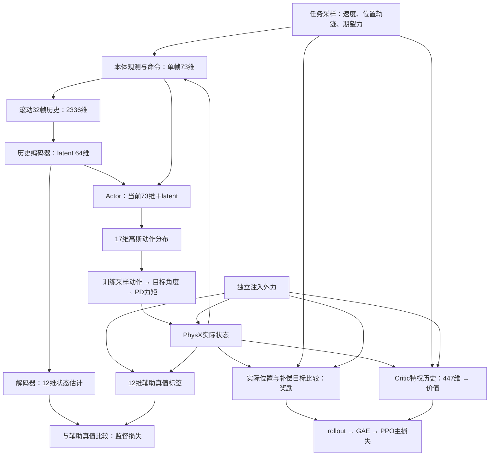

# UniFP 两阶段训练详解：目标、时间线与数据关系

本文从“每个环境究竟在做什么任务”出发，串起官方 `b2z1_pos_force` 的位置训练与受力训练。依据为本仓库 `UniFP/` 中的官方源码；当前轮式 V3 的差异另见 [05 · V3 两阶段实施](/home/sorry/python_ws/interactive/unifp_reproduction/introduction/05-v3-two-stage-training-zh-CN.md)。这里的两阶段都属于复现流程，不是轮式机器人创新阶段。

阅读入口：[总体流程](/home/sorry/python_ws/interactive/unifp_reproduction/introduction/00-training-flow-zh-CN.md) · [Actor](/home/sorry/python_ws/interactive/unifp_reproduction/introduction/01-actor-zh-CN.md) · [Critic](/home/sorry/python_ws/interactive/unifp_reproduction/introduction/02-critic-zh-CN.md) · [PPO](/home/sorry/python_ws/interactive/unifp_reproduction/introduction/03-ppo-zh-CN.md)。核对日期：2026-11-08。以下数值例子均为教学演算。

## 1. 两阶段到底分别让机器人学什么

第一阶段同时给底盘速度命令和末端位置轨迹，让机器人在移动、转向、站立和扰动中，把末端跟到当前目标附近。没有先单独训练机械臂、再单独训练底盘；同一个 Actor 同时输出腿和臂的动作。

第二阶段保留上述任务，再加入两路独立信号：明确告诉机器人的期望末端力 `F_cmd`，以及通过仿真施加、没有把真值直接告诉 Actor 的外力 `F_ext`。奖励要求实际末端跟踪经过力偏置的位置，而不是始终刚性地追到原始位置。

| 项目 | 第一阶段 | 第二阶段 |
|---|---|---|
| 底盘速度命令 | 有，含站立样本 | 继续存在 |
| 末端位置轨迹 | 有，随时间插值 | 继续存在 |
| 期望末端力命令 | 为零 | 独立随机调度，可非零 |
| 人工注入末端外力 | 为零 | 独立随机调度，可非零 |
| 末端奖励目标 | 原始位置目标 | 原始位置目标＋力／虚拟刚度偏置 |
| Actor 输出 | 17维关节动作 | 仍为17维关节动作 |
| 历史编码、Critic、PPO、估计辅助更新 | 都已工作 | 继续工作，没有换一套网络 |

官方用环境计数 `global_steps > 8000 * 24` 启动力课程，每次批量策略步只加1。按默认24步采样，这约为8000个训练迭代；严格大于号及初始化的零动作步会影响准确切换边界。官方默认总预算为60000轮，并不是“阶段二再60000轮”。V3采用另行确认的A8000＋B32000。

代码：[阶段判断与仿真](/home/sorry/python_ws/interactive/unifp_reproduction/UniFP/legged_gym/envs/b2/legged_robot_b2z1_pos_force.py:100)、[力课程阈值](/home/sorry/python_ws/interactive/unifp_reproduction/UniFP/legged_gym/envs/b2/b2z1_pos_force_config.py:178)、[官方默认训练预算](/home/sorry/python_ws/interactive/unifp_reproduction/UniFP/legged_gym/envs/base/legged_robot_config.py:211)。

## 2. 先分清五种“目标”和三种“力”

### 2.1 五种目标并不处在同一层

| 名称 | 具体内容 | 给谁使用 | 是否直接规定正确动作 |
|---|---|---|---|
| 任务命令 `commands` | 速度、当前末端目标球坐标、期望力等15个数 | Actor、Critic及奖励函数 | 否；只说明任务 |
| 几何目标 `x_g` | 当前时刻的原始末端世界坐标目标，单位m | 奖励、可视化、目标坐标转换 | 否 |
| 补偿目标 `x_*` | 几何目标加上力产生的偏置，单位m | 末端跟踪奖励、Critic特权信息 | 否 |
| 辅助监督标签 `obs_pred` | 实际速度、实际末端球坐标、实际注入外力，12维 | 估计分支的监督损失 | 只规定应估计什么 |
| 关节控制目标 `q_des` | 动作缩放后加默认角度，单位rad | 底层PD控制器 | 是控制参考，但由策略产生，不是教师提供的动作标签 |

`obs_pred` 名字含有 `pred`，在环境返回值里却是真值标签；网络预测值来自解码器。训练 Actor 时没有一份逐样本的“正确关节动作”数据集。

### 2.2 三种力的来源不同

| 力 | 来源及坐标系 | 主要去向 | Actor是否直接读到真值 |
|---|---|---|---|
| `F_cmd`，期望力 | 任务采样；底盘yaw坐标系，N | `commands[:,9:12]`，同时进入补偿目标 | 是，作为命令输入 |
| `F_ext`，人工外力 | 仿真调度；世界坐标系，N | `forces`送入PhysX；进入奖励、Critic和辅助标签 | 否；只能从历史运动响应中推断 |
| `F_contact`，实际接触力 | 碰撞约束解算，例如手指碰墙、手臂碰机身，N | 接触检测、惩罚及专门接触评估 | 不能把它直接等同于上述注入力标签 |

官方辅助“末端力真值”来自 `self.forces` 中的人工注入力，先转到yaw坐标系再缩放。它不是力传感器实测值，也不是把所有碰撞接触力相加的结果。没有人工注入力但有碰撞时，注入力标签仍可为零。

代码：[命令槽位定义](/home/sorry/python_ws/interactive/unifp_reproduction/UniFP/legged_gym/envs/b2/legged_robot_b2z1_pos_force.py:27)、[观测与标签构造](/home/sorry/python_ws/interactive/unifp_reproduction/UniFP/legged_gym/envs/b2/legged_robot_b2z1_pos_force.py:333)、[外力写入](/home/sorry/python_ws/interactive/unifp_reproduction/UniFP/legged_gym/envs/b2/legged_robot_b2z1_pos_force.py:1113)。

## 3. 给机器人的任务命令具体是什么样

### 3.1 一条15维命令的含义

Python切片右边界不包含在内。以下先列物理量，再说明网络缩放。

| 切片 | 含义 | 单位／坐标系 | 官方采样范围或实际状态 |
|---|---|---|---|
| `0:2` | 底盘前后、左右速度 | m/s，底盘本体坐标 | `vx∈[-0.6,0.6]`，`vy∈[-0.4,0.4]` |
| `2:3` | 底盘yaw角速度 | rad/s，与底盘角速度标签比较 | `[-0.6,0.6]` |
| `3:6` | 当前末端目标的半径、仰角、方位角 | m、rad、rad，绕底盘yaw对齐的任务中心 | 半径`[0.35,0.95]`，仰角`[-72°,72°]`，方位角`[-108°,108°]` |
| `6:9` | 预留末端姿态命令槽位 | rad | 默认训练没有将生成的姿态目标写入这些槽位，保持零；姿态跟踪奖励也为零 |
| `9:12` | 期望末端力xyz | N，yaw坐标系 | 阶段一为零；阶段二每轴峰值独立采样`[-60,60]` |
| `12:15` | 期望底盘力xyz | N，预留底盘力通道 | 默认训练没有调用底盘显式力课程，保持零 |

注意两处实现边界：源码会生成 `ee_goal_orn_quat`，这不等于Actor获得了完整姿态命令；配置中 `zero_vel_cmd_prob_after_force=0.8` 也没有在该默认重采样路径中使用，不能据字段名断言第二阶段自动变成80%静止样本。

例如第一阶段某一时刻的未缩放命令可以是：

```text
[0.30, 0.00, 0.20,  0.60, 0.30, 0.10,  0,0,0,  0,0,0,  0,0,0]
 └──底盘速度───┘   └─末端球坐标──┘   姿态槽位   末端力   底盘力
```

它的意思是：底盘以0.30m/s前进并以0.20rad/s转向，同时末端跟踪当前球坐标目标。不是要求机器人先走完、再动机械臂。

代码：[任务命令配置](/home/sorry/python_ws/interactive/unifp_reproduction/UniFP/legged_gym/envs/b2/b2z1_pos_force_config.py:121)、[球坐标范围](/home/sorry/python_ws/interactive/unifp_reproduction/UniFP/legged_gym/envs/b2/b2z1_pos_force_config.py:23)、[速度重采样](/home/sorry/python_ws/interactive/unifp_reproduction/UniFP/legged_gym/envs/b2/legged_robot_b2z1_pos_force.py:838)。

### 3.2 速度命令与末端目标有各自的时钟

底盘速度大约每5秒重采样。每次有30%概率把三项速度一起置零；如果三项均未超过对应小速度阈值，也整体置零。它不是每个20ms策略步都独立更换速度。

末端先采样一个轨迹端点，再从旧端点向新端点连续插值，移动时间为1—3秒，到达后保持0.5—2秒，再采样下一端点。Actor读到的是**当前插值点**，不是整条未来轨迹或最终端点列表。

官方实现把每环境的移动／总时长在 `_init_buffers()` 中采样，在 `_resample_ee_goal()` 中主要更换端点、清零计时器；不能描述成官方每一段都重新采样时长。V3的实现确实是逐段重新采样，见05。

```python
# 官方 update_curr_ee_goal() 中的原始连续代码片段
t = torch.clip(self.goal_timer / self.traj_timesteps, 0, 1)
self.curr_ee_goal_sphere[:] = torch.lerp(self.ee_start_sphere, self.ee_goal_sphere, t[:, None])
self.commands[:, INDEX_EE_POS_RADIUS_CMD:(INDEX_EE_POS_YAW_CMD+1)] = self.curr_ee_goal_sphere.view(self.num_envs,3)
```

这是球坐标分量的线性插值。经过球坐标转笛卡尔坐标后，世界中的曲线一般不是直线，也没有在此直接给出目标末端速度或加速度。

初始化时，官方从固定球坐标 `[0.66,π/4,0]` 向 `[0.66,0,0]` 过渡，随后随机目标。路径筛查在插值路径上取10个点，检查预设局部禁入盒和地下边界，最多重采样10次；它不是完整的全机械臂逆运动学、动态可达性或自碰撞证明。

代码：[时长初始化](/home/sorry/python_ws/interactive/unifp_reproduction/UniFP/legged_gym/envs/b2/legged_robot_b2z1_pos_force.py:1388)、[端点采样与筛查](/home/sorry/python_ws/interactive/unifp_reproduction/UniFP/legged_gym/envs/b2/legged_robot_b2z1_pos_force.py:889)、[目标插值](/home/sorry/python_ws/interactive/unifp_reproduction/UniFP/legged_gym/envs/b2/legged_robot_b2z1_pos_force.py:949)。

### 3.3 相对任务目标怎样变成世界坐标

记球坐标为 `(r,p,y)`，先转换成yaw局部笛卡尔向量：

$$
u=(r\cos p\cos y,\;r\cos p\sin y,\;r\sin p).
$$

官方任务中心为：

$$
c^W=(b_x,b_y,0)+R_z(\psi)(0.2,0,0.8),\qquad
x_g^W=c^W+R_z(\psi)u.
$$

`b_x,b_y`是当前底盘世界位置，`ψ`是当前yaw。代码在任务中心z方向使用固定0.8m，不直接叠加实际底盘z；应按代码理解这一高度基准，不把配置注释扩大为实时地形高度测量。

因此底盘向前移动，世界中的目标也相应平移；底盘转向，局部目标也随yaw旋转。保持同一组球坐标，不意味着末端在世界中保持不动。目标变换不使用底盘roll／pitch旋转。

例如底盘在原点、yaw为0、`(r,p,y)=(0.6,0,0)`时，`x_g=(0.8,0,0.8)m`。底盘yaw变为90°，其他条件不变，`x_g=(0,0.8,0.8)m`。

代码：[球坐标转换](/home/sorry/python_ws/interactive/unifp_reproduction/UniFP/legged_gym/utils/isaacgym_utils.py:59)、[局部转世界与任务中心](/home/sorry/python_ws/interactive/unifp_reproduction/UniFP/legged_gym/envs/b2/legged_robot_b2z1_pos_force.py:949)。

## 4. 第一阶段：从任务目标到策略更新

### 4.1 一个策略步的物理闭环

机器人获得当前目标和本体观测；编码器把32帧历史压缩成64维latent。Actor把当前73维观测与latent拼接，输出17维动作均值，训练时从可学习标准差的高斯分布采样动作。

```python
# 官方 update_distribution() / act() 的关键原始代码
latent = self.adaptation_encoder_module(observations)
mean = self.actor_body(torch.cat((observations[:, -self.num_obs_now:], latent), dim=-1))
self.distribution = Normal(mean, mean*0. + self.std)
```

随后 `act()` 返回 `self.distribution.sample()`。没有通过解码器的12维估计结果再生成动作；解码器与Actor是共享latent的两个分支。

动作是无量纲残差。官方主要控制路径为：

$$
q_{des}=q_{default}+0.25\,(m\odot a),\qquad
\tau=K_p(q_{des}-q)-K_d\dot q.
$$

`m`为电机强度系数，17维策略动作对应前17个受控DOF；其余两个DOF按固定参考控制，最终向19个DOF提交限幅力矩。相同动作维持4个0.005秒物理子步，但每个子步根据新的关节状态重算PD力矩。

代码：[动作分布及采样](/home/sorry/python_ws/interactive/unifp_reproduction/UniFP/legged_gym/b2_gym_learn/ppo_cse_pf/actor_critic.py:143)、[PD与力矩限幅](/home/sorry/python_ws/interactive/unifp_reproduction/UniFP/legged_gym/envs/b2/legged_robot_b2z1_pos_force.py:865)。

### 4.2 奖励比较的是实际位置，不是动作标签

两个阶段都用同一个末端奖励函数。阶段一两路力为零，补偿目标等于几何目标：

$$
x_*^W=x_g^W,\qquad
r_{ee}=\exp\left(-2\frac{\|x_{actual}^W-x_*^W\|_1}{\sigma_{ee}}\right),\quad \sigma_{ee}=1.
$$

这里使用的是**三轴绝对误差之和L1**。评估图里常见的L2欧氏距离是另一个指标，不能把两个数值直接当成同一误差。

总奖励还包括底盘速度跟踪、步态、存活及力矩／动作变化／碰撞等约束。官方末端项权重为2.0，准备奖励函数时再乘策略步长0.02秒。若L1误差为0.05m，原始末端奖励为 `exp(-0.1)≈0.9048`，该项对单步总奖励贡献约 `2×0.02×0.9048≈0.0362`。这不是总奖励，更不是episode总回报。

代码：[末端奖励](/home/sorry/python_ws/interactive/unifp_reproduction/UniFP/legged_gym/envs/b2/legged_robot_b2z1_pos_force.py:1891)、[权重](/home/sorry/python_ws/interactive/unifp_reproduction/UniFP/legged_gym/envs/b2/b2z1_pos_force_config.py:271)、[权重乘dt](/home/sorry/python_ws/interactive/unifp_reproduction/UniFP/legged_gym/envs/b2/legged_robot_b2z1_pos_force.py:1551)。

### 4.3 第一阶段也在训练估计器

辅助标签依次是实际底盘线速度3维、实际末端球坐标3维、注入末端外力3维、注入底盘外力3维。阶段一后6维为零，但前6维仍提供非零监督。估计器并不是进入第二阶段才新建。

此外，零末端注入力不意味着环境没有扰动：摩擦、质量、质心、电机等随机化、观测噪声，以及约每8秒一次的底盘水平速度push仍存在。速度push是直接改变速度，不会自动变成注入力标签。

代码：[辅助标签](/home/sorry/python_ws/interactive/unifp_reproduction/UniFP/legged_gym/envs/b2/legged_robot_b2z1_pos_force.py:405)、[速度push](/home/sorry/python_ws/interactive/unifp_reproduction/UniFP/legged_gym/envs/b2/legged_robot_b2z1_pos_force.py:1025)。

## 5. 第二阶段：给位置任务增加力学关系

### 5.1 两路力分别调度，而不是互相复制

官方期望力与注入力各自有选择掩码、峰值、时长和事件时钟。两路每轴峰值分别在 `[-60,60]N` 内独立采样；每路事件被选中的概率为0.8。区间配置为3.5—9秒，上升／下降时长候选1—3秒、中间保持配置1秒，上升时长还会受事件间隔限制。

这些是独立随机事件，不保证同向、不保证反向、不保证同时达到峰值。`±60N`是**每轴**界限，不是三维合力模长上限；三轴都接近60N时，单路合力模长可接近104N，两路同轴相加可接近120N，对应200N/m下0.6m的单轴目标偏置。这说明力课程可显著改变任务难度，并不保证所有组合动态可达。

按调度意图，一个事件为“零→上升→保持→下降→零”。阅读公开实现时还须注意：`_push_gripper()` 在每个物理子步被调用，但调度依据是策略步级 `episode_length_buf`；平台期也没有每次显式覆写精确峰值。因此图解表示课程结构，不把它当成精确的逐子步实测波形；精确取值要回读实际buffer。当前V3在策略边界生成显式梯形波，另见05。

```text
任务速度：    每约5秒换一组速度，贯穿整个episode
位置轨迹：    插值到端点 → 保持 → 下一段
期望力：      /──\           /──\        （本路独立事件）
注入外力：       /──\              /──\  （另一路独立事件）
episode结束：本环境局部reset，清零力状态及历史后开始新回合
```

代码：[两路力参数](/home/sorry/python_ws/interactive/unifp_reproduction/UniFP/legged_gym/envs/b2/b2z1_pos_force_config.py:140)、[命令力事件](/home/sorry/python_ws/interactive/unifp_reproduction/UniFP/legged_gym/envs/b2/legged_robot_b2z1_pos_force.py:1037)、[注入外力事件](/home/sorry/python_ws/interactive/unifp_reproduction/UniFP/legged_gym/envs/b2/legged_robot_b2z1_pos_force.py:1113)。

### 5.2 统一位置—力目标的原始代码

```python
# 官方 _reward_tracking_ee_force_world() 的原始函数体
forces_global = self.forces[:, self.gripper_idx, 0:3]
forces_cmd = self.current_Fxyz_gripper_cmd
forces_cmd_global = quat_apply(self.base_yaw_quat, forces_cmd)
forces_offset = (forces_global + forces_cmd_global)
curr_ee_goal_cart_world_offset = forces_offset / self.gripper_force_kps + self.curr_ee_goal_cart_world

ee_pos_error = torch.sum(torch.abs(self.ee_pos - curr_ee_goal_cart_world_offset), dim=1)
rew = torch.exp(-ee_pos_error/self.cfg.rewards.tracking_ee_sigma * 2)
return rew
```

出处：[官方奖励实现](/home/sorry/python_ws/interactive/unifp_reproduction/UniFP/legged_gym/envs/b2/legged_robot_b2z1_pos_force.py:1891)。上面的代码用于阅读，不是可单独运行的完整脚本。

写成公式：

$$
x_*^W=x_g^W+\frac{F_{ext}^W+R_z(\psi)F_{cmd}^Y}{K_{ee}},\qquad K_{ee}=200\;\mathrm{N/m}.
$$

`Y`表示只按底盘yaw对齐的坐标系，`W`表示世界坐标系。除法按分量进行。外力已经是世界坐标，只旋转命令力；不能把局部力与世界力直接相加。配置中的末端 `K_ee` 是任务层虚拟刚度，不是关节PD的 `K_p`，单位也不同。该奖励实际只用到了虚拟刚度，不因配置另有 `gripper_force_kds` 就自动包含阻尼项。

### 5.3 四个工况说明机器人应如何响应

为便于演算，取一个方向、yaw为0、`x_g=0.60m`，忽略其他轴：

| 工况 | `F_cmd` | `F_ext` | 奖励位置目标 `x_*` | 希望学到的行为 |
|---|---:|---:|---:|---|
| 零力 | 0N | 0N | 0.60m | 跟踪几何目标 |
| 未知外力 | 0N | +20N | 0.70m | 允许顺外力产生10cm位移，体现柔顺性 |
| 只有力命令 | +20N | 0N | 0.70m | 根据已知命令主动产生位置偏置 |
| 匹配反作用力 | +20N | −20N | 0.60m | 在外力与期望力抵消时维持几何目标 |
| 两路同向 | +20N | +20N | 0.80m | 根据合成偏置响应，不能误判为未跟原目标就是失败 |

表中“顺外力位移”指期望平衡关系，不保证任一瞬间都精确到达。实际还要受惯性、力矩限幅、目标持续变化及学习效果影响。

### 5.4 期望力是用来移动，还是到达后持续施力

统一关系可改写为：

$$
K_{ee}(x_{actual}-x_g)\approx F_{ext}+F_{cmd}.
$$

自由空间只有力命令时，通常表现为相对几何目标的位移；没有墙面约束，就不能仅凭位移宣称真实接触力达标。在有墙且机器人向墙施加期望力时，墙对机器人的反作用力方向相反。若反作用力约为 `−F_cmd`，则机器人可以在几何目标附近持续接触施力。

是否“持续”取决于当前命令的保持时长与任务约束，不是“到达位置就自动结束力任务”。训练中的力事件最终会归零；换成持续接触任务时，应以真实法向接触力和稳定性验收。人工训练注入力和墙的真实反作用力是不同来源，迁移效果需要单独验证。

## 6. 观测、latent、真值和动作的完整数据图



箭头表示前向数据来源。反向更新范围见第8节。尤其没有“12维解码输出→Actor”的前向箭头，也没有“Critic直接给关节控制指令”的箭头。

### 6.1 官方一帧73维由哪些数据组成

| 单帧切片 | 内容 | 维数 |
|---|---|---:|
| `0:2` | 底盘roll、pitch | 2 |
| `2:5` | 底盘本体角速度 | 3 |
| `5:22` | 17个关节相对默认姿态的位置偏差 | 17 |
| `22:39` | 17个关节角速度 | 17 |
| `39:56` | 最近执行的17维动作 | 17 |
| `56:58` | 步态相位sin／cos | 2 |
| `58:73` | 缩放后的15维命令 | 15 |

Actor不直接获得底盘线速度真值、实际末端位置真值、注入外力真值；这些由历史表示支持隐式适应，并用辅助分支监督。当前目标位置属于命令，实际末端位置属于被估计状态，两者不能混为一谈。

### 6.2 缩放只是数值变换，不是物理量改变

| 物理量 | 进入网络时的缩放 | 例子 |
|---|---:|---|
| 底盘线速度及其命令 | ×2 | 0.30m/s → 0.60 |
| 角速度及yaw速度命令 | ×0.25 | 0.20rad/s → 0.05 |
| 关节角度偏差 | ×1 | 0.10rad → 0.10 |
| 关节角速度 | ×0.05 | 2rad/s → 0.10 |
| 末端球坐标半径／仰角／方位角 | ×0.5／1／1.3 | `[0.6,0.3,0.1]` → `[0.3,0.3,0.13]` |
| 末端／底盘力 | ×0.01 | 20N → 0.20 |

奖励里的力／刚度计算仍使用N和N/m，不使用已经乘0.01的观测数值。把网络预测的缩放力还原为N，需要除以0.01。

### 6.3 12维标签与64维latent不是同一个东西

标签顺序为 `[v_base(3), p_TCP_spherical(3), F_ext_TCP(3), F_ext_base(3)]`，都按对应尺度缩放。其中速度采用底盘完整本体坐标，末端球坐标采用yaw任务中心，力采用yaw坐标；“局部坐标”不是一个统一可互换的坐标系名称。

latent是编码器自行学习的64维表示，没有规定每一维分别代表哪一项物理量。解码器把latent映射到12维以施加监督；Actor则直接使用latent与当前帧决定动作。因此解码出力的大小，只能证明表示里存在可被解码的力信息，不能证明策略已经把这些信息转化为合适的关节动作。

Critic的一帧149维包含这12维真值、质量／摩擦／电机等参数、步态／接触信息、本体状态、动作、命令和3维补偿目标，堆3帧得到447维。详表见 [Critic输入](/home/sorry/python_ws/interactive/unifp_reproduction/introduction/02-critic-zh-CN.md)。

代码：[观测拼接与缩放](/home/sorry/python_ws/interactive/unifp_reproduction/UniFP/legged_gym/envs/b2/legged_robot_b2z1_pos_force.py:333)、[缩放配置](/home/sorry/python_ws/interactive/unifp_reproduction/UniFP/legged_gym/envs/base/legged_robot_config.py:129)、[编码器／解码器结构](/home/sorry/python_ws/interactive/unifp_reproduction/UniFP/legged_gym/b2_gym_learn/ppo_cse_pf/actor_critic.py:7)。

## 7. 32帧历史、24步采样、episode和训练轮次的关系

| 概念 | 含义 | 默认大小／时间 |
|---|---|---|
| 物理子步 | 仿真积分与PD反馈 | 0.005秒 |
| 策略步 | 采样一次动作，执行4个物理子步 | 0.02秒，50Hz |
| Actor历史 | 决定当前动作时可用的过去与当前观测 | 32帧，名义0.64秒；最早到最新时间差0.62秒 |
| Critic历史 | 当前价值估计所用的特权观测历史 | 3帧 |
| rollout | 本轮PPO收集的新策略步数 | 每环境24步，即0.48秒 |
| 并行数N | 同一策略驱动的独立仿真环境数 | 默认4096 |
| 一轮数据量 | `24×N`条transition | 98304条 |
| episode | 一个环境从reset到超时或物理终止的回合 | 最长约20秒、约1000策略步 |
| iteration | 采样一段rollout，再更新一次完整PPO流程 | 不等于一个episode |

32帧是**每个样本内部的输入历史**，24步是**本轮要新增的样本时间轴**。训练不会每24步清空历史：没有结束的环境继续滚动历史与episode；只有结束的环境局部清零历史并重新开始。新episode最初的历史多数为零，逐步被真实帧填满。

官方存储形状为：

```text
历史观测       [24, N, 2336]     其中2336 = 32×73
特权观测       [24, N, 447]      其中447  = 3×149
辅助真值       [24, N, 12]
动作／旧均值／旧std  [24, N, 17]
奖励／done／价值／return／advantage [24, N, 1]
```

因此存储里并不是再向未来采样32步，也不是先收集32帧才能开始每次24步的PPO。相邻策略步的32帧历史会高度重叠。

代码：[历史堆叠](/home/sorry/python_ws/interactive/unifp_reproduction/UniFP/legged_gym/envs/b2/legged_robot_b2z1_pos_force.py:426)、[rollout张量分配](/home/sorry/python_ws/interactive/unifp_reproduction/UniFP/legged_gym/b2_gym_learn/ppo_cse_pf/rollout_storage.py:24)、[按24步采样](/home/sorry/python_ws/interactive/unifp_reproduction/UniFP/legged_gym/b2_gym_learn/ppo_cse_pf/on_policy_runner.py:115)。

## 8. 一条训练样本怎样同时服务两个更新

### 8.1 必须按时刻配对

1. 在状态时刻`t`，持有历史 `H_t`、特权状态 `C_t` 和标签 `y_t`。
2. 用 `H_t`采样 `a_t`，用 `C_t`算 `V_t`，保存动作概率、均值、std以及**当前**标签 `y_t`。
3. 执行动作，仿真产生后继状态，返回该动作的奖励 `r_t`、终止标记和下一观测包。
4. 把步骤2保存的数据和步骤3的奖励写成一条transition。不要把新返回的 `y_(t+1)` 错配给旧历史 `H_t`。
5. 收满24步后，用最后特权状态估值，计算GAE与return，再打乱样本进行更新。

关键证据是官方 `PPO.act()` 在调用环境step之前保存标签：

```python
self.transition.observations = obs
self.transition.critic_observations = critic_obs
self.transition.observation_preds = obs_pred
```

随后 `process_env_step()` 再补入奖励和done并写storage。源码在step后会先局部reset结束环境再返回观测；终止样本下一观测可能已属于新episode，GAE需要用done隔断，并对timeout单独处理。官方与V3的超时bootstrap实现细节见各自代码，不把它理解为跨reset拼接连续轨迹。

代码：[保存当前观测与标签](/home/sorry/python_ws/interactive/unifp_reproduction/UniFP/legged_gym/b2_gym_learn/ppo_cse_pf/ppo.py:77)、[补入奖励及timeout](/home/sorry/python_ws/interactive/unifp_reproduction/UniFP/legged_gym/b2_gym_learn/ppo_cse_pf/ppo.py:90)、[GAE](/home/sorry/python_ws/interactive/unifp_reproduction/UniFP/legged_gym/b2_gym_learn/ppo_cse_pf/rollout_storage.py:72)。

### 8.2 PPO主更新解决“动作是否带来更好回报”

默认每轮5个epoch、每个epoch4个minibatch，即20次主更新。每个minibatch为 `98304/4=24576` 条样本，每条已经带有完整历史。重新计算旧动作在新策略下的概率，结合优势计算裁剪损失；Critic拟合return，熵项鼓励探索：

$$
L_{main}=L_{PPO\_clip}+c_vL_{value}-0.01\,H(\pi).
$$

主Adam的初始学习率为`1e-3`，随后按KL自适应；恢复训练时实际学习率未必仍是初值。主更新影响Actor、Critic、历史编码器以及可学习std；解码器没有在此损失前向路径中，不会仅因被注册到优化器就获得该损失的梯度。

### 8.3 辅助更新解决“历史是否包含可辨识的状态信息”

每次主更新后，用同一minibatch历史经编码器、解码器得到12维预测，与标签作分组监督：

$$
L_{aux}=\sum_{g=1}^{4}\operatorname{MSE}(w_g\hat y_g,w_gy_g),
\quad w=(0.2,0.2,1,1).
$$

源码对预测与标签都乘权重，所以在MSE中等效权重为 `w²`。辅助Adam学习率为`1e-5`；默认每次主更新后做1次辅助更新，即每轮20次。尽管官方两个Adam都传入整个模型参数，实际辅助梯度路径只经过编码器与解码器，不直接训练Actor动作头、Critic或std。

因此“力估计损失下降”与“末端跟踪改善”是两个需要分别检查的结果。中间还隔着Actor对latent的使用、动作探索噪声、控制增益与限幅、环境运动响应、奖励与价值学习；任何一处不合适，都可能出现“估力能解码，闭环动作仍不理想”。

代码：[主损失与主Adam](/home/sorry/python_ws/interactive/unifp_reproduction/UniFP/legged_gym/b2_gym_learn/ppo_cse_pf/ppo.py:147)、[辅助损失与辅助Adam](/home/sorry/python_ws/interactive/unifp_reproduction/UniFP/legged_gym/b2_gym_learn/ppo_cse_pf/ppo.py:178)、[有效熵系数配置](/home/sorry/python_ws/interactive/unifp_reproduction/UniFP/legged_gym/envs/b2/b2z1_pos_force_config.py:313)。

## 9. 怎样判断两阶段是否学到了目标行为

第一阶段至少要同时看末端几何误差、底盘速度误差、物理失败和动作／力矩行为。只看总奖励，无法区分末端改善、底盘退化或某个惩罚项变化。

第二阶段至少分开以下指标：

| 指标 | 比较对象 | 能回答什么 |
|---|---|---|
| 几何末端误差 | `x_actual`与`x_g` | 是否仍靠近原始几何轨迹；非零力时不一定应趋零 |
| 补偿末端误差 | `x_actual`与`x_*` | 是否满足训练中的位置—力平衡目标 |
| 注入力估计误差 | 解码力与已知人工注入力 | 历史中是否学到可解码的扰动信息 |
| 实际接触力误差 | 真实接触测量与期望法向力 | 接触任务是否确实施加了要求的力 |
| 零力回归 | 两路力归零后的跟踪及估计 | 受力训练是否损伤第一阶段能力，估力是否有偏置 |
| 稳定性与执行情况 | 失败率、底盘误差、饱和、动作变化 | 是否以失稳或长期限幅换取局部奖励 |

例如外力造成合理的10cm柔顺位移时，几何误差会变大，补偿误差却可能很小；这不必然是退化。反过来，估力误差很小但补偿误差仍很大，也不能判定闭环力控制已经成功。

训练用高斯采样，确定性策略回放一般用动作均值。两者的差别应明确标记：均值回放稳定不能自动证明带探索的训练稳定；减小噪声后的短回放也不等于重新训练后的性能提升。

## 10. 从入口逐段查代码

| 顺序 | 官方代码入口 | 阅读重点 |
|---|---|---|
| 1 | [train_b2z1posforce.py](/home/sorry/python_ws/interactive/unifp_reproduction/UniFP/legged_gym/scripts/train_b2z1posforce.py:13) | 创建环境、runner并调用learn |
| 2 | [b2z1_pos_force_config.py](/home/sorry/python_ws/interactive/unifp_reproduction/UniFP/legged_gym/envs/b2/b2z1_pos_force_config.py:4) | 目标范围、力事件、动作尺度、奖励与网络配置 |
| 3 | [on_policy_runner.py](/home/sorry/python_ws/interactive/unifp_reproduction/UniFP/legged_gym/b2_gym_learn/ppo_cse_pf/on_policy_runner.py:115) | 24步采样→returns→update |
| 4 | [actor_critic.py](/home/sorry/python_ws/interactive/unifp_reproduction/UniFP/legged_gym/b2_gym_learn/ppo_cse_pf/actor_critic.py:143) | 历史编码、动作分布、估计分支与价值 |
| 5 | [环境step](/home/sorry/python_ws/interactive/unifp_reproduction/UniFP/legged_gym/envs/b2/legged_robot_b2z1_pos_force.py:100) | 阶段条件、控制子步、外力、奖励与局部reset |
| 6 | [目标轨迹](/home/sorry/python_ws/interactive/unifp_reproduction/UniFP/legged_gym/envs/b2/legged_robot_b2z1_pos_force.py:889) | 端点采样、路径筛查、插值和坐标变换 |
| 7 | [观测与标签](/home/sorry/python_ws/interactive/unifp_reproduction/UniFP/legged_gym/envs/b2/legged_robot_b2z1_pos_force.py:333) | Actor、Critic、辅助真值各自看到什么 |
| 8 | [ppo.py](/home/sorry/python_ws/interactive/unifp_reproduction/UniFP/legged_gym/b2_gym_learn/ppo_cse_pf/ppo.py:106) | 主更新与辅助更新如何共用rollout |

本文记录的是上述公开代码的执行路径与可推导关系，不把静态说明当成官方或V3已经收敛的实测证据。论文图表、训练日志与当前评估应分别核对。
