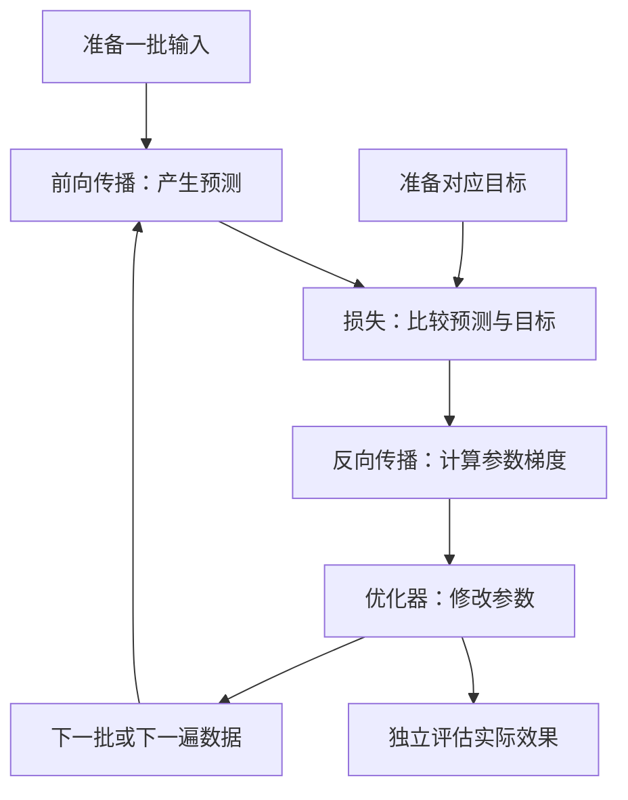

# 神经网络训练入门：从一个可手算的模型，到V3的Actor–Critic

本文按“一个数怎样预测 → 怎样知道错了 → 怎样调整参数 → 怎样扩展到多层网络 → 怎样对应强化学习”的顺序解释训练。无需先了解PPO。所有手算数据均为教学例子，不是机器人实验结果，也不是推荐修改正式训练配置。

读完后应能回答：权重与偏置是什么，梯度是什么，前向传播与反向传播有什么区别，损失由谁决定，Adam是不是PPO，为什么损失下降不等于机器人任务成功。

项目专题可继续阅读 [Critic](/home/sorry/python_ws/interactive/unifp_reproduction/introduction/02-critic-zh-CN.md)、[Actor](/home/sorry/python_ws/interactive/unifp_reproduction/introduction/01-actor-zh-CN.md)、[PPO](/home/sorry/python_ws/interactive/unifp_reproduction/introduction/03-ppo-zh-CN.md) 和 [V3两阶段训练](/home/sorry/python_ws/interactive/unifp_reproduction/introduction/05-v3-two-stage-training-zh-CN.md)。本文于2026-11-09补充，只讲训练机制，不启动或改变训练。

## 1. 先看训练到底在做什么

神经网络可以看作一个带很多可调数字的函数：

$$
\hat y=f_\theta(x).
$$

- $x$：输入，例如一组机器人状态。
- $\theta$：模型内部可学习的参数，例如权重和偏置。
- $\hat y$：模型给出的预测。
- $y$：希望预测接近的目标；它可以是人工标签、测量结果，也可以由另一个计算过程构造。

**训练就是利用样本和目标，反复调整参数，使模型在关心的数据上表现更好。** 神经网络不会仅因为“看过数据”就自动改变；必须定义目标、计算损失并执行更新。



上图中，前向传播、损失计算和反向传播都不直接改变权重；通常由优化器执行参数修改。独立评估则检查训练所优化的目标是否转化成实际效果。

## 2. 第一层难度：只有一个输入的线性模型

先不用多层网络，考虑最简单的预测函数：

$$
\hat y=wx+b.
$$

这里有两个可训练参数：

| 概念 | 作用 | 在直线中的含义 |
|---|---|---|
| 权重 $w$ | 决定输入变化对输出的影响 | 斜率 |
| 偏置 $b$ | 调整输出基准 | 截距 |
| 输入 $x$ | 当前样本提供的数据 | 横坐标 |
| 目标 $y$ | 这个样本希望得到的输出 | 目标纵坐标 |

“偏置”不是“预测错误”，它是模型中的正常可训练项。预测错误另用误差表示：

$$
e=\hat y-y.
$$

例如输入为2，目标为5，初始 $w=1,b=0$，则预测为2，误差为−3。此时模型还没有学会这个样本。

## 3. 损失函数：把“错了多少”变成可优化的数

最简单的平方误差是：

$$
L=(\hat y-y)^2.
$$

上例损失为9。若预测改成4，损失为1；若预测恰好为5，损失为0。

**误差与损失不同。** 误差可以为正或负；平方误差非负，大偏差受到更大的惩罚。具体使用什么损失，取决于想完成的任务。

对一批 $B$ 条样本，均方误差MSE为：

$$
L_{\mathrm{MSE}}=
\frac1B\sum_{i=1}^{B}(\hat y_i-y_i)^2.
$$

平均可以减少批次大小对损失规模的直接影响。但如果输入输出单位、归一化方式或损失权重不同，两个损失数值不能直接比较。例如以米计算的位置平方误差，换成厘米后会放大一万倍。

损失函数衡量的是我们选定的训练目标，不等于所有真实需求。一个分类器可能在训练样本上损失很小，遇到新数据却经常出错；一个机器人也可能提高某些奖励项，却变得不稳定。

## 4. 梯度：参数向哪个方向调整，损失会怎样变化

导数描述一个量对另一个量的局部变化率。对于当前线性模型：

$$
\frac{\partial L}{\partial\hat y}=2(\hat y-y),
\qquad
\frac{\partial\hat y}{\partial w}=x,
\qquad
\frac{\partial\hat y}{\partial b}=1.
$$

用链式法则把它们连接起来：

$$
\frac{\partial L}{\partial w}=2(\hat y-y)x,
\qquad
\frac{\partial L}{\partial b}=2(\hat y-y).
$$

当 $x=2,y=5,w=1,b=0$ 时：

$$
\frac{\partial L}{\partial w}=-12,
\qquad
\frac{\partial L}{\partial b}=-6.
$$

这意味着在当前位置附近，适当增加 $w$ 和 $b$ 都会降低该样本的损失。梯度不是“正确参数答案”，而是当前参数附近的变化信息；走得过远后，这个局部判断未必继续成立。

多个参数的偏导数组合起来就是梯度向量：

$$
\nabla_\theta L=
\left[\frac{\partial L}{\partial w},\frac{\partial L}{\partial b}\right].
$$

对梯度取负方向，是因为梯度指向局部上升最快的方向，而训练通常要降低损失。

## 5. 用最简单的梯度下降手算两次更新

设学习率为 $\eta=0.05$，按梯度下降修改参数：

$$
w_{new}=w-\eta\frac{\partial L}{\partial w},
\qquad
b_{new}=b-\eta\frac{\partial L}{\partial b}.
$$

沿用同一个教学样本，计算结果为：

| 状态 | $w$ | $b$ | 预测 $2w+b$ | 平方误差 | 对 $w$、$b$ 的梯度 |
|---|---:|---:|---:|---:|---|
| 初始 | 1 | 0 | 2 | 9 | −12，−6 |
| 更新一次后 | 1.6 | 0.3 | 3.5 | 2.25 | −6，−3 |
| 更新两次后 | 1.9 | 0.45 | 4.25 | 0.5625 | −3，−1.5 |

这说明参数修改会改变下一次前向结果，再改变下一次梯度。不是直接令预测变量等于目标，也不是每次把所有参数加上同一个误差。

**学习率**控制每次移动的尺度。太大可能越过较好区域、振荡或发散；太小可能学习很慢。不同任务和不同优化器适合的尺度不同，上例的0.05不是V3配置建议。

一个样本也不够确定完整规律：任何满足 $2w+b=5$ 的参数，都能把这个样本拟合到零误差。只有加入更多不同输入及相应目标，才能约束整个函数。这也是“记住一个样本”与“学会可以泛化的规律”的区别。

## 6. 第二层难度：多个输入、神经元与隐藏层

当输入包含位置、速度等多个数时，一个神经元先计算：

$$
z=\sum_{j=1}^{D}w_jx_j+b.
$$

再通过激活函数：

$$
h=\sigma(z).
$$

这里 $\sigma$ 泛指激活函数，不一定是sigmoid。常见选择包括ReLU、ELU和tanh。

| 激活 | 计算特点 | 常见注意点 |
|---|---|---|
| ReLU | 正数保留，负数置零 | 负区间导数为零 |
| ELU | 正区间线性，负区间平滑趋近−1 | 本项目隐藏层使用默认ELU |
| tanh | 输出在−1与1之间 | 绝对输入很大时梯度可能很小 |

非线性激活让多层网络能够表示更复杂的关系。如果每一层都只有线性变换，那么多层组合仍然只是一个仿射变换，不能仅靠加深获得一般非线性表达能力。

同一层包含多个神经元时，可以写成矩阵形式。对批量输入：

$$
X\in\mathbb R^{B\times D},\qquad
W\in\mathbb R^{H\times D},\qquad
b\in\mathbb R^H,
$$

$$
Z=XW^\mathsf{T}+b,\qquad H_{out}=\sigma(Z).
$$

偏置会广播到每条样本，输出形状为 $B\times H$。这里的shape就是“每个轴有多少个元素”；批量大小不是输入特征维数。

一层的参数量为 $HD+H$。增加宽度、深度通常会增加表达能力、计算量和存储需求，但不保证学得更好。

## 7. 前向传播、计算图、反向传播分别是什么

**前向传播**：输入从前往后经过网络，得到预测和损失。

**计算图**：记录各个运算之间的依赖，例如损失依赖预测，预测依赖隐藏特征，隐藏特征依赖前层权重。

**反向传播**：从损失出发，按链式法则沿这些依赖反向计算参数梯度。它不会逆向播放机器人运动，也不要求把Isaac Gym做成可微世界模型。

可以用一个两层的标量网络手算链式法则：

$$
z=wx+b,\qquad h=\operatorname{ReLU}(z),\qquad
\hat y=uh+d,\qquad L=(\hat y-y)^2.
$$

设 $x=2,w=1,b=0,u=3,d=0,y=8$。则 $z=h=2$、预测6、损失4。在这个正区间，ReLU导数为1，因此：

$$
\frac{\partial L}{\partial u}=-8,\qquad
\frac{\partial L}{\partial d}=-4,
$$

$$
\frac{\partial L}{\partial w}=(-4)\times3\times1\times2=-24,
\qquad
\frac{\partial L}{\partial b}=(-4)\times3\times1=-12.
$$

前层参数的梯度包含后层权重和激活导数，不能只用“输出误差”直接替代。这些连乘也解释了深网络为什么可能出现梯度消失或爆炸。

PyTorch的 `loss.backward()` 自动计算这些导数。通常会把结果累加到参数的 `.grad` 中，但**不会修改权重值**；真正修改由优化器负责。

## 8. 优化器：SGD、动量和Adam

### 8.1 优化器究竟接收什么

优化器通常接收参数及其梯度，并维护自己的更新状态。它不负责决定输入应该包含什么、标签对不对、机器人碰撞是否合理。

最基本的随机梯度下降SGD为：

$$
\theta_{k+1}=\theta_k-\eta_k g_k,
\qquad g_k=\nabla_\theta L_k.
$$

这里 $k$ 表示参数更新次数，不是机器人仿真时刻。所谓“随机”，通常来自只用一小批随机样本近似全数据梯度；不表示优化器随便修改参数。

### 8.2 动量为什么会记住过去

动量方法会累计过去梯度方向的滑动统计，减少某些振荡，也可能在梯度反向后继续受到旧方向影响。它记住的是优化历史，不是全部训练样本，也不是环境动力学模型。

### 8.3 Adam的核心公式

Adam同时维护梯度和梯度平方的指数滑动平均，初始为零：

$$
m_k=\beta_1m_{k-1}+(1-\beta_1)g_k,
$$

$$
u_k=\beta_2u_{k-1}+(1-\beta_2)g_k^2.
$$

因为初始为零会导致早期统计偏小，需要偏差修正：

$$
\hat m_k=\frac{m_k}{1-\beta_1^k},\qquad
\hat u_k=\frac{u_k}{1-\beta_2^k}.
$$

最后更新：

$$
\theta_{k+1}
=\theta_k-\eta_k\frac{\hat m_k}{\sqrt{\hat u_k}+\epsilon}.
$$

这些运算逐元素执行。$\beta_1,\beta_2$控制历史保留程度；$\epsilon$防止分母为零；学习率控制总体尺度。梯度平方用于刻画尺度，不是二阶导数，也不是Hessian。

因此，同样的网络权重和同样的当前梯度，若Adam历史状态不同，下一步更新仍可能不同。完整恢复训练通常需要保存优化器状态，而不仅是网络权重。

**Adam不等于PPO。** Adam可以训练分类、回归、Critic和辅助估计器；PPO规定策略怎样利用轨迹、优势和概率比构造更新目标。两者属于不同层次。

## 9. batch、epoch、step与iteration怎样区分

| 名称 | 普通监督学习中的常见含义 | V3中的对应 |
|---|---|---|
| 样本 | 一组输入与目标 | 一条transition及其派生训练目标 |
| minibatch | 一次计算梯度使用的样本子集 | 一轮rollout展平后分出的四份之一 |
| epoch | 把当前训练数据完整学习一遍 | 把当前这批rollout完整学习一遍 |
| optimizer step | 优化器执行一次参数更新 | 每个minibatch有一次主更新和一次辅助更新 |
| training iteration | 由具体训练程序定义的一轮 | 采集24步，再做5遍小批次学习 |
| policy step | 不适用于所有监督任务 | 每个环境的一次策略动作执行周期 |
| physics step | 不适用于普通监督任务 | 仿真积分步，不能与策略步混用 |

同一个“step”在不同日志里可能含义不同，必须看计数器定义。

以4096环境的V3配置为例：每轮采集 $4096\times24=98\,304$ 条样本，分4份，每份24,576条，完整学习5遍，因此有20次主优化器更新。辅助优化器另外执行20次，但不更新Critic。

多次学习同一批数据可以提高利用率，也可能过度拟合。PPO通常只在当前新鲜轨迹上学习有限遍数；普通监督学习则经常在一个固定训练集上学习许多遍，两者数据生命周期不同。

## 10. 第三层难度：完整的监督训练代码

下面用一个小型网络拟合 $y=2x+1$。这是独立教学代码，使用CPU即可；不是V3训练入口，也没有使用PPO。运行需要已有PyTorch环境，本文不要求安装或修改项目依赖。

```python
import torch
from torch import nn

torch.manual_seed(0)

# Four scalar inputs and targets, both with shape [4, 1].
training_inputs = torch.tensor([[0.0], [1.0], [2.0], [3.0]])
training_targets = 2.0 * training_inputs + 1.0

# A hidden nonlinear layer turns scalar inputs into eight learned features.
network = nn.Sequential(nn.Linear(1, 8), nn.Tanh(), nn.Linear(8, 1))
loss_function = nn.MSELoss()
optimizer = torch.optim.Adam(network.parameters(), lr=0.02)

network.train()
for update_index in range(500):
    # Gradients accumulate by default, so discard the previous update's values.
    optimizer.zero_grad(set_to_none=True)
    predictions = network(training_inputs)
    loss = loss_function(predictions, training_targets)
    loss.backward()
    optimizer.step()

# Evaluation reports the current network after the final optimizer step.
network.eval()
with torch.no_grad():
    final_predictions = network(training_inputs)
    final_loss = loss_function(final_predictions, training_targets)
print(final_predictions)
print(final_loss.item())
```

该示例已在本机已有的PyTorch 2.3.1环境中使用CPU执行，500次更新后四个训练点的MSE约为0.00199。这只验证示例可以执行并拟合这几个点，不是独立测试集上的泛化成绩，也没有运行机器人仿真。

代码各步的作用是：

| 操作 | 做什么 | 会改变网络权重吗？ |
|---|---|---|
| 创建网络 | 初始化权重与偏置 | 创建初值 |
| `zero_grad()` | 清除残留梯度 | 否，不是清空已有知识 |
| `network(inputs)` | 前向预测 | 此例不会 |
| `loss_function(...)` | 计算目标偏差 | 否 |
| `loss.backward()` | 计算梯度 | 否 |
| `optimizer.step()` | 按梯度及Adam状态修改参数 | **是** |
| `eval()` | 切换某些层的运行模式 | 本身不执行优化更新 |
| `no_grad()` | 不记录自动求导图 | 不自动切换网络模式 |

本例没有BatchNorm或Dropout，因此 `train()` 和 `eval()` 不改变其具体前向公式；在包含这些层的网络里，这两个模式会影响统计或随机行为。`eval()`也不等于禁用梯度，需要与 `no_grad()`的职责区分。

`detach()`同样可以切断某个张量的自动求导联系，例如把Critic生成的旧价值保存为固定数据。切断梯度联系不等于复制独立存储；需要保护数据不被覆盖时，还应按实际情况复制。自动求导图、数值缓存和网络权重是三类不同对象。

## 11. 从标量回归扩展到多输出和分类

### 11.1 多输出回归

若希望预测三维力，网络输出可以是 `[B,3]`，每列分别对应一个分量。损失可以使用三个分量的MSE，但必须确认坐标系、单位、归一化和各维权重一致。

本项目辅助解码器输出12维，按四组三维量组织；其监督目标来自仿真真值，而不是Critic价值。即使都使用平方误差，它们的预测对象也不同。

### 11.2 分类

分类任务常先输出每个类别的未归一化得分logit，再通过softmax表达概率：

$$
p_j=\frac{e^{z_j}}{\sum_{l=1}^{C}e^{z_l}},
\qquad L=-\log p_{y}.
$$

$C$是类别数，$y$是正确类别索引。实践中常由稳定的交叉熵实现直接接收logits，不必手写指数求和。

Critic输出没有softmax，因为它预测的是一个可能为正或负的回报，不是类别概率。Actor则输出动作分布参数；动作概率密度也不能与分类概率或价值估计混为一谈。

## 12. 训练准备与评估：代码循环之外还必须考虑什么

### 12.1 先定义数据和任务

训练前应明确输入、输出、单位、坐标系、采样时序和目标来源。数据错位时，网络可能仍然降低损失，却学到错误关系。

例如，“动作执行前的状态”应与“该动作造成的奖励”对应。将reset后的新状态错误地当成失败前状态的连续后继，会污染价值目标。坐标变换和缩放也必须在训练与推理时保持一致。

### 12.2 初始化与数据尺度

随机初始化帮助不同神经元开始学习不同特征。把所有多层网络参数都设为同样的零值，可能造成对称性，不能把线性回归里某些可行初始化简单照搬到深网络。

输入尺度也影响梯度。例如角度以rad、力以N、位置以m混在一起时，通常需要有依据地缩放。归一化统计应来自允许使用的数据，不能偷看测试集；机器人部署时还需要一致的处理。

### 12.3 欠拟合、过拟合与泛化

| 现象 | 常见表现 | 可检查什么 |
|---|---|---|
| 欠拟合 | 训练和验证表现都差 | 数据／目标是否正确，模型容量和优化是否足够 |
| 过拟合 | 训练表现好，新数据表现差 | 数据覆盖、模型复杂度、正则化和训练时长 |
| 分布变化 | 原场景好，新场景退化 | 外力、命令、物性或策略是否变化 |

泛化是对未直接训练过的样本和场景仍能有效预测或控制。更多训练轮次不保证更好泛化。

### 12.4 训练集、验证集和测试集

监督学习通常分出训练集用于梯度更新，验证集用于选择方案，测试集用于最终检查。反复根据测试结果修改方案，会逐渐把测试集变成实际验证集。

机器人强化学习对应的是分离训练和冻结评估协议：评估时不做策略更新，固定命令、扰动、episode规模和判定方法。仍需报告随机性、失败样本与适用范围；单seed成功不能证明所有seed都成功。

### 12.5 梯度裁剪、正则化与早停

- 梯度裁剪：限制梯度大小；不会直接把参数或物理力矩限制在安全范围。
- 正则化：对某些参数或行为施加额外约束，例如权重衰减；它与PPO裁剪不是一回事。
- 早停：按预先确定的验证规则停止训练；是否触发取决于任务协议，不是所有普通失败都应全局停训。

这些方法降低某些风险，不能保证收敛。PPO中的策略概率比裁剪、价值裁剪、梯度裁剪和机器人执行力矩限幅位于不同层次，应分别分析。

### 12.6 保存、恢复与计算设备

只做推理通常主要需要网络权重和一致的数据处理；继续训练还常需要优化器状态、学习率调度、计数器和随机数状态。仿真训练还可能涉及物性及episode恢复协议，具体以项目约定为准。

CPU和GPU负责执行数值运算，不决定训练目标。GPU擅长大批量矩阵计算，CPU常负责数据处理和调度；本项目中仿真、网络和张量设备还需要协调。更换设备也不意味着完全相同的数值轨迹或运行速度。

## 13. 第四层难度：强化学习为什么没有“正确动作标签”

普通监督学习常有明确的输入—目标对。机器人强化学习则主要得到：

$$
(o_t,a_t,r_t,o_{t+1},d_t).
$$

这里 $o_t$ 是观测，$a_t$ 是实际执行动作，$r_t$ 是环境给出的奖励，$d_t$ 是边界标记。环境通常不会告诉Actor“这个状态的正确动作就是某个关节角度”。

因此各网络的目标来源不同：

| 模块 | 输出 | 训练依据 |
|---|---|---|
| Actor | 动作分布参数 | 哪些采样动作的后续结果相对更好 |
| Critic | 预计累计折扣回报 | 奖励、边界信息与旧价值构造的回报目标 |
| 辅助估计器 | 速度、位置和外力等状态量 | 仿真提供的监督真值 |

Actor从策略分布采样，动作进入仿真；仿真负责产生下一状态和奖励。Critic不会在内部预测下一状态，而是直接学习状态到累计回报的映射。这个过程称为无模型强化学习，并不表示环境没有物理仿真器。

### 13.1 Critic怎样生成并拟合目标

采样得到旧预测后，用GAE计算：

$$
\delta_t=r_t+\gamma(1-d_t)V_{old}(c_{t+1})-V_{old}(c_t),
$$

$$
A_t^{raw}=\delta_t+\gamma\lambda(1-d_t)A_{t+1}^{raw},
\qquad \hat R_t=A_t^{raw}+V_{old}(c_t).
$$

这里先省略纯超时补偿，具体项目边界见Critic专篇。目标计算不更新网络；回报目标和旧预测固定后，再用当前 $V_\phi(c_t)$ 拟合 $\hat R_t$。与普通回归相比，区别主要在标签来源：标签由经历与自举构造，并会随下一批数据和策略变化。

### 13.2 PPO怎样更新Actor

用 $\rho_t$ 表示同一个已采样动作的新旧策略概率密度比：

$$
\rho_t(\theta)=
\frac{\pi_\theta(a_t\mid o_t)}{\pi_{old}(a_t\mid o_t)}.
$$

PPO的典型裁剪目标是最大化：

$$
J_{clip}(\theta)=
\mathbb E_t\left[
\min\left(
\rho_t\hat A_t,
\operatorname{clip}(\rho_t,1-\varepsilon,1+\varepsilon)\hat A_t
\right)\right].
$$

$\hat A_t$在这里表示供Actor使用的标准化优势。实现时通常最小化它的负值，再加入价值损失和熵项。优势、旧动作概率和回报目标都作为固定数据，不通过它们反向修改采样时的网络。

PPO定义的是“用什么目标、以什么约束改变策略”。接下来仍由自动求导求梯度、Adam修改参数。**执行Adam只是实现PPO更新的一个环节，不是PPO的定义。** PPO也不是所有深度学习训练的通用名称。

### 13.3 为什么不能只看loss

Critic可以准确预测一个差策略的回报；辅助网络也可能准确估计外力，却没有使Actor学会稳定补偿。奖励设计、优势质量、探索、执行限幅和动力学可行性都会影响最终行为。

本项目必须把损失与实际位置误差、力误差、底盘跟踪、失败率和限幅放在一起看。独立评估发现退化时，不能仅以“训练仍能运行”或“某个loss下降”宣布成功。

## 14. 将全部基础概念对应到V3

| 通用概念 | V3具体含义 |
|---|---|
| 模型参数 | 各网络权重、偏置，以及可学习的动作标准差等 |
| Critic输入 | 最近3帧特权观测，`[B,294]` |
| Critic网络 | `294→512→256→128→1`，隐藏层ELU |
| Critic目标 | rollout奖励、边界和旧价值构造的return |
| Actor输入 | 32帧观测，经编码得到latent，与当前帧共同生成动作分布 |
| 主损失 | PPO策略损失＋价值损失权重项−熵奖励项 |
| 辅助损失 | 四组三维状态标签的加权监督误差 |
| 主优化器 | Adam；更新Actor、Critic、编码器和std等 |
| 辅助优化器 | 另一个Adam；更新编码器与解码器，不更新Critic |
| 一轮训练 | 新采样24步，然后4个小批次×5遍学习 |
| 验证 | 冻结策略零更新评估；分别检查零力、受力和接触任务 |

源码入口：[V3网络构造](/home/sorry/python_ws/interactive/unifp_reproduction/UniFP_v3/legged_gym/b2_gym_learn/ppo_cse_pf/v3_actor_critic.py:88)、[优化器参数范围](/home/sorry/python_ws/interactive/unifp_reproduction/UniFP_v3/legged_gym/b2_gym_learn/ppo_cse_pf/v3_ppo.py:53)、[主辅更新](/home/sorry/python_ws/interactive/unifp_reproduction/UniFP_v3/legged_gym/b2_gym_learn/ppo_cse_pf/v3_ppo.py:215)、[GAE与缓存](/home/sorry/python_ws/interactive/unifp_reproduction/UniFP_v3/legged_gym/b2_gym_learn/ppo_cse_pf/v3_rollout_storage.py:124)、[采样与迭代计数](/home/sorry/python_ws/interactive/unifp_reproduction/UniFP_v3/legged_gym/b2_gym_learn/ppo_cse_pf/v3_on_policy_runner.py:119)。

## 15. 常见问题速查

| 问题 | 回答 |
|---|---|
| 神经网络是不是一套固定公式？ | 运算结构由人定义，里面的可训练参数由数据驱动调整 |
| 前向传播是不是训练？ | 它是训练或推理中的预测步骤，本身通常不更新权重 |
| 反向传播是不是更新？ | 它计算梯度，优化器才使用梯度改参数 |
| 梯度是不是预测误差？ | 不是；它还包含参数影响输出的链式导数 |
| 清空梯度会不会忘掉以前学到的东西？ | 不会；权重没有因此被清零 |
| 参数和超参数有什么区别？ | 权重等由梯度学习；学习率、网络宽度等由训练配置指定 |
| Adam会检查标签是否正确吗？ | 不会，它按传入损失产生的梯度执行更新 |
| Adam就是PPO吗？ | 不是；优化器与策略学习算法属于不同层次 |
| Critic没有世界模型，怎么预测未来？ | 它直接估计累计回报，不推演未来状态 |
| Critic用全部历史日志训练吗？ | 当前PPO每轮主要使用刚采集的一批轨迹，历史经验保存在参数和优化状态中 |
| 只保存网络权重就能完全续训吗？ | 通常不能；优化器、随机状态和任务进度等也可能影响后续训练 |
| 数据越多、模型越大、训练越久一定越好吗？ | 都不保证；还取决于数据质量、目标、优化和泛化 |
| 为什么loss下降，机器人仍可能变差？ | 训练目标、估计误差和实际任务表现并非同一个量 |

